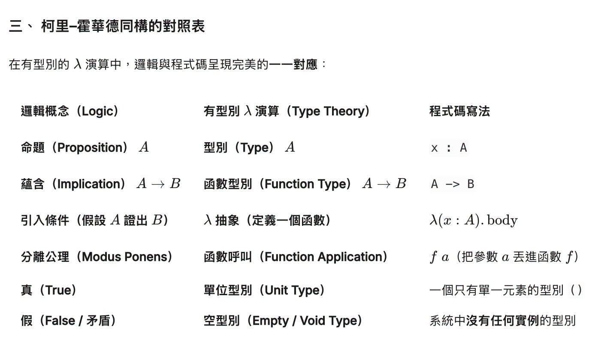

# prover
Prover : resolution prover + lean prover + lambda cube prover

- `lean-prover/` — 互動式定理證明器（自然演繹 + 可信核心 `check()`）
- `theorem-prover/` — 一階邏輯自動定理證明器（歸結法 + 參數替換）
- `lambda-cube/` — λ-Cube 依值型別檢查器（`infer()` + Church 編碼）

教科書：[`book/`](book/README.md)（《三個證明器：自然演繹、歸結法與 λ-Cube》）

## 數學，證明與 AI

今天向 AI 詢問數學證明的進展，學到了下列事項：

1. 電腦可以自動證明定理，但是搜尋空間太大，會指數暴漲，所以只能證明簡單問題。

2. 於是需要數學家用 Lean 透過手寫證明，或者搭配自動推論完成證明。

3. LLM 和 AI 變強後，OpenAI, DeepMind 這類公司，就用 LLM 取代數學家的角色，去完成證明。

於是 AI 就在數學領域大爆發了。

但有一個隱藏在這些技術背後的東西，其實是 1930 年代 Alonzo Church 發展出來的 λ-Calculus.

柯里–霍華德同構，站在 λ-Calculus 的肩膀上，説『邏輯與程式碼』呈現完美的一一對應

荷蘭邏輯學家 Henk Barendregt 提出的 λ-Cube 延伸了 λ-Calculus，把柯里–霍華德同構優美的實現出來。

現在的 Lean, Coq 等數學證明語言，都是從 λ-Cube 衍生出來的。

於是才有了你看到的，最近的 AI 數學大爆發！

