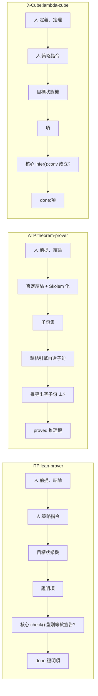

# 1.1 三個程式三種證明哲學

## 開篇：全書的問題

邏輯學有兩千五百年歷史，但它真正開始「被機器執行」只有大約六十年。從 1960 年代的 Robinson 歸結原理，到 1980 年代的 de Bruijn 索引與 Curry–Howard 對應，再到 1990 年代的 typeclass 與模理論，人類花了一個半世紀把「一個命題已被證明」這句話從口頭的社會共識，變成可交給機器複驗的客觀程序。

本書的中心問題只有一句：

> **當我們說「一個命題已被證明」時，機器究竟檢查了什麼？**

這個問題之所以值得用一整本書回答，是因為「證明」在現代計算裡有三種互不相同、甚至互相敵對的技術解釋：

- **自然演繹（Natural Deduction）** —— 人給思路、機器驗證的**互動式定理證明器（ITP）**。代表軟體是 Lean、Coq、Isabelle；
- **歸結法（Resolution）** —— 機器獨自尋找矛盾的**自動定理證明器（ATP）**。代表軟體是 Vampire、Z3、E；
- **Curry–Howard 對應** —— 命題即型別、證明即程式的 **λ-Cube 型別論**。代表軟體是 Coq、Lean、Agda。

本專案把這三條路線各做了一個不到 250 行的真實版本：`lean-prover`、`theorem-prover`、`lambda-cube`。本章不深入任何一個的技術細節，而是先建立一把尺子，讓讀者能問出「這個程式把『證明』這個詞翻譯成了什麼」。這把尺子有兩個刻度：一是**輸入與輸出**（人給的東西和機器還的東西各是什麼），二是**信任的落點**（機器究竟在哪一步做出判斷）。

## 三種輸入與三種輸出

先看最外層的介面。三個程式的「簽名」差別極大：

**ITP（`lean-prover`）吃三樣東西**：前提、結論、以及人寫的**每一個策略指令**。它產出的是一個**證明項**（proof term），一個有結構的物件，記錄了推理是怎麼搭起來的。輸入長得像這樣：

```
theorem syllogism (h1 : P -> Q) (h2 : Q -> R) : P -> R := by
  intro hp
  apply h2
  apply h1
  exact hp
```

這段文字裡有公式，也有「怎麼處���公式」的指示。`intro hp` 不是邏輯步驟，而是一條**關於目標狀態的指令**；`apply h2` 也不是蘊含律的實例化，而是「請把 $h_2$ 的結論餵給當前目標」的操作描述。整份腳本的資訊量遠大於它所證明的命題本身。

**ATP（`theorem-prover`）吃兩樣東西**：前提與結論。它產出的是一個**矛盾**（空子句 $\bot$ ），以及一條從前提推到 $\bot$ 的推理鏈。輸入長得像這樣：

```
forall x. (Man(x) -> Mortal(x))
Man(socrates)
|- Mortal(socrates)
```

沒有任何策略指令。使用者給出的是「題目」，不是「解法步驟」；機器必須自己想出解法。

**λ-Cube（`lambda-cube`）吃三樣東西**：型別定義（`def`、`axiom`）、定理宣告、以及策略。它產出的是一個**型別檢查通過的項**（term）。輸入長得像這樣：

```
system λω
def And (A B : Prop) : Prop := forall (C : Prop), (A -> B -> C) -> C
theorem and_swap (A B : Prop) (h : And A B) : And B A := by
  intro C f
  apply h C
  intro a b
  apply f
  assumption
  assumption
```

注意這裡的 $\land$ 、 $\lor$ 、 $\exists$ 都不在核心裡。它們是用 Π 型別**定義**出來的：`And A B` 就是「接受一個從 $A$ 與 $B$ 到任意 $C$ 的函數」的 $\forall C$ 。這是三個程式中邏輯表達力最特殊的一個。

## 根本差異：誰來給思路

把三者的介面攤開之後，真正分野浮現出來了：**思路由誰提供**。

| | 思路來源 | 搜尋空間 | 失敗的樣子 |
|---|---|---|---|
| ITP | 人 | 使用者給定的策略序列 | 卡在某個目標上，機器沒有一招能解決 |
| ATP | 機器 | 子句空間的指數級膨脹 | 飽和或逾時，找不到矛盾 |
| λ-Cube | 人（但受型別系統約束） | 項空間 | 型別不吻合，或系統不允許該 Π 規則 |

ITP 的搜索其實幾乎不存在：使用者按順序給出策略，每一步都直接把一個目標換成另一個目標，所以「搜尋」退化成了「人的思考被逐步打字出來」。它的效率上限是人的思考速度。

ATP 完全相反：使用者什麼都不給，機器在子句集合上做「生成—篩選—合一」的無限迴圈。它的成功取決於機器能不能在正確的分支上及時剪枝。

λ-Cube 介於兩者之間但偏 ITP：策略是人給的，但**型別規則會限制策略能做的事**。例如 `apply` 遇到依賴型參數時必須停下：

```js
        if (uses(cur.b)) throw new Error('apply 遇到依賴型參數(∀),請把參數寫進去,例如 apply h C');
```
（`lambda-cube/src/cube.js:145`）

換句話說，λ-Cube 把一部分「思路推理」外包給了型別系統本身，這是 Curry–Howard 對應最深刻的實踐意義：**邏輯結構與計算結構是同一件事的兩種說法**，因此邏輯推導可以交給型別推導。

第二個差異在**資料形狀**。ITP 與 λ-Cube 處理的是**命題樹 / 項樹**：有巢狀結構、有子公式、有人類可讀的推導順序。ATP 處理的是**扁平子句集**：所有公式先被壓成 $C_1 \lor C_2 \lor \dots$ 形式的合取範式子句，變成一個無序的集合（更精確地說，是一個帶過濾規則的集合）。這個壓平是有代價的——Skolem 化會犧牲存在量詞的語意（第 4.3 節會細講），但換來的是可以在其上做完整 unification 的、可搜尋的物件。

第三個差異在**產物的性質**。ITP 產生的證明項可以被機器獨立重新檢查，這是「可信核心」得以存在的技術前提；ATP 產生的矛盾則附帶一條從子句 ID 到子句 ID 的推理鏈，是給人看的解說；λ-Cube 產生的項本身就是「證明」，因為在 Curry–Howard 對應下型別就是命題。

把三條資料流畫在一起，差異會看得更清楚。注意每條流程的**左端**（誰貢獻想法）與**右端**（機器交出的東西）：



三條流程的**左半部**幾乎一模一樣（都要解析成某種樹狀結構、都要有一個目標佇列），**右半部**卻分道揚鑣。這正是下一節要逐一拆解的地方。

## 共同的核心問題：機器到底檢查了什麼

現在回到全書的中心問題。對每一個程式，給出一句**精確**的回答。

### ITP：機器檢查證明項的型別是否等於宣告命題

```js
  try {
    const pf = inst(S.assign[g0.id], S.assign), fl = {};
    if (!eq(check(pf, ctx, fl), F)) throw new Error('核心推出的命題與宣告不符');
    r.status = fl.sorry ? 'sorry' : 'done'; r.term = sx(pf);
  } catch (e) { r.status = 'kernel'; r.detail = e.message; }
```
（`lean-prover/src/lean.js:208-212`）

`check()` 是一個以證明項為輸入、以命題為輸出的遞迴函式（`lean-prover/src/lean.js:80-109`）。它從「假設 `hyp`」開始，每個推理規則都回傳它證明了什麼：

```js
    case 'impE': { const i = need(C(p.f), 'imp', '→ 消去'); return eq(i.l, C(p.a)) ? i.r : bad('→ 消去的前提不吻合'); }
```
（`lean-prover/src/lean.js:96`）

所以「`P → Q` 已被證明」在機器眼裡的意思是：存在一個證明項 $t$ ，使得 `check(t, ctx)` 遞迴算出來的命題與宣告的 $P \to Q$ **α 等價**。用邏輯學的語言說，就是

$$
\Gamma \vdash A \quad\Longleftrightarrow\quad \text{存在證明項 } t \text{ 使得 } \mathrm{type}(t) = A
$$

這裡有個關鍵細節：核心**不判斷命題真假**，它判斷的是「型別等式」。一個謬誤的策略指令會讓核心丟出「核心檢查失敗」，但一個**偽造**的證明項（例如手寫一個把 $P$ 硬說成 $Q$ 的 `hyp` 節點）同樣會被拒絕——`lean-prover/test/test.js:8-10` 就是在測這件事。

### ATP：機器檢查是否推導出空子句 ⊥

```js
    const c = { id: ++nid, lits: l, rule, from, w: l.map(ls).join('').length };
    all[c.id] = c; prune(active, c); prune(passive, c); passive.push(c); gen++;
    if (!l.length) empty = c;
```
（`theorem-prover/src/prover.js:150-152`）

整個 `prove()` 函式（`theorem-prover/src/prover.js:143-198`）就是 ATP 的「核心」。它做的事只有一件：維護一個子句集合，反覆挑選子句、嘗試歸結（`resolve`）、因子化（`factor`）、等式替換（`para`）、等式歸結（`eqres`），並且在任一时刻產生一個**長度為零的子句**時停下。所謂「推導出空子句 $\bot$ 」，就是「在語意上，前提與結論的否定一起為假」。

要注意 ATP 的判定與 ITP 有本質差異：ATP 判定的是**語意上的邏輯後果**，而且它只在一階邏輯、且在 Herbrand 定理假設下才與「可證」對應。 $\mathrm{proved}$ 代表「我找到了一條推導鏈」； $\mathrm{saturated}$ 代表「我 exhaust 了整個子句空間，沒找到」——後者**不是**反例，只代表在這個時間與資源上限內失敗。

### λ-Cube：機器檢查項的推導型別是否與宣告型別在 conv 下相等

```js
            fl.sorry = false; const full = wrap(Lm, bs, fill(S.assign[g0.id], S.assign));
            if (!K.conv(K.infer([], full), decl)) throw new Error('核心推出的型別與宣告不符');
            if (fl.sorry) cmd.status = 'sorry';
```
（`lambda-cube/src/cube.js:203-205`）

`infer()` 從項推出型別（`lambda-cube/src/cube.js:94-115`），而 `conv` 判斷兩個型別是否「算起來相同」：

```js
  const conv = (a, b) => {
    a = whnf(a); b = whnf(b); if (a.k !== b.k) return false;
    switch (a.k) {
      case 'v': return a.i === b.i; case 's': return a.s === b.s; case 'c': return a.n === b.n;
      case 'a': return conv(a.f, b.f) && conv(a.a, b.a);
      case 'l': case 'p': return conv(a.ty, b.ty) && conv(a.b, b.b);
    }
    return false;
  };
```
（`lambda-cube/src/cube.js:82-90`）

`whnf` 先做 β 歸約與 δ 展開（把 `def` 的內容代進去），`conv` 再做結構比較。所以「`And A B` 已被證明」在機器眼裡的意思是：存在一個項 $t$ ，其推導型別經過化簡後與宣告的 Π 型別相同。三個答案的形狀驚人地一致——**都是「產物的型別／內容與宣告相等」**，只是 ATP 的產物是「空子句」而非「型別」。

### 把三句答案並排

| 程式 | 「已被證明」的機器意義 | 比較對象 |
|---|---|---|
| ITP | 證明項的推導型別 == 宣告命題 | $\text{type}(t) = A$ |
| ATP | 推導出了空子句 | $\bot \in \text{closure}(\Gamma \cup \{\neg A\})$ |
| λ-Cube | 項的推導型別在 conv 下 == 宣告型別 | $\text{type}(t) \equiv_{\beta\delta} A$ |

這張小表就是全書的地圖。第 3 章會深入 ITP 的 `check()`，第 4 章深入 ATP 的子句化與歸結，第 5 章深入 λ-Cube 的 Π 形成規則，而第 6 章會把同一批數學放進三個系統裡對照。

## 為什麼要從零寫三個 toy 版本

既然 Lean、Vampire、Coq 都存在，為什麼還要從零寫三個玩具？理由不是取代，而是**對照**。

真實系統的複雜度來自工程需求：Lean 有 30 多萬行 Rust，涵蓋 metaprogramming、tactic elaborator、unification、declaration hygiene、universe polymorphism。當你在 Lean 裡按下 `simp`，你無法回答「機器到底檢查了什麼」，因為中間有太多層。但當你讀完 `lean-prover/src/lean.js:80-109` 那 30 行的 `check()`，你就真的知道了一個 ITP 的核心可以小到什麼程度。

更關鍵的是，**只有把三個系統放進同一個 codebase，才能做真正的對照**。本專案的三個核心檔案共享同一套骨架：解析 → 可信核心 → 策略層 → 報告。因為骨架一致，你可以做像「把同一個定理分別餵給三個程式，看誰能解出來」這種實驗（第 6 章）；也可以比較三種失敗的樣子（第 7.5 節）；還可以在同一個檔案裡讀完三種「可證性」的定義。

玩具的另一個價值是**可完整閱讀**。三個核心檔案合計 719 行（`lean-prover/src/lean.js` 243 行、`theorem-prover/src/prover.js` 225 行、`lambda-cube/src/cube.js` 251 行），一個有耐心的讀者可以在兩天內讀完，並且在讀完之後對「機器檢查證明」這件事有第一手的、不是二手的理解。本書假設你會這樣讀。

## 三者對照表

| 面向 | ITP（`lean-prover`） | ATP（`theorem-prover`） | λ-Cube（`lambda-cube`） |
|---|---|---|---|
| 代表軟體 | Lean、Coq、Isabelle | Vampire、Z3、E | Coq、Agda、Idris |
| 底層理論 | 簡單型別 + 命題邏輯（Curry–Howard 直覺） | 一階邏輯 + Herbrand 定理（語意完整性） | 依值型別、System F、λ-Cube（Barendregt） |
| 輸入方式 | 互動式 tactic 腳本 | 前提＋結論（無策略） | 型別定義 + 定理 + tactic 腳本 |
| 思路由誰給 | 人（逐條策略） | 機器（子句搜尋） | 人，但受型別規則約束 |
| 邏輯表達 | 命題 AST + 證明項 | 扁平子句集（NNF→Skolem→CNF） | 項與型別；連接詞由 Π 定義（Church 編碼） |
| 量詞 | $\forall$ 、 $\exists$ 在 AST 中 | $\forall$ 保持、 $\exists$ 被 Skolem 化消去 | $\forall$ 是 Π 型別、 $\exists$ 需自行定義 |
| 可信核心 | `check()`，約 30 行 | `prove()`，整個引擎 | `infer()` + `conv`，約 40 行 |
| 產物 | 證明項（可再檢查） | 推理鏈（給人看） | 項（即證明） |
| 失敗模式 | 策略卡住 / 核心拒絕 | 飽和 / 逾時 / 子句爆炸 | 型別不吻合 / Π 規則不允許 |
| 對應本書章節 | 第 3 章 | 第 4 章 | 第 5 章 |

## 小結與交棒

三個程式、三種證明哲學，但它們回答的是同一個問題。差別只在於「思路」由人給還是機器給、「資料」是樹還是集合、「產物」是型別、矛盾、還是項。

下一節我們不再談哲學，而是打開工具箱：這三個檔案各自長什麼樣、哪些行是可信核心、哪些行是策略、資料如何在四段之間流動。第 1.3 節則給出實際的執行方式與除錯對照表，讓你可以立刻動手。

有了地圖之後，第 2 章才有意義：我們將回到歷史現場，看 Hilbert 在 1900 年到底要求什麼、Church 在 1934 年把甚麼編碼進了 λ 演算、Gentzen 在 1935 年如何把「證明步驟」變成可執行的規則、Robinson 在 1965 年如何把一階邏輯變成一個搜尋問題，以及 de Bruijn 在 1960 年代如何讓「變數」變成數字——那正是我們在 `lambda-cube/src/cube.js:7` 看到的 $V(i)$ 。
