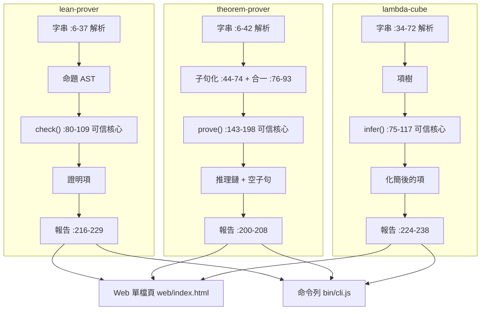

# 1.2 本專案的程式碼地圖

## 1.2.1 從尺子到地圖

1.1 節結尾我們替三個程式各做了一把尺子：一把量「輸入與輸出」，一把量「信任的落點」。那兩把尺子有個明顯的不足：它們能分辨出「這個程式是 ITP 還是 ATP」，卻沒有回答「我明天要動手改它，該先打開哪一個檔案、哪一段行號」。

尺子適合回答「這是什麼」，地圖適合回答「這在哪裡」。本章的任務就是把尺子換成地圖，而且要保證這張地圖不是憑印象畫的，而是逐行對照原始碼標出來的。書裡每一個行號都經得起 `sed -n '80,109p' lean-prover/src/lean.js` 的檢驗；如果你跟著讀到某一行跟描述對不上，那是本書錯了，不是原始碼錯了。

值得先講一件事：這三個程式不是三個獨立專案拼湊在一起的。它們是**同一個骨架的三次實作**。三個子專案的目錄名完全一樣（`src/`、`bin/`、`web/`、`scripts/`、`examples/`、`test/`），三個核心檔案的內部結構也完全一樣，而且是同一種四段式切分。本節要說明的，就是這張地圖為什麼長成這個樣子，以及它怎麼讓「並排比較」這件事在工程上真的可能。

## 1.2.2 三個子專案，一套目錄

先看最外層。`prover/` 目錄下的三個子專案，每一個都有同樣的六個目錄，而每個目錄的名字本身就是一份職責說明：

| 目錄 | 職責 | 為什麼需要它 |
|---|---|---|
| `src/` | 唯一的邏輯所在 | 三個程式各自只有一個核心檔案：`lean.js`、`prover.js`、`cube.js`。所有邏輯都在這裡，沒有第二個地方 |
| `bin/` | 命令列薄殼 | 只做「讀檔、呼叫核心、印報告」三件事，不含任何推理邏輯 |
| `web/` | 網頁介面 | `template.html` 是原始檔，`index.html` 是建置產物 |
| `scripts/` | 建置腳本 | 只有 `build-web.js` 一支，負責把 `src/` 內嵌進網頁 |
| `examples/` | 可直接執行的範例 | 給「想先看效果再讀程式碼」的讀者 |
| `test/` | 測試 | 每個都在 12 行以內，重點是測核心**會不會拒絕壞輸入** |

`src/` 只有一個檔案這件事，是本專案最重要的工程決定。這正是第 7.1 節要談的 De Bruijn 準則：信任必須集中在**一個小到可以完整閱讀**的地方。如果一個證明助手把解析器、策略層、報表、錯誤訊息分散在八個檔案裡，「核心有多大」這個問題就變得無法回答。三個核心檔案合計 719 行，可以在一個下午讀完，而且讀完之後你知道的是**全部**的行為，不是大部分。

`examples/` 與 `test/` 是同一件事的兩面：前者證明「這個系統真的能證明東西」，後者證明「這個系統真的會拒絕壞東西」。`lean-prover/test/test.js` 只有 9 行，但其中最後兩行是整個專案最重要的一個斷言：

```js
try { L.check({ r: 'andE1', p: { r: 'hyp', n: 'h' } }, [['h', { t: 'atom', n: 'P', a: [] }]]); ok(false, '核心應拒絕偽造的證明項'); }
catch (e) { ok(true, '核心拒絕偽造的證明項'); }
```
（`lean-prover/test/test.js:7-8`）

這兩行直接把手伸進核心，餵給它一個**手寫的、結構上不成立的證明項**，要求核心丟出例外。正常情況下沒有任何使用者能造出這種東西——策略層只會產生合法的證明項——所以這是只有測試才能做的事。第 7.5 節會回頭細講這個設計：**一個可信核心如果從來沒有被餵過壞資料，它就還沒有被檢驗過**。

`bin/cli.js` 之所以值得單獨看一眼，是因為它薄到一眼看完。以 ITP 為例，整個 CLI 是 13 行：

```js
const fs = require('fs'), L = require('../src/lean.js');
const a = process.argv.slice(2), trace = a.includes('--trace'), files = a.filter(x => !x.startsWith('--'));
let text;
if (a.includes('--demo') || (!files.length && process.stdin.isTTY)) text = L.examples.map(e => e.src).join('\n\n');
else text = fs.readFileSync(files[0] || 0, 'utf8');
```
（`lean-prover/bin/cli.js:3-7`）

注意 `(!files.length && process.stdin.isTTY)` 這個判斷：沒有參數而且是互動式終端機時跑示範，否則從標準輸入讀。這個設計讓 `cat 檔案 | node bin/cli.js` 也能運作，而 CLI 裡**沒有任何一行在做推理**。邏輯全部在 `src/`，CLI 只是把字串餵進去、把字串印出來。這是四段式切分的必然結果：報告段拿到的結果已經是「狀態 + 資料」，CLI 只需要把它們排版。

## 1.2.3 四段式：解析 → 可信核心 → 策略層 → 報告

三個核心檔案的檔頭都有一段自我描述，而 ITP 寫得最直白：

```js
/* 互動式一階邏輯證明助手 — 核心(Node 與瀏覽器共用)
   結構:解析器 → 可信核心 check()(唯一決定證明對錯的部分)→ 策略層(只負責產生證明項)→ 報告 */
```
（`lean-prover/src/lean.js:1-2`）

λ-Cube 的檔頭強調的是另一件事——核心裡的項只有五種節點，連接詞全部由 Π 型別定義：

```js
/* λ-cube 證明助手 — 核心(Node 與瀏覽器共用)
   項只有 5 種節點:變數、sort、應用、λ、Π(內部用 de Bruijn index)。連接詞全由 Π 型別定義出來。 */
```
（`lambda-cube/src/cube.js:1-2`）

而 ATP 的檔頭最短，只有「核心」二字加一句「Node 與瀏覽器共用」：

```js
/* 一階邏輯歸結法定理證明器 — 核心(Node 與瀏覽器共用) */
```
（`theorem-prover/src/prover.js:1`）

三段自我描述合起來正好點出三個系統的關注點：ITP 關心**職責邊界**，λ-Cube 關心**資料形狀**，ATP 關心**它是核心**。而底下這四段的順序，在三個檔案裡都一樣。這順序不是任意的，它是整個架構的**信任梯度**：資料只能單向流動，越靠近「證明對錯」的地方，越不依賴別人。解析器只會把字串變成樹，它錯了頂多讓你 parse error，不會讓錯誤的證明通過；策略層只會填洞，它錯了會被核心抓出來；核心不依賴策略層，策略層也沒有權力判定對錯。

三個模組的四段對照如下。行號是實測的，範圍包含該段的最後一行：

| 階段 | `lean-prover/src/lean.js` | `theorem-prover/src/prover.js` | `lambda-cube/src/cube.js` |
|---|---|---|---|
| 解析 | `:6-37`（詞彙正規化 + `P()` 遞迴下降解析器 + `parseF`） | `:6-42`（`parse()`，含等式 `=` `!=` 的特殊處理） | `:34-72`（`tok()` + `parser()`，含 de Bruijn 命名空間） |
| 可信核心 | `:80-109`（`check()`，30 行） | `:143-198`（`prove()`，56 行，含子句化與剪枝） | `:75-117`（`kernel()`：`whnf` / `conv` / `infer`） |
| 策略層 | `:112-174`（`app()` 假設套用 + `tactic()` 13 個策略） | 無：搜尋策略直接寫在核心迴圈內 | `:120-164`（`tactic()` 6 個策略） |
| 報告 | `:216-229`（`showGoal` / `showGoals` / `statusText` / `report`） | `:200-208`（`fmtClause` / `fmtRule` / `statusText` / `format`） | `:224-238`（`showGoal` / `showGoals` / `ICON` / `report`） |

除了這四段，三個檔案各自還有幾個「配角區塊」，它們不構成獨立階段，卻是理解第四段不可或缺的背景：

- **`lean.js`**：`:39-51` 顯示（把 AST 印成人看得懂的 `P → Q`）；`:53-77` 公式工具（`key`/`eq` 做 α 等價、`sub` 做避免變數捕獲的代換、`look` 查假設）；`:176-214` 執行（`inst` 把洞填回證明項、`runThm` 跑完一篇腳本）；`:231-240` 內建範例。
- **`prover.js`**：`:44-74` 子句化（`nnf` → `skolem` → `cnf` → `clausify`）；`:76-93` 合一（`unify` 含 occurs check、`unifyL` 文字層合一）；`:95-120` 剪枝（`match` / `subsumes` / `ren` / `norm`）；`:122-140` 等式替換（paramodulation）；`:210-221` 內建範例。
- **`cube.js`**：`:10-15` de Bruijn 運算（`V(i)`、`shift`、`subst`、`inst`）；`:17-32` 顯示；`:167-222` 執行（`runScript` 逐條命令跑 `system`/`def`/`theorem`/`check`/`eval`）；`:240-248` 內建範例。

三個解析段的輸出形狀也值得並排看一眼，因為它們直接預告了後面的分歧。`lean.js` 的解析器回傳 `{ t: 'imp', l, r }` 這種**命題樹**，`cube.js` 的解析器回傳 `{ k: 'p', n, ty, b }` 這種**項與型別的樹**，`prover.js` 的解析器回傳的則是 `{ t: 'atom', n, a }` 的**還沒壓平的公式樹**——壓平要等到 `clausify()` 才發生。三者都不是「最終資料」：解析段只負責把字串變成**忠實的樹**，所有「為了讓證明能進行下去」而做的加工（把 $\neg A$ 展開成 $A \to \bot$ 這樣的蘊含式、對存在量詞做 Skolem 化、把合取運算展開成 Church 編碼）都放在解析之後的階段。這個分工讓「我的輸入寫錯了」和「我的推理推不出來」變成兩件可以分開診斷的事。

這張表有一個值得停下來的地方：**ATP 沒有策略層**。`prover.js` 的 `prove()` 是一個自帶搜尋策略的引擎——挑選子句、歸結、因子化、等式替換全都寫在 `while (!empty)` 那個迴圈裡（`theorem-prover/src/prover.js:160-186`）。所以它的「核心」比別人的大：整個 `prove()` 都是可信核心，而且**必須**是，因為 ATP 的使用者沒有任何機會插手說明「接下來該試哪一步」。第 4.5 節會拆開那個迴圈，說明「加權挑選最小的子句」這個策略為什麼是效能的關鍵。

反過來說，ITP 與 λ-Cube 的核心小得離譜：`check()` 30 行、`infer()` 加 `conv` 40 行左右。這個反差本身就是 ITP 與 ATP 最深刻的結構性差異——**人給思路的系統，信任可以集中在極小的核心裡；機器自己找思路的系統，核心必須包辦整個搜尋程序**。

## 1.2.4 零外部相依與 Node.js 15+

三個 `package.json` 的 `scripts` 內容完全一樣（只有縮排風格不同），`lean-prover` 的寫法是：

```json
  "scripts": { "demo": "node bin/cli.js --demo", "test": "node test/test.js", "build": "node scripts/build-web.js" },
```
（`lean-prover/package.json:6`）

沒有 `dependencies`，也沒有 `devDependencies`。這不是潔癖，是教學上的必要條件：**讀者不需要先學會 npm 的依賴樹，就能讀懂證明器怎麼運作**。真實的 Lean 有幾百個相依套件，你要在裡面找到「核心在哪裡」是件麻煩事；本專案把相依拿掉，是為了讓 de Bruijn 準則在實作層面也成立。

「Node.js 15 以上」這個門檻也不是隨口寫的。整個專案裡真正需要新語法的只有一處——`theorem-prover/src/prover.js:113` 的空值賦值運算子：

```js
const ren = lits => { const m = {}; const r = t => isV(t) ? (m[t.v] ??= { v: fresh() }) : { f: t.f, a: t.a.map(r) }; return lits.map(l => ({ s: l.s, n: l.n, a: l.a.map(r) })); };
```

`??=` 是 Node 15 才有的。其餘的語法——`Object.fromEntries`（`lean.js:178`）、`padStart`（`prover.js:208`）、`globalThis`——在更早的版本就有了。把門檻定在 15，是為了讓「三個子專案的執行環境需求完全一致」這件事成立。

## 1.2.5 單檔網頁版是怎麼生出來的

網頁版不是另一份實作，它是同一份 `src/*.js` 被**內嵌**進 HTML 的產物。`scripts/build-web.js` 只有四行：

```js
const fs = require('fs'), path = require('path'), root = path.join(__dirname, '..');
fs.writeFileSync(path.join(root, 'web/index.html'), fs.readFileSync(path.join(root, 'web/template.html'), 'utf8')
  .split('/*LEAN*/').join(fs.readFileSync(path.join(root, 'src/lean.js'), 'utf8')));
console.log('已產生 web/index.html');
```
（`lean-prover/scripts/build-web.js:1-4`）

機制簡單到有點粗暴：把 `template.html` 讀成字串，用 `split('/*LEAN*/')` 把它切成兩半，再把 `src/lean.js` 的內容 `join` 回去。ATP 的版本用 `/*PROVER*/` 當佔位符，λ-Cube 用 `/*CUBE*/`。三個佔位符名字刻意不同，因為三份 HTML 是各自獨立的檔案，不會互相干擾。

這個做法能成立，前提是核心檔案的最後一行做了**雙棲匯出**：

```js
const API = { runThm, splitThms, report, statusText, showGoals, check, parseF, fm, examples };
if (typeof module !== 'undefined' && module.exports) module.exports = API; else globalThis.Lean = API;
```
（`lean-prover/src/lean.js:241-242`）

在 Node 裡，`module` 存在，走第一個分支，`require('../src/lean.js')` 拿到的是物件；在瀏覽器裡，`module` 不存在，走 else 分支，把 API 掛到 `globalThis.Lean`。網頁版就是靠 `globalThis.Lean` 取得能力的。

**同一份核心檔案，同時是 Node 函式庫與瀏覽器腳本**，這是「零相依」的關鍵。整個相依鏈只有 Node 內建的 `fs` 與 `path`（只在 `bin/` 與 `scripts/` 用到），核心本身連 `fs` 都不用。產出的 `web/index.html`（三個檔案各約 340 行）可以直接用瀏覽器以 `file://` 協定打開，不需要起任何伺服器。

網頁介面本身是 `template.html` 裡的另一段腳本，它呼叫 `Lean.runThm()` 取得結果，再用 `Lean.statusText()` 與 `Lean.showGoals()` 排版——**報告段的函式被 CLI 和網頁版共用**，這正是下一小節要說的設計意圖。

## 1.2.6 共用資料流：三個模組疊在一起看

把三條資料流疊在一起，會發現它們的形狀驚人地一致：



三條流程的**左端**都是「字串 → 某種樹狀結構」，**右端**都是「一個狀態碼 + 一份可讀的成果」。中間那一步是各自不同的：AST / 子句集 / 項樹。但正因為左右兩端統一，第 6 章才能做那個決定性的實驗——把同一個數學命題餵給三個程式，比較誰解得出來、誰先放棄、以及**它們各自用什麼語言描述「放棄」**。

## 1.2.7 為什麼三個專案共用 `showGoals` / `report` / `statusText`

最後回到報告段。三個模組的報告函式**同名、同形、近乎同構**：

| 函式 | ITP | λ-Cube | ATP |
|---|---|---|---|
| 目標顯示 | `showGoals` `lean.js:218` | `showGoals` `cube.js:226` | 無（沒有目標棧） |
| 狀態文案 | `statusText` `lean.js:219-220` | `ICON` + `cmd.status` `cube.js:227` | `statusText` `prover.js:204-207` |
| 總報告 | `report(r, trace)` `lean.js:222-229` | `report(R, trace)` `cube.js:228-238` | `format(r)` `prover.js:208` |

這個「同名」不是偶然，而是**對照學習**的直接工程後果。如果三個程式的報告分別叫 `printResult`、`dump`、`out`，讀者在並排比較時就要先適應三套不同的心智模型；一旦它們都叫 `report`，讀者就可以把注意力放在**內容差異**上，而不是介面差異上。具體來說，`showGoals` 在 ITP 與 λ-Cube 裡幾乎一模一樣：

```js
const showGoals = gs => gs.length ? (gs.length > 1 ? gs.length + ' 個目標\n\n' : '') + gs.map(showGoal).join('\n\n') : '沒有目標了';
```
（`lean-prover/src/lean.js:218`；`lambda-cube/src/cube.js:226` 逐字相同）

連「沒有目標了」這個字串都一樣，因為那正是 ITP 與 λ-Cube 策略層共有的**目標棧**語義的直接反映：兩者都是「人給思路」的系統，都靠 `solve()` 把棧頂換掉。

而 ATP 沒有 `showGoals`，也不是偷懶：它**真的沒有目標棧**。它的進度單位是「已產生的子句數」與「推理鏈」，不是「還剩幾個目標」。這個缺席本身就是第 3 章與第 4 章的分野在介面層的投影。

還有一處刻意的差異值得一提。λ-Cube 的報告層多了一張 `ICON` 表：

```js
const ICON = { ok: '✔', sorry: '⚠', open: '…', error: '✘' };
```
（`lambda-cube/src/cube.js:227`）

因為 λ-Cube 的一個腳本裡可能混有 `system`、`def`、`axiom`、`check`、`eval`、`theorem` 六種命令，每一條命令都要有自己的成敗圖示；而 ITP 的一個檔案裡只有 `theorem`，所以圖示直接寫死在 `statusText` 的物件值裡就夠了。**一致的是「回報風格」，不一致的是「每個系統實際有幾種東西要回報」**——這正是地圖應該有的樣子：骨架相同，但每個骨架上都長出符合自身內容的細節。

## 小結與交棒

本章交給你的地圖，可以濃縮成三句話：

第一，三個程式住在 `prover/` 底下三個長得一模一樣的子專案裡，每個子專案的核心只有一個檔案，`bin/`、`web/`、`scripts/` 都是薄殼。

第二，三個核心檔案都是同一種四段式：**解析 → 可信核心 → 策略層 → 報告**，並且都把行號切得清清楚楚。ATP 的核心特別大（因為它連搜尋策略都包辦），ITP 與 λ-Cube 的核心特別小（因為它們只驗收）。

第三，三者共用同一套報告詞彙（`showGoals` / `report` / `statusText`），這樣它們才能被並排閱讀、並排比較。

地圖有了，但地圖上標的都是「現在是什麼」。第 2 章要補上「為什麼是這個」：Hilbert 在 1900 年要的是什麼、Church 在 1934 年編碼了什麼、Gentzen 在 1935 年把證明變成了什麼、Robinson 在 1965 年把一階邏輯變成了什麼、de Bruijn 又如何把變數變成數字——那些才是這張地圖上每一段的來歷。帶著地圖回頭看歷史，你會發現 1.1 節那三種「證明的機器意義」，其實是三段不同的歷史各自逼出來的答案。
