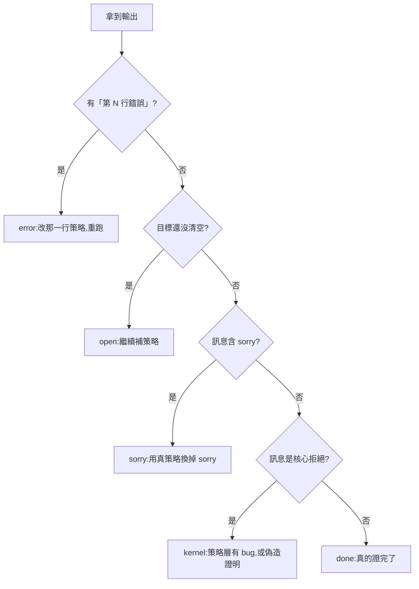

# 1.3 閱讀指南與執行環境

## 1.3.1 這本書有三條路，你是哪一種讀者

1.2 節把地圖交給你了，但地圖有個麻煩：它攤開了所有東西，卻不告訴你先看哪一塊。本書不是手冊，不存在「從頭讀到尾」的義務；它是三條可以並行推進的路線，各自有自己的入口、自己的節奏，和自己的終點。

先給總表（與 `book/README.md` 的表格一致）：

| 路線 | 適合誰 | 章節順序 |
|---|---|---|
| 實作線 | 想動手改程式、或想讀懂 `src/*.js` 的人 | 第 1 章 → 第 3 章 → 第 5 章 → 第 7 章 → 第 9 章 |
| 理論線 | 想搞懂 Curry–Howard、λ-Cube 與證明論史的人 | 第 1 章 → 第 2 章 → 第 5 章 → 第 6 章 → 第 9 章 |
| 對比線 | 想比較 ITP 與 ATP 兩大流派的人 | 第 1 章 → 第 3 章 → 第 4 章 → 第 6 章 → 第 8 章 |

三條路線的差別不是「讀多少」，而是「先建立什麼直覺」。下面把它們拆開。

**實作線**（第 1 章 → 第 3 章 → 第 5 章 → 第 7 章 → 第 9 章）走的是「把程式讀透」的路。第 3 章拆 `lean-prover` 的目標狀態機：`3.1` 目標狀態機與 `Goal` 的四個欄位、`3.2` 從字串到 AST（特別是 `~A` 與 `A ↔ B` 的展開）、`3.3` 可信核心 `check()`、`3.4` 策略層 `intro`/`apply`/`cases`/`exact` 的語意、`3.5` 變數捕獲與 $\alpha$ 等價、`3.6` 八個範例的目標變化全紀錄。第 5 章把同一套讀法搬到 λ-Cube：`5.1` Curry–Howard 對應表、`5.2` 簡單型別 λ→ 與核心的形狀、`5.3` System F 與多型 λ2、`5.4` 依值型別 λP、`5.5` 三個維度同時打開的 λC、`5.6` Church 編碼、`5.7` de Bruijn 索引與 $\beta$ 歸約。第 7 章回收三個專案的工程面：`7.1` De Bruijn 準則、`7.2` `check()` 與 `infer()` 的對稱、`7.3` 策略層的目標棧與洞、`7.4` 命令列與單檔網頁的打包策略、`7.5` 測試策略。最後第 9 章附錄提供語法速查與原始碼索引，當作長期查閱的入口。

**理論線**（第 1 章 → 第 2 章 → 第 5 章 → 第 6 章 → 第 9 章）走的是「先知道為什麼有這個技術」的路。第 2 章是全書的歷史坐標：`2.1` 1900–1930 的 Hilbert 綱領、`2.2` 1934–1936 的 Church 演算與 Church 編碼、`2.3` 1935 年的 Gentzen 自然演繹、`2.4` 1959–1965 年的 Robinson 歸結原理與 Herbrand 定理、`2.5` 1960–1990 年的 de Bruijn 索引與 Martin-Löf 類型論。接著第 5 章把 Curry–Howard 從口號變成具體的 Π 形成規則，第 6 章把同一批數學放進三個系統裡比較，最後第 9 章附錄收束。

**對比線**（第 1 章 → 第 3 章 → 第 4 章 → 第 6 章 → 第 8 章）走的是「看兩大流派如何正面交鋒」的路。它刻意不碰 λ-Cube，把火力集中在 ITP 與 ATP 的對立上：第 3 章讀 ITP，第 4 章讀 ATP（`4.1` 演繹與反駁的分工、`4.2` NNF 與 CNF、`4.3` Skolem 化的代價、`4.4` 合一與 occurs check、`4.5` Given-Clause 迴圈、`4.6` 剪枝、`4.7` 等式推理），第 6 章看同一個定理在兩邊的推理鏈長什麼樣，第 8 章則是「玩具到真實」之間的落差清單。

三條路線在**第 6 章**交會。那一章是全書唯一一處三個系統同時出現的地方，也是唯一能直接回答「三種證明哲學到底差在哪」的地方——如果你只有讀完一章的時間，請讀第 6 章。

## 1.3.2 先跑起來：四種執行方式

理論可以等，程式不會。這個專案的門檻低到有點可疑：**不需要 `npm install`，不需要設定，不需要網路**。三個 `package.json` 裡沒有任何 `dependencies`，所以下載下來就能跑。唯一的環境要求是 **Node.js 15 以上**（理由見 1.2 節：`theorem-prover/src/prover.js:113` 用到空值賦值運算子 `??=`）。

第一種是內建示範：

```bash
cd lean-prover     && node bin/cli.js --demo
cd theorem-prover  && node bin/cli.js --demo
cd lambda-cube     && node bin/cli.js --demo
```

`npm run demo` 與 `node bin/cli.js --demo` 完全等價，因為 `package.json` 裡的 script 就是 `"demo": "node bin/cli.js --demo"`。跑 ITP 的示範，你會看到八個定理依序被證明，每一個底下都躺著一句核心的判語：

```
theorem syllogism : P → R
✔ 證明完成,核心檢查通過
```

第二種是檢查自己的檔案，這是真正有用的模式：

```bash
cd lean-prover     && node bin/cli.js examples/syllogism.lean --trace
cd lambda-cube     && node bin/cli.js examples/or_comm.lc --trace
cd theorem-prover  && node bin/cli.js examples/socrates.txt
```

`--trace` 會把**每一條策略執行完之後的目標**都印出來，這是理解 ITP 與 λ-Cube 最直接的窗口。以 `lean-prover/examples/syllogism.lean` 為例，`--trace` 的輸出是這樣的：

```
theorem syllogism : P → R
  intro hp
      h1 : P → Q
      h2 : Q → R
      hp : P
      ⊢ R
  apply h2
      h1 : P → Q
      h2 : Q → R
      hp : P
      ⊢ Q
  apply h1
      h1 : P → Q
      h2 : Q → R
      hp : P
      ⊢ P
  exact hp
      沒有目標了
✔ 證明完成,核心檢查通過
```

注意最底下那行「沒有目標了」：它對應的是 `showGoals` 在目標清單為空時的回傳值（`lean-prover/src/lean.js:218`）。目標依序退成 $R$ 、 $Q$ 、 $P$ ，最後消失——這就是 1.1 節說的「搜索退化成人類思考的打字」。`theorem-prover` 沒有 `--trace` 選項，因為它的推理鏈本身就是完整過程：`format()` 會把每一步產生的子句連同規則名一起列出。

第三種是標準輸入，適合配合編輯器或管線使用。三個 CLI 都支援沒有參數時從 stdin 讀：

```bash
cat examples/socrates.txt | node bin/cli.js
```

第四種是瀏覽器。`web/index.html` 是建置產物，**直接用瀏覽器打開就好**（`file://` 協定，不需要起伺服器）。網頁版比 CLI 更好用的一點是：點選腳本裡的任一行，下方就會顯示「那一行之後」的目標狀態，等於把 `--trace` 做成了互動的。它還有一個 CLI 沒有的面板——「核心驗證的證明項」，把核心重算出來的證明項攤開給你看。

最後是兩支維護用命令：

```bash
npm test        # 跑測試
npm run build   # 修改 src/ 或 web/template.html 之後重新產生 web/index.html
```

`npm test` 值得特別說明，因為它是這個專案的**安全網**。`lean-prover/test/test.js` 只有 9 行，卻同時測四件事：內建範例全部可證、錯誤的策略會被拒絕（狀態為 `error`）、未完成的證明回報 `open`、`sorry` 會被標記，外加最關鍵的一條——**核心會拒絕手寫的偽造證明項**。`lambda-cube/test/test.js` 的 12 行多了一層：它會檢查系統頂點選對沒有（λP 沒有多型就該拒絕 `∀ (A : Prop)`），也就是測「核心規則有沒有被正確接上」。

`npm run build` 只有在你真的改了 `src/*.js` 或 `web/template.html` 之後才需要跑。記住它的方向性：`src/` 是唯一的真相來源，`web/index.html` 是產物。永遠不要直接改 `web/index.html`——下一次 build 就會把你的修改蓋掉。

## 1.3.3 出錯時怎麼看：五種狀態的判讀

讀程式最花時間的往往不是「懂」，而是「出錯時不知道錯在哪」。好消息是這個專案的報告層設計得很誠實：它不只說「失敗」，還會告訴你**失敗發生在哪一層**。ITP 的 `statusText` 定義了五種狀態（`lean-prover/src/lean.js:219-220`），每一種對應到程式裡一個明確的位置：

| 狀態 | 訊息 | 判定位置 | 代表什麼 | 該怎麼修 |
|---|---|---|---|---|
| `done` | ✔ 證明完成,核心檢查通過 | `lean.js:211` | 策略跑完、目標清空、核心重算的命題與宣告 $\alpha$ 等價 | 不用修 |
| `sorry` | ⚠ 證明完成,但含有 sorry(未真正證明) | `lean.js:171` 標記、`lean.js:86` 傳到核心 | 核心通過了，但證明項裡混進了 `sorry` 節點 | 用真正的策略換掉 `sorry`；否則這不是證明 |
| `error` | ✘ 有策略執行失敗 | `lean.js:201` 的 `catch` | 某一條策略指令拋出例外，後面的行全部沒跑 | 照錯誤訊息改那一行；具體訊息在 `report()` 的「第 N 行錯誤」 |
| `open` | … 證明尚未完成,還有目標 | `lean.js:207` | 腳本跑完了，但目標棧沒清空 | 繼續寫策略把剩下的目標解完 |
| `kernel` | ✘ 核心拒絕了這個證明:（後接詳細原因） | `lean.js:212` 的 `catch` | 核心重算出來的命題與宣告不符，或證明項內部結構不合法 | 策略層有 bug，或有人偽造證明項——核心是對的，錯的是外面 |

這五種狀態的因果關係值得說清楚，因為它決定了你的除錯方向：

- **`error` 與 `open` 是你的問題。** `error` 是「這一步的指令語意用錯了」，`open` 是「這一步還不夠」。兩者都發生在策略層，也就是你寫的指令那一側。典型輸出長這樣：

```
theorem bad : P → Q
第 3 行錯誤:exact 的型別不吻合:得到 P → Q,但目標是 Q
    h1 : P → Q
    hp : P
    ⊢ Q
✘ 有策略執行失敗
```

訊息直接告訴你「得到什麼、但目標是什麼」，而下面的目標快照則告訴你「你當下站在哪裡」。`--trace` 加上這兩樣，足以還原整個推理過程。

- **`kernel` 不是你的問題（多半）。** 它意味著策略層交出來的證明項**在核心眼裡推不出宣告的命題**。由於策略層的每一條指令都會先用 `eq()` 檢查型別才填洞，正常情況下 `kernel` 不該出現。它出現，通常只有兩種原因：策略層有 bug（例如 `intro` 把一個已經出現在假設裡的變數一般化了，核心會以「變數 x 出現在假設中,不能一般化」拒絕），或者有人手寫了一個假的證明項想混進來。第 7.5 節會說明後者要怎麼被測試抓到。

- **`done` 與 `sorry` 只差一個字，但差很多。** `sorry` 的核心照樣通過——`check()` 遇到 `sorry` 節點時會記下 `fl.sorry = true` 然後回傳該目標（`lean.js:86`），所以證明「看起來」是完成的，但實際上它沒有證明任何東西。報告把它標成 ⚠ 而不是 ✔，就是為了讓這件事無法被忽略。

三個系統的狀態詞彙**並不完全一致**，這是本專案少數幾處「對照風格」的例外，而且各有理由：

| 系統 | 狀態集合 | 特殊說明 |
|---|---|---|
| ITP | `done` / `sorry` / `error` / `open` / `kernel` | 五種，前述表格 |
| λ-Cube | `ok` / `sorry` / `open` / `error` | 沒有獨立的 `kernel`：核心丟出的例外在 `runScript` 的 `try` 裡被接住（`cube.js:218`），狀態記成 `error`，但訊息裡會出現「核心」二字可資辨認 |
| ATP | `proved` / `saturated` / `timeout` | 沒有「尚未完成」：ATP 不會停在半路。要嘛找到矛盾（`proved`），要嘛把子句空間搜完仍找不到（`saturated`），要嘛撞到上限（`timeout`） |

`saturated` 這個狀態特別值得警告：**它不是反例**。它只代表「在目前的時間與子句數上限內沒找到矛盾」。第 4 章會說明一階邏輯裡它的真正意義（配合 Herbrand 定理才等於「不是邏輯後果」），第 4.6 節會說明剪枝如何讓飽和提早發生，而第 8.4 節會說明真實的驗證工具如何用模理論與 SMT 走出另一條路。

底下這張流程圖把判讀順序畫出來：



## 1.3.4 符號怎麼對應到速查表

三個系統的符號長得不太一樣，這是最容易絆住新手的東西。好消息是它們的差異有規律，而且都有被收進第 9 章附錄：

| | ITP（`lean-prover`） | ATP（`theorem-prover`） | λ-Cube（`lambda-cube`） |
|---|---|---|---|
| 否定 | `~`（也接受 `¬`） | `~`（也接受 `¬`） | 無（要自己用 Π 型別定義） |
| 合取 | `&`（也接受 `∧`） | `&`（也接受 `∧`） | 無（同上） |
| 析取 | `\|`（也接受 `∨`） | `\|`（也接受 `∨`） | 無（同上） |
| 蘊含 | `->`（也接受 `→`） | `->`（也接受 `→`） | `->`（也接受 `→`） |
| 全稱 | `forall x.` | `forall x.` | `forall (x : A),` |
| 存在 | `exists x.` | `exists x.` | 無（要自己定義） |
| 函式 | 無（項只出現在原子裡） | 無 | `fun (x : A) => t` |
| 等式 | 無 | `a = b` / `a != b` | 無 |

三個關於符號的注意事項：

第一，**ITP 與 ATP 的命題語法幾乎相同**，因為它們都需要解析一階語言；它們的差別在語義層（AST 是有巢狀結構的樹，子句集是扁平集合）。λ-Cube 的語法最不同，因為它的「公式」其實是**型別**，所以必須標註型別：`forall (x : A), B` 而不是 `forall x. B`。

第二，**量詞的分隔符號不同**。ITP 與 ATP 用句點（`forall x. P(x)`），λ-Cube 用逗號加型別標註（`forall (x : A), P x`）。這不是任意的：λ-Cube 的 `forall` 本身就是一個 Π 型別，而 Π 型別**必須**知道被綁定者的型別，否則「∀ 消去」根本無從算起。

第三，**λ-Cube 沒有 $\neg$ 、 $\land$ 、 $\lor$ 、 $\exists$ ，而且這是刻意的**。它們可以用 Π 型別定義出來——第 5.6 節的 Church 編碼會完整做一遍——而 `lambda-cube/src/cube.js` 的核心裡沒有任何一行提到這些符號。這個「核心裡沒有邏輯連接詞」的設計，正是 Curry–Howard 對應最乾淨的示範。

完整的語法速查在第 9 章：`9.1` ITP 語法與策略、`9.2` ATP 問題檔格式與命令列、`9.3` λ-Cube 腳本語法與系統表、`9.4` 原始碼索引與延伸閱讀。本書正文引用的每一段程式碼都標了 `檔名:行號`，你可以用它對回 `9.4` 的索引。

## 1.3.5 全書路線圖：每一章在解決什麼問題

給一個總覽，方便你決定下一章往哪走：

- **第 2 章 邏輯的座標：從 Hilbert 到 Curry–Howard** —— 回答「為什麼會有自然演繹、歸結法與 λ 演算這三種東西」，把三條技術路線各自的思想起源與限制講清楚（`2.1` Hilbert 綱領、`2.2` Church 演算、`2.3` Gentzen 自然演繹、`2.4` Robinson 歸結與 Herbrand 定理、`2.5` de Bruijn 索引與 Martin-Löf 類型論）。
- **第 3 章 互動式證明助手：自然演繹的策略引擎** —— 回答「人給的思路要怎麼變成機器可檢查的證明項」，也就是 `check()` 與它的策略層（`3.1` 目標狀態機、`3.2` 解析器、`3.3` 可信核心、`3.4` 策略層、`3.5` 變數捕獲與 $\alpha$ 等價、`3.6` 演練）。
- **第 4 章 演繹與反駁：歸結法自動定理證明器** —— 回答「機器自己找思路時，公式要先被壓成什麼樣子、搜尋要怎麼剪枝」，涵蓋 NNF、CNF、Skolem 化、合一、Given-Clause 迴圈與等式推理（`4.1` 至 `4.7`）。
- **第 5 章 λ-Cube：命題即型別** —— 回答「 Curry–Howard 對應在型別系統裡長什麼樣」，把 λ 的八個頂點逐一實作出來，並解釋 Church 編碼與 de Bruijn 索引（`5.1` 至 `5.7`）。
- **第 6 章 演練：同一批數學在三個系統中的樣貌** —— 回答「三套系統對同一個定理各自說什麼、會卡在哪裡」，是三條路線的交會點（`6.1` 合取交換律、`6.2` 假言三段論、`6.3` 雙重否定消去、`6.4` Peirce 定律、`6.5` 一階量詞、`6.6` 德摩根與對偶、`6.7` 群論與等式）。
- **第 7 章 軟體工程：可信核心、策略與介面** —— 回答「三個玩具程式背後的通用工程原則是什麼」，談 de Bruijn 準則、核心的形狀、策略層設計、零依賴打包與測試策略（`7.1` 至 `7.5`）。
- **第 8 章 局限與延伸：從三個玩具走向真實的證明器** —— 回答「這三個玩具缺了什麼、補上之後會變成什麼」，涵蓋歸納型別、宇宙階層、古典邏輯的代價、自動化與 SMT（`8.1` 至 `8.5`）。
- **第 9 章 附錄：語法速查與原始碼索引** —— 回答「我要用的那一條策略、那一個符號、那一行程式碼在哪裡」，是全書的長期查閱入口。

## 小結與交棒

本章給了三樣東西：一張三條路線的選擇表、一組可以直接貼進終端機的命令、以及一張把「失敗」翻譯成「你的哪一步寫錯了」的狀態對照表。

如果這些工具都已經就位，接下來就不需要工具了，需要的是**問題**。第 2 章會帶你回到 1900 年，問一個今天看起來很奇怪的問題：Hilbert 為什麼要一個「可以被人完全檢查」的證明？那個年代沒有電腦，所謂「完全檢查」指的是讓一個人逐行核對——而正是這個要求，逼出了把證明拆成「規則應用」的觀念，逼出了把邏輯連接詞編碼成函數的觀念，也逼出了把「機器自己找」和「機器幫你驗」這兩條路分開的觀念。第 3、4、5 章的每一段程式碼，都能在第 2 章找到它的思想出處；而第 2 章的每一個定理，也都會在第 3、4、5 章找到它的行號。地圖和歷史，在此交會。
