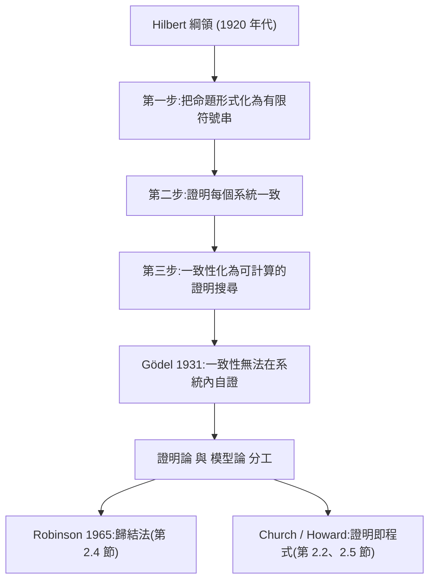

# 2.1 1900–1930 Hilbert 綱領與形式化的誕生

> 第 1 章說三個程式代表三種證明哲學。本章開始回答更難的問題：這三種哲學為什麼會長成今天這個樣子？答案不在個人的偏好，而在二十世紀前半的兩次失敗與一次技術成功。

Hilbert 綱領是二十世紀數學的總綱，也是本專案三個程式共同的祖先。它第一次明確提出：數學可以被完整地寫成一套有限書寫的符號規則，而關於這套規則的問題——它是否一致、它是否完備、其中的定理能否被機械地找到——本身就是可以形式化地回答的問題。本節要說的是：這個綱領是怎樣出現的、它為什麼催生了「把命題解析成抽象語法樹」這個在今天看起來天經地義的做法，以及它的失敗如何把我們推向 Church、Gentzen 與 Robinson。

## 2.1.1 Frege 1879：先把邏輯從語言裡抽離出來

Frege 在 1879 年出版的《Begriffsschrift》（概念文字）不是第一個邏輯系統，卻是第一個把邏輯做成「可書寫的推理」而不是「推理的語法分析」的系統。他最重要的設計是把一個句子拆成兩層：底層是命題的**內容**，上層是對這個內容的**斷言**（例如「F 是對的」）。這個分離意味著：同一個內容可以被放進不同的斷言框裡，而框與框之間的推理規則完全不依賴自然語言。

這個設計把「命題」變成了一級對象。回想 Frege 之前的邏輯教材，它們談的是「判斷的形式」（unary、relational、modal），但內容仍是散文；Frege 之後，「形式」本身成為被寫下的對象。

我們在本專案裡看到的，正是這一步的現代版本。`lean-prover/src/lean.js:6-7` 先建立了一張符號表（把 `∀`、`∧`、`→` 映射到 ASCII 關鍵字），再用一個正規表示式把字串切成詞元：

```javascript
// lean-prover/src/lean.js:6-7
const GREEK = { '∀': ' forall ', '∃': ' exists ', '¬': '~', '∧': '&', '∨': '|', '→': '->', '↔': '<->', '⊥': ' False ' };
const lex = s => s.replace(/[∀∃¬∧∨→↔⊥]/g, c => GREEK[c]).replace(/\\/g, '&').replace(/\\\//g, '|').match(/<->|->|[A-Za-z_][\w']*|\S/g) || [];
```

這兩行是「Begriffsschrift 的現代化」：符號表是詞彙表，切詞是詞法分析，而接下來的 `P()` 才把詞元組成一個可以被人與機器共同操作的樹狀對象。`theorem-prover/src/prover.js:7-8` 與 `lambda-cube/src/cube.js:35-36` 的 `parse()`、`tok()` 做的是同一件事，只是連接詞的符號集不同。

## 2.1.2 Principia 1910–1913，以及一致性這道幽靈

Russell 與 Whitehead 的《Principia Mathematica》第一卷於 1910 年問世，三卷分別在 1910、1912、1913 年出版。它是 Frege 綱領的工業級實現：每一條公理、每一次推導都被寫成公式，並且用 **\*-記號** 表示「由前面的公理與定理推得」。PM 追求三個目標：一致性（不矛盾）、完備性（把命題邏輯的全部定理都收錄）、以及獨立性（每條公理都能由其他公理推出，藉以挑出最小公理集）。

要達成這些目標，就必須先證明系統本身沒有毛病。而就在 PM 開寫之前，壞消息已經來了。

**1902 年的 Russell 悖論**直擊 Frege 與 Russell 的共同弱點：以「所有集合的集合」為全域所導出的概括原理。Russell 指出，若存在一個由「所有不屬於自己的集合」所定義的集合 $R$ ，則 $R \in R$ 蘊含 $R \notin R$ 。這不只是一個錯誤，這是一種**不一致的來源**：只要語言允許用一個定義好的謂詞去切割全域，就能造出矛盾。

Frege 原本宣稱概念文字是一致而完備的；發現悖論後，他在 1903 年致信給 Russell，承認他的一整套方案被推翻。**1908 年 Zermelo** 用公理化集合論（分離公理取代-naive 概括）給出了第一個不含 Russell 悖論的集合論模型。Zermelo 的做法值得記住：他沒有禁止「定義一個集合」，而是禁止了「定義那個會包含自己的集合」。

這段歷史留下兩個對本專案有直接影響的教訓：

1. **一致性的問題不能用「直接用自然語言談論」的方式解決**，必須把對象語言與談論對象的語言分開。這正是下一小節元數學／元邏輯分工的來源。
2. **「系統是否一致」是一個關於整個系統的性質，不是任何單一公式的性質。** 要斷言它，就需要一个不必信任整個系統的檢查程序。第 7 章的「可信核心」正是這種檢查程序的最小版本。

## 2.1.3 1928：Hilbert 綱領的三步曲

1900 年，在柯尼斯堡的國際數學家大會上，Hilbert 提出了二十三個問題；**第 23 問題**正是：「如何證明任意一組公理的無矛盾性？」這是綱領的第一個問題，也是二十世紀數學的中心問題之一。

接著是 1928 年。Hilbert 在柏林帝國科學院發表〈Über den Entscheidungsproblem〉（論判定問題），把「一階邏輯是否可判定」正式擺上檯面：一階邏輯的公式有沒有演算法可以判斷它是否為邏輯後承？Huntington 與 Bertrand Russell 在更早的年代就問過類似問題，但 Hilbert 把它連到一個更大的綱領上。綱領的三步是：

1. **形式化**：把每一門數學（算術、幾何、代數）翻譯成一個形式系統，只允許有限長度的字串作為對象。
2. **一致性**：證明每個這樣的系統都一致。
3. **自動化**：透過完全性定理，把「一致性」與「定理的可機械尋找性」接上。



綱領中最容易被忽略、卻最有工程價值的一步是第三步。它的邏輯是：**若系統 S 一致，則 S 中的定理在語義上有效；而有效性可以透過某種「把所有可能證明逐一檢查」的裝置被化約為一個可計算程序**。後來 Herbrand 的定理（2.4 節）與 Gödel 的完全性定理（1930/1931）會把這條鏈真正接上：證明存在 ⟺ 可滿足 ⟺ 反駁程序能停在一個空子句上。

這也就是「反駁法」（refutation）程序的理論來源，也是本專案 `theorem-prover` 的理論來源。

## 2.1.4 綱領的核心洞見，以及它為什麼讓我們想要 AST

把上面三步壓縮成一條，就是綱領最深刻、也最工程化的一句話：**數學可以被轉換成對有限符號串的有限規則操作。**

這句話有兩個直接後果，恰好就是本專案三個程式的形狀。

**後果一：邏輯對象必須是資料。** 一個「有限的符號操作」不可能作用在「一段德文的句子」上，只能作用在某種能被機器存取的結構上。本專案三個核心檔案的頭幾十行全是解析器，而且解析器的輸出都是**普通的 JavaScript 物件**（tagged union），不是任何演語言的類別：

```javascript
// lean-prover/src/lean.js:17-20
const iff = () => { let l = imp(); while (T[p] === '<->') { p++; const r = imp(); l = { t: 'and', l: { t: 'imp', l, r }, r: { t: 'imp', l: r, r: l } }; } return l; };
const imp = () => { const l = or(); if (T[p] === '->') { p++; return { t: 'imp', l, r: imp() }; } return l; };
const or = () => { let l = and(); while (T[p] === '|') { p++; l = { t: 'or', l, r: and() }; } return l; };
const and = () => { let l = un(); while (T[p] === '&') { p++; l = { t: 'and', l, r: un() }; } return l; };
```

注意 `'iff'` 在這裡被**就地展開**成 `(A → B) ∧ (B → A)`，`'not'` 被展開成 `A → ⊥`。這不是隨意的取巧，而是綱領的直接後果：一旦要把邏輯交給機器，「雙條件句」就必須被還原成系統已能處理的連接詞集合，否則核心規則表就要為每個命題運算子各寫一套證明規則。系統 F 的命題邏輯片段恰好是完整的，所以要還原。

**後果二：連接詞的集合必須很小、必須被明示。** Hilbert 風格的系統裡，連接詞就是「與、或、否定、蘊含、全称、存在」這有限幾個；它們被寫成文法中的運算子，而不是被「定義」出來的。本專案三個程式都遵守這條：

- `lean-prover/src/lean.js:6` 的 `GREEK` 表列出全部連接詞；
- `theorem-prover/src/prover.js:4` 的 `SYM` 表同樣列出全部連接詞，還多了一個 `⊃` 作為蘊含的別名；
- `lambda-cube/src/cube.js:5-6` 則相反——它**不列任何連接詞**，因為在 λ-Cube 裡連接詞是 Π 型別的定義（2.2 與 2.5 節的主題）。

這三張表就是「Hilbert 綱領在 100 年後的考古遺物」。

## 2.1.5 元數學與元邏輯：為什麼今天還需要可信核心

Hilbert 綱領裡有兩個層次：被形式化的對象語言（object language），以及談論它的一致性所使用的元語言（metalanguage）。數學家寫的是元語言，數學本身是被寫下的對象語言。

這個分工在今天仍然完好，只是名字換了：

| 1920 年代的說法 | 今天的說法 | 本專案的對應 |
|---|---|---|
| 對象語言：被形式化的算術／幾何 | 宣告、模型、公理 | `lean.js` 的 `ctx` 假設、`prover.js` 的 `premises` |
| 元語言：證明一致性的系統 | 檢查器、核心、證明項 | `lean.js:80-109` 的 `check()`、`cube.js:94-115` 的 `infer()` |
| 元邏輯推理規則 | 策略、腳本、自動化 | `lean.js:129-174` 的 `tactic()`、`prover.js:143-198` 的 `prove()` |

為什麼今天還需要可信核心？因為「元語言」本身也是用某種語言寫的，也可能出錯。Hilbert 當年的答案是「證明它一致」，而 Gödel 立刻證明這條路走不通（下一小節）。現代的答案是更謙虛也更實用的一條：**把元語言縮到小到可以被逐行檢查**。這就是 de Bruijn 準則（第 7.1 節）與 Lean 的設計。

`lean-prover/src/lean.js:80-83` 的開頭，就是這個 shrunk-to-minimum 版本的元邏輯：

```javascript
// lean-prover/src/lean.js:80-83
function check(p, ctx, fl = {}) {
  const C = (q, c = ctx) => check(q, c, fl);
  const bad = m => { throw new Error('核心檢查失敗:' + m); };
  const need = (f, t, m) => f.t === t ? f : bad(m + ' 的對象形狀不對');
```

這四行裡沒有任何推理策略，只有一個遞迴的形狀檢查器。它的正當性幾乎可以用眼睛看完：它不「發現」任何東西，只「拒絕」不正確的形狀。第 2.3 節會說明這個分工是怎麼在 Gentzen 的自然演繹之後才逐漸定型的；第 7 章會把它升格成一條工程原則。

## 2.1.6 綱領的失敗，與兩門新學科的誕生

Hilbert 綱領沒有完成。失敗分三波，每一波都留下一個永久的學科：

**1927 年，König。** 在柯尼斯堡的會議上，König 指出 Hilbert 用來處理判定問題的組合論工具（König 引理）能給出「如果判定程序存在，那麼它可以怎樣被加速」的資訊，但也顯示這些工具不足以處理整個一階邏輯。結果是：一階邏輯的判定問題被證明不可判定（Church 1935、Turing 1936，見 2.2 節），但**個子片段**（例如只含全称量詞的片段）仍可判定。局部成功保住了綱領的部分希望。

**1930 年，Herbrand。** Herbrand 給出了綱領第三步最精確的版本：把量化代換成 Skolem 函數項後，檢查「所有這些項的實例上的原子式賦值」是否一致。他證明了這樣的檢查程序是有效的（Herbrand 展開與 Herbrand 定理）。這是第 2.4 節的主題，也是 `theorem-prover/src/prover.js:60-67` 的 `skolem()` 存在的理由。

**1931 年，Gödel。** 不完全性定理是決定性的一擊。任何足以承載算術的、局部可判定的形式系統，若它是一致的，那麼它的一致性**不能在自身之內被證明**。綱領的第二步（「在元數學中證明系統一致」）因此不可能對所有系統完成——連同樣的元數學一起也不可能。

Gödel 沒有摧毀綱領，而是**精確地界定了它失敗的邊界**，並逼出了現代邏輯的二分：

- **證明論（proof theory）**：問的是「能不能機械地找到證明」？答案對一階邏輯是「能給出程序，但程序可能不停止」。歸結法（2.4 節）與自然演繹的證明搜尋（2.3 節）都是證明論的產物。
- **模型論（model theory）**：問的是「命題在所有模型中是否為真」？Henkin 在 1949 年證明了可以把模型限制在可數域上，使得模型論的可判定子片段也能被程序化。SMT 求解器（第 8.4 節）走的正是這條路。

值得注意的是，這兩門學科的分工並沒有廢棄綱領，反而讓它精確化了：**一致性的問題交給模型論與外部證明，證明的問題交給證明論與可計算程序。** 本書的三個程式，正好分布在这張地圖上：`theorem-prover` 是證明論的歸結法血統，`lean-prover` 是證明論的自然演繱血統，`lambda-cube` 則是把「證明」本身當成一個有型別的物件來操作的第三條路。

## 2.1.7 交棒

綱領留下了三樣東西，構成本書全部技術的前提：

1. **對象語言必須先被解析成資料結構**，才能被規則操作；
2. **連接詞集合必須小而明示**，因為證明規則要為它們逐一寫下；
3. **元語言必須被壓到最小且可檢查**，因為信任不能無限倒退。

但綱領也留下了一個致命的缺口：它描述了「規則系統」該長什麼樣，卻沒有給出**規則本身**。Hilbert 風格的系統裡，推導是由公理與推理模式拼湊出來的片段，樣子像「把一個真命題的公式拆成可辨識的片段，再用模式比對」。這種證明對人類不友好，對機器更不友好：機器很難判斷「這個公式片段是不是某個定理的實例」。

要讓規則本身變得可執行，必須有人把「推理的骨架」顯式地寫出來。這件事在 1930 年代中期同時發生在兩個地方：Turing 與 Church 定義了什麼叫「可計算」（2.2 節），Gentzen 則定義了什麼叫「一條推理規則」（2.3 節）。前者給了 λ 演算與 Church 編碼，後者給了自然演繹——而自然演繹，正是 `lean-prover` 與 `lambda-cube` 共同的規則骨架。

下一節我們先看 Church：因為在 Gentzen 之前，人們要先確定「可計算的證明」到底該用什麼語言來寫。
