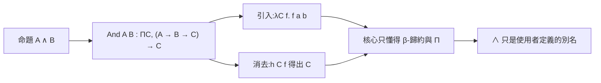

# 2.2 1934–1936 Church 演算與 Church 編碼

> 上一節的最後留下兩個問題：什麼叫「可計算」，以及「一條推理規則」該長什麼樣。1930 年代中期，Church 與 Turing 分別回答了第一個問題，而他們用的語言，恰好就是我們今天稱為 λ 演算的那個東西。本節的主線是：λ 演算如何從「可計算函數的語言」逐步長成「邏輯的語言」，以及為什麼 `lambda-cube` 敢於不內建任何連接詞。

## 2.2.1 1933–1936：Church 的 λ 演算與可計算函數

1933 年，在普林斯頓的數學邏輯討論會上，Alonzo Church 提出了一套符號系統，用來定義「λ 演算」（the lambda calculus）。Church 的目標非常明確：把「有效計算」這件事做成一個可以寫在紙上的、純粹的物件操縱。1934 年他把講義以油印本形式散發，1935–1936 年間發表與印發了關於 λ 演算與判定問題的一系列成果，其中最有名的兩篇是關於 Church–Rosser 定理與 Church 論題的工作。

λ 演算的規則少得驚人。唯一的綁定形式是 λ 抽象，唯一的主體是應用：

$$
(\lambda x . M) \, N \;\longrightarrow\; M[x := N]
$$

這個 β-歸約規則是整個系統的心跳。一個項是「一個函式應用到一個引數」的樹狀結構；β-歸約就是把樹上的一個「函式—引數」配對收攏成引數代入函式體。它沒有其他規則了：沒有內建的數字、沒有內建的布林值、沒有型別註記。

而就在這樣一個系統上，Church 定義了「λ 可定義函數」，並證明了**一階邏輯的判定問題是不可判定的**：不存在一個程序，能對任意一階邏輯公式判定其有效性。他的方法是把邏輯的有效性與 λ 演算的某種可定義性掛上鉤，再證明後者不可判定。

1936 年，Turing 在〈On Computable Numbers〉一文中用另一套裝置（他稱之為 a-machine，即今日的圖靈機）給出了同樣的結論。Turing 的做法與 Church 相反：他不去證明某個抽象系統的極限，而是去證明**任何**能夠「走紙帶」的過程都能被圖靈機模擬；因此只要證明圖靈機無法判定判定問題，就一舉壓制了所有可能的計算模型。兩人從完全不同的角度出發，卻在 1930 年代末被公認為同一件事：**Church–Turing 論題**——「可計算函數」這個直覺概念，可以由任一這兩個正式系統精確刻画。

對本書而言，重要的不是不可判定性本身，而是它確立的**方法論**：一個純粹的形式系統，只要規則是有限的、操作是機械的，它就同時（a）擁有極大的表達力，（b）擁有明確的邊界。往後所有的邏輯基礎研究都在這條張力上進行。而且注意這個張力的另一面——Church 論題說明「可判定」是過於苛刻的要求，但「可半判定」是可以達到的：只要命題成立，就有程序會停；命題不成立時，程序可能永遠跑下去。歸結法（第 2.4 節）正是一個半判定程序，而它「可能永遠跑下去」这件事，正是所有 ATP 都需要超時的原因。

## 2.2.2 從「可計算」到「邏輯」：Church 編碼

Church 的 λ 演算原本只是可計算性的語言。但它有個奇怪的本領：**它能把邏輯連接詞「定義」出來**。既然 λ 項只是樹狀結構，而 β-歸約只是樹上的代換，那麼像「合取」這種東西，就可以用一個特定的樹狀結構加上一條特定的使用慣例來表達。

最著名的例子是 Church 編碼的合取：

$$
A \wedge B \;\equiv\; \Pi C . \, (A \to B \to C) \to C
$$

這個定義的讀法是：「A 合取 B」是一個**函數**，它接受任意命題 $C$ ，以及一個把 $A$ 和 $B$ 轉成 $C$ 的函式。所以：

- **引入方向**（給定 $a : A$ 與 $b : B$ ，要證明 $A \wedge B$ ）就是造出那個函式：`λC f. f a b`。
- **消去方向**（給定 $h : A \wedge B$ ，以及一個把 $A$ 與 $B$ 轉成 $C$ 的函式 $f$ ）就是**套用**它：`h C f` 得到 $C$ 。

同樣的辦法可以定義蘊含（就是 Π 型別本身）、否定（以蘊含與 ⊥ 定義）、析取、存在量詞：

$$
A \vee B \;\equiv\; \Pi C . \, (A \to C) \to (B \to C) \to C
$$
$$
\exists x : A . \, P(x) \;\equiv\; \Pi C . \, \bigl(\Pi x : A . \, P(x) \to C\bigr) \to C
$$



**這就是整個 λ-Cube 專案的理論依據**：連接詞不必被寫死成核心的內建常數，它們可以是使用者定義的 Π 型別。核心只要懂得「Π 型別」與「β-歸約」兩件事，就自動懂得 ∧、∨、∃，而且懂得的是**使用者自己定義**的 ∧、∨、∃。

本專案把這個想法做成了程式碼。`lambda-cube/src/cube.js:243` 的範例裡，`And` 是一個普通的 `def`：

```javascript
// lambda-cube/src/cube.js:243
def And (A B : Prop) : Prop := forall (C : Prop), (A -> B -> C) -> C
def and_intro (A B : Prop) (a : A) (b : B) : And A B := fun (C : Prop) (f : A -> B -> C) => f a b
```

`Or` 與 `Ex` 同理：

```javascript
// lambda-cube/src/cube.js:244
def Or (A B : Prop) : Prop := forall (C : Prop), (A -> C) -> (B -> C) -> C
```

```javascript
// lambda-cube/src/cube.js:246
def Ex (A : Prop) (P : A -> Prop) : Prop := forall (C : Prop), (forall (x : A), P x -> C) -> C
```

注意核心程式碼 `lambda-cube/src/cube.js:5-6` 的系統表裡，沒有 `And`、`Or`、`Ex` 這三個名字：

```javascript
// lambda-cube/src/cube.js:5-6
const CUBE = { 'λ→': [], 'λ2': ['Type>Prop'], 'λP': ['Prop>Type'], 'λω_': ['Type>Type'], 'λP2': ['Type>Prop', 'Prop>Type'],
  'λω': ['Type>Prop', 'Type>Type'], 'λPω_': ['Prop>Type', 'Type>Type'], 'λC': ['Type>Prop', 'Prop>Type', 'Type>Type'] };
```

核心只有五種項節點（`V`、`Sx`、`Ap`、`Lm`、`Pi`，見 `lambda-cube/src/cube.js:7-8`），連接詞的邏輯完全由 Π 型別的形成規則承擔：

```javascript
// lambda-cube/src/cube.js:101-105
case 'p': {
  const s1 = sort(ctx, t.ty), s2 = sort([...ctx, { n: t.n, ty: t.ty }], t.b);
  if (!rules.has(s1 + '>' + s2)) throw E(`目前的系統不允許這個 Π 型別:定義域屬於 ${s1},值域屬於 $ {s2}(缺少規則 ${s1}>$ {s2}):${show(t, names(ctx))}`);
  return Sx(s2);
}
```

這四行是「Church 編碼」在工程上的全部成本。要判定一個 Π 型別合法，核心只需要知道定義域與值域各自的 sort，以及目前系統允許哪些 sort 組合（`Prop>Prop`、`Type>Prop` 之類）。至於 `And`、`Or` 是不是「真正的連接詞」，核心完全不必知道——它們只是使用者寫下的 Π 型別別名。第 5.6 節會把這個想法推到底：那裡會看到 ∧、∨、∃、⊥ 全部被定義出來，核心依然是那五種節點。

## 2.2.3 Curry–Howard 對應的歷史拼圖

Church 編碼並不是憑空出現的，它背後有一段更長的歷史——今天稱為 **Curry–Howard 對應**。這張拼圖是分幾十年、由不同的人分別放上來的：

- **1934–1935 年，Robert Fitch** 在一篇論文中嘗試把邏輯規則與類比推理（deduction as analogical reasoning）對應起來，第一次讓「命題像型別」的想法露出水面。
- **1935–1936 年，Gentzen** 的 sequent 演算（下一節的主題）在形式上已經是「命題當型別、證明當項」；只是當時沒有人這樣命名，也沒有人把它和 λ 演算連起來。
- **1938 年，Stephen Kleene** 在《Introduction to Metamathematics》中用了一種「real number of a statement」之類的說法，隱約觸及同一件事。
- **1958 年，Haskell Curry** 在〈Computability and Classical Logic〉中把邏輯公式與函數語言並列處理，並明確指出：在某些條件下，邏輯公式可以「被當作」型別來解碼。
- **1969 年，William Howard** 發表〈The formulas-as-types notion of construction〉，把 Curry 的想法形式化為一條精確的對應：命題 $A$ 對應型別 $A$ ，證明 $A$ 對應型別為 $A$ 的項，蘊含對應函式型別，合取對應積型別，析取對應和型別。並且——這是最關鍵的一半——**證明的化簡對應 β-歸約**。
- **1958 年，Böhm** 在與 Church、Kleene 合著的《Constructive Mathematics》中研究 λ 項的樹狀表示（描述符），把 λ 演算與當時正在興起的程式分析連接起來；這條線後來長成操作語義、程序分析裡的 Böhm 樹。

**為什麼這個對應是「拼圖」而不是一次發現？** 因為它需要三個成熟的概念同時到位：λ 演算（1930 年代中期）、以證明項取代推導序列的想法（1930 年代中期的 Gentzen、以及 1960 年代的 Prawitz 與 Curry–Howard），以及以型別系統取代公式系統的觀點（1960 年代末）。任何一塊缺席，「證明即程式」都只能是個類比； Curry 與 Howard 的貢獻，就是把這三塊釘在同一張圖上。

這張圖一旦釘上，就立刻產生兩個後果。第一，**邏輯規則變成了型別規則**：合取引入對應積型別的構造子，合取消去對應積的消去規則，蘊含對應函式型別。第二，**「證明對不對」變成了「項對不對型」**：一個證明是否有效，不再需要有人去「讀」它，而是可以交給一個型別檢查器。Howard 的文章正是把 Gentzen 的規則表逐條「翻譯」成型別系統的規則表，並且示範了怎麼把 α-轉換（同一個命題的不同變數命名視為相同）納入。第 2.5 節會把這次翻譯徹底做完。

## 2.2.4 1930 年代的 λ 演算為什麼「不是」依值型別

這裡要插一段歷史更正，因為它常被誤講。Church 在 1930 年代中葉引入的 λ 演算**是**有型別的——但那是非常簡單的型別：每個項都被指派一個簡單型別（simple type），型別由基礎型別與箭頭組成，箭頭不可分割、不可作為引數。這個系統足以處理 Church 論題，但表達力有限。

真正的革命發生在之後：

| 年份 | 事件 | 意義 |
|---|---|---|
| 1930 年代中葉 | Church 的簡單型別 λ 演算 | 有型別，但型別是封閉的階層，不可作為引數 |
| 1970 / 1986 | Girard 的 **System F**（1970 年論文；1986 年〈A New Formulation of System F〉） | 引進多型：型別本身可以作為引數 |
| 1986 | Coquand 與 Paulin 的 **Calculus of Constructions**（CoC） | 把多型與依值型別合在一起 |
| 1980 年代中期 | Barendregt 整理出 **λ-cube** | 把「多型 × 依值 × 遞歸型別」三個維度畫成一個立方體 |

System F 是關鍵的一步：一旦型別可以作為引數傳入，`id` 就能對任何型別取恆等函數（`lambda-cube/src/cube.js:242` 的範例正是如此）， Curry 編碼裡那些「對任意命題 $C$ 」的量化也才真正有了地位——Church 編碼本身其實就是一個 System F 層級的裝置。

CoC 則把第三個維度（依值型別）打開：型別可以**依賴於項的值**。於是 `Vec n` 這種「長度由參數決定的型別」可以被寫出來。

Barendregt 的 λ-cube 把這些維度整理成一個八格的立方體，本專案的 `lambda-cube/src/cube.js:5-6` 正是這個立方體的可執行版本：`λ→`（無維度）、`λ2`（多型）、`λP`（依值）、`λC`（多型 + 依值）……每一格的差異，被壓縮成一條規則表：

```javascript
// lambda-cube/src/cube.js:103
if (!rules.has(s1 + '>' + s2)) throw E(`目前的系統不允許這個 Π 型別:定義域屬於 ${s1},值域屬於 $ {s2}(缺少規則 ${s1}>$ {s2}):${show(t, names(ctx))}`);
```

`λ→` 的規則表是空的（除了永遠允許的 `Prop>Prop`），所以 `lambda-cube/src/cube.js:247` 那個範例——在 `λ→` 下定義 `forall (A : Prop), A -> A`——會被核心直接拒絕。這不是 bug，這是歷史的實物展示：**1930 年代的 λ 演算確實做不到這件事。**

## 2.2.5 交棒

Church 演算給了三樣東西：一個足夠小到可以完全檢查的規則系統；一個 β-歸約，提供了「化簡」這個概念；以及 Church 編碼，證明了連接詞可以是定義而非內建。

但它還缺兩樣東西，兩者都必須由 Gentzen 補上：

1. **規則的清單**。λ 演算的規則是「綁定」與「應用」，它並沒有告訴我們「一個合取命題的證明長什麼樣」。要把 λ 演算與邏輯對上，還需要知道邏輯的推理規則表——∧I、∧E、∨I、∨E、→I、→E、∀I、∀E、∃I、∃E，以及反證法的位置。這份清單在 1935 年由 Gentzen 給出。
2. **推理的方向**。λ 演算的歸約是「把一個項變成它的正規形」，方向是內斂的、确定的；而邏輯推理既可以向前推（從前提推結論），也可以向後問（給定結論，該用什麼規則）。Gentzen 的 sequent 演算给出了第一種方向，自然演繹的證明搜尋給出了第二種。

下一節進入 Gentzen 1935。那是「證明的形狀」第一次被明確畫出來的一年，也是本專案 `lean-prover/src/lean.js` 那張規則表的歷史來源。
