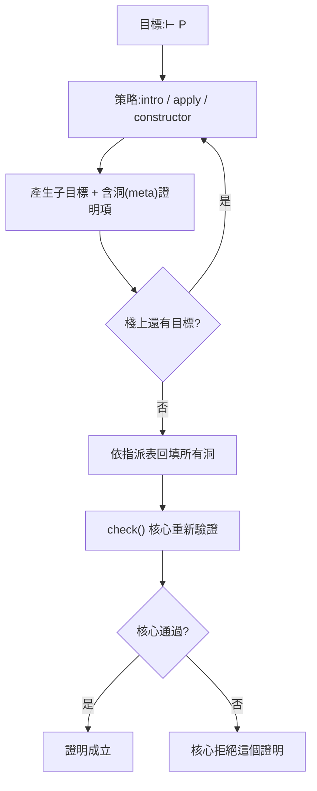

# 2.3 1935 Gentzen 自然演繹與可執行的證明

> 第 2.1 節講了綱領，第 2.2 節講了 λ 演算。兩者之間還缺一塊：綱領描述了「規則系統」，λ 演算給了「可計算的語言」，但沒有任何一份清單告訴我們，一個蘊含式的證明在型態上究竟長什麼樣。1935 年，Gerhard Gentzen 補上了這塊拼圖——他把推理的**骨架**顯式畫了出來。這一節的主題是那份骨架，以及它如何在本專案裡變成 `lean-prover/src/lean.js:84-107` 的那張規則表。

## 2.3.1 1935：從公理到「規則」

故事從直觀主義開始。Brouwer 在二十世紀初主張數學是心智的構造，直覺主義者因此不接受排中律。**Heyting 在 1930 年**把直觀主義命題邏輯公理化，給出「Heyting 代數」；此後的問題是：Heyting 的那張公理表，是否忠實地捕捉了直覺主義推理？

Hilbert 式的回答方式是「拿公理與推理模式去湊」。這個方式有兩個致命缺陷：一是難以判斷「這串公式究竟是不是某個定理的實例」，二是**無法研究「證明本身」的結構**。Gentzen 的關鍵洞見是：與其把推理模式寫成「公理 + 模式比對」，不如把每一條推理規則寫成「從哪些假設、經過哪一步、得到哪個結論」的**局部規則**。規則本身是小的、可列舉的；一個長證明是許多規則的串接。

Gentzen 1935 年完成了兩項工作（德文手稿與希臘文版本的sequent 演算分別於 1935/1936 年問世，後來有德文與英文譯本流傳）：

1. **Sequent 演算**：判斷的基本形式從「一個公式」改成「一個序列」 $\Gamma \vdash \Delta$ ，左邊是假設、右邊是待證的結論。規則是向前推的：從 $\Gamma \vdash \Delta$ 與 $\Sigma \vdash \Theta$ 推出某個新的 $\Gamma' \vdash \Delta'$ 。
2. **自然演繹（natürliches Schließen）**：以「引入了什麼假設」為線索的推理形式——一條規則若引入了一個假設，就把它記錄下來，供後續的推理使用；若用到某個假設，就把它消掉。

Gentzen 同時證明了**切割消去定理**（cut elimination，也稱 Hauptsatz）：任何證明都可以被改寫成不含切割（cut）的證明，也就是只用「邏輯規則」而不使用「把任意兩個證明拼接起來」這條超級規則。切割消去的後果極為重要：它說明邏輯規則是**完備的**——每個邏輯後承都可以只用基本規則推出來，不需要任何額外的推理機器。

Hilbert 風格與 Gentzen 風格的差異，可以用一張表說清楚：

| 面向 | Hilbert 風格 | Gentzen 風格 |
|---|---|---|
| 證明的樣子 | 一串公式，其中某些行標著「由定理 T 與前式得出」 | 每一行是一條局部規則的實例 |
| 可讀性 | 需要反覆「猜測這是哪個定理」 | 規則的形狀一目了然 |
| 機械化 | 困難：模式比對需要強大的等式判斷 | 容易：把證明項遞迴對照規則表 |
| 結構研究 | 困難 | 可證正規形、可證切割消去 |

這最後一行，正是 Gentzen 改變歷史的原因：**當證明被視為某種資料，它的形狀就能被研究**。而「證明是一種資料」這個觀點，正是 Curry–Howard 對應的另一半（第 2.5 節）。

順帶一提，Gentzen 證明的切割消去定理在技術上是相當不平凡的。它的意思是：所有推理最終都可以還原成一串「最小步驟」——引進一個假設、用掉一個假設。這與 λ 演算中的正規形定理是同一件事的兩個版本。Prawitz 在 1965 年把這件事推到了自然演繹：每一條自然演繹規則都可以有兩種讀法，**順讀**是「我從哪裡得到這個結論」，**逆讀**是「我要得到這個結論，該用哪條規則、需要哪些前提」。切割消去保證了逆讀總是可能的——這是後來所有證明搜尋演算法的理論保證。

這也解釋了一個為什麼定理證明器後來都長得差不多的原因：**證明的搜尋，就是在一棵由規則展開成的樹上做搜尋**，而切割消去（或其 Curry–Howard 版本）保證這棵樹是「完全」的：只要存在證明，就存在一條搜尋路徑可以找到它。

## 2.3.2 自然演繹的規則集

自然演繹的規則可以分兩類：引入規則（把公式「組裝」起來）與消去規則（把公式「拆開」）。完整清單如下，用與 `lean-prover/src/lean.js` 相同的符號：

| 規則 | 形式 | 說明 |
|---|---|---|
| ∧ 引入 | 從 $A$ 與 $B$ 得 $A \wedge B$ | 把兩個證明組成一個 |
| ∧ 消去 | 從 $A \wedge B$ 得 $A$ （或 $B$ ） | 拆出其中一半 |
| ∨ 引入 | 從 $A$ 得 $A \vee B$ | 左支／右支皆可 |
| ∨ 消去 | 從 $A \vee B$ 、 $A \to C$ 、 $B \to C$ 得 $C$ | **兩支必須得出同一個 $C$ ** |
| → 引入 | 從 $A$ （作為假設）與 $B$ 得 $A \to B$ | 假設必須在結論中被用掉 |
| → 消去 | 從 $A \to B$ 與 $A$ 得 $B$ | 又稱 modus ponens |
| ∀ 引入 | 從 $A$ 得 $\forall x . A$ | **變數不得出現在任何未消去的假設中** |
| ∀ 消去 | 從 $\forall x . A$ 與項 $t$ 得 $A[t/x]$ | 即「實例化」 |
| ∃ 引入 | 從 $A[t/x]$ 得 $\exists x . A$ | 必須提供見證 |
| ∃ 消去 | 從 $\exists x . A$ 與 $A \to C$ 得 $C$ | **分支用的變數必須是新鮮的** |
| ⊥ 消去 | 從 $\bot$ 得任何 $A$ | 直覺主義允許 |

其中加粗的三個「側條件」（∨ 消去的兩支同結論、∀ 引入的變數不外洩、∃ 消去的變數新鮮）是整個系統最容易出錯、也最值得被機器檢查的地方。本專案把它們寫成了核心的三個檢查：

```javascript
// lean-prover/src/lean.js:94
case 'orE': { const o = need(C(p.p), 'or', '∨ 消去'), a = C(p.a, [...ctx, [p.x, o.l]]), b = C(p.b, [...ctx, [p.y, o.r]]); return eq(a, b) ? a : bad('∨ 消去的兩個分支結論不同'); }
```

```javascript
// lean-prover/src/lean.js:99-101
case 'allI': { if (ctx.some(([, f]) => fv(f).has(p.v))) bad(`變數 ${p.v} 出現在假設中,不能一般化`); return { t: 'all', v: p.v, f: C(p.p) }; }
case 'allE': { const a = need(C(p.p), 'all', '∀ 消去'); return sub(a.f, a.v, p.t); }
case 'exI': return eq(C(p.p), sub(p.f, p.v, p.t)) ? { t: 'ex', v: p.v, f: p.f } : bad('∃ 引入的見證不吻合');
```

```javascript
// lean-prover/src/lean.js:102-106
case 'exE': {
  const e = need(C(p.p), 'ex', '∃ 消去'), r = C(p.q, [...ctx, [p.h, sub(e.f, e.v, { v: p.x })]]);
  if (fv(r).has(p.x) || fv(e).has(p.x) || ctx.some(([, f]) => fv(f).has(p.x))) bad(`變數 ${p.x} 不夠新`);
  return r;
}
```

請注意這幾行的結構特徵：**每一條規則都是一個 `case`，每一條規則都回傳它所證明的公式**，而公式的形狀檢查（`need(...)`）與側條件檢查都在同一個函式裡完成。這就是「規則表 = 型別系統」的第一個具體版本：核心從證明項**推導**出它證明了什麼命題。

順帶說明「反證法的位置」。在直觀主義邏輯裡，從 $\bot$ 可以推出任意命題（⊥ 消去），但**雙重否定消去** $\neg\neg A \to A$ 不可推導。而 `lean-prover/src/lean.js:98` 的 `dne` 規則正是那條古典規則：

```javascript
// lean-prover/src/lean.js:98
case 'dne': { const f = need(C(p.p), 'imp', '反證'); return f.r.t === 'bot' && f.l.t === 'imp' && f.l.r.t === 'bot' ? f.l.l : bad('反證需要 ¬¬A'); }
```

它在核心裡是一條**額外的規則**，而不是內建推論。這是一個很值得學習的設計選擇：古典性不必藏進每個規則裡，只要被明確標示為一條額外的規則，就能被移除、被檢查、被討論。第 6.3、6.4 與 8.2 節會回頭處理這個選擇的代價。

## 2.3.3 推理的方向：從向前推到向後問

Gentzen 的 sequent 演算規則是**向前推**的：給定前提，推出更多結論。但人在做數學時，實際思維方向恰恰相反——我們通常**從結論出發**，問「要證明這個，最後一步可以用什麼規則？需要哪些前提？」

這個方向的反轉，是 1960 年代的另一項成果。**Prawitz 在 1965 年**發表的自然演繹分析，把「證明的檢驗」與「證明的搜尋」明確區分開來，並指出：**如果一個證明以正規形書寫，那麼它的規則序列可以機械地反轉過來，得到一個搜尋程序**。這是自然演繹第一次被證明「可被機器執行」。

於是 1960 年代末出現了一個關鍵組合：Prawitz 的證明搜尋（1965）+ Curry–Howard 對應（Curry 1958、Howard 1969）= **目標導向的證明器**。用一句話說：把命題 $A$ 當成一個型別，把「證明 $A$ 」當成「造一個 $A$ 的項」，那麼證明策略就退化成一條條「造項」的規則，而「造不出來」的問題就退化成一串待解的型別。

本專案 `lean-prover/src/lean.js` 的策略層正是這個樣子：**一個目標棧**加上一組把目標換成新目標的策略。

```javascript
// lean-prover/src/lean.js:130-133
const g = S.goals[0]; if (!g) throw new Error('已經沒有目標了');
const { ctx, f } = g, M = x => ({ r: 'meta', id: x.id });
const solve = (pf, gs = []) => { S.assign[g.id] = pf; S.goals = [...gs, ...S.goals.slice(1)]; };
const ng = (c, f2, v = g.vars) => S.mk(c, v, f2);
```

四行說明了一切：`S.goals[0]` 是「目前要解決的目標」；`solve(pf, gs)` 把一個**含洞的證明項**指派給目標，並把新產生的子目標壓進棧頂；`M(x)` 就是那個「洞」——一個指向尚未完成子目標的佔位符。整個迴圈是：



最後兩步是本專案的關鍵設計：**策略只負責「產生」，核心負責「驗收」**。

## 2.3.4 為什麼策略與核心的分工在 1935 年還沒定型

這裡要誠實地指出歷史的界線。1935 年的 Gentzen 手上只有一個**檢查器**（規則表），沒有**搜尋器**。方向反轉的搜尋程序要到 Prawitz 1965 才出現；而「把證明的搜尋結果做成一個可被獨立檢查的資料結構」這個想法，還需要 Curry–Howard 提供型別系統的框架、以及 de Bruijn 提供處理變數綁定的方法（第 2.5 節）。

換句話說，下面這個分工在 1935 年是做不到的：

> 一個「證明項」的資料結構，其中每個節點標明自己用的是哪條推理規則；而檢查器只做遞迴的形狀比對，完全不需要知道策略是怎麼想的。

原因是三個技術障礙：

1. **命題與證明的表示**。1935 年的公式是以名字（字母）標記變數的。當證明項裡出現綁定時，「這個 $x$ 指的是哪個 $x$ ？」需要一個 α-等價與變數捕獲的機制——`lean.js` 用名字加啟發式換名（`lean-prover/src/lean.js:66-76` 的 `sub()`）來處理，這是個過渡方案；de Bruijn 索引才是徹底的解法。
2. **證明的序列 vs 證明的項**。Prawitz 的搜尋產生的是一個規則序列；要把序列變成可獨立檢查的「項」，需要 Curry–Howard 那一層。
3. **檢查器與搜尋器的信任邊界**。沒有 Curry–Howard，「檢查一個證明項」和「搜尋一個證明」使用的是同一套規則，但在資料結構上尚未分離。

所以本節的結論是：**1935 年 Gentzen 給出了規則的骨架，1960 年代補上了方向與資料結構，1990 年代（透過 Lean、Coq 等系統）才定型成今天「小核心 + 大策略」的可信核架構。** 本專案直接採用最後一種形態。

## 2.3.5 「證明可被機器執行」的後果

一旦證明可以被機器執行，就立刻出現一個新的責任問題：**錯誤從哪裡被抓住？**

在自然演繹的框架下，有兩種完全不同的錯誤，必須由兩個不同的地方負責：

- **錯誤的證明腳本**：使用者寫了一行不合法的策略，例如在一個不是 $\exists$ 的目標上用 `exists`。這是「腳本層」的錯誤，必須由**策略層**擋下，而且要擋得友善——告訴你目標是什麼、為什麼不能用這個策略。
- **錯誤的證明項**：腳本本身合法，但產生的證明項在核心檢查時發現形狀不對。這是「數學層」的錯誤，必須由**核心**擋下。

本專案把這個區分做成了兩種不同的失敗回報。策略層的失敗是 `Error` 例外：

```javascript
// lean-prover/src/lean.js:136
const is = (t, m) => { if (f.t !== t) throw new Error(`${name} 不適用:目標是 ${fm(f)}${m || ''}`); };
```

核心的失敗則是另一個 `Error`，而且訊息前綴不同：

```javascript
// lean-prover/src/lean.js:82
const bad = m => { throw new Error('核心檢查失敗:' + m); };
```

而在 `runThm()` 的最外層，兩者被分流到不同的狀態：策略失敗記在 `errors`，核心失敗記成 `status = 'kernel'`：

```javascript
// lean-prover/src/lean.js:206-212
if (failed) return r;
if (S.goals.length) { r.status = 'open'; return r; }
try {
  const pf = inst(S.assign[g0.id], S.assign), fl = {};
  if (!eq(check(pf, ctx, fl), F)) throw new Error('核心推出的命題與宣告不符');
  r.status = fl.sorry ? 'sorry' : 'done'; r.term = sx(pf);
} catch (e) { r.status = 'kernel'; r.detail = e.message; }
```

**兩種錯誤必須被分開，因為它們的後果不同。** 策略錯誤只是「你還沒證完」；核心錯誤是「你以為證完了，但它不是」。第 3 章會把這個區分發揚成完整的策略語義；第 7.5 節會說明如何用測試去證明「核心必須拒絕偽造證明」。

## 2.3.6 交棒

Gentzen 解決了「規則骨架」的問題，Prawitz 與 Curry–Howard 解決了「方向與資料結構」的問題。但還有一個問題沒有解決：**如果完全不想自己寫證明呢？**

自然演繹要求人給出思路、機器驗證。對於某些領域——尤其是等式理論與組合問題——人給思路的成本遠高於讓機器自己找。於是 1930 年代的 Herbrand 思想在 1960 年代被 Robinson 發展成一整套反駁程序，成為第二條技術路線。

下一節我們轉向 Robinson 1965。那是一篇只有十幾頁的論文，但它把「證明存在」重新表述成「子句集可飽和」，從此把自動定理證明變成了一個可以不停產出成果的工程領域。
