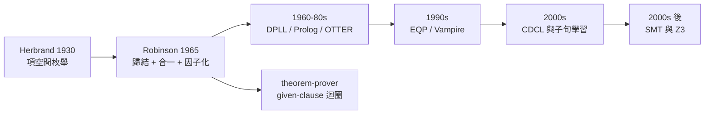

# 2.4 1959–1965 Robinson 歸結原理與 Herbrand 定理

> 上一節說自然演繹要求「人給思路、機器驗證」。但有一整類問題——等式理論、組合問題、群論代數——人給思路的成本遠高於讓機器自己找。1930 年 Herbrand 留下一個「只要有程序就行」的保證，1965 年 Robinson 把那個程序壓縮成一條規則。本節的主題是：**Herbrand 的「項空間枚舉」如何被 Robinson 的「歸結」取代**，以及「可證」如何被重新表述成「子句集可飽和」。

## 2.4.1 1930：Herbrand 定理

1930 年，Jacques Herbrand 在巴黎大學的碩士論文《Recherches sur la théorie de la démonstration》（後來以《Actualités Scientifiques et Industrielles》單行本出版）中處理了一個看似平凡的問題：**一個只含全称量詞的公式集，是否可滿足？**

關鍵在於「只含全称量詞」：對這樣的公式集，每一個原子式的真值只取決於它身上那些項的**形狀**。把這個觀察推到極致，就得到 **Herbrand 宇宙**——給定一組函數符號與常數符號 $T$ ，用它們組成的所有有限項構成的集合。記 $C$ 為其中的常數符號集合，則

$$
H(T) \;=\; \bigcup_{n \ge 0} T_n, \qquad T_0 = C, \quad T_{n+1} = \{\, f(t_1,\dots,t_k) \mid f \in T,\ t_1,\dots,t_k \in H(T) \,\}
$$

一個全称公式 $F$ 的所有**基礎實例**（ground instance），就是把其中每個全称量詞的變數替換成 $H(T)$ 裡某個項所得的那些公式；這個實例集合叫做 **Herbrand 展開**。Herbrand 定理說：

> 若公式集 $S$ 的 Herbrand 展開不可滿足，那麼存在 $S$ 的某個**有限**部分，它自己的 Herbrand 展開也不可滿足。

把定理與 Gödel 1930 年的完全性定理接起來，得到的推論就是整個自動定理證明領域的立足點：**可證 ⇔ 前提加上否定結論之後不可滿足**。

$$
\Gamma \vdash A \quad\Longleftrightarrow\quad \neg\bigl(\Gamma \cup \{\neg A\}\bigr)
$$

換句話說，**證明問題被翻譯成了可滿足性問題**。這是第 2.1 節的「綱領第三步」第一次真正兌現：「找出一個矛盾」從此有了可計算的程序。

## 2.4.2 壞消息與好消息

Herbrand 定理是一個典型的「壞消息就是好消息」的例子，值得把它兩面都說清楚。

**壞消息（就「可判定性」而言）。** $H(T)$ 通常是無限的：只要 $T$ 裡有 arity 大於零的函數符號，它就是可數無窮的。因此那個「枚舉所有項、對每個原子式試兩種真值、檢查是否所有實例都被滿足」的程序，在命題為真時**永遠不會停**。這與第 2.2 節的 Church–Turing 不可判定性完全一致；Herbrand 定理只在**純命題邏輯**（沒有函數符號）的片段上給出完整的判定程序——這正是那個片段之所以可判定的原因。

**好消息（就「自動化」而言）。** 程序存在，就意味著「證明可以被機器找到」不再只是口號。哪怕它有時不停、效率糟糕透頂，它仍然把一類此前只能由人做的問題，變成了一類**原則上可以交給機器**的問題。

這裡有一個值得記住的因果鏈：因為不可判定，所以 Herbrand 程序只能是半判定的；因為它是半判定的，所以任何以它為基礎的實作都必須回答「怎麼在程序不停下來時收場」。**不可判定性逼出了 timeout 這種工程設計**，本專案 `theorem-prover/src/prover.js:144` 的 `maxMs` 與 `maxN` 就是這條鏈的實物。

## 2.4.3 1965：Robinson 把枚舉壓縮成一條規則

1965 年，J. A. Robinson 在 *Journal of the ACM* 上發表〈A Machine-Oriented Logic Based on the Resolution Principle〉。這篇論文的影響不在於它有多長（正文十幾頁），而在於它做了一件乾淨的事：**證明 Herbrand 式的枚舉根本不必真的枚舉。**

Herbrand 程序之所以笨重，是因為它必須把每一個可能的實例都列出來。但歸結規則允許我們**一次處理所有實例**。設有兩個子句

$$
A \lor C , \qquad \neg B \lor D
$$

其中 $A$ 與 $B$ 有一個最一般合一者（most general unifier） $\sigma$ ，那麼 Robinson 的**歸結規則**給出新的子句

$$
\dfrac{A \lor C \qquad \neg B \lor D}{C \lor D\,\sigma}
$$

這是一條**健全**的規則：若前兩式皆真則後式亦真，因為 $A\sigma$ 與 $B\sigma$ 相同，一真一假時另一個必真。

規則的力量在於**方向是反的**。它不從假設推出結論，而是把兩個公式「合成一個更弱的公式」——結論式是前提式的邏輯後承，真值被保留，資訊量卻變少了。人的定理證明每一行都資訊豐富；Robinson 的證明每一行都在**丟棄資訊**，直到只剩一個矛盾。

這條規則還有兩個必要的配角，Robinson 在同一篇論文裡一併給出：

- **因子化（factoring）**：若同一子句中有兩個同號文字 $A$ 與 $B$ 可合一，則可去掉其中一個。

$$
\dfrac{A \lor B \lor C}{A \lor C\,\sigma} \qquad \sigma = \mathrm{mgu}(A,B)
$$

- **超級替換（superposition）**：處理等式的規則，把 $A = B$ 用來改寫另一個子句中出現的 $A$ （Robinson 1965 的版本；後來 Robinson 與 Wos 在 1969 年發展出的**參數替換** paramodulation 是它的後裔，本專案 `theorem-prover/src/prover.js:128-140` 的 `para()` 屬於這一系）。

加上這三條規則，Robinson 證明了**歸結的可靠性與反駁完備性**：公式集 $S$ 若不可滿足，則從 $S$ 經由歸結、因子化、超級替換可以導出**空子句**；反之，導出空子句則 $S$ 不可滿足。證明的方法正是 Herbrand 的：把歸結反覆套用到 Herbrand 展開上的所有實例，再把整個展開壓回一個有限證明。

**於是「證明」這個概念被重新表述了。** 在 Robinson 之後，「可證」不再是關於推導序列的性質，而是關於**子句集狀態**的性質：

> $S$ 不可滿足 $\Longleftrightarrow$ 從 $S$ 出發可以不斷衍生新子句，直到導出空子句。

這就是「反駁法」（refutation）的全部內容，也是 `theorem-prover` 這個專案的全部內容。

## 2.4.4 「可飽和」：反駁法的程序化

Robinson 證明中最容易被工程文獻略過的一句話是：**歸結程序會停在某個「不再產生新子句」的狀態上，那個狀態叫做飽和（saturated）。**

程序因此有一個非常簡單的形狀：

1. 起始子句集 = 前提子句 $\cup$ 否定結論子句；
2. 不斷選一對子句，套用歸結／因子化／超級替換，把新子句加入集合；
3. 若某個新子句是空子句 → **證明成功**；
4. 若集合不再增加新子句（飽和）→ **結論確實不是前提的後承**；
5. 若資源耗盡（時間／子句數）→ **不知道**。

第 4 步與第 5 步的區分是整個 ATP 工程學的起點。**飽和是可以信的「不可能」；超時不是。** 這個區別不是文字遊戲，而是**邏輯地位**的區別：前者是定理級的否定命題（給定這套公理，結論不成立），後者只是知識的空白。任何把兩者混為一談的實作都是錯的。本專案把三種結局分成三個明確的狀態字串：

```javascript
// theorem-prover/src/prover.js:189-197
  function fin(status) {
    const steps = [];
    if (empty) {
      const seen = new Set(), st = [empty.id];
      while (st.length) { const id = st.pop(); if (!seen.has(id)) { seen.add(id); st.push(...all[id].from); } }
      [...seen].sort((a, b) => a - b).forEach(id => steps.push({ id, text: fmtClause(all[id]), rule: fmtRule(all[id]), from: all[id].from }));
    }
    return { status, steps, generated: gen, ms: Date.now() - t0, hasGoal: !!goal };
  }
```

而結論的措辭則把「不可證」與「不知」分得清清楚楚：

```javascript
// theorem-prover/src/prover.js:204-207
const statusText = r => r.status === 'proved'
  ? `✔ ${r.hasGoal ? '證明成功' : '前提互相矛盾'}(產生 ${r.generated} 個子句,${r.ms} ms)`
  : r.status === 'saturated' ? '✘ 無法證明:子句集已飽和,結論不是前提的邏輯後果'
  : '… 超過時間或子句數上限,結果未知';
```

## 2.4.5 對照程式碼：量化子必須被消掉

現在來看本專案的實作。第一個觀察是：**歸結法的前置條件比自然演繹嚴苛得多。** 自然演繹的規則表可以對任意公式形狀運作（`lean-prover/src/lean.js:84-107` 裡有 `allI` 、 `exE` 等等），但歸結只能在**子句**上運作。所謂子句，就是「文字的析取」，文字必須是**無量詞的原子式或它的否定**。

要把一階公式變成子句集，必須依序做三件事：**否定內移 → Skolem 化 → 分配律展開**。第一步是把否定推到最裡面：

```javascript
// theorem-prover/src/prover.js:50-59
function nnf(f, pos) {
  switch (f.t) {
    case 'atom': return pos ? f : { t: 'not', f };
    case 'not': return nnf(f.f, !pos);
    case 'and': case 'or': return { t: (f.t === 'and') === pos ? 'and' : 'or', l: nnf(f.l, pos), r: nnf(f.r, pos) };
    case 'imp': return nnf({ t: 'or', l: { t: 'not', f: f.l }, r: f.r }, pos);
    case 'iff': return nnf({ t: 'and', l: { t: 'imp', l: f.l, r: f.r }, r: { t: 'imp', l: f.r, r: f.l } }, pos);
    default: return { t: (f.t === 'all') === pos ? 'all' : 'ex', v: f.v, f: nnf(f.f, pos) };
  }
}
```

注意 `nnf(f, pos)` 的 `pos` 參數：`pos = false` 時不是「產生否定」，而是「產生否定正規形」。這個寫法讓 `nnf` 呼叫兩次就同時得到 NNF 與 NNF 的否定，否定結論時不必在 AST 上另設「否定節點」的處理路徑。

第二步是 Skolem 化：**存在量詞必須被消掉**，而且是被一個**新函數符號**消掉：

```javascript
// theorem-prover/src/prover.js:60-67
function skolem(f, env, us) {
  switch (f.t) {
    case 'all': { const v = fresh(); return skolem(f.f, { ...env, [f.v]: { v } }, [...us, { v }]); }
    case 'ex': return skolem(f.f, { ...env, [f.v]: { f: 'sk' + (++skn), a: us } }, us);
    case 'and': case 'or': return { t: f.t, l: skolem(f.l, env, us), r: skolem(f.r, env, us) };
    default: { const a = f.t === 'not' ? f.f : f; return { t: 'lit', s: f.t !== 'not', n: a.n, a: a.a.map(x => sub(x, env)) }; }
  }
}
```

全称量詞的處理方式很特別：它**不是**被消掉，而是被換成一個**自由變數**（`{ v }`），並用 `us` 這個「已經出現的全称變數清單」記住它。存在量詞則被換成一個函數，其引數就是到目前為止出現過的全称變數（`{ f: 'sk1', a: us }`）——這正是 Skolem 函數的標準定義。

**為什麼這個差異如此重要？** 全称變數在子句裡保持自由，於是它可以在**推導過程中**被合一實例化——這正是 Herbrand 空間被「壓縮」成合一的地方；而存在量詞一旦被 Skolem 函數取代，就固定成一個項，不再被推導改變。**量化子必須被消掉（或被降級成自由變數）這件事，決定了整個資料結構必須是扁平的子句集**：一個子句就是一個文字陣列，文字則是「符號名 + 參數項陣列」。

第三步是分配律展開成合取範式：

```javascript
// theorem-prover/src/prover.js:68-74
function cnf(f) {
  if (f.t === 'lit') return [[f]];
  const L = cnf(f.l), R = cnf(f.r);
  if (f.t === 'and') return L.concat(R);
  const o = []; for (const a of L) for (const b of R) o.push(a.concat(b)); return o;
}
const clausify = f => cnf(skolem(nnf(f, true), {}, []));
```

`cnf()` 的遞迴形狀值得停下來看：它回傳的是「子句的陣列的陣列」，`and` 對應串接、`or` 對應交叉相乘；`clausify()` 則把三個步驟串成一條管線。注意順序**不可交換**：必須先 NNF，才能 Skolem 化（Skolem 化要在否定次正規形裡辨認量詞）；必須先 Skolem 化，才能 CNF（變數替換要在量詞還在的時候做）。

對照一下：`lean-prover/src/lean.js` 的公式是一棵保留結構的樹（`{ t: 'and', l, r }`），因為自然演繹的規則可以對樹的任何位置運作；`theorem-prover/src/prover.js` 的公式是一個扁平的文字陣列，因為歸結的規則只能作用在「析取」的層級上。第 2.1 節說過「連接詞集合必須小且明示」，這裡要補一句：**規則能作用在什麼形狀上，決定了資料結構能長什麼樣**。

## 2.4.6 合一：歸結的心跳

歸結規則的每一步都在問同一個問題：兩個原子式能不能變成同一個？這個問題的演算法就是**合一（unification）**，Robinson 1965 論文裡的合一演算法是本專案 `theorem-prover/src/prover.js:79-86` 的直接原型：

```javascript
// theorem-prover/src/prover.js:77-86
const walk = (t, s) => { while (isV(t) && s[t.v]) t = s[t.v]; return t; };
const occ = (v, t, s) => { t = walk(t, s); return isV(t) ? t.v === v : t.a.some(x => occ(v, x, s)); };
function unify(a, b, s) {
  a = walk(a, s); b = walk(b, s);
  if (isV(a)) { if (isV(b) && a.v === b.v) return s; return occ(a.v, b, s) ? null : { ...s, [a.v]: b }; }
  if (isV(b)) return unify(b, a, s);
  if (a.f !== b.f || a.a.length !== b.a.length) return null;
  for (let i = 0; i < a.a.length && s; i++) s = unify(a.a[i], b.a[i], s);
  return s;
}
```

三個設計點：

1. **`walk()` 是解算器的正規化步驟。** 綁定表 $s$ 是一張「變數 → 項」的映射，`walk()` 沿著映射一路追到底，避免出現 $x \mapsto y \mapsto t$ 這種鏈式綁定。
2. **occurs check。** `occ()` 檢查變數 $v$ 是否出現在將被綁定到它的項之內。若 $x$ 被綁定成含 $x$ 的項（例如 $x \mapsto f(x)$ ），則不存在最一般合一者。這種項是無窮的，`unify()` 必須拒絕它，否則 Herbrand 空間的枚舉會發散。
3. **失敗以 `null` 表示，成功以綁定表表示。** 這個慣例在整個檔案裡一致：合一失敗就是 `null`，不 throws。

**合一與匹配的區別**也值得在此點名：`unify()` 是**對稱**的（兩邊都可以被綁定），`match()` 則是**單向**的（只有模式端可以被綁定）：

```javascript
// theorem-prover/src/prover.js:98-103
function match(p, t, s) { // 單向匹配:只綁定 p 的變數
  if (isV(p)) { const b = s[p.v]; return b ? (ts(b) === ts(t) ? s : null) : { ...s, [p.v]: t }; }
  if (isV(t) || p.f !== t.f || p.a.length !== t.a.length) return null;
  for (let i = 0; i < p.a.length && s; i++) s = match(p.a[i], t.a[i], s);
  return s;
}
```

`match()` 服務的是**包含（subsumption）**判斷，也就是剪枝用的「 $C$ 是否比 $D$ 弱」。因為「包含」是「 $C$ 的某個實例等於 $D$ 」，方向必須是單向的： $D$ 的變數不能被綁定。用 `unify()` 會判斷錯方向——那問的是「 $C$ 與 $D$ 是否可合一」，是另一個問題。

## 2.4.7 `prove()`：given-clause 迴圈與 timeout 的工程學

把所有零件組起來，就得到 Robinson 的搜尋程序。本專案把它寫成一個 **given-clause 迴圈**——每一輪選一個子句當作給定子句，去和其它子句配對：

```javascript
// theorem-prover/src/prover.js:160-186
  while (!empty) {
    if (!passive.length) return fin('saturated');
    if (Date.now() - t0 > maxMs || gen > maxN) return fin('timeout');
    let bi = 0; for (let i = 1; i < passive.length; i++) if (passive[i].w < passive[bi].w) bi = i;
    const g = passive.splice(bi, 1)[0]; active.push(g);
    const news = [];
    for (let i = 0; i < g.lits.length; i++) for (let j = i + 1; j < g.lits.length; j++) { // 因子化
      if (g.lits[i].s !== g.lits[j].s) continue;
      const s = unifyL(g.lits[i], g.lits[j], {});
      if (s) news.push([g.lits.filter((_, k) => k !== j).map(x => applyL(x, s)), 'factor', [g.id]]);
    }
    for (const l of g.lits) { // 等式歸結:消去 t != t'
      if (l.s || l.n !== '=') continue;
      const s = unify(l.a[0], l.a[1], {});
      if (s) news.push([g.lits.filter(x => x !== l).map(x => applyL(x, s)), 'eqres', [g.id]]);
    }
    for (const h of active) { // 二元歸結與等式替換
      const hl = h === g ? ren(g.lits) : h.lits;
      para(g.lits, hl, g.id, h.id, news); para(hl, g.lits, h.id, g.id, news);
      for (const a of g.lits) for (const b of hl) {
        if (a.s === b.s) continue;
        const s = unifyL(a, b, {}); if (!s) continue;
        news.push([[...g.lits.filter(x => x !== a), ...hl.filter(x => x !== b)].map(x => applyL(x, s)), 'resolve', [g.id, h.id]]);
      }
    }
    for (const [l, r, f] of news) { accept(l, r, f); if (empty) break; }
  }
```

這個迴圈有五個值得拆開看的設計：

1. **`active` 與 `passive` 兩個集合。** `passive` 是等待被選中的子句，`active` 是已被選中過、可拿來與新子句配對的子句。兩者分離是效率上的關鍵：給定子句只和 `active` 配對，避免同一對子句被重複處理。
2. **加權選擇。** `w` 是子句中所有文字的字串長度總和，迴圈挑**最短**的那個。「優先處理小子句」在實務上非常有效：小子句變數少、合一成功率高、產生的新子句也小。1980 年代的 ATP 幾乎都用類似的權重函數。
3. **因子化在迴圈內部處理**（`factor`），因為它是「一個子句與自己」的運算；二元歸結與等式替換則是「兩個子句之間」的運算。Robinson 的規則表裡三條規則是平級的，但實作裡時機不同。
4. **變數必須分開（apartness）。** 歸結規則要求兩個母式子句的變數互不重疊，否則「 $A$ 與 $B$ 可合一」會把兩個公式的變數混在一起。本專案讓每個被接受的子句都經過 `norm()` 裡的 `ren()` 取得全局新鮮的變數名，並在自我配對時額外 `ren()` 一次。
5. **剪枝。** `accept()` 會丟棄被既有子句包含的新子句，並用 `prune()` 刪掉被新子句包含的舊子句。

```javascript
// theorem-prover/src/prover.js:146-154
  const prune = (arr, c) => { for (let i = arr.length; i--; ) if (arr[i].lits.length >= c.lits.length && subsumes(c.lits, arr[i].lits)) arr.splice(i, 1); };
  const accept = (lits, rule, from) => {
    const l = norm(lits); if (!l) return null;
    for (const c of active.concat(passive)) if (c.lits.length <= l.length && subsumes(c.lits, l)) return null;
    const c = { id: ++nid, lits: l, rule, from, w: l.map(ls).join('').length };
    all[c.id] = c; prune(active, c); prune(passive, c); passive.push(c); gen++;
    if (!l.length) empty = c;
    return c;
  };
```

`accept()` 裡還藏著一個容易忽略的機制：**空子句的偵測**。`if (!l.length) empty = c;`——文字數為零的子句就是矛盾本身，它的出現就是成功訊號。`empty` 一旦被設定，`while (!empty)` 迴圈立刻結束，`fin()` 還會沿著 `from` 欄位回溯，把「哪些子句推導出哪些子句」整理成一條可讀的推導鏈（`theorem-prover/src/prover.js:191-194`）。**這個回溯功能是把「找到矛盾」變成「展示矛盾」的關鍵**：一個 ATP 若只能說「成功了」而不能說「如何成功」，輸出價值會掉一半。

最後是反駁法的入口。結論是被**否定**後加入子句集的：

```javascript
// theorem-prover/src/prover.js:156-158
  const items = premises.map(s => load(s, 'premise'));
  if (goal) { const g = load(goal, 'negated goal'); items.push({ f: { t: 'not', f: g.f }, rule: g.rule }); }
  for (const { f, rule } of items) for (const c of clausify(f)) accept(c, rule, []);
```

三行，三個關鍵決定：前提各自成為子句；結論被包成否定；每個公式再被 `clausify()` 壓成子句。**整個反駁法的全部機關，就在「把否定結論丟進子句集」這一步。**

## 2.4.8 血緣：從 DPLL 到 CDCL 再到 SMT

Robinson 1965 不是孤立的事件。它是一條線上的中段，而這條線的前後兩端今天都還在跑。

| 年份 | 事件 | 與歸結的關係 |
|---|---|---|
| 1960 | Davis 的機器判定程序、Putnam 的 MIT 論文、Logemann 的 IBM 報告 | 命題邏輯的子句化搜尋，即 DPLL 的雛形 |
| 1962 | Davis、Putnam、Logemann、Davis 在 *CACM* 發表同名短文 | 把命題層的程序化推到實用 |
| 1965 | Robinson 的 *JACM* 論文 | 一階歸結、合一、因子化、超級替換 |
| 1970 年代 | Prolog 採用合一作為核心機制（Colmerauer、Kowalski 一系） | 合一從定理證明流入邏輯程式語言 |
| 1980 年代 | 大型 ATP 出現（OTTER 一系）、等式推理成熟、參數替換改良 | 反駁法進入工業規模 |
| 1990 年代 | EQP、Vampire 等，以及「高階邏輯」方向 | 反駁法與推理規則分流 |
| 2000 年前後 | CDCL 與子句學習成為 SAT 求解的主流 | 衝突解釋本身就是歸結式的推導 |
| 2000 年代後 | SMT（Z3 等）：CDCL 加上等式理論與其他理論的求解器 | 歸結血統與模型論血統合流 |

這條線最值得說明的一點是 **CDCL 的子句學習**。現代 SAT 求解器遇到矛盾時，會從決策樹回溯出一串「衝突解釋」——那正是從衝突點往下的一串**歸結推導**：每一步把兩個文字配對、消去一個、得到更短的子句。整個衝突解釋就是一個歸結證明，只是方向被反轉（由衝突往回推到某個決策點）。

所以「歸結」在 1960 年代是定理證明器的主引擎，在 2000 年代是 SAT 求解器的底層機制。**它的兩端都是「把兩個公式合成一個更弱的公式」。**



順帶說明本專案 `theorem-prover` 在這張圖上的位置：它站在 Robinson 那一格，把 1965 年的三條規則、Herbrand 的概念，以及 1960 年代的「加權選擇 + 包含剪枝」策略，放進一個不到兩百行的檔案裡。它沒有等式理論的完整正確性（第 4.7 節會說明 `para()` 的侷限），也沒有 SMT 的理論求解器，但它的**核心迴圈**與 1965 年的論文字面上是同一個東西。

## 2.4.9 與第 2.3 節對照：方向相反，目標相同

把本節與上一節並排，可以得到一張對照表：

| 面向 | 自然演繹（Gentzen 1935 / Prawitz 1965） | 歸結法（Robinson 1965） |
|---|---|---|
| 規則方向 | **向前推**：從前提推導出結論 | **反向**：從否定結論出發，把子句越合成越弱 |
| 完备性的來源 | 切割消去定理 | Herbrand 定理 + 歸結的健全性 |
| 資料形狀 | 保留結構的公式樹 | 壓平的子句集（文字陣列） |
| 量詞 | 留在規則裡（`allI` 、 `exE`） | 必須先被消掉（Skolem 化） |
| 誰提供想法 | 人 | 機器 |
| 失敗的樣子 | 目標解不掉 | 飽和（真的不行）或超時（不知道） |
| 對應程式 | `lean-prover/src/lean.js` | `theorem-prover/src/prover.js` |

表中最重要的一列是**規則方向**。Gentzen 的規則把資訊**加進**證明：從 $\Gamma \vdash \Delta$ 推出更多結論。Robinson 的規則把資訊**減掉**：兩個子句合成一個。**方向相反，但兩者都在縮小問題**——自然演繹縮小的是「待證明的目標」，歸結法縮小的是「待飽和的子句集」。

還有一個更深的對稱值得記住：**機器找得到的證明**與**機器驗得過的證明**，在 λ 項這個共同的物件上接上了頭——Robinson 的完整性證明正是靠把矛盾**還原**成一個自然演繹證明，而第 2.5 節的 Curry–Howard 則是說：自然演繹的證明項就是 λ 項。

## 2.4.10 交棒

本節留下三樣東西：

1. **一個可以跑的半判定程序**，以及它必然帶來的「飽和／超時」二分；
2. **一個資料結構決定**：量化子必須被消掉，所以公式必須被壓成扁平的子句集；
3. **一個可以說清楚的失敗**：不是「證不出來」，而是「子句集已飽和」。

但歸結法有兩個它自己解決不了的問題。第一，**它只會破壞，不會建設**：它能把前提打成矛盾，卻不能把零散的定理「拼」成漂亮的形式證明。第二，**它要求公式被壓成子句**，而壓縮本身會損失結構：Skolem 化與分配律展開都讓公式難以閱讀。

有沒有一種方法，既保留公式的結構、又能讓機器檢查？Church 與 Gentzen 都已經給出了線索，但還差最後一塊拼圖：**怎麼把「證明」變成不含名字、只含索引的資料結構**，以及**怎麼把「證明正確」變成「型別相符」**。下一節的 de Bruijn 與 Curry–Howard，正是這最後兩塊拼圖。

## 延伸閱讀

- Jacques Herbrand，《Recherches sur la théorie de la démonstration》，巴黎大學碩士論文，1930（1931 年以 *Actualités Scientifiques et Industrielles* 出版）。
- J. A. Robinson，〈A Machine-Oriented Logic Based on the Resolution Principle〉，*Journal of the ACM* 第 12 卷第 1 期，1965，頁 23–41。
- Martin Davis、Hilary Putnam、George Logemann、Warren Davis，〈A Machine-Oriented Logic Based on the Resolution Principle〉，*Communications of the ACM* 第 5 卷第 10 期，1962，頁 521–532（Robinson 沿用了這篇短文的題名；DPLL 程序的早期文獻）。
- Martin Davis，〈A Program for the Machine-Resolution of First Order Theorems〉，1960 年 Princeton AI Project 備忘錄（DPLL 程序的原始文獻之一）。
- John Harrison，《Handbook of Practical Logic and Automated Reasoning》，Cambridge University Press，1993（第 3 章「Herbrand's theorem」與第 4 章「Resolution」是本節兩個主題的現代處理）。

## 下一節

第 2.5 節：**1960–1990 de Bruijn 索引、Curry–Howard 與 Martin-Löf 類型論**。

我們將看到：怎麼用「索引」取代「名字」，讓 α 等價從此不必處理；怎麼把「命題」翻譯成「型別」、「證明」翻譯成「項」；以及為什麼 1980 年代末三條路線會在 λ 演算這個共同物件上會合——那正是 `lambda-cube` 存在的理由。
