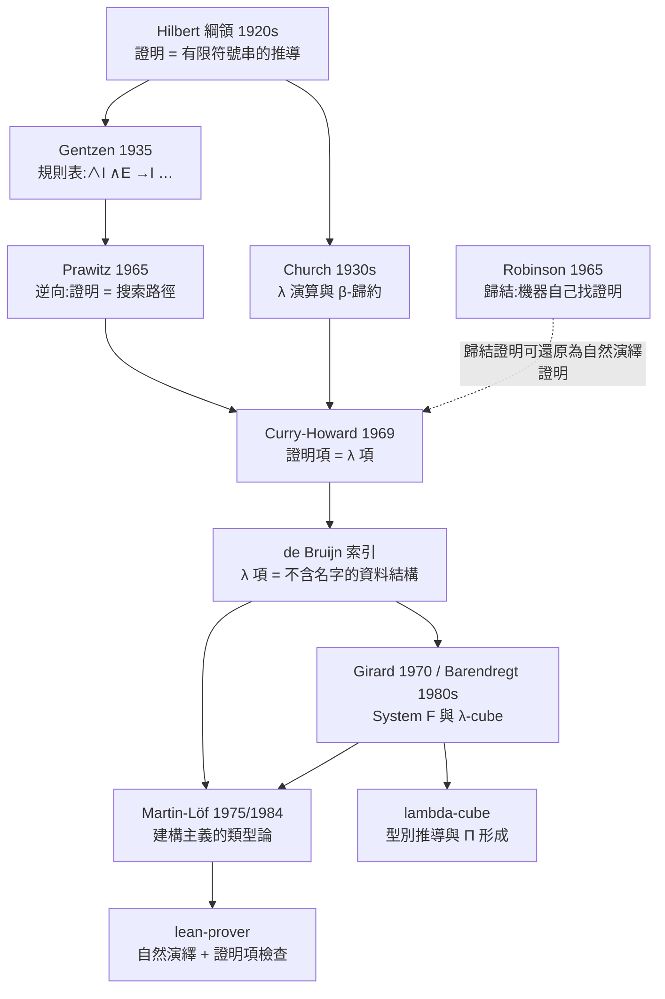

# 2.5 1960–1990 de Bruijn 索引、Curry–Howard 與 Martin-Löf 類型論

> 上一節結束於兩塊拼圖：**怎麼把「證明」變成不含名字、只含索引的資料結構**，以及**怎麼把「證明正確」變成「型別相符」**。這兩塊拼圖分別由 de Bruijn 與 Curry–Howard 在 1940–1960 年代補上，並在 1970–1980 年代由 Martin-Löf、Girard、Barendregt 揉成一個完整的體系。本節的主題是：這條線如何走完，以及**為什麼三個程式最後可以住進同一個 codebase**。

## 2.5.1 1940–1960 年代：de Bruijn 索引

1930 年代的 λ 演算把變數用**名字**標記：綁定寫成 $\lambda x . M$ ，而 $\lambda x . M$ 與 $\lambda y . M[y/x]$ 在意義上相同、但在字面上不同。這件事叫 **α 等價**，而它的代價在機器上非常具體：**核心必須自己去判斷兩個項是否 α 等價**，而且在把一個項代入另一個項時，必須小心不要發生**變數捕獲**。

N. G. de Bruijn 的解法非常暴力：乾脆不要名字。1940 年代中期發表於荷蘭數學年報的〈Compositions of Groups〉中的〈Lambda Calculus Notation〉一章，首次把綁定寫成**索引**——一個數字，意思是「往外數第幾個綁定」；這些文章在 1968 年被收進同名專著《Compositions of Groups》出版。

| 名字寫法 | 索引寫法 | 說明 |
|---|---|---|
| $\lambda x . x$ | $\lambda . 0$ | 索引 0 指向最近的綁定 |
| $\lambda x . \lambda y . x$ | $\lambda . \lambda . 1$ | 索引 1 越過 $\lambda y$ 指回 $\lambda x$ |
| $\lambda x . \lambda y . y$ | $\lambda . \lambda . 0$ | 索引 0 指向最近的綁定 $\lambda y$ |
| $\lambda x . y$ （ $y$ 自由） | $\lambda . 1$ | 自由變數的索引以「越過所有綁定」為基準 |

這張表說明了 de Bruijn 索引的全部要義：**一個變數的身分不再由它的名字決定，而由它「距離最近的綁定有幾層」決定。** 於是 α 等價變成**字面相等**：兩個項只要形狀一樣、索引一樣，就是同一個項，不需要任何額外處理。

代價則是三個額外的操作：**移位（shift）**、**代入（subst）**、**實例化（inst）**。本專案 `lambda-cube/src/cube.js:10-15` 把它們寫得極為精簡：

```javascript
// lambda-cube/src/cube.js:10-15
const shift = (t, d, c = 0) => t.k === 'v' ? (t.i >= c ? V(t.i + d) : t) : t.k === 'a' ? Ap(shift(t.f, d, c), shift(t.a, d, c))
  : bind(t) ? { k: t.k, n: t.n, ty: shift(t.ty, d, c), b: shift(t.b, d, c + 1) } : t;
const subst = (t, j, s) => t.k === 'v' ? (t.i === j ? s : t) : t.k === 'a' ? Ap(subst(t.f, j, s), subst(t.a, j, s))
  : bind(t) ? { k: t.k, n: t.n, ty: subst(t.ty, j, s), b: subst(t.b, j + 1, shift(s, 1)) } : t;
const inst = (b, a) => shift(subst(b, 0, shift(a, 1)), -1);
const uses = (t, j = 0) => t.k === 'v' ? t.i === j : t.k === 'a' ? uses(t.f, j) || uses(t.a, j) : bind(t) ? uses(t.ty, j) || uses(t.b, j + 1) : false;
```

四行裡藏著三個必須理解的規則：

1. **`shift` 的守門條件 `t.i >= c`。** 移位是「把某個深度以上的變數編號全部加上 $d$ 」，而 `c` 就是「從哪一層開始算」。走進一個綁定子句時 `c` 遞增（`shift(t.b, d, c + 1)`），因為在綁定子句內部，索引 0 指向的是**新**綁定，不該被移位。
2. **`subst` 的 `shift(s, 1)`。** 把項 $s$ 塞進綁定子句的體內時， $s$ 裡的每個自由變數都因為「多穿過了一層」而必須加一。**這就是變數捕獲問題的解法**：名字方案裡要靠「偵測衝突 → 改名 → 重算」，索引方案裡只要「加一」。
3. **`inst` 是 `subst` 加 `shift` 的合成**：先做 `shift(a, 1)` 把引數的自由變數推深一層，再 `subst(b, 0, ...)` 替換掉最深層的綁定，最後 `shift(..., -1)` 把整體推回來。

**名字只在兩個地方出現：解析與顯示。** 解析器把使用者寫的名字換成索引：

```javascript
// lambda-cube/src/cube.js:47
    const i = ns.lastIndexOf(x); if (i >= 0) return V(ns.length - 1 - i);
```

顯示器再把索引換回名字：

```javascript
// lambda-cube/src/cube.js:21
    case 'v': return ns[ns.length - 1 - t.i] ?? '#' + t.i;
```

**核心從來不需要知道名字。** 這就是「α 等價從此不需要處理」的真正含義：不是「我們寫了一個更聰明的 α 等價判定器」，而是「我們讓 α 等價變成字面相等」。核心的相等判定因此簡單到一眼看完：

```javascript
// lambda-cube/src/cube.js:82-90
  const conv = (a, b) => {
    a = whnf(a); b = whnf(b); if (a.k !== b.k) return false;
    switch (a.k) {
      case 'v': return a.i === b.i; case 's': return a.s === b.s; case 'c': return a.n === b.n;
      case 'a': return conv(a.f, b.f) && conv(a.a, b.a);
      case 'l': case 'p': return conv(a.ty, b.ty) && conv(a.b, b.b);
    }
    return false;
  };
```

`case 'v': return a.i === b.i;` 這一行，就是 de Bruijn 索引的全部收益。

**對照本專案的另一個程式，這個對比會非常清楚。** `lean-prover/src/lean.js` 走的是名字路線，因為它必須處理自然語言寫成的命題：

```javascript
// lean-prover/src/lean.js:54-57
const kt = (t, e) => t.v !== undefined ? (e[t.v] || 'v:' + t.v) : t.f + '(' + t.a.map(x => kt(x, e)).join(',') + ')';
const key = (f, e = {}, d = 0) => f.t === 'bot' ? '⊥' : f.t === 'atom' ? f.n + '(' + f.a.map(t => kt(t, e)).join(',') + ')'
  : f.t === 'all' || f.t === 'ex' ? f.t + '.' + key(f.f, { ...e, [f.v]: '#' + d }, d + 1) : f.t + '(' + key(f.l, e, d) + ',' + key(f.r, e, d) + ')';
const eq = (a, b) => key(a) === key(b);
```

這三行是**用字串鍵實作的 α 等價**：`key()` 把量化符綁定的變數換成 `'#' + d`（`d` 是綁定深度），因此 `forall x. P(x)` 與 `forall y. P(y)` 會得到同一個鍵。代價是每次比較都要重新算鍵、每次代換都要重新編碼。

而 `lean-prover/src/lean.js:71-73` 則是名字路線最著名的痛處——**變數捕獲的處理**：

```javascript
// lean-prover/src/lean.js:71-73
    let v = f.v, b = f.f;
    if (fvt(u).has(v)) { const bad = new Set([...fvt(u), ...fv(f.f), x]); let n = v; while (bad.has(n)) n += "'"; b = sub(b, v, { v: n }); v = n; }
    return { t: f.t, v, f: sub(b, x, u) };
```

替換一個項進去之前，先偵查有沒有撞名，撞了就用加撇號的方式改名（`x` → `x'` → `x''`），然後**整棵子樹重新代換**。這段程式碼是可以運作的，但它是**權宜之計**：de Bruijn 索引用三個純函式（`shift` 、 `subst` 、 `inst` ）徹底消除了這個問題。第 5.7 節會把兩種做法並排比較，這裡先記住結論：**名字方案的代價，是把「α 等價」與「變數捕獲」變成核心必須自己處理的問題。**

## 2.5.2 Curry–Howard：命題即型別、證明即項

第 2.2 節已經交代過 Curry–Howard 對應的歷史拼圖（Fitch 1934、Curry 1958、Howard 1969）。這裡要做的是把它**形式化**，並指出它為什麼是一個工程上的轉捩點。

Howard 1969 年的〈The formulae-as-types notion of construction〉做的事情，可以總結成一句話：

> 把命題 $A$ 看成型別 $A$ ；把「證明 $A$ 」看成「造出一個型別為 $A$ 的項」；把每一條邏輯規則看成對應的型別規則。

於是規則表有了固定形狀：

| 邏輯 | 型別 | 說明 |
|---|---|---|
| 命題 $A$ | 型別 $A$ | 兩者是同一件事 |
| 證明 $A$ | 項 $a : A$ | 證明就是一個值 |
| $A \to B$ | $A \to B$ | 蘊含就是函式型別 |
| $A \wedge B$ | $A \times B$ | 合取就是積型別 |
| $A \vee B$ | $A + B$ | 析取就是和型別 |
| 從 $A$ 與 $B$ 得 $A \wedge B$ | `pair a b` | 引入 = 構造子 |
| 從 $A \wedge B$ 得 $A$ | `fst p` | 消去 = 投影 |
| 從 $A$ 得 $A \to B$ | `λh. ...` | 蘊含引入 = λ 抽象 |
| 從 $A \to B$ 與 $A$ 得 $B$ | `f a` | 蘊含消去 = 應用 |

**這個表最重要的後果只有一句：檢查一個證明是否正確，等價於檢查一個項的型別是否相符。** 前者是「讀一串推導，看每一步有沒有犯錯」；後者是「跑一個型別檢查器」。前者需要理解語意，後者只需要比對形狀。第 2.3 節講過「策略只負責產生、核心只負責驗收」，而 Curry–Howard 正是這個分工得以成立的**理論依據**：證明項是一種資料結構，而「這個資料結構證明了什麼」可以由核心**遞迴推導**出來。

本專案把這件事做了兩次，兩次的方式不同，但骨架完全一樣：

```javascript
// lean-prover/src/lean.js:89
    case 'andI': return { t: 'and', l: C(p.a), r: C(p.b) };
```

```javascript
// lambda-cube/src/cube.js:101-105
      case 'p': {
        const s1 = sort(ctx, t.ty), s2 = sort([...ctx, { n: t.n, ty: t.ty }], t.b);
        if (!rules.has(s1 + '>' + s2)) throw E(`目前的系統不允許這個 Π 型別:定義域屬於 ${s1},值域屬於 ${s2}(缺少規則 ${s1}>${s2}):${show(t, names(ctx))}`);
        return Sx(s2);
      }
```

前者回傳「這條規則證明了哪個命題」，後者回傳「這個 Π 型別的 sort 是什麼」。**兩者都是「從項的形狀推出它的意義」**，只是前者推的是命題、後者推的是型別。這不是巧合：它們是同一個函數在兩套記號下的樣子。

## 2.5.3 Martin-Löf：建構主義的類型論

1969 年的 Howard 論證已經足夠說明 Curry–Howard 對應在技術上成立，但它沒有回答一個哲學問題：**這個對應是「真的」，還是只是一個方便的類比？**

Per Martin-Löf 在 1970 年代的演講與講義中回答了這個問題。他的〈Intuitionistic Type Theory: A Short Introduction〉最早以講義形式於 1975 年流通，修訂版在 1984 年問世。他在其中的立場是：**直觀主義數學可以被建構在一個帶有 Π 型別與歸納型的類型系統之上，而這個系統的規則就是建構的規則本身。**

這與第 2.1 節的 Hilbert 綱領形成了一個尖銳對照。Hilbert 綱領說「數學可以被形式化，然後我們用電腦檢查形式化」；Martin-Löf 說「**數學就是那個類型系統的項**，而檢查型別就是檢查數學」。命題不再是關於世界的陳述，而是**一個等待被填上的洞的型別**；證明不再是論證，而是**一個把洞填滿的項**。

Martin-Löf 系統還帶來一個後來影響深遠的區分：**命題與型別不是一回事**。有些型別只有一個居民（「至多一個」），有些型別有很多居民（「至少零個」），前者在邏輯上扮演命題的角色，後者不是。這個區分在今天的 Lean 與 Coq 裡以 `Prop` 與 `Type` 的形式存在，而本專案 `lambda-cube/src/cube.js` 也內建了 `Prop` 與 `Type` 兩個 sort：

```javascript
// lambda-cube/src/cube.js:97
      case 's': if (t.s === 'Prop') return Sx('Type'); throw E('Type 沒有型別(λ-cube 的最頂層)');
```

這一行就是「命題可以當型別用，但型別本身沒有型別（除非允許宇宙階層）」的精確表述。第 8.1 節會回頭討論宇宙階層的缺失。

## 2.5.4 Girard 的 System F、CoC 與 Barendregt 的 λ-cube

Curry–Howard 對應只給出了「命題即型別」。要讓它承載真正的數學，還需要更多。1970–1980 年代的三項成果把這張圖補滿：

- **Girard 的 System F。** Girard 在 1970 年的巴黎第七大學博士論文中引入了**多型**：型別本身可以作為引數傳入。這篇論文也同時發展了依值型別的雛形（ $\lambda\pi$ ）。System F 的關鍵論文〈A new formulation of System F〉收在 Springer 的 *Lecture Notes in Mathematics* 第 782 卷（1981）。有了多型，「對任意命題 $C$ 」這種 Church 編碼裡的量化才有了地位（第 2.2 節的 `And` 定義正是如此）。
- **Coquand 與 Paulin 的 Calculus of Constructions（1986）。** 把多型與依值型別合在一起，得到「型別可以依賴於項的值」的系統：於是 `Vec n`（長度由參數決定的型別）可以被寫出來。
- **Barendregt 的 λ-cube 整理（1980 年代中期，代表作是 1984 年的《The Lambda Calculus: Its Syntax and Semantics》）。** 把「多型 × 依值 × 型別的型別」三個維度畫成一個立方體，八個頂點就是八個系統。

本專案 `lambda-cube/src/cube.js:5-6` 的系統表，正是這個立方體的可執行版本：

```javascript
// lambda-cube/src/cube.js:5-6
const CUBE = { 'λ→': [], 'λ2': ['Type>Prop'], 'λP': ['Prop>Type'], 'λω_': ['Type>Type'], 'λP2': ['Type>Prop', 'Prop>Type'],
  'λω': ['Type>Prop', 'Type>Type'], 'λPω_': ['Prop>Type', 'Type>Type'], 'λC': ['Type>Prop', 'Prop>Type', 'Type>Type'] };
```

這張表值得逐條讀懂，因為**每個字串的意義是可解釋的**。核心的 Π 形成規則只問兩個問題：定義域的 sort 是什麼、值域的 sort 是什麼：

```javascript
// lambda-cube/src/cube.js:101-105
      case 'p': {
        const s1 = sort(ctx, t.ty), s2 = sort([...ctx, { n: t.n, ty: t.ty }], t.b);
        if (!rules.has(s1 + '>' + s2)) throw E(`目前的系統不允許這個 Π 型別:定義域屬於 ${s1},值域屬於 ${s2}(缺少規則 ${s1}>${s2}):${show(t, names(ctx))}`);
        return Sx(s2);
      }
```

而 `rules` 集合裡的字串就是「允許的 sort 組合」：

| 組合 | 意義 | 對應的 λ-cube 維度 |
|---|---|---|
| `Prop>Prop` | 命題可以作為引數，得到命題 | 每個系統都有（`runScript` 裡它是預設項） |
| `Type>Prop` | **型別**可以作為引數，得到命題 | 多型（λ2 那一維） |
| `Prop>Type` | **命題**可以作為引數，得到型別 | 依值（λP 那一維） |
| `Type>Type` | 型別可以作為引數，得到型別 | 宇宙階層（λω 那一維） |

於是八個系統名稱的含義一目了然：`λ→` 什麼都不准（只有 `Prop>Prop`）；`λ2` 開了 `Type>Prop`；`λP` 開了 `Prop>Type`；`λω_` 只開 `Type>Type`；`λP2` = 多型 + 依值；`λω` = 多型 + 宇宙；`λPω_` = 依值 + 宇宙；`λC` 三者全開，也就是 CoC 所在的頂點。命名上帶 `_` 的那幾格是「拿掉了 `Type>Prop` 方向」的版本。

**換句話說：λ-cube 的八個系統，被壓縮成一張兩欄的規則表。** 這是第 2.1 節「規則能作用在什麼形狀上，決定了資料結構能長什麼樣」的又一例證：立方體的八個格子，在程式裡是八個字串。

## 2.5.5 型別推論 vs 型別檢查

在結束本節之前，有一個技術區分必須說清楚，因為它直接決定了 `lambda-cube/src/cube.js` 為什麼可以那麼小。

- **型別檢查（type checking）**：給定項 $t$ 與型別 $A$ ，判斷 $t : A$ 是否成立。這是**判定問題**——答案只有「是」或「不是」。
- **型別推論（type inference）**：給定項 $t$ ，求出它的型別 $A$ 。這是**求解問題**——而且答案可能不唯一。

對簡單型別 λ 演算，Hindley 與 Milner（1969 / 1982）證明了每個可定型項都有唯一的**最一般型別**（principal type），於是推論可以做成一個以合一為核心的演算法——**這正是第 2.4 節的合一再次出現的地方**：Hindley–Milner 的推論器本質上就是一個合一器。

但 System F 沒有最一般型別：它的型別引數是 **impredicative** 的（可以出現在自己的型別參數位置），推論器因而無法用有限次合一把一個未知的型別變元算出來。換句話說，**System F 的型別推論在一般情形下做不到**，必須靠註解把型別告訴機器。

這就是 `lambda-cube` 的核心只需要一個 `infer()` 的原因，而且理由是疊加的：

1. **命題全在 `Prop`。** 命題邏輯裡沒有「值的型別」這種東西，所以不會出現「要推出高階型別」的難題。
2. **隱含引數少。** 每個 λ 抽象都顯式寫出參數與型別，沒有 Haskell 那種由上下文決定的隱含引數。
3. **宣告處已給出型別。** `def` 、 `theorem` 、 `axiom` 全部要求先寫 `名稱 : 型別`，所以核心永遠不需要「猜」一個未知的型別。

```javascript
// lambda-cube/src/cube.js:208-214
      } else {
        const q = parser(body, [], G), { name, bs, ty } = head(q), pis = wrap(Pi, bs, ty);
        if (kind === 'def') {
          q.ex(':='); const val = wrap(Lm, bs, q.term());
          K.sort([], pis); if (!K.conv(K.infer([], val), pis)) throw new Error('定義的內容與宣告的型別不吻合');
          if (!q.done()) throw q.err('語法錯誤:多餘的符號'); G[name] = { ty: pis, val };
        } else { if (!q.done()) throw q.err('語法錯誤:多餘的符號'); K.sort([], pis); G[name] = { ty: pis }; }
```

看 `def` 那一行：`K.infer([], val)` 算出值的型別，`K.conv(...)` 把它和宣告的型別比對。**這是「檢查」，不是「推論」**——宣告的型別是已知的前提，核心只是在問「這兩者是否相等」。

即使在策略層，`exact` 與 `apply` 也都遵循同一模式：

```javascript
// lambda-cube/src/cube.js:134-138
    case 'exact': {
      const t = prs(arg), ty = K.infer(ctx, t);
      if (!K.conv(ty, g.ty)) throw new Error(`exact 的型別不吻合:\n  得到 ${show(ty, ns)}\n  需要 ${show(g.ty, ns)}`);
      return solve(t);
    }
```

`infer()` 之所以看起來像推論，是因為它必須**算出引數的型別**才能與函數期望的型別比較（`cube.js:107-112` 的應用規則）。但這個「算出」永遠是在一個已經宣告好的語境裡做的，所以它退化成一種帶著期望型別的檢查。**系統 F 的註解要求，在這裡被轉嫁給了語法層：使用者必須寫出型別，核心就不必推論。**

## 2.5.6 三線會合

現在可以把三條線畫在同一張圖上了。



圖中最關鍵的一條線是 **Gentzen → Prawitz → Curry–Howard** 這條鏈：Gentzen 給了規則表，Prawitz 把它倒過來變成搜索程序，Curry–Howard 說明這個搜索程序產生的東西**就是 λ 項**。於是：

- 自然演繹的**證明項**就是 λ 演算的**項**；
- λ 演算的 **β-歸約**就是證明的**化約**（把一個用不到的假設消掉、把一個蘊含消去換成應用）；
- 因此**檢查一個證明**就是**檢查一個 λ 項的型別**。

這條線的終點是一個非常好用的工程命題：**「證明是否正確」這個問題，被完全轉化成了「型別是否相符」這個問題。** 而後者是可以在幾百行裡寫完、並且可以逐行檢查的。

於是本專案的三個程式共享同一個骨架：

| 程式 | 規則骨架 | 資料結構 | 誰給想法 |
|---|---|---|---|
| `lean-prover` | Gentzen 的自然演繹 | 保留結構的公式樹 + 帶洞的證明項 | 人 |
| `theorem-prover` | Robinson 的歸結 | 扁平的子句集 | 機器 |
| `lambda-cube` | Curry–Howard 的型別規則 | 不含名字的 λ 項（de Bruijn 索引） | 人（由核心驗證） |

**三個程式能放在同一個 codebase 裡，理由不是它們在做同一件事，而是它們在做同一件事的不同的刻度。** 第 7.2 節會把 `check()` 與 `infer()` 這兩個核心並排放在一起比較，那時這張圖會再具體一次。

## 2.5.7 交棒

本節留下三樣東西：

1. **一個不需要名字的資料結構**（de Bruijn 索引），讓 α 等價與變數捕獲從核心裡消失；
2. **一個把邏輯與程式設計接起來的形式化**（Curry–Howard + Martin-Löf），讓「證明正確」變成「型別相符」；
3. **一個立方體**（Barendregt 的 λ-cube），把多型、依值與宇宙三個維度整理成八個可執行的系統。

但有一個問題還沒解決，而它是下一整章的主題：**規則表已經有了，資料結構也已經有了，那麼「找到一個證明」這件事要怎麼讓機器去做？**

第 2.3 節提到過 Prawitz 的逆向閱讀，第 2.4 節看到 Robinson 用歸結讓機器自己找矛盾。但**互動式**的證明搜索——目標棧、策略、可填補的洞——是另一種工程問題：它不是「一次找完」，而是「一步一步陪著使用者走」。

下一章就去看 `lean-prover/src/lean.js` 的策略層怎麼做這件事。

## 延伸閱讀

- N. G. de Bruijn，〈Compositions of Groups〉中的〈Lambda Calculus Notation〉一章，1940 年代中期發表於 *Nieuw Archief voor Wiskunde*，並收於 1968 年同名專著《Compositions of Groups》，North-Holland。
- H. B. Curry，〈Computability and Classical Logic〉，收於 *Sets, Sets and Sets*（Mostowski、Robinson、Tarski 編），Cambridge University Press，1958。
- W. A. Howard，〈The formulae-as-types notion of construction〉，收於 *Contributions to Logic*（Seldin、Steel 編），North-Holland，1969。
- P. Martin-Löf，〈Intuitionistic Type Theory: A Short Introduction〉，1975 年講義；1984 年修訂版收於 *Applications of Higher Order Logics*（Weiss 編），Academic Press。
- H. P. Barendregt，《The Lambda Calculus: Its Syntax and Semantics》，Studies in Logic and Foundations of Mathematics 第 103 卷，Elsevier，1984（λ-cube 的標準出處）。
- J.-Y. Girard，〈A new formulation of System F〉，收於 *Logical Systems*，Lecture Notes in Mathematics 第 782 卷，Springer，1981。

## 下一節

第 3 章：**互動式證明助手：自然演繹的策略引擎**。

第 2 章走完了理論線：從 Hilbert 綱領到 Robinson 的歸結，再到 Curry–Howard 與 λ-cube。接下來的三章進入實作線——先看一個互動式證明助手怎麼把 Gentzen 的規則表變成一個可以一步步互動的引擎，再看歸結法自動定理證明器的內部，最後是 λ-Cube 的核心與其餘的立方體。
