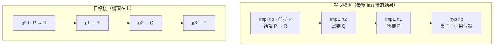

# 3.1 目標狀態機：Context、Goal 與證明項

第 2 章的最後，我們停在兩件事的交界處。一件是 1935 年 Gentzen 提出的自然演繹：證明不是「一串命題」，而是「一串推論規則的應用」，其中每一條規則都告訴你前提長什麼樣子、結論長什麼樣子。另一件是 Curry–Howard 對應：命題可以看成是型別，證明可以看成是具有那個型別的項。兩件事合起來意味著一件很實際的事——**證明是有形狀的資料結構**。

第 2 章給的是紙上的形狀：Gentzen 的 sequent $\Gamma \vdash A$ 、自然演繹的推論規則表、Church 編碼的 $\lambda$ 項。本章要回答的是更工程的一個問題：這些紙上的形狀，怎麼變成一個 243 行的 JavaScript 程式裡真的會動的資料結構？

答案藏在 `lean-prover/src/lean.js` 開頭的那段自我描述裡：

```js
/* 互動式一階邏輯證明助手 — 核心(Node 與瀏覽器共用)
   結構:解析器 → 可信核心 check()(唯一決定證明對錯的部分)→ 策略層(只負責產生證明項)→ 報告 */
```
（`lean-prover/src/lean.js:1-2`）

這四層的順序不是隨便排的，它是整個 ITP（互動式定理證明器）架構的精髓：**最靠近證明語義的地方，必須是最小、最不依賴別人的地方**。解析器只負責把字串變成樹，策略層只負責把樹填滿，只有 `check()` 真正決定「這個證明對不對」。本章先把焦點放在策略層與核心共用的那個資料結構上，也就是「目標」。

## 3.1.1 Goal 是什麼：一個四格的資料結構

在 `runThm()` 讀完 `theorem` 宣告之後，程式替整篇證明建立了一個狀態物件 `S`，裡面有三樣東西：目標棧 `goals`、洞對照表 `assign`、以及一個產生目標的工廠 `mk`：

```js
  const S = { goals: [], assign: {}, sorry: false, mk: (c, v, f) => ({ id: ++n, ctx: c, vars: v, f }) };
  const g0 = S.mk(ctx, [], F); S.goals = [g0];
```
（`lean-prover/src/lean.js:194-195`）

`mk(c, v, f)` 產生的東西就是本章的主角——**Goal**。它只有四個欄位：

| 欄位 | 型別 | 意義 |
|---|---|---|
| `id` | 數字 | 目標的唯一識別碼，用來把「洞」和「目標」配對 |
| `ctx` | `[名字, 公式]` 的陣列 | 上下文：目前可以自由使用的假設，也就是 sequent 裡的 $\Gamma$ |
| `f` | 公式 AST | 待證的命題，也就是 sequent 裡的 $A$ |
| `vars` | 名字陣列 | 目前「活著的」項變數清單，純粹為了顯示 |

`ctx` 用「名字對公式」的配對陣列而不是用物件，是一個很小但關鍵的決定：它讓「同一個名字重新綁定」變成合法而且自然的事實。自然演繹的推理常常需要引入一個和既有假設同名的中間結果，例如在 `cases` 之後把原假設的左右兩半攤平成兩個新假設。陣列保留了前後順序，所以 `look()` 從後往前找，最後綁定的同名假設會贏：

```js
const look = (ctx, n) => { for (let i = ctx.length; i--; ) if (ctx[i][0] === n) return ctx[i][1]; };
```
（`lean-prover/src/lean.js:77`）

而 `f` 是「還差什麼」，不是「已經證明了什麼」。這是整個 ITP 的樞紐，下一小節會回來說明。

`vars` 欄位看起來最沒用：它不參與任何推理規則，只出現在顯示時：

```js
const showGoal = g => [...(g.vars.length ? [g.vars.join(' ') + ' : 項'] : []), ...g.ctx.map(([n, f]) => n + ' : ' + fm(f)), '⊢ ' + fm(g.f)].join('\n');
```
（`lean-prover/src/lean.js:217`）

輸出出來是這樣：

```
y : 項
h : ∀ x, P(x) ∧ Q(x)
⊢ P(y)
```

第一行 `y : 項` 是在提醒使用者：「`y` 是個項變數（可以拿去套 `P(y)` 這種帶參數的原子命題），不是命題」。它存在的理由是：這個系統的項和命題寫法長得幾乎一樣（`P` 與 `P(x)` 都是 atom 節點），如果不明講，使用者很容易把 `y` 當成命題去 `intro` 出一個錯誤的目標。留着這個欄位，等於把「這裡有一個項變數」這個資訊一路從解析器傳到螢幕。

## 3.1.2 為什麼目標是棧，不是佇列

`tactic()` 的第一行就決定了這件事：

```js
function tactic(S, name, arg) {
  const g = S.goals[0]; if (!g) throw new Error('已經沒有目標了');
  const { ctx, f } = g, M = x => ({ r: 'meta', id: x.id });
  const solve = (pf, gs = []) => { S.assign[g.id] = pf; S.goals = [...gs, ...S.goals.slice(1)]; };
```
（`lean-prover/src/lean.js:129-132`）

策略只看 `S.goals[0]`，也就是**棧頂**；而 `solve` 做的兩件事是：把這個目標的「證明項」記在 `S.assign[g.id]`，然後用新產生的目標 `gs` 取代棧頂——注意是 `[...gs, ...S.goals.slice(1)]`，新的目標被**插到前面**。

三個理由讓棧是對的選擇：

**第一，深度優先符合證明的結構。** 一個證明項本來就是樹：先證大結論的某個部分，再處理那個部分底下的子問題。棧把「最近產生的子問題」放在最上面，於是「先做剛開的坑」變成預設行為。使用者不需要寫任何東西來表達「我要先把左邊證完」。

**第二，每個策略只作用於棧頂，讓實作變成一種單純的資料流。** 策略函式的介面被壓到極簡：讀棧頂、回報一個證明項、產生零到多個新目標。沒有「選擇哪個目標」的額外參數，也沒有目標的搜尋順序問題。第 7 章會看到，這正是 Lean 的 `Focus` 與 Coq 的「子證明焦點」機制的簡化版。

**第三，undo 的語意變得平凡。** 因為每個目標自己帶著 `id`，而 `S.assign` 是從 `id` 到證明項的對照表，所以「回到上一個狀態」不需要反轉任何東西：把棧頂丟掉、把 `assign[g.id]` 刪掉即可。這就是為什麼 `solve` 要把「舊棧頂」換成「新目標」，而不是去修改舊目標的欄位——目標是不可變的（immutable）值，每次變化都產生新的目標物件。

## 3.1.3 證明項：策略真正在做的事情

所謂「證明項」（proof term），在這個程式裡就是一棵以規則名為節點的樹。以第三章第一個範例 `syllogism` 為例，跑完之後 `runThm()` 產生的證明項是：

```
(impI hp P (impE h2 (impE h1 hp)))
```

把它展開成樹：

- 最外層 `impI`：引入假設 `hp`，命題型別是 $P \to R$ ，所以 `impI` 節點帶著兩個子節點：前提 `P` 與主體。
- 主體是 `impE h2 ...`：用 `h2 : Q \to R` 消去得到 `R`，它的第一個參數是前提證明 `h2`，第二個參數是餵給它的東西。
- 餵給 `h2` 的東西是 `impE h1 hp`：用 `h1 : P \to Q` 消去得到 `Q`。
- 葉子是 `hyp hp`：直接引用上下文裡的 `hp : P`。

這棵樹和紙上的自然演繹推導是一對一的： $\to$ 引入對應 `impI`， $\to$ 消去對應 `impE`，假設引用對應 `hyp`。Curry–Howard 的讀法也立刻成立：`impI` 是 λ-抽象，`impE` 是應用，`hyp` 是變數。

那麼策略在整個過程中到底做了什麼？只有兩件事：

**第一，填一個洞。** 證明項在剛建立的時候是「不完整的」，裡面留著 `meta` 節點：

```js
const { ctx, f } = g, M = x => ({ r: 'meta', id: x.id });
```
（`lean-prover/src/lean.js:131`）

`M(n)` 就是「指向目標 `n` 的洞」。當所有目標都被解掉，`inst()` 會拿 `S.assign` 把這些洞一一替換成真正的證明項：

```js
const inst = (p, A) => Array.isArray(p) ? p.map(x => inst(x, A)) : p && typeof p === 'object'
  ? (p.r === 'meta' ? inst(A[p.id], A) : Object.fromEntries(Object.entries(p).map(([k, v]) => [k, inst(v, A)]))) : p;
```
（`lean-prover/src/lean.js:177-178`）

**第二，產生新的目標。** 也就是「這個洞要怎麼填？需要先證明什麼？」。

這個設計把「推理」和「檢查」徹底分開了：策略是證明項的**生產者**，核心是證明項的**消費者**。策略寫錯了，結果只會是證明項形狀不對、核心回報錯誤——不可能讓一個錯誤的證明通過。第 3.3 節會把這條保證講清楚。

## 3.1.4 逆向推理：為什麼目標是「還差什麼」

比較一下兩種思維方式。

**向前推理**是：從已知出發，套用規則，得到新的事實，最後看看能不能湊出結論。Hilbert 綱領、Robinson 的歸結法（第 4 章）都是這個方向。它適合機器，因為規則可以全自動地反覆嘗試；它不適合人，因為人往往知道結論長什麼樣子，卻說不出第一步該推什麼。

**逆向推理**是：從結論出發，把結論拆成「要證它，我還需要什麼」。這正是自然演繹在紙上的樣子，也是 Lean、Coq、Isabelle 的樣子。

一個 ITP 必須支援逆向推理，原因很單純：**使用者輸入的是結論**。使用者寫

```
theorem syllogism (h1 : P -> Q) (h2 : Q -> R) : P -> R := by
```

這裡 `P -> R` 是他要證的東西。如果系統只能向前推理，使用者就得自己把整條推導展開成 `P`、`Q`、`R` 三個命題的推理鏈，然後請機器去驗證——那樣就沒有「互動」可言了。

所以 `Goal.f` 的語意是「**還差什麼**」，`ctx` 的語意是「**手上已經有什麼**」。這兩個欄位合起來，正好把 Gentzen 的 sequent $\Gamma \vdash A$ 重新解讀成一個程式語言裡的「型別判斷上下文」： $\Gamma$ 是 typing context， $A$ 是 goal type。Curry–Howard 的對應在這裡已經悄悄開始運作了。

而 `apply` 策略是這個世界觀最乾淨的表達。`apply h2` 讀成：「要證 `R`，我手上有 `h2 : Q -> R`，那還缺什麼？缺 `Q`。」——於是產生一個新目標 `⊢ Q`。目標棧從此往下長，證明項的樹從此往上長，兩者互為鏡像。



圖裡兩棵樹的節點一一對應：`impE` 對應「產生一個缺口目標」，`hyp` 對應「缺口就是上下文裡現成的假設」。策略引擎的工作，就是把右邊那列棧由下往上（由外往內）逐一消化掉，最後把左邊那棵樹填滿。

## 3.1.5 `ctx` 的不變性與遮蔽

`ctx` 是「名字 → 公式」的陣列，而策略只能**產生新陣列**，從不改寫舊的。`intro` 是 `ng([...ctx, [h, f.l]], f.r)`（lean.js:141），`cases` 是 `ng([...ctx, [a, A.l], [b, A.r]], f)`（lean.js:160）——每一次都是把舊陣列攤開，再接上新的東西。

好處是同一個名字可以在不同地方重新綁定，而 `look` 從後往前掃（lean.js:77），所以最後綁定的同名假設贏。`cases` 的效果最明顯：

```
  cases h with hp hq
      h : P ∧ Q
      hp : P
      hq : Q
      ⊢ Q ∧ P
```

原來的 `h : P ∧ Q` 還在上下文裡，同時多出 `hp` 與 `hq`——`cases` 是**追加**，不是替換。整個上下文裡可以同時有好幾個版本的名字共存：`look` 從後往前掃，所以同名時最後綁定的贏，但舊的那個並沒有從資料結構裡消失。如果 `ctx` 用的是物件（字典）而不是陣列，同名時後者會把前者直接**蓋掉**，「重綁定」就會變成一種破壞性的操作——而自然演繹裡，「先把合取攤成兩個假設」正是要靠多份上下文同時活著才成立。

遮蔽的代價是名字會撞車，所以 `intro` 在處理 `∀` 時要專門檢查新鮮性（lean.js:137 的 `fresh`、lean.js:143 的 `sub`）：公式裡的變數名有全域意義，把 `∀ x, P(x)` 改寫成 `∀ y, P(y)` 是一次真正的改寫，連帶要檢查假設裡有沒有出現那個名字。λ-cube 用 de Bruijn 索引就完全沒有這個負擔（5.4 節說過：綁定變數沒有名字，就沒有捕獲的問題）。

## 3.1.6 反事實：核心若直接執行策略

如果沒有「證明項」這個中間產物，核心就得自己跑策略：那會是一個**執行器**，而不是**檢查器**。差別不在效率，在信任邊界。

具體後果有三個。

第一，**核心無法獨立驗證**。現在 `check()` 的輸入是一棵純資料的樹，它不需要知道策略是怎麼產生的；策略有 bug 也只會產出一棵形狀不對的樹，被核心擋下來（第 3.3 節）。若核心自己跑策略，兩件事就綁死在一起，外部沒有任何東西可以重新檢查一遍。

第二，**證明項無法輸出給別人**。lean.js 的 `sx()` 把證明項印成 `(impI hp P (impE h2 (impE h1 hp)))` 這樣的字串——這正是 Lean、Coq 的 kernel 所吃的格式。第 5.1 節說「型別檢查就是證明檢查」，跨系統的對話靠的就是這個可攜的資料結構；執行器沒有東西可以輸出。

第三，**undo 會變難**。現在「回到上一個狀態」只是丟掉棧頂、刪掉 `assign[g.id]`（3.1.2 的第三個理由），因為狀態就是「目標棧 + 洞對照表」兩個純資料，不需要反轉任何東西。

順帶注意兩個專案在這裡的巧合：cube.js:165 的 `fill` 與 lean.js:177-178 的 `inst`，是同一個函數的兩份寫法——「拿洞對照表把洞換成真正的項」。這說明「證明項 + 洞」這個中間表示不是哪一個專案的發明，而是這種架構的自然結果。

## 3.1.7 小結與交接

本節把自然演繹的紙上形狀翻譯成了三個具體的資料結構：`Goal`（待證事項）、`ctx`（手上已有的東西）、以及以規則名為節點的證明項樹，並且確立了「目標是棧、策略只作用在棧頂、證明項靠填洞完成」這個骨架。

但上面提到的 `ctx` 與 `f` 裡裝的東西，一直被我們寫成「公式」。公式在程式裡究竟是什麼資料結構？`~` 這個符號進來之後會變成什麼？`A <-> B` 進來之後會變成什麼？這些問題不是實作細節，而是全書樞紐：**一旦把否定與雙條件句在解析期就展開成以 $\to$ 為核心的形狀，核心裡就只剩一種連接詞，Curry–Howard 對應才有技術上的立足點**。下一節就從 `lex()` 開始，把字串一路拆到 AST。
