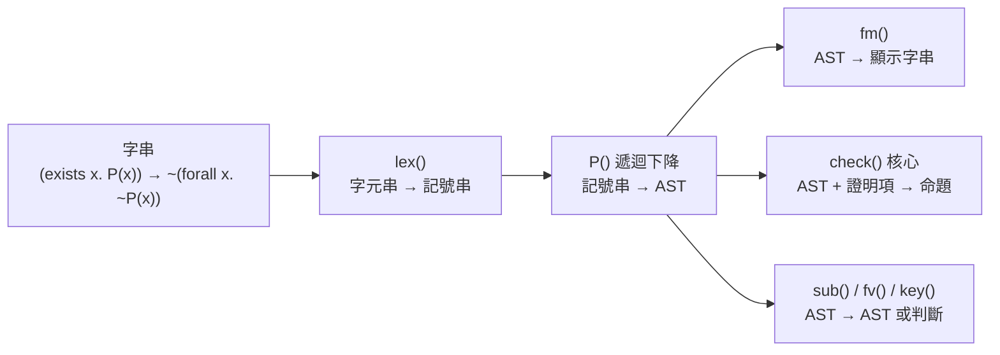

# 3.2 從字串到 AST：解析器與否定、雙條件句的展開

3.1 節末尾留下了一個問題：上下文 `ctx` 與目標 `f` 裡裝的東西，一直被我們寫成「公式」，但公式在程式裡究竟是什麼資料結構？本章從最外層開始拆：先看一個字串怎麼變成樹，再看那棵樹怎麼被核心消費。

拆解順序沿著 `lean-prover/src/lean.js` 的檔案順序：`lex()`（:7）把字元串切成記號，`P()`（:10）用遞迴下降把記號串組成樹，`fm()`（:42-51）再把樹印回人看的樣子。而這條管線裡最重要的一件事發生在 `P()` 裡：**否定與雙條件句在解析期就被展開掉了**，核心從來沒有見過它們。

## 3.2.1 管線總覽：字元串、記號串、樹

整個前端可以畫成一條單向管線：



這裡值得停下來問一句：為什麼要把「字元串」和「記號串」分成兩層？因為它們面對的問題不同。字元層要處理的是**輸入的雜訊**：使用者可能用 `∀` 或 `forall`，用 `→` 或 `->`，用 `¬` 或 `~`。記號層要處理的是**文法**：哪個記號可以跟在哪個記號後面，優先序誰高誰低。如果把兩件事混在一起寫，解析器會變成一個難以驗證的萬用字串處理器；而分成兩層之後，記號串就是一份可以直接對照 BNF 檢查的東西。

`lex()` 回傳的就是這份記號串：

```js
const lex = s => s.replace(/[∀∃¬∧∨→↔⊥]/g, c => GREEK[c]).replace(/\/\\/g, '&').replace(/\\\//g, '|').match(/<->|->|[A-Za-z_][\w']*|\S/g) || [];
```
（`lean-prover/src/lean.js:7`）

三段動作依序是：先把七個希臘字母換成 ASCII 關鍵字，再處理兩個跳脫記號，最後用一條正規表示式切出記號。

## 3.2.2 lex()：把書寫差異吸收掉

第一段的對照表是：

```js
const GREEK = { '∀': ' forall ', '∃': ' exists ', '¬': '~', '∧': '&', '∨': '|', '→': '->', '↔': '<->', '⊥': ' False ' };
```
（`lean-prover/src/lean.js:6`）

這張表值得逐項看。`∀` 與 `∃` 換成帶前後空格的 `forall`、`exists`，是為了讓它們在記號串裡不會與 `forallx` 這種識別字元黏在一起——`∀x` 必須切成 `forall`、`x` 兩個記號。`⊥` 換成帶空格的 `False`，是因為 `⊥` 沒有對應的 ASCII 短碼，而這個系統裡 `False` 已經被定義成底命題的關鍵字（:31），所以乾脆讓它走同一條路。

第二段是跳脫處理：`/\` 想表示 `&`、`\/` 想表示 `|`（Mathematica 風格的寫法）。這裡有兩個值得記錄下來的地方，因為它是「失敗也要記錄」的最好例子。

第一，**這個樣式的樣子極易被看錯**。原始碼寫的是 `.replace(/\/\\/g, '&')`，第一條規則的樣式不是「一個反斜線」，而是**斜線後面接反斜線**這兩字元的序列——正則表示式裡 `\/` 是跳脫過的斜線、`\\` 是跳脫過的反斜線。把它誤讀成「樣式只含一組跳脫反斜線」會得出完全不同的結論：前者會把 `A /\ B` 變成 `A & B`，後者則什麼也不會發生。

第二，**替換字串裡的 `&` 並不是特殊字元**。JavaScript 的 `String.prototype.replace` 只把 `$$`、`$&`、`` $` ``、`$'` 與 `$n` 視為特殊序列，裸的 `&` 就是字面的 ampersand。所以第一條規則確實在做替換，不是空操作——這一點也常被記錯。

實測（用 `eval` 直接取出原始碼的那一行來跑，避免人工轉錄的誤差）：

| 輸入 | 記號串 | 結果 |
|---|---|---|
| `P & Q` | `["P","&","Q"]` | 正常 |
| `A /\ B` | `["A","&","B"]` | 被解讀成 `A ∧ B` |
| `A \/ B` | `["A","|","B"]` | 正常 |
| `P \& Q` | `["P","\\","&","Q"]` | 多出一個反斜線記號，解析失敗 |

前兩列的跳脫寫法是刻意設計的，但 README 從來沒有提到它們，所以使用者若誤打 `/\`，公式會被**安靜地**解讀成合取——這是真正危險的地方：後者會擋住使用者，前者會讓一個意思不同的命題悄悄進入證明。第四列才是真正的缺陷：`\&` 根本不是受支援的寫法，卻留下了一個孤零零的反斜線記號，錯誤訊息是「語法錯誤:多餘的符號」，完全沒有指出真正的原因是「你用了不支援的跳脫寫法」。修正方向很清楚：把跳脫語法補進 README，或在 `lex()` 裡對落單的反斜線給一條明確的錯誤訊息。

第三段的正規表示式 `/<->|->|[A-Za-z_][\w']*|\S/g` 是整個詞彙分析器的規格書。它有四個分支，順序有意義：

| 分支 | 匹配對象 | 說明 |
|---|---|---|
| `<->` | 雙條件句 | 必須排在 `->` 前面，否則 `<->` 會被切成一堆單字元 |
| `->` | 蘊含 | 最長匹配的第二順位 |
| `[A-Za-z_][\w']*` | 識別字元 | 首字只能是字母或底線，之後可含數字與撇號（`x'`） |
| `\S` | 任何非空白字元 | 兜底分支，負責 `&`、`\|`、`~`、括號、句點 |

「兜底分支」是遞迴下降解析器的常見寫法：寧可切出來讓文法去報錯，也不要在詞彙層就偷偷丟棄。用一句話總結 `lex()` 的設計原則：**所有書寫上的選擇都在這一層收斂，之後的每一層只面對一種形狀。**

## 3.2.3 優先序階梯：iff > imp > or > and > un

`P()` 裡的文法函數就是一部優先序階梯：

```js
  const iff = () => { let l = imp(); while (T[p] === '<->') { p++; const r = imp(); l = { t: 'and', l: { t: 'imp', l, r }, r: { t: 'imp', l: r, r: l } }; } return l; };
  const imp = () => { const l = or(); if (T[p] === '->') { p++; return { t: 'imp', l, r: imp() }; } return l; };
  const or = () => { let l = and(); while (T[p] === '|') { p++; l = { t: 'or', l, r: and() }; } return l; };
  const and = () => { let l = un(); while (T[p] === '&') { p++; l = { t: 'and', l, r: un() }; } return l; };
```
（`lean-prover/src/lean.js:17-20`）

每個函式呼叫「優先序比自己低一層」的那個函式去取得左右兩個 operand，這是遞迴下降解析器的標準套路：函式的呼叫鏈本身就是優先序的宣告。`iff` 呼叫 `imp`，`imp` 呼叫 `or`，`or` 呼叫 `and`，`and` 呼叫 `un`，`un` 處理最基礎的東西（否定、量詞、括號、原子）。因此 `P & Q | R` 會被解析成 $(P \wedge Q) \vee R$ 而不是 $P \wedge (Q \vee R)$ ——`or` 呼叫 `and` 取得左 operand，右 operand 也呼叫 `and`，`&` 的結合力因此高於 `|`。

有兩個結合性決定值得注意。

**`->` 是右結合的。** `imp()` 的右邊遞迴呼叫 `imp()` 自己，所以 `P -> Q -> R` 解析成 $P \to (Q \to R)$ 。這個方向不是任意的：它正是 Curry–Howard 對應要求的樣子。在 Curry–Howard 之下， $A \to (B \to C)$ 是「先給一個 $A$ ，得到一個吃 $B$ 的函式」；而 $(A \to B) \to C$ 是「先給一個吃 $A$ 的函式」——兩者在型別論裡是**不同的型別**（前者是 $A \to B \to C$ ，後者是 $(A \to B) \to C$ ）。在紙上寫蘊含時，人們幾乎都讀右結合；但在 λ 演算裡，右結合對應的是 $\lambda x . \lambda y . t$ 的自然嵌套。如果解析器選了左結合，那麼 `P -> Q -> R` 這個字串在紙上和在機器裡就會是兩個不同的命題，整個 Curry–Howard 對應會從一開始就錯位。

**`&` 與 `|` 是左結合的**，`while` 迴圈每次把新的 operand 接在右邊。嚴格來說， $\wedge$ 與 $\vee$ 是可結合的，所以 `P & Q & R` 解析成 $(P \wedge Q) \wedge R$ 還是 $P \wedge (Q \wedge R)$ 在語意上無關紧要；這裡只是選了一個省事的寫法。

**`<->` 也是右結合的**，但方式有點特別：`iff()` 的迴圈每次把已經累積起來的 `l` 當成一個整體，重新包成 $(l \to r) \wedge (r \to l)$ 。所以 `A <-> B <-> C` 解析成 $((A \leftrightarrow B) \to C) \wedge (C \to (A \leftrightarrow B))$ 。在邏輯上這其實是正確的讀法——雙條件句本來就常被當成一個整體來做等值運算。

## 3.2.4 三個關鍵展開：核心只需要 `→`

現在到了本節的核心。`un()` 裡有三處「糖的剝除」：

```js
  const un = () => {
    const x = T[p];
    if (x === '~') { p++; return { t: 'imp', l: un(), r: BOT }; }
```
（`lean-prover/src/lean.js:22-23`）

```js
    if (x === '(') { p++; const f = iff(); expect(')'); return f; }
    const n = ident(); if (n === 'False') return BOT; if (n === 'True') return { t: 'imp', l: BOT, r: BOT };
```
（`lean-prover/src/lean.js:30-31`）

再加上 :17 的 `<->` 展開，三條規則合起來是：

| 輸入 | 展開後的 AST | 位置 |
|---|---|---|
| `~A` | $A \to \bot$ | :23 |
| `A <-> B` | $(A \to B) \wedge (B \to A)$ | :17 |
| `True` | $\bot \to \bot$ | :31 |
| `False` | $\bot$ （原樣） | :31 |

這張表是**全書的樞紐**，理由要說清楚。

一個自然演繹的核心如果同時認得 `imp`、`and`、`or`、`neg` 四種連接詞，那它就有四套引入規則與四套消去規則，核心的規則表會膨脹到二十幾個 `case`。而現在，核心只需要認得 `imp` 一種連接詞（加上 `and`、`or` 這兩種「合取與析取」的形式，因為它們在自然演繹裡是各自獨立的規則）。否定消失了，因為 `~A` 已經是 $A \to \bot$ ；雙條件句消失了，因為它已經是兩個蘊含的合取；`True` 消失了，因為它已經是 $\bot \to \bot$ 。

這不是節省幾行的程度，而是**技術前提**。第 5 章會證明 Curry–Howard 對應最乾淨的版本——命題即型別、證明即項——要求邏輯只有「蘊含」與「底」兩個基本建構：`⊥` 對應空型別（沒有任何項有那個型別），`→` 對應函數型別。如果核心裡還留著 `∧` 與 `∨`，你就得額外為它們定義「什麼是證明 $A \wedge B$ 的項」——在 Church 編碼裡那是積型別的雙重編碼，在自然演繹裡則是兩條獨立的規則，兩種做法都會讓 Curry–Howard 的對應表多出兩列解釋。

**先在解析期把糖剝掉，核心只看見糖的產物**，這是一個非常划算的取捨：解析器不是可信核心的一部分，它只是把使用者的輸入正規化；核心只面對正規形。

順帶提一句 `True` 展開成 $\bot \to \bot$ 的理由： $A \to A$ 才是邏輯學裡最常見的「真」命題，但 $A \to A$ 需要一個實際的 $A$ 才能判真偽，而 $\bot \to \bot$ 是恆真式（前提永遠推不出東西，所以永遠「不難過」），而且不依賴任何前提命題——`True` 在這個系統裡是**沒有前提的定理宣告**，不能是 $A \to A$ 的形式。 $\bot \to \bot$ 恰好滿足這個要求。

## 3.2.5 項：為什麼 `f(a,b)` 和 `x` 不是同一種東西

公式的文法到 `un()` 為止已經講完，但 `un()` 裡還有一個東西沒說清楚：原子可以帶參數。

```js
  const term = () => { const n = ident(); if (T[p] === '(') { p++; return { f: n, a: list(term) }; } return { v: n }; };
```
（`lean-prover/src/lean.js:16`）

一個**項**（term）只有兩種形狀：變數 `{ v: 'x' }`，或函數應用 `{ f: 'f', a: [...] }`。注意應用是遞迴的——`list(term)` 讓每個參數本身又是一個項，所以 `f(g(a), b)` 合法。

原子公式則是 `{ t: 'atom', n: 'P', a: [項, ...] }`。所以 `P(x)` 是「名為 P、帶一個項參數 x 的原子」，`P` 是「名為 P、沒有參數的原子」。

這個設計有一個刻意的簡化：**系統不區分謂詞符號與函數符號**。`P` 和 `f` 都是識別字元，差別只在於出現在「原子名的位置」還是「項的位置」。這在語法上省事，但要注意它帶來的一個歧義：在一階邏輯裡 `P(x)` 中的 `x` 必須是個項，而項可以是函數應用，所以 `P(f(a,b))` 完全合法。

更值得注意的是 `list()` 這個小函式：

```js
  const list = f => { const a = [f()]; while (T[p] === ',') { p++; a.push(f()); } expect(')'); return a; };
```
（`lean-prover/src/lean.js:15`）

它要求括號必須閉合，而且用 `expect(')')` 給出「語法錯誤:預期 ")"」的訊息。這個嚴格性在互動式系統裡很重要：使用者打錯一個括號，系統必須立刻在**正確的位置**報錯，而不是讓錯誤往下滲透成一個語意上的奇蹟。`err()` 的設計也一樣，它會把錯誤位置前後三個記號印出來：

```js
  const err = m => new Error(`${m}(附近:${T.slice(Math.max(0, p - 3), p + 1).join(' ') || '結尾'})`);
```
（`lean-prover/src/lean.js:12`）

這是「錯誤訊息也是介面的一部分」這個原則的具體實踐。第 3.4 節會看到策略層用同樣的態度處理錯誤。

## 3.2.6 fm()：顯示層是文法的鏡像

有了 AST 之後還需要把它印回來，因為使用者要看的目標是公式而不是 JSON。`fm()` 就是文法的反方向：

```js
function fm(f, q = 0) {
  switch (f.t) {
    case 'bot': return 'False';
    case 'atom': return f.n + (f.a.length ? '(' + f.a.map(pt).join(', ') + ')' : '');
    case 'imp': return f.r.t === 'bot' ? (f.l.t === 'bot' ? 'True' : '¬' + fm(f.l, 4)) : par(fm(f.l, 2) + ' → ' + fm(f.r, 1), q > 1);
    case 'or': return par(fm(f.l, 2) + ' ∨ ' + fm(f.r, 3), q > 2);
    case 'and': return par(fm(f.l, 3) + ' ∧ ' + fm(f.r, 4), q > 3);
    default: return par((f.t === 'all' ? '∀ ' : '∃ ') + f.v + ', ' + fm(f.f, 0), q > 0);
  }
}
```
（`lean-prover/src/lean.js:42-51`）

參數 `q` 是「呼叫端要求的優先序門檻」，每一層用不同數字把自己的子式往內推：蘊含的左 operand 用門檻 2、右 operand 用門檻 1；合取的左右分別用 3 與 4；析取的左右用 2 與 3。子式印出來的優先序**比呼叫端低**時才加括號。這正是解析器優先序階梯的鏡像。

`fm()` 還做了一件解析器不做的事：把剝掉糖的結果**裝回去**。`imp` 那個 `case` 裡的三層判斷是：右邊是 $\bot$ 而且左邊也是 $\bot$ → 印成 `True`；右邊是 $\bot$ 而左邊不是 → 印成 `¬` 加上左邊；否則是正常的蘊含。換言之 `~P` 進去、`¬P` 出來，`True` 進去、`True` 出來。

**這裡有一個真實的顯示不對稱，值得當作練習。** `imp` 的分支裡，否定是直接字串拼接 `'¬' + fm(f.l, 4)`，**否定本身沒有被括起來**。好消息是內層的門檻是 4，所以 `~(P & Q)` 會印成 `¬(P ∧ Q)`、`~(forall x. P(x))` 會印成 `¬(∀ x, P(x))`——這兩種都沒問題。

**問題出在反過來的方向**：當否定是別的連接詞的 operand 時，它不會被括起來。`~P & Q` 的 AST 是 $({\neg P}) \wedge Q$ ，`fm()` 卻把它印成 `¬P ∧ Q` 。而按照慣例讀法，人們通常把 `¬P ∧ Q` 讀成 $\neg(P \wedge Q)$ ——**意思正好相反**。使用者若照著顯示的樣子理解目標，就會寫出對錯誤命題有效的策略，然後被核心回一句「型別不吻合」，完全不知道問題出在哪裡。

把 `fm()` 與解析器並排看，就會得到本章最重要的一條工程教訓：**parser 與 formatter 必須是同一份文法的兩個方向，它們是彼此的規格。** 這裡解析器認得 `~` 的優先序最高（在 `un()` 裡），`fm()` 也認得（它認得「右邊是 $\bot$ 就是否定」），但兩者對「否定作為 operand 時要不要加括號」的處理不一致：解析器知道 `~` 的作用域只到下一個原子或括號群為止，formatter 卻不知道，於是同一個 AST 可以被印出兩種讀法的字串。**這類 bug 極難被察覺，因為錯誤訊息會指向完全無辜的地方。**

練習：修改 `fm()`，讓否定作為連接詞的 operand 時也加上括號（例如讓 `imp` 分支在 `f.l` 本身是否定時印成 `¬(A)` 形式，或改用一個能記住「這一層印的是否定的主體」的額外參數），並確認解析器與 formatter 對每一個公式都給出互逆的結果。

## 3.2.7 對照預告：Church 編碼走的是另一條路

本章描述的「展開」策略，在第 5 章會遇到一個對手。

第 5 章要處理的是同一個問題——如何讓一個核心只認得最少的連接詞——但用的是完全不同的辦法。λ-Cube 走的不是**展開**（把 $\neg A$ 定義成 $A \to \bot$ 的展開式），而是**Church 編碼**（把 $\neg A$ 定義成一個真正的型別 $\Pi \alpha . \alpha \to \bot$ ，把 $A \wedge B$ 定義成 $\Pi \alpha . (A \to \alpha \to B) \to \alpha$ ）。

兩種辦法的差別在於：

| | 解析期展開（本專案 `lean.js`） | Church 編碼（第 5 章 `cube.js`） |
|---|---|---|
| 否定 | $A \to \bot$ 展開成一棵 `imp` 樹 | $\neg A$ 編碼成 $\Pi \alpha . \alpha \to \bot$ |
| 合取 | `and` 是一種連接詞節點 | $A \wedge B$ 編碼成 $\Pi \alpha . (A \to \alpha \to B) \to \alpha$ |
| 核心認得的連接詞 | `imp`、`and`、`or` | 只有 $\to$ 與 $\Pi$ |
| 好處 | 目標可以直接用自然語言的形狀 | 與 Curry–Howard 對應完全對齊 |
| 代價 | 核心的規則數略多 | 目標的形狀不再像人寫的命題 |

Church 編碼更「純」，但代價是使用者要證 $A \wedge B$ 的時候，目標長得跟 $A \wedge B$ 完全不像。第 5.6 節會把兩條路的取捨攤開來比較。

## 3.2.8 小結與交棒

本節把一個字串走完了前端：字元串經過 `lex()` 變成記號串，記號串經過遞迴下降的 `P()` 變成 AST，AST 再經過 `fm()` 變回人看的樣子。過程中最重要的三件事是：

1. **優先序階梯** `iff > imp > or > and > un` 被寫成函式的呼叫鏈，而 `->` 右結合的選擇是為了對齊 Curry–Howard 對應裡 $\lambda x . \lambda y . t$ 的嵌套方向。
2. **糖在解析期被剝掉**：`~A`、`A <-> B`、`True` 分別被展開成 $A \to \bot$ 、 $(A \to B) \wedge (B \to A)$ 、 $\bot \to \bot$ ，核心因此只需要認得 $\to$ 與 $\bot$ 這兩件事。
3. **parser 與 formatter 是同一份文法的兩個方向**，兩邊不一致就會產生「顯示與實際不符」的難查 bug。

現在 AST 已經準備好了。但它還只是**一個被動的樹**——它描述「要證什麼」，卻不描述「有沒有證明」。要讓這棵樹活過來，需要一個能檢查證明項的東西。

下一節就進入那個東西：可信核心 `check()`。它是全書第一個真正決定「一個命題是否已被證明」的函式，也是 de Bruijn 準則的具體落點——它是整個程式裡唯一有權說「不」的地方。
