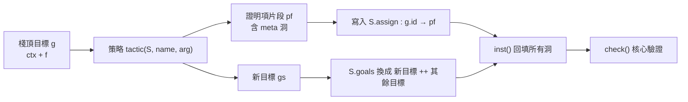

# 3.4 策略層：intro、apply、cases、exact 的語意

3.3 節的核心只會說「是」或「不是」。誰來說「是」？答案在策略層。

策略層是整個 `lean-prover` 裡最長、想法最多、也最容易出錯的部分。它的工作可以一句話講完：**把棧頂的目標換成新的目標，同時產生一棵帶洞的證明項。** 核心事後才檢查這棵樹。

這節要做的，是把這句話拆成具體的機制，然後把十幾個策略一個一個走過去。

## 3.4.1 骨架：每個策略都是同一個形狀

`runThm()` 逐行讀腳本，把每一行拆成「策略名 + 參數」餵給 `tactic()`：

```js
      try { const mm = t.match(/^(\w+)\s*(.*)$/); if (!mm) throw new Error('看不懂這一行'); tactic(S, mm[1], mm[2]); }
      catch (e) { errors[i] = e.message; failed = true; }
```
（`lean-prover/src/lean.js:200-201`）

注意 `catch` 的位置：策略層的例外在**這裡**就被抓下來，記進 `errors[i]`，並且 `failed = true` 讓後續的策略全部跳過。核心的檢查則在完全另一個地方（:208-212）。兩套錯誤處理從來不混。

`tactic()` 的前九行是所有策略共用的骨架：

```js
function tactic(S, name, arg) {
  const g = S.goals[0]; if (!g) throw new Error('已經沒有目標了');
  const { ctx, f } = g, M = x => ({ r: 'meta', id: x.id });
  const solve = (pf, gs = []) => { S.assign[g.id] = pf; S.goals = [...gs, ...S.goals.slice(1)]; };
  const ng = (c, f2, v = g.vars) => S.mk(c, v, f2);
  const hyp = n => look(ctx, n) || (() => { throw new Error(`找不到假設 ${n}`); })();
  const ws = arg.trim() ? arg.trim().split(/\s+/) : [];
  const is = (t, m) => { if (f.t !== t) throw new Error(`${name} 不適用:目標是 ${fm(f)}${m || ''}`); };
  const fresh = x => { if (fv(f).has(x) || ctx.some(([, h]) => fv(h).has(x))) throw new Error(`變數名 ${x} 已被使用,請換一個名稱`); };
```
（`lean-prover/src/lean.js:129-137`）

這九行裡每一行都有用：

- `g = S.goals[0]`：只作用於棧頂（3.1 節）。
- `M = x => ({ r: 'meta', id: x.id })`：**造洞**。`M(n)` 就是「指向目標 `n` 的洞」，證明項用它把「這裡還需要一個證明」記錄下來。
- `solve(pf, gs)`：**同時做兩件事**——把證明項片段記在 `S.assign[g.id]`，並且把棧頂換成新目標 `gs`。這兩件事**永遠綁在一起**，這是整個策略層的關鍵設計：不可能出現「改了目標卻沒留下證明項」或「留了證明項卻沒改目標」的不一致狀態。
- `ng(c, f2, v)`：**造新目標**。它預設繼承舊目標的 `vars`（活著的項變數清單），某些策略會傳第三個參數覆寫。
- `ws`：把參數按空白切成單詞。`intro h` 得到 `['h']`，`cases h with hp hq` 得到 `['h','with','hp','hq']`。
- `is(t, m)`：**策略適用性檢查**。如果目標形狀不對，就用一句「`intro` 不適用:目標是 ⊢ P」把錯誤擋掉——這正是第 2.3 節說的「策略層的錯誤必須擋得友善」。
- `fresh(x)`：**變數新鮮性檢查**，3.5 節詳述。

整個策略層的形狀可以畫成這樣：



這個「同時產生證明項片段與新目標」的形狀，就是 3.1 節那句「策略是證明項的生產者，核心是證明項的消費者」的程式化版本。**它有一個重要後果：每個策略「做了什麼」完全由它產生的那兩個東西決定**，不需要另外記錄日誌——證明項片段本身就是日誌。

## 3.4.2 app()：假設套用機制

在逐個講策略之前，先抽出其中最關鍵的一塊：`exact` 與 `apply` 共用的「把假設套用到目標上」機制。

```js
function app(src, ctx) { // 解析 "h t m":假設 h 依序套用項(∀ 消去)或假設(→ 消去)
  const q = P(src), n = q.ident(); let F = look(ctx, n), pf = { r: 'hyp', n };
  if (!F) throw new Error(`找不到假設 ${n}`);
  while (!q.done()) {
    const t = q.peek(), A = /^[A-Za-z_]/.test(t) && look(ctx, t);
    if (A) {
      q.next();
      if (F.t !== 'imp' || !eq(F.l, A)) throw new Error(`假設 ${t} 無法餵給 ${fm(F)}` + (F.t === 'imp' ? `:這裡需要 ${fm(F.l)}` : ''));
      pf = { r: 'impE', f: pf, a: { r: 'hyp', n: t } }; F = F.r;
    } else {
      const tm = q.term();
      if (F.t !== 'all') throw new Error(`無法把 ${pt(tm)} 代入 ${fm(F)},它不是 ∀`);
      pf = { r: 'allE', p: pf, t: tm }; F = sub(F.f, F.v, tm);
    }
  }
  return [pf, F];
}
```
（`lean-prover/src/lean.js:112-128`）

`app("h t m", ctx)` 回傳一對東西：**證明項** `pf`，與**套用完之後的命題** `F`。

演算法是這樣的：先取第一個名字 `n`，在上下文裡找到它，型別設為 `F`，證明項設為 `hyp n`。然後一路讀下去，每讀到一個東西就問：**它是上下文裡的假設嗎？**

- **是假設** → 做 $\to$ 消去：檢查當前 `F` 是不是蘊含、而且前提等於這個假設的命題。符合就產生 `impE` 節點，`F` 變成蘊含的結論。
- **不是假設** → 把它當成**項**，做 $\forall$ 消去：檢查當前 `F` 是不是全稱命題。符合就產生 `allE` 節點，並且用 `sub()` 把全稱公式裡的綁定變數換成這個項。

這個設計非常精妙，因為**同一個字串裡可以混著寫假設和項**。看第 3.6 節的 `socrates` 範例：

```
  exact h socrates m
```

其中 `h : ∀ x, Man(x) → Mortal(x)`、`m : Man(socrates)`。`app` 的處理過程是：

| 讀到的東西 | 是假設嗎？ | 動作 | 當前的 `F` |
|---|---|---|---|
| `h` | 是（起頭） | 建立 `hyp h` | $\forall x . Man(x) \to Mortal(x)$ |
| `socrates` | 否（上下文裡沒有這個假設） | 當成項，做 ∀ 消去 | $Man(socrates) \to Mortal(socrates)$ |
| `m` | 是 | 做 → 消去 | $Mortal(socrates)$ |

三步之後 `F` 恰好就是目標，`pf` 恰好就是需要的證明項。

**注意中間那一步的判定依據是「上下文裡有沒有這個名字的假設」，而不是「這個 token 是不是項」。** 這是一個真正的歧義點：如果使用者寫了一個項 `x`，而上下文裡恰好有個假設也叫 `x`，那 `app` 會把它當成假設。如果假設的型別對不上，就會得到一個令人困惑的錯誤訊息。這個歧義是「名字空間共享」的必然代價——整套系統裡，項變數和命題假設共用同一個名字空間（3.1 節的 `vars` 欄位就是為了在顯示上區分這兩者而存在的）。

`app` 的第二個設計特徵是**它同時是檢查器**。回傳 `F` 讓呼叫端（`exact`、`apply`、`have`）可以拿它跟目標比較。也就是說，「套用」不只是產生證明項，還順帶算出了結果型別。

## 3.4.3 目標是「還差什麼」：逆向推理的直覺

在講策略之前，最好先建立一個直覺。

**向前推理**問的是：「從我手上的東西出發，怎麼得到結論？」**逆向推理**問的是：「要得到結論，我還缺什麼？」

`apply h2` 是後者的最短表達。目標是 $\vdash R$ ，手上是 `h2 : Q → R`。逆向思維立刻回答：「用 `h2`，我缺一個 $Q$ 。」於是產生新目標 $\vdash Q$ 。

這個思維方式的完整版本，是把目標 $A$ 看成一個型別，問「要造一個 $A$ 的項，還需要什麼？」對應到 Curry–Howard：

- 目標是 $A \to B$ → 需要一個 $\lambda x . \text{...}$ ，即需要「給定 $x : A$ ，造一個 $B$ 」。
- 目標是 $A \wedge B$ → 需要「造一個 $A$ 和一個 $B$ 」。
- 目標是 $A \vee B$ → 需要「造一個 $A$ **或** 一個 $B$ 」。
- 目標是 $\forall x . A$ → 需要「對任意 $x$ 造一個 $A$ 」。
- 目標是 $\exists x . A$ → 需要「找一個 $x$ 造一個 $A$ 」。
- 手上有一個 $A \to B$ 的項 → 可以「餵一個 $A$ 進去，得到 $B$ 」。

**每一條策略都不過是上面這張表的一行。** 這是本章最值得帶走的一句話：`intro` 是「造 λ」，`constructor` 是「造 pair」，`left`/`right` 是「造 sum 的其中一邊」，`exists` 是「造 witness」，而 `exact`/`apply` 是「用手上現成的項」。

## 3.4.4 逐一走訪策略

### 引入類：`intro`

```js
    case 'intro': {
      const h = ws[0] || (f.t === 'all' ? 'x' : 'h');
      if (f.t === 'imp') { const n = ng([...ctx, [h, f.l]], f.r); return solve({ r: 'impI', h, f: f.l, p: M(n) }, [n]); }
      is('all', '(需要 → 或 ∀)'); fresh(h);
      const n = ng(ctx, sub(f.f, f.v, { v: h }), [...g.vars, h]); return solve({ r: 'allI', v: h, p: M(n) }, [n]);
    }
```
（`lean-prover/src/lean.js:139-144`）

`intro` 有兩種行為，取決於目標的形狀：

目標是蘊含 $A \to B$ ：把 $A$ 當作假設放進上下文，目標變成 $B$ 。證明項是 `impI`。注意假設名預設是 `h`，而 `intro h` 可以自己指定。

**目標是全稱 $\forall x . A$ **：把綁定變數 $x$ **改名**成一個新的名稱（預設 `x`），然後把主體裡的 $x$ 全部換成新名字，目標變成那個主體。證明項是 `allI`。

第二種情況有兩個額外動作值得注意。第一是 `fresh(h)`：新名字必須是全新的，不能和目標或上下文裡任何自由變數撞名。這是 3.5 節的主題。第二是 `sub(f.f, f.v, { v: h })`：這不是代換，而是**改名**。為什麼要改名？因為量詞裡的 $x$ 綁的是公式內部的 $x$ ；一旦我們要把 $\forall x . A(x)$ 變成一個待證的具體命題 $A(y)$ ，那個 $y$ 必須是一個**不受任何綁定約束**的新變數。這個改名正是 `sub()` 的「避免變數捕獲」機制在做事（3.5 節）。

`intro` 的目標型別檢查寫在 `is('all', '(需要 → 或 ∀)')` 裡——如果不是 $\to$ 也不是 $\forall$ ，錯誤訊息會說「intro 不適用:目標是 P (需要 → 或 ∀)」。

### 直接結案類：`exact`、`assumption`

```js
    case 'exact': { const [pf, F] = app(arg, ctx); if (!eq(F, f)) throw new Error(`exact 的型別不吻合:得到 ${fm(F)},但目標是 ${fm(f)}`); return solve(pf); }
    case 'assumption': { for (let i = ctx.length; i--; ) if (eq(look(ctx, ctx[i][0]), f)) return solve({ r: 'hyp', n: ctx[i][0] }); throw new Error('找不到符合目標的假設'); }
```
（`lean-prover/src/lean.js:145-146`）

`exact` 的語意是「用這個假設（或假設的套用）把目標解決掉」，並且**型別必須完全吻合**。注意 `exact` 也能處理量詞消去：`exact h socrates m` 就是把 `app` 的結果跟目標比一比。

`assumption` 是 `exact` 的簡化版：不用使用者指定哪個假設，自己在上下文裡掃一圈，找第一個型別等於目標的假設。

兩個錯誤訊息都把「得到什麼」和「要什麼」一起印出來，這是友善錯誤訊息的標準做法。

### 倒推類：`apply`

```js
    case 'apply': {
      const [pf, F] = app(arg, ctx), prem = []; let c = F;
      while (!eq(c, f)) { if (c.t !== 'imp') throw new Error(`apply 失敗:${fm(F)} 的結論無法吻合目標 ${fm(f)}`); prem.push(c.l); c = c.r; }
      const gs = prem.map(a => ng(ctx, a));
      return solve(gs.reduce((p, x) => ({ r: 'impE', f: p, a: M(x) }), pf), gs);
    }
```
（`lean-prover/src/lean.js:147-152`）

`apply` 的演算法是：**把 `F` 沿著蘊含鏈往下拆，直到拆到目標為止，中間拆出來的前提全部變成新目標。**

以 `syllogism` 為例，`apply h2` 時 `F = Q → R`，目標是 $R$ 。迴圈第一次：`c = Q → R` 不等於 $R$ ，是 `imp`，所以 `prem.push(Q)`、`c = R`。第二次：`c = R` 等於目標，迴圈結束。於是產生一個新目標 $\vdash Q$ ，證明項是 `impE h2 (meta g1)`。

多層的情況也一樣自然：`apply` 一個 $A \to B \to C$ 而目標是 $C$ ，會同時產生 $\vdash A$ 與 $\vdash B$ 兩個目標（順序是 $A$ 在上，因為 `gs[0]` 會被壓到棧頂）。

這個「拆蘊含鏈」的動作，就是第 3.3 節那個 $\to$ 消去規則的**逆向**。核心的 `impE` 是「給我前提，我給你結論」；策略的 `apply` 是「給你結論，你還需要前提」。兩者拼起來就是 modus ponens 的兩個方向。

`apply` 的失敗訊息也值得看：`apply 失敗:${fm(F)} 的結論無法吻合目標 ${fm(f)}`——它告訴你「你給的東西的結論跟目標對不上」，而不是乾巴巴地說「型別錯誤」。

### 拆解類：`constructor`、`left`、`right`

```js
    case 'constructor': { is('and', '(↔ 已展開成 ∧)'); const a = ng(ctx, f.l), b = ng(ctx, f.r); return solve({ r: 'andI', a: M(a), b: M(b) }, [a, b]); }
    case 'left': case 'right': { is('or'); const L = name === 'left', n = ng(ctx, L ? f.l : f.r); return solve({ r: L ? 'orI1' : 'orI2', p: M(n), f: L ? f.r : f.l }, [n]); }
```
（`lean-prover/src/lean.js:153-154`）

`constructor` 處理 $\wedge$ ，產生兩個目標（左半、右半），證明項是 `andI`。它的錯誤訊息裡附帶 `(↔ 已展開成 ∧)`——這是 3.2 節那個展開的直接後果：使用者看到目標是 $\leftrightarrow$ ，可能會想用 `constructor`，但系統會告訴他「雙條件句已經被展開成合取了，請用 `constructor` 兩次」。

`left`/`right` 處理 $\vee$ ，產生一個目標（選中的那一邊），證明項是 `orI1`/`orI2`。注意證明項裡多了一個 `f` 欄位：`orI1` 的節點形狀是 `{ r: 'orI1', p: M(n), f: f.r }`——被放棄的那一半直接寫在證明項裡，因為 `orI1` 核心規則的回傳值就是 `{ t: 'or', l: C(p.p), r: p.f }`（3.3 節）。

### 量詞類：`exists`

```js
    case 'exists': { is('ex'); const q = P(arg), t = q.term(); if (!q.done()) throw q.err('語法錯誤:多餘的符號'); const n = ng(ctx, sub(f.f, f.v, t)); return solve({ r: 'exI', t, p: M(n), v: f.v, f: f.f }, [n]); }
```
（`lean-prover/src/lean.js:155`）

`exists` 的語意是「我提供一個見證」。它解析參數成一個**項**（不是公式），把存在公式的主體裡綁定變數換成這個項，產生新目標。證明項是 `exI`。

這裡的 `sub(f.f, f.v, t)` 用到的是 `sub()` 的一般形式（3.5 節），而不是 `intro` 那種改名用法：這次是真的代換，把 $\exists x . A(x)$ 的主體變成 $A(t)$ 。

### 反證類：`by_contra`、`exfalso`

```js
    case 'exfalso': { const n = ng(ctx, BOT); return solve({ r: 'botE', p: M(n), f }, [n]); }
    case 'by_contra': { const h = ws[0] || 'h', neg = { t: 'imp', l: f, r: BOT }, n = ng([...ctx, [h, neg]], BOT); return solve({ r: 'dne', p: { r: 'impI', h, f: neg, p: M(n) } }, [n]); }
```
（`lean-prover/src/lean.js:156-157`）

`exfalso`（拉丁文 ex falso quodlibet，「從假推出任何事」）把目標換成 $\bot$ ，證明項是 `botE`。這是「我知道目標是假的，所以隨便推」。

`by_contra` 是反證法。它的機制值得慢慢拆，因為它是**唯一一個會把核心規則 `dne` 包進證明項的策略**：

1. 令 `neg = ¬f`（即 $f \to \bot$ ）。
2. 把 `neg` 當作假設 `h` 放進上下文。
3. 目標換成 $\bot$ 。
4. 證明項是 `dne (impI h neg (meta g1))`。

為什麼要這樣？因為 `dne` 這條核心規則要求前提的形狀是 $\neg\neg A$ （3.3 節）。而 $\neg\neg f$ 正是「用 `impI` 引入一個名叫 `h` 的假設 `neg : ¬f`，然後證明 $\bot$ 」。所以 `by_contra` 產生的是：**一個證明 $\neg\neg f$ 的證明項**。核心檢查時，內層 `impI` 回傳 $\neg f \to \bot = \neg\neg f$ ，`dne` 檢查這個形狀正確，然後抽出 $f$ ——正是原來的目標。

這就是「策略可以把一個大規則拆成幾個小規則的組合」的具體例子。`by_contra` 本身在自然演繹裡並不是一條基本規則，它是 $\to$ 引入加上 $\to$ 消去，再加上 DNE 的合成。

`dne` 這條規則的存在意味著系統是**古典的**。第 6.3、6.4 節會詳細討論直觀主義的壁與跨越的代價。

### 分案類：`cases`

```js
    case 'cases': {
      const [h, a = 'h1', b = 'h2'] = ws.filter(x => x !== 'with'), A = hyp(h), H = { r: 'hyp', n: h };
      if (A.t === 'and') { const n = ng([...ctx, [a, A.l], [b, A.r]], f); return solve({ r: 'let', n: a, p: { r: 'andE1', p: H }, q: { r: 'let', n: b, p: { r: 'andE2', p: H }, q: M(n) } }, [n]); }
      if (A.t === 'or') { const n1 = ng([...ctx, [a, A.l]], f), n2 = ng([...ctx, [b, A.r]], f); return solve({ r: 'orE', p: H, x: a, a: M(n1), y: b, b: M(n2) }, [n1, n2]); }
      if (A.t === 'ex') { fresh(a); if (fv(A).has(a)) throw new Error(`變數名 ${a} 已被使用`); const n = ng([...ctx, [b, sub(A.f, A.v, { v: a })]], f, [...g.vars, a]); return solve({ r: 'exE', p: H, x: a, h: b, q: M(n) }, [n]); }
      throw new Error(`cases 不適用:${h} 是 ${fm(A)}`);
    }
```
（`lean-prover/src/lean.js:158-164`）

`cases h with a b` 是三合一：它依照 `h` 的型別決定怎麼拆。

`h` 的型別是 $\wedge$ ：拆成兩個假設 $a$ 與 $b$ ，但**只產生一個目標**（目標不變）。這是「兩半都拿進來繼續用」的情況。證明項用 `let` 巢狀起來：`let a (andE1 h) (let b (andE2 h) (meta g))`。為什麼要巢狀 `let`？因為核心的 `let` 規則是 `C(p.q, [...ctx, [p.n, C(p.p)]])`——它把 `p.n` 綁到上下文才檢查 `p.q`。第一層 `let a` 把 `a` 綁成 $\wedge$ 的左半，第二層 `let b` 把 `b` 綁成右半，於是內層的目標可以看到 `a` 與 `b` 兩個假設。**這正是「局部綁定」在證明項裡的樣子。**

**`h` 的型別是析取** $\vee$ ：產生**兩個目標**，每個目標的上下文各自擴充（左支拿 $a :$ 左半，右支拿 $b :$ 右半）。證明項是 `orE`。

**`h` 的型別是存在** $\exists$ ：產生**一個目標**，上下文多了一個假設 $b : A[a/x]$ （把存在公式的綁定變數換成新名稱 $a$ ），而且 `vars` 多了 $a$ （所以顯示時會出現 `a : 項` 那一行）。證明項是 `exE`。

三種情形的差異，正是「析取消去的兩支必須同結論」這個側條件的後果： $\vee$ 必須分兩支各自證明同一件事， $\wedge$ 與 $\exists$ 則是把資訊攤平到同一條推理線上。

`cases` 的參數解析也值得留意：`ws.filter(x => x !== 'with')` 把 `with` 這個關鍵字濾掉，剩下的依序是假設名、分支一名字、分支二名字。所以 `cases h` 會得到預設名 `h1`、`h2`；`cases h with hp hq` 得到 `hp`、`hq`。

### 輔助類：`have`、`show`、`sorry`

```js
    case 'have': {
      const m = arg.match(/^([\w']+)\s*(:=|:)\s*(.+)$/); if (!m) throw new Error('格式:have 名稱 : 命題  或  have 名稱 := 假設 參數…');
      if (m[2] === ':=') { const [pf, F] = app(m[3], ctx), n = ng([...ctx, [m[1], F]], f); return solve({ r: 'let', n: m[1], p: pf, q: M(n) }, [n]); }
      const F = parseF(m[3]), n1 = ng(ctx, F), n2 = ng([...ctx, [m[1], F]], f); return solve({ r: 'let', n: m[1], p: M(n1), q: M(n2) }, [n1, n2]);
    }
    case 'show': if (!eq(parseF(arg), f)) throw new Error(`show 不吻合:目標是 ${fm(f)}`); return;
    case 'sorry': S.sorry = true; return solve({ r: 'sorry', f });
```
（`lean-prover/src/lean.js:165-171`）

`have` 有兩種語意，這個區分是本系統裡相當漂亮的一個設計：

**`have h := f a`**：左邊是「假設名」，右邊是「一個已經成立的項」。語意是「把 `f a` 的值記成 `h`」。此時 `h` 的型別 $F$ 是**算出來的**（`app` 回傳），不需要使用者寫出來。證明項是 `let h (真的證明) (meta g)`——`p` 是實際的證明項，`q` 是洞。**只產生一個新目標**（原本的目標），因為 `f a` 本身不需要被證明。

**`have h : A`**：右邊是「一個命題」。語意是「我要先證明 $A$ ，把它記成 `h` 繼續用」。此時 $A$ 的型別是**使用者宣告的**。證明項是 `let h (meta g1) (meta g2)`——`p` 是洞，`q` 也是洞。**產生兩個新目標**：先證 $A$ ，再證原目標。

兩者的差異一句話：**`:=` 假設那個值已經有了，`: ` 假設那個命題還沒證。** 這是 Lean 裡 `have h := e` 與 `have h : T` 的區別的直接翻譯。

`show` 是一個**斷言**：檢查使用者寫的公式確實等於當前目標，等於的話什麼都不做（`return;`，連 `solve` 都不呼叫）。不等就報錯。它的實用價值是讓人可以在腳本裡標註「我現在要證的是這個」，在核心拒絕的時候幫助定位。

`sorry` 是被標記的逃生門（3.3 節提過）。

## 3.4.5 策略速查表

| 策略 | 目標必須是 | 產生的新目標 | 證明項片段 | 自然演繹規則 |
|---|---|---|---|---|
| `intro h` | $\to$ | 1（前提進上下文） | `impI` | → 引入 |
| `intro x` | $\forall$ | 1（變數改名） | `allI` | ∀ 引入 |
| `exact e` | 任意 | 0 | `hyp` / `impE` / `allE` 鏈 | 假設引用 |
| `assumption` | 任意 | 0 | `hyp` | 假設引用 |
| `apply h` | 任意 | n（前提各一） | `impE` 鏈 | → 消去（逆向） |
| `constructor` | $\wedge$ | 2（左、右） | `andI` | ∧ 引入 |
| `left` / `right` | $\vee$ | 1 | `orI1` / `orI2` | ∨ 引入 |
| `cases h` | 任意（看 `h`） | $\wedge$ :1； $\vee$ :2； $\exists$ :1 | `let` / `orE` / `exE` | ∧、∨、∃ 消去 |
| `exists t` | $\exists$ | 1 | `exI` | ∃ 引入 |
| `exfalso` | 任意 | 1（目標變 $\bot$ ） | `botE` | ⊥ 消去 |
| `by_contra h` | 任意 | 1（目標變 $\bot$ ） | `dne (impI …)` | 反證法（**古典**） |
| `have h := e` | 任意 | 1 | `let`（左邊是實體） | 局部綁定 |
| `have h : A` | 任意 | 2 | `let`（左邊是洞） | 局部綁定 |
| `show A` | 任意 | 0（只檢查） | — | 斷言 |
| `sorry` | 任意 | 0 | `sorry` | 逃生門 |

「目標必須是」那一欄是 `is()` 檢查的依據。留意 `exact`、`apply`、`assumption`、`have`、`show`、`sorry` 對目標型別沒有任何限制——因為它們本來就對任何型別都有意義。

## 3.4.6 小結與交棒

策略層的機制現在完全清楚了：**每個策略讀棧頂目標，產生一個證明項片段（帶洞）與零到多個新目標，然後 `solve()` 把它們一起寫進狀態。** 「逆向推理」在這裡不是一句口號，而是每個策略的實作方式：目標的形狀決定了該用哪條規則，而規則的前提就是新的目標。

但整個策略層都建立在一個假設之上：`app()` 裡的 `sub()`、`intro` 裡的改名、`cases` 裡的 `fresh()`，都能正確處理**變數綁定**。只要量詞綁的是同名變數，只要代入的項含有會撞名的自由變數，這些機制就可能出錯——而且出錯的方式往往不是「報錯」，而是**靜靜地證明了一件不同的命題**。

這是下一節的主題：**變數捕獲、α 等價與安全的代換**。它是整個系統裡最隱蔽、也最危險的一類 bug——因為 α 等價判斷一旦錯了，核心檢查通過的東西可能根本不是使用者想證的東西。
