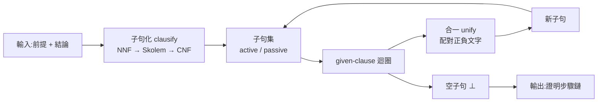

# 4.1 演繹式證明與反駁式證明的分工

第 3 章的主線是「人給思路、機器驗證」。`lean-prover` 的 `check()` 核心只做一件事：遞迴檢查證明項，把每一步推導還原成一個命題公式，最後確認它等於宣告的定理。這件事做得很好——第 3.3 節我們看過它的形狀是「小而嚴格」的。但它有一個前提：使用者必須**先知道怎麼證**。

第 3 章的「等式代入」與「群論」兩個演練把這件事的痛點暴露得很清楚。要證「單位的反元素是單位」，人必須自己想到「先用 `mul(inv(x),x) = e` 代入結合律，再用右單位律消掉 `e`」這條路徑，然後把它寫成一串 `have` / `exact` 指令。策略寫錯，`check()` 會老老實實回報「核心檢查失敗」，但它不會替你找出那條路。

歸結法證明器（`theorem-prover`）採取的是完全相反的分工：**人只給前提與結論，機器自己找矛盾**。本章接下來六節要拆開的，就是這個「自己找」到底是怎麼做到的。

## 反駁法：把證明題翻轉成可滿足性問題

演繹式證明是「從前提推導結論」；反駁式證明（refutation）是「證明前提與結論的否定不能同時成立」。在語意層面，這兩件事等價：

$$
前提 \models 結論 \quad\Longleftrightarrow\quad 前提 \wedge \neg 結論 \;\text{不可滿足}
$$

這個等價式是整個 ATP 的地基。它的重要性在於把「證明一個蘊含關係」變成「找出一個矛盾」——後者是一個可以機械化搜尋的目標，因為矛盾有非常容易被認出的形式（空子句）。

程式碼裡，翻轉只發生在一行：

```js
if (goal) { const g = load(goal, 'negated goal'); items.push({ f: { t: 'not', f: g.f }, rule: g.rule }); }
```

（`theorem-prover/src/prover.js:157`）

`items` 收集的每一項都會被子句化後放進子句集（第 4.2 節）。所以整個 `prove()` 做的事，用一句話說就是：**把所有前提與否定結論混在一起，當成一個整體的公式集，看看它們是不是不可能同時為真。**

以 `examples/socrates.txt` 為例，輸入是：

```
forall x. (Man(x) -> Mortal(x))
Man(socrates)
|- Mortal(socrates)
```

跑出來的結果是：

```
✔ 證明成功(產生 6 個子句,1 ms)
  1. ~Man(X2) | Mortal(X2)    [前提]
  2. Man(socrates)    [前提]
  3. ~Mortal(socrates)    [否定結論]
  5. ~Man(socrates)    [歸結 1, 3]
  6. ⊥    [歸結 5, 2]
```

注意第 3 條：它不是 `Mortal(socrates)`，而是它的否定。整條證明的終點也不是「推導出 `Mortal(socrates)`」，而是第 6 條的 `⊥`——一個空子句，代表「這個集合不可能同時成立」。

## ATP 的三根支柱

要完成上面這件事，機器必須具備三樣能力，而 `theorem-prover/src/prover.js` 恰好把它們切成三塊互相獨立的程式碼：

**第一根：子句化（clausification）。** 把任意的一階公式（可以含量詞、蘊含、否定、雙條件）壓平成一組「子句」，每個子句是若干「文字」（literal）的析取。入口是 `clausify`：

```js
const clausify = f => cnf(skolem(nnf(f, true), {}, []));
```

（`theorem-prover/src/prover.js:74`）——一行之內串起 NNF、Skolem 化、CNF 三步，第 4.2 與 4.3 節分別拆開前兩步，第 4.2 節拆開第三步。子句化的意義是：**子句是歸結的最小操作單位**。只要所有前提都被壓成同一種形狀，後面的搜尋就不必再處理公式結構。

**第二根：合一（unification）。** 兩個子句要歸結，必須先「對齊」——例如 `~Man(X2) | Mortal(X2)` 與 `~Mortal(socrates)`，要先知道 `X2` 與 `socrates` 指的是同一個東西，才能把正負文字配對。核心是：

```js
function unify(a, b, s) {
  a = walk(a, s); b = walk(b, s);
  if (isV(a)) { if (isV(b) && a.v === b.v) return s; return occ(a.v, b, s) ? null : { ...s, [a.v]: b }; }
  if (isV(b)) return unify(b, a, s);
  if (a.f !== b.f || a.a.length !== b.a.length) return null;
  for (let i = 0; i < a.a.length && s; i++) s = unify(a.a[i], b.a[i], s);
  return s;
}
```

（`theorem-prover/src/prover.js:79-86`）第 4.4 節會詳細討論它，特別是那個看似多餘、卻絕對不能刪的 `occ` 檢查。

**第三根：搜尋（search）。** 在子句集上不斷挑一個子句出來，跟別的子句做運算，產生新子句，直到出現空子句或資源耗盡。這就是所謂的 **given-clause 迴圈**，是第 4.5 節的主題：

```js
while (!empty) {
    if (!passive.length) return fin('saturated');
    if (Date.now() - t0 > maxMs || gen > maxN) return fin('timeout');
    let bi = 0; for (let i = 1; i < passive.length; i++) if (passive[i].w < passive[bi].w) bi = i;
    const g = passive.splice(bi, 1)[0]; active.push(g);
```

（`theorem-prover/src/prover.js:160-164`）

三根支柱串起來的資料流是這樣的：



## 資訊損失：ATP 為什麼必須靠 timeout 兜底

子句化是一個**有損**的轉換。把公式壓成子句的過程中，兩樣東西消失了。

第一樣是**量詞**。第 4.3 節會看到，Skolem 化把 `∀x` 與 `∃x` 全部消掉，換成自由變數與 Skolem 項。這不是 bug，而是為了讓子句能自由地做合一與替換——但代價是，公式原本的「對所有個體成立」的語意資訊被抹平了。

第二樣是**公式形狀**。第 4.2 節會看到，`P ↔ Q` 變成 `(P → Q) ∧ (Q → P)`，`P → Q` 變成 `¬P ∨ Q`，最後整個公式變成一堆平面化的析取。原始公式裡「這一段是蘊含、那一段是量詞」的結構資訊全部消失。

這兩種損失共同決定了 ATP 的成敗模式：**子句化讓搜尋變得可行，但也讓搜尋空間變得巨大**。歸結法是半可判定的（semi-decidable）：如果命題確實是前提的邏輯後果，歸結法在有限時間內會找到證明；如果不是，歸結法可能永遠搜下去。於是所有的 ATP 都必須配一個「兜底」——本實作的兜底寫在第 144 行：

```js
const maxMs = opts.maxMs || 10000, maxN = opts.maxClauses || 20000, t0 = Date.now();
```

（`theorem-prover/src/prover.js:144`）十秒或兩萬個子句，任一超標就回報 `timeout`。README 裡的「限制」段落說的就是這件事。

這個兜底是 ATP 與 ITP 最尖銳的對比。ITP 不會「搜尋失敗」——它只會「這個證明項不被接受」，使用者看到的是一個明確的拒絕理由（變數不夠新、對象形狀不對、結論不吻合）。ATP 的失敗是**語意上的空洞**：它只能說「我沒找到」，而「沒找到」和「不存在」之間沒有邏輯關係。這個差別會在 4.3 節結尾再具體化一次。

## ITP 與 ATP 的分工對照

| 面向 | ITP（`lean-prover`） | ATP（`theorem-prover`） |
|---|---|---|
| 輸入 | 定理宣告 + 一串策略指令 | 一組前提 + 一個結論（或只有前提） |
| 輸出 | 證明項（可被 `check()` 逐行驗證） | 子句推導鏈（可重播，但不可單獨驗證） |
| 誰負責「想」 | 人寫策略，機器只驗 | 人不寫，機器自己搜 |
| 失敗模式 | 核心拒絕（`kernel`）、目標未解（`open`） | 飽和（`saturated`）、逾時（`timeout`） |
| 失敗的意義 | 明確：這條證明項不合法 | 空洞：沒找到 ≠ 不存在 |
| 使用者負擔 | 高：要懂自然演繹、要想通每一步 | 低：只需把題目寫成公式 |
| 擅長 | 需要巧思的、需要「局部推理」的定理 | 機械可推的、等式密集的、搜尋空間可控的定理 |
| 不擅長 | 例證式的長鏈條、需要全體證明的定理 | 需要非平凡想法、或公式本身會爆炸的定理 |

從這張表可以看出兩者不是競爭關係，而是**負擔的重新分配**：ITP 把負擔放在「想」上，ATP 把負擔放在「搜」上。第 6 章的演練會用同一批命題（假言三段論、Peirce 定律、群論）在三個系統中各跑一遍，把這張表填滿。

## 空子句：矛盾在子句層的樣子

反駁法的目標被說成「找出一個矛盾」，但「矛盾」在子句層長什麼樣？答案是**空子句**。

子句是文字的析取，而析取的語意是「只要有一個文字為真，整個子句就為真」。所以要讓一個子句在所有模型下都為假，唯一的辦法是讓它沒有任何文字——空析取恆為假，通常寫成 $\bot$ 這個符號。程式碼裡就是這個判斷：

```js
if (!l.length) empty = c;
```

（`theorem-prover/src/prover.js:152`）輸出層把它印成那個符號：

```js
const fmtClause = c => c.lits.length ? pv(c.lits.map(ls).join(' | ')) : '⊥';
```

（`theorem-prover/src/prover.js:202`）

這裡有一個漂亮的收束：所謂「反駁法的目標」，其實不是結論本身，而是**整個子句集的一個不動點**。本章接下來每一節——子句化、Skolem 化、合一、搜尋、剪枝、等式（第 4.2 到 4.7 節）——都在回答同一個問題的兩半：怎麼產生更多子句，以及怎麼讓空子句有機會出現。

順帶一提，這個「目標＝空子句」的觀點，正是把歸結法與 SAT 求解器接起來的那條線。SAT 求解器把命題變成合取范式、去找一個**滿足賦值**；歸結法把子句集拿來、去找一個**不可滿足的子句集**。骨架是同一套：一個把目標寫成「找模型」，一個寫成「找矛盾」。第 4.5 節講過 given-clause 迴圈有另一種對應物叫 DPLL，那種做法就是把子句集餵給 SAT 求解器；本實作自己寫迴圈，好處是每一步推理都留下可讀的證明鏈。

## 沒有目標也能反駁：可滿足性檢查器

第 157 行的翻轉只在 `goal` 非空時發生：

```js
if (goal) { const g = load(goal, 'negated goal'); items.push({ f: { t: 'not', f: g.f }, rule: g.rule }); }
```

（`theorem-prover/src/prover.js:157`）`goal` 為空時子句集裡只有前提，於是「找出空子句」證明的是**前提集合本身不可滿足**。輸出層用一個欄位區分這兩種情況：

```js
const statusText = r => r.status === 'proved'
  ? `✔ ${r.hasGoal ? '證明成功' : '前提互相矛盾'}(產生 ${r.generated} 個子句,${r.ms} ms)`
```

（`theorem-prover/src/prover.js:204-205`）`hasGoal`（第 196 行）就是那個布林的區分依據。

這不是附屬功能，這是反駁法的**根本性格**：它其實是一個可滿足性檢查器，「證明」只是它的一個應用。`examples/barber.txt` 就是這個用法——理髮師悖論不需要目標，反駁法的工作是證明這個自指的前提自己跟自己打架。

反過來，這也解釋了一件乍看之下奇怪的事：**當前提彼此矛盾時，反駁法會「證明成功」，不管結論是什麼**。實測：

```
$ node bin/cli.js -e "P(a)" "~P(a)" "|- Q(b)"
✔ 證明成功(產生 4 個子句,0 ms)
  1. P(a)    [前提]
  2. ~P(a)    [前提]
  4. ⊥    [歸結 2, 1]
```

（毫秒數隨機器而異。）注意輸出裡**沒有第 3 條**。第 3 條是否定結論 `~Q(b)`，它確實被產生了，但矛盾是在兩個前提之間找到的，所以證明鏈（第 192-193 行，從空子句沿 `from` 往回追溯）根本沒走到它。邏輯上這完全正確：前提既已矛盾，任何結論都跟著成立。但它也暴露了反駁法的輸出**不是「關於目標的敘述」，而是「關於整個子句集的敘述」**——目標只是被塞進子句集的一個搜索方向。

## 反事實：如果不翻轉結論會怎樣

把第 157 行的翻轉拿掉，證明器就必須「正面推出」結論：找到 `Mortal(socrates)` 這個文字本身。這會帶來兩個麻煩。

第一，**目標必須被精確命中**。歸結產生的子句形狀千篇一律，要從裡面認出「這一條就是目標」需要額外的比對邏輯；而「找出任意一個矛盾」不需要。

第二，**矛盾的來源被限制死了**。反駁法允許矛盾出現在任何地方；正面推導則要求每個中間子句都朝著目標推進，任何一個不相干的分支都會讓整條路徑作廢。

第 2.4 節講過 Robinson 1965 年的核心洞察正是這個翻轉：把蘊含式命題 $\Gamma \models \varphi$ 換成可滿足性問題 $\Gamma \wedge \neg \varphi$ 是**不可滿足**的，而 Herbrand 定理保證「只要它不可滿足，就存在一個有限的 ground instance 集合同樣不可滿足」。於是「找證明」被換成「找矛盾」，後者可以用一套機械的、可重複的規則系統來做。

這個翻轉也是 ATP 半可判定性的來源。Skolem 化、子句化、合一、搜尋加起來，是一個**只會在成功時才停**的程式：命題若確實成立，搜尋終究會找到矛盾；命題若不成立，程式只會在飽和或逾時時停下，不會給出「不成立」的判斷。這個限制源自把命題變成可滿足性問題這一步，而不是源自任何一個具體的搜尋策略。

## 下一節

分工講清楚了，接下來要處理 ATP 面對的第一個真實難題：**人類寫的公式長什麼樣子都不太可能**，而歸結法只認子句。第 4.2 節就從 `parse()` 開始，把一個含蘊含、否定、雙條件與量詞的公式，逐步壓成一組平面化的子句——並說明為什麼這條「壓平」的路線必然帶來「CNF 爆炸」的先天代價。
