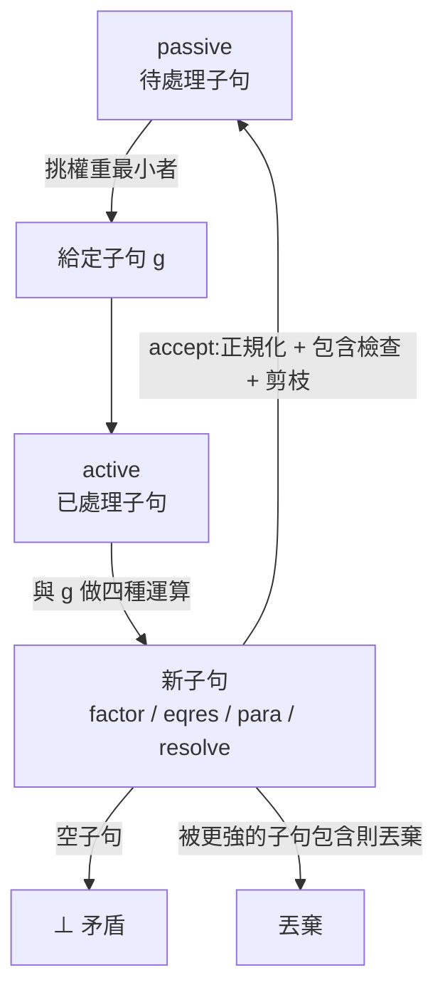

# 4.5 Given-Clause 迴圈：active、passive 與加權選擇

前三節把零件都組好了：公式被壓成子句（第 4.2、4.3 節），子句之間可以被合一對齊（第 4.4 節）。現在缺的最後一塊是**控制流程**：機器該先動哪個子句？跟誰算？算出來的東西放哪裡？何時收工？

歸結法有多種搜尋架構：把所有子句兩兩配對的「全對付」法、把子句集合視為命題變數然後用 SAT 求解器解的「DPLL」法、以及本實作採用的 **given-clause 迴圈**。given-clause 迴圈的原型來自 1960 年代的 Gilmore–Robinson 與後來的 Otter：每一輪從待處理佇列裡挑一個子句出來（「給定子句」，given clause），跟所有「已處理」子句做一遍推理，把新結果丟回佇列，然後重複。

整個迴圈在 `prove()` 裡大約五十行：

```js
const all = [], active = [], passive = []; let nid = 0, gen = 0, empty = null;
```

（`theorem-prover/src/prover.js:145`）三個陣列撐起整個架構，本節就靠這三個名字展開。

## 三個陣列的分工

| 陣列 | 角色 | 內容 |
|---|---|---|
| `active` | 已處理過的子句 | 過去挑出來、已與其他子句做過運算的子句 |
| `passive` | 待處理的子句 | 還沒被挑出來做運算的新子句 |
| `all` | 完整的記錄簿 | 所有被接受過的子句，依 id 索引，供最後重建證明步驟用 |

`active` 與 `passive` 是搜尋的兩端，而 `all` 是只寫不讀的工作記錄。分開 `active` 與 `passive` 的理由正是效率：已經處理過的子句彼此之間不必再重新算一次（假設運算規則對稱且子句不變）。這種「已處理 / 待處理」的分法，就是給定子句迴圈能夠擺脫指數級兩兩配對的關鍵——它把配對次數從 $O(n^2)$ 降成 $O(n)$ 這個量級。

`all` 的存在是為了輸出。`fin()` 函式（第 189-197 行）會從空子句出發，沿著 `from` 欄位往回追溯，把整條推導鏈攤開來：

```js
const seen = new Set(), st = [empty.id];
while (st.length) { const id = st.pop(); if (!seen.has(id)) { seen.add(id); st.push(...all[id].from); } }
```

（`theorem-prover/src/prover.js:192-193`）這是一個以空子句為根的**反向樹遍历**：`from` 記錄「這個子句是由哪兩個子句推出來的」，所以從終點往回走就能重建整條證明。這個設計在第 4.6 節談剪枝時會顯出重要性——剪枝會讓某些子句被丟棄，`all` 保留了它們的歷史，所以證明鏈仍然完整。

## 初始化：把前提與否定結論混在一起

在迴圈開始之前，所有輸入都要進場：

```js
const items = premises.map(s => load(s, 'premise'));
if (goal) { const g = load(goal, 'negated goal'); items.push({ f: { t: 'not', f: g.f }, rule: g.rule }); }
for (const { f, rule } of items) for (const c of clausify(f)) accept(c, rule, []);
```

（`theorem-prover/src/prover.js:156-158`）

三行做了三件事。第一行把每個前提字串解析成 AST（`load` 會把解析錯誤包成友善的訊息，第 155 行）。第二行是第 4.1 節說過的那個翻轉：`{ t: 'not', f: g.f }`——把結論包成否定節點。第三行把每個公式（含否定結論）子句化，然後逐個送進 `accept()`。

注意「否定結論」的 rule 名稱是 `'negated goal'`，而前提是 `'premise'`。這兩個標籤會一路跟著子句走到最後的輸出（`fmtRule`，第 203 行），讓讀者一眼看出證明的哪一步是輸入、哪一步是推導。

## accept()：新子句的入場券

每個新子句都要通過 `accept()` 的三道關卡：

```js
const accept = (lits, rule, from) => {
  const l = norm(lits); if (!l) return null;
  for (const c of active.concat(passive)) if (c.lits.length <= l.length && subsumes(c.lits, l)) return null;
  const c = { id: ++nid, lits: l, rule, from, w: l.map(ls).join('').length };
  all[c.id] = c; prune(active, c); prune(passive, c); passive.push(c); gen++;
  if (!l.length) empty = c;
  return c;
};
```

（`theorem-prover/src/prover.js:147-154`）

第一道關卡是 `norm()`：正規化，如果子句是恆真式（例如 `P ∨ ¬P` 或 `t = t`）就整個丟棄（回傳 `null`）。第二道關卡是**包含檢查**：如果 `active` 或 `passive` 裡已經有一個更強的子句（`subsumes(c.lits, l)`），新子句就是多餘的，直接丟掉。細節留到第 4.6 節。

通過兩道關卡之後，子句被建成一個物件，四個欄位各有用途：`id` 是流水號，`lits` 是正規化後的文字陣列，`rule` 與 `from` 是證明步驟的書籤，`w` 是權重。

```js
const c = { id: ++nid, lits: l, rule, from, w: l.map(ls).join('').length };
```

（`theorem-prover/src/prover.js:150`）權重 `w` 是**所有文字的字串長度之和**。這是一個非常粗糙、但方向正確的啟發式：文字越短，子句通常越簡單。單位子句（只有一個文字）自然會排在前面。

然後 `prune` 把新子句的「較弱版本」從 `active` 與 `passive` 中清掉，最後新子句自己進 `passive` 等待被挑選。`gen++` 累計產生過的子句數，這是逾時判斷的依據之一。

最後兩行處理成功與否：`if (!l.length) empty = c;`——空子句（`lits` 是空陣列）代表矛盾產生，證明成功。`empty` 這個旗標一旦被設定，外層迴圈就會在下一次檢查時退出。

## 迴圈本體

```js
while (!empty) {
  if (!passive.length) return fin('saturated');
  if (Date.now() - t0 > maxMs || gen > maxN) return fin('timeout');
  let bi = 0; for (let i = 1; i < passive.length; i++) if (passive[i].w < passive[bi].w) bi = i;
  const g = passive.splice(bi, 1)[0]; active.push(g);
```

（`theorem-prover/src/prover.js:160-164`）

四個動作：

**檢查終止。** `passive` 空了代表「沒有待處理的子句了」→ 飽和（`saturated`）。時間或子句數超標 → 逾時（`timeout`）。預設上限寫在第 144 行：

```js
const maxMs = opts.maxMs || 10000, maxN = opts.maxClauses || 20000, t0 = Date.now();
```

**挑選。** 從 `passive` 裡找出權重最小的子句。第 163 行是一個線性掃描（不是優先佇列），這在子句數上千時會成為熱點，但對教學用的實作足夠。

**轉移。** 選中的子句從 `passive` 移出、推進 `active`。從這一刻起，它就會成為其他子句的運算對象。

**做運算。** 剩下的程式碼分成四塊：因子化、等式歸結、等式替換、二元歸結。

### 因子化

```js
for (let i = 0; i < g.lits.length; i++) for (let j = i + 1; j < g.lits.length; j++) { // 因子化
  if (g.lits[i].s !== g.lits[j].s) continue;
  const s = unifyL(g.lits[i], g.lits[j], {});
  if (s) news.push([g.lits.filter((_, k) => k !== j).map(x => applyL(x, s)), 'factor', [g.id]]);
}
```

（`theorem-prover/src/prover.js:166-170`）在同一個子句裡找兩個**同號**文字，若它們能合一，就把它們合併成一個（刪掉第二個，把合一結果套回第一個）。第 4.6 節會用理髮師悖論說明這條規則為什麼不可省。

### 等式歸結

```js
for (const l of g.lits) { // 等式歸結:消去 t != t'
  if (l.s || l.n !== '=') continue;
  const s = unify(l.a[0], l.a[1], {});
  if (s) news.push([g.lits.filter(x => x !== l).map(x => applyL(x, s)), 'eqres', [g.id]]);
}
```

（`theorem-prover/src/prover.js:171-175`）看到否定等式 `t != t'` 時，若兩端能合一，就是矛盾——`t = t` 不可能成立。這個子句被整個刪掉，剩下的部分（如果還有其他文字）就是後果。

### 等式替換與二元歸結

```js
for (const h of active) { // 二元歸結與等式替換
  const hl = h === g ? ren(g.lits) : h.lits;
  para(g.lits, hl, g.id, h.id, news); para(hl, g.lits, h.id, g.id, news);
  for (const a of g.lits) for (const b of hl) {
    if (a.s === b.s) continue;
    const s = unifyL(a, b, {}); if (!s) continue;
    news.push([[...g.lits.filter(x => x !== a), ...hl.filter(x => x !== b)].map(x => applyL(x, s)), 'resolve', [g.id, h.id]]);
  }
}
```

（`theorem-prover/src/prover.js:176-184`）這是迴圈的核心。給定子句 `g` 與 `active` 裡的每個子句 `h`，做三件事：

1. **自我保護**：`h === g` 時（自己跟自己歸結），先用 `ren()` 給一份副本換新變數名（第 177 行）。第 4.4 節解釋過原因。
2. **等式替換**：兩個方向的 `para` 呼叫（第 178 行）——第 4.7 節的主題。
3. **二元歸結**：找出 `g` 與 `h` 中一正一負、且能合一的兩個文字，把這兩個文字從各自的子句裡拿掉，剩下的合併成新子句。注意 `if (a.s === b.s) continue;`——**只有正負相反的文字才能歸結**。

最後，所有新子句被送進 `accept`：

```js
for (const [l, r, f] of news) { accept(l, r, f); if (empty) break; }
```

（`theorem-prover/src/prover.js:185`）一旦產生空子句就立刻停下，不再處理剩下的。

## 資料流



注意圖中的迴路：新子句不是直接回到 `active`，而是先進 `passive` 排隊。這個設計保證了**每個子句只會被完整處理一次**（被挑出來當 given clause 的那一次），避免了重複計算。

## 策略的影響：為什麼挑最短的

`w` 是文字字串長度的總和，所以「權重最小」≈「子句最短」≈「接近單位子句」。這個選擇有明確的理由。

在歸結法裡，**單位子句（只有一個文字）是強力的推理工具**。一個單位子句 `P(a)` 可以跟任何含 `¬P(...)` 的子句歸結，產生的新子句比原來兩個都短——每一步都在「消耗」。相反地，兩個長子句歸結的結果通常也很長，資訊量增加有限。經驗上，優先處理短的、接近單位的子句，能讓矛盾更快浮出水面。

這是一個**不完全但高度有效的啟發式**。現代 ATP 用的是更精緻的權重函式（例如以文字出現次數的平方和為基礎，加上「這個謂詞是『選擇性』的嗎」這類資訊），但核心直覺是同一個：**優先處理最可能立刻導致矛盾的子句**。

順帶一提，這個啟發式在本實作裡的效果被第 4.6 節要談的剪枝機制放大了。因為一旦產生空子句就立刻停，任何能讓矛盾提早出現的選擇都會直接反應在 `ms` 上。

## 走一遍：蘇格拉底三段論

用 `examples/socrates.txt` 實際跑一次。初始的子句集是三條，最後一欄是權重 `w`：

| id | 子句 | 規則 | w |
|---|---|---|---|
| 1 | `~Man(X2) \| Mortal(X2)` | 前提 | 18 |
| 2 | `Man(socrates)` | 前提 | 13 |
| 3 | `~Mortal(socrates)` | 否定結論 | 17 |

**第一輪**：權重最小的是第 2 條 `Man(socrates)`，被挑出來推進 `active`。它要與 `active` 裡的子句做運算——此時 `active` 只有它自己，而 `Man(socrates)` 與自己同號，歸結規則要求正負相反，所以這一輪沒有新子句產生。這種「空轉」很正常：給定子句要先被推進 `active`，**下一輪**才會成為別人的運算對象。

**第二輪**：`passive` 剩下第 1 條（w=18）與第 3 條（w=17），挑第 3 條 `~Mortal(socrates)`。它與第 2 條 `Man(socrates)` 歸結會失敗——`unifyL` 發現謂詞名不同（`Mortal` 對 `Man`）；與自己歸結也不行（同號）。這一輪同樣沒有新子句。

**第三輪**：剩下第 1 條 `~Man(X2) | Mortal(X2)`（w=18），它被挑出來。此時 `active` 裡已有第 2、3 條，於是這一次產生兩個新子句：

- 與第 2 條 `Man(socrates)` 歸結：`~Man(X2)` 與 `Man(socrates)` 互為否定，合一得 `X2 ↦ socrates`，消去這一對文字後剩下 `Mortal(socrates)`——**第 4 條**。
- 與第 3 條 `~Mortal(socrates)` 歸結：`Mortal(X2)` 與 `~Mortal(socrates)` 互為否定，同樣消去後剩下 `~Man(socrates)`——**第 5 條**。

**第四輪**：`passive` 裡有第 4 條（w=16）與第 5 條（w=14）。權重較小的是第 5 條 `~Man(socrates)`，它被挑出來，與 `active` 裡的第 2 條 `Man(socrates)` 歸結——兩個文字互為否定且可合一，消去後得到**空子句**，也就是第 6 條 `⊥`。證明成功。

實際的輸出是：

```
  1. ~Man(X2) | Mortal(X2)    [前提]
  2. Man(socrates)    [前提]
  3. ~Mortal(socrates)    [否定結論]
  5. ~Man(socrates)    [歸結 1, 3]
  6. ⊥    [歸結 5, 2]
```

（標題列會顯示「產生 6 個子句」與毫秒數，後者隨機器而異。）

兩個值得注意的地方。第一，**第 4 條 `Mortal(socrates)` 雖然真的被產生了，卻沒有出現在輸出裡**。因為輸出的證明鏈是從空子句出發、沿 `from` 往回追溯得到的（第 192-193 行），只有通往矛盾的那條路徑會被印出來；不在路徑上的子句雖然還躺在 `all` 裡，卻不會出現。第二，**權重啟發式確實發揮了作用**：第四輪如果先挑第 4 條 `Mortal(socrates)`，它跟第 3 條 `~Mortal(socrates)` 也能歸結出空子句——但那條路徑要多走一步。先挑權重小的第 5 條，讓矛盾早一步浮現。

整條鏈一共 6 個子句、幾毫秒。**這就是整個 ATP 的全部故事**：把公式壓平、把子句對齊、兩兩抵消，直到抵消到什麼都不剩。

## 終止條件與半可判定性

迴圈有三種出口：

| 出口 | 條件 | 意義 |
|---|---|---|
| `proved` | 產生空子句 | 找到了矛盾，結論成立 |
| `saturated` | `passive` 清空 | 沒有更多可推的子句（推論已飽和） |
| `timeout` | 超過 10 秒或 20000 個子句 | 資源耗盡，什麼都不知道 |

第 4.1 節說過，歸結法是半可判定的：命題若確實成立，搜尋終究會找到矛盾；若命題不成立，搜尋可能永遠進行下去——因為「不可滿足」是無法被證明的（除非用別的系統，例如第 6 章會談的 SMT 求解器或模型尋找器）。

這三種出口在**資訊量**上極不對稱：

- `proved` 是**确定的**：找到了一個可以逐行重播的矛盾。
- `saturated` 是**可信但需保留**的：在完整且可靠的推論系統下，飽和意味著真的推不出矛盾。
- `timeout` 是**空洞的**：只知道「還沒找到」。

第 4.3 節提過本實作的推論系統在等式部分有完備性的折扣（參數替換丟棄了等式），所以嚴格來說，`saturated` 在等式密集的題目上也只能解讀為「這個被削弱過的系統挖不出來」。

## 下一節

迴圈跑得通，但子句數會爆炸。第 4.2 節提過 CNF 轉換會指數膨脹，搜尋本身也一樣：每產生一個新子句，未來的配對次數就多一份。第 4.6 節要談三種對策——**正規化**（把多餘的子句清理掉）、**subsumption**（用更強的子句淘汰較弱的）、**factoring**（避免產生同義的浪費）——並指出本實作還缺了哪些現代技術。

