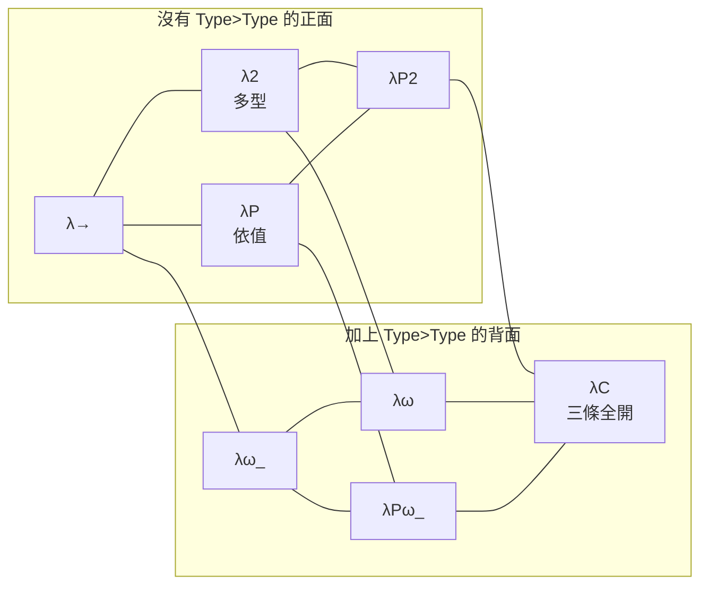

# 5.5 λC：三個維度同時打開

前三節我們沿著 λ-cube 的三條軸各走了一段：5.2 拆開最小的頂點 λ→ ，5.3 沿「型的型別」這條軸加上 `Type>Prop` 得到多型 λ2 ，5.4 沿「型別依賴於項」這條軸加上 `Prop>Type` 得到依值型別 λP 。每一節都只動了 `rules` 集合裡的一個字串，核心其餘部分一字未改。這節要問的問題是：**如果三條軸同時打開，會得到什麼？**

答案是 λC ——Calculus of Constructions，Barendregt 在 1980 年代初提出的那個「什麼都放進去」的頂點。

## λC 在 `CUBE` 表裡的位置

`CUBE` 表在 `lambda-cube/src/cube.js` 的 cube.js:5-6：

```js
const CUBE = { 'λ→': [], 'λ2': ['Type>Prop'], 'λP': ['Prop>Type'], 'λω_': ['Type>Type'], 'λP2': ['Type>Prop', 'Prop>Type'],
  'λω': ['Type>Prop', 'Type>Type'], 'λPω_': ['Prop>Type', 'Type>Type'], 'λC': ['Type>Prop', 'Prop>Type', 'Type>Type'] };
```

λC 在 cube.js:6 的最後，規則是三條全開。配合 cube.js:170 永遠存在的基底規則 `Prop>Prop`，λC 的規則集合是：

$$
\{\,\mathit{Prop}>\mathit{Prop},\; \mathit{Type}>\mathit{Prop},\; \mathit{Prop}>\mathit{Type},\; \mathit{Type}>\mathit{Type}\,\}
$$

四個字串，涵蓋了「定義域的 sort」與「值域的 sort」的所有組合。這就是「Calculus of Constructions」這個名字的字面意思：**把所有構造都放進同一個演算裡**。

## 八個頂點：三條軸的獨立性

回頭看 5.4 節末尾那張三軸對照表：

| 軸 | 規則 | λ-cube 裡的樣子 |
|---|---|---|
| 項依賴於項 | （λ 演算本身） | `Lm` / `Ap` |
| 型別依賴於型別 | `Type>Prop`（λ2） | `forall (A : Prop), A → A` |
| 型別依賴於項 | `Prop>Type`（λP） | `Vec : Nat → Prop`、`cons : ∀ (n : Nat), Vec n → Vec (succ n)` |

三條軸可以獨立打開或關閉，於是 $2^3 = 8$ 個頂點。把 `CUBE` 表攤平，就是完整的八格：

| 頂點 | 額外規則 | 能表達什麼 | 對應的邏輯能力 |
|---|---|---|---|
| λ→ | （無） | 命題之間的蘊含 | 直觀命題邏輯 |
| λ2 | `Type>Prop` | 對命題本身做量化 | 二階邏輯、System F 的 impredicativity |
| λP | `Prop>Type` | 型別是項的函數 | 一階量詞、依賴型別 |
| λP2 | `Type>Prop`、`Prop>Type` | 多型與依值同時可用 | 二階與一階的混合 |
| λω_ | `Type>Type` | $\mathit{Prop}$ 在 $\mathit{Type}$ 內對 Π 封閉 |  kinds 的 $\mathit{Type} : \mathit{Type}$ |
| λω | `Type>Prop`、`Type>Type` | 多型加上型別運算子 | System F + 種類多態 |
| λPω_ | `Prop>Type`、`Type>Type` | 依值加上型別運算子 | 一階量詞 + kinds |
| λC | 三者全有 | 全部 | Calculus of Constructions |

下面這張圖把八個頂點畫成一個立方體。讀法是：**左邊是「沒有 `Type>Type`」的四個頂點，右邊是「有 `Type>Type`」的四個頂點；上下是 `Type>Prop` 與 `Prop>Type` 兩條軸；由左往右是第三條軸。**



這張圖真正的重點不在形狀，而在**邊的意義**：cube.js:5-6 的 `CUBE` 表裡，每一個頂點的規則集合都恰好是基底 `Prop>Prop` 加上三條規則的某個子集。所以八個頂點不是八套不同的核心，而是**同一套核心加八個不同的形成規則集合**。5.2 節說過「核心的其他部分完全不必改動」，現在我們看到這句話的完整含義：連「有哪些頂點」這件事本身，都只寫在一張物件字面量裡。

這個設計的後果是：**新增一個頂點不需要改核心，也不需要改策略層，只需要改一張表。** 這正是 Barendregt 說 lambda-cube 是一個「框架」而不是一個「系統」的意思。

## `system` 指令：切換頂點的機制

腳本裡的 `system` 指令由 cube.js:181 處理：

```js
if (kind === 'system') { setSys(body); cmd.text = `${sys}  規則:${[...rules].join('  ')}`; }
```

而 `setSys` 在 cube.js:170：

```js
const setSys = n => { if (!CUBE[n]) throw new Error(`未知的系統 ${n},可用:${Object.keys(CUBE).join(' ')}`); sys = n; rules = new Set(['Prop>Prop', ...CUBE[n]]); K = kernel(G, rules, fl); };
```

這一行做了三件事：**換掉 `sys`**、**用新的規則集合重建 `rules`**、**用新的規則集合重建核心 `K`**。cube.js:171 的 `setSys('λC');` 是預設值——**沒有寫 `system` 的腳本，一律跑在 λC 上**。

重建 `K` 之所以必要，是因為 `rules` 被 `kernel()` 閉包捕捉（cube.js:75 的 `kernel(G, rules, fl)`），而 `infer()` 的 `p` 分支（cube.js:103）要查 `rules.has(s1 + '>' + s2)`。`rules` 一旦換了，核心裡那份參照就過期了，所以整個核心要重建。

但有兩件事**不會**跟著換：

1. **全域環境 `G` 不變。** `kernel(G, rules, fl)` 裡的 `G` 是同一個物件。切換系統不會丟掉先前宣告的 `def`、`axiom`、`theorem`。
2. **`fl`（`sorry` 旗標）不變。** 這代表一個腳本裡先 `sorry` 過、再切系統，旗標會被沿用。

我們把這件事實測一遍：

```
system λC
def And (A B : Prop) : Prop := forall (C : Prop), (A -> B -> C) -> C
axiom P : Prop
system λ→
check And
check And P
eval And P
```

輸出：

```
✔ system λC  規則:Prop>Prop  Type>Prop  Prop>Type  Type>Type
✔ def And : Prop → Prop → Prop
✔ axiom P : Prop
✔ system λ→  規則:Prop>Prop
✔ check And : Prop → Prop → Prop
✔ check And P : Prop → Prop
✔ eval fun (B : Prop) => ∀ (C : Prop), (P → B → C) → C : Prop → Prop
```

`And` 是在 λC 下宣告的，切到 λ→ 之後仍然用得好好的。但同一個 `And`，如果在 λ→ 下重新 `def` 一次：

```
system λ→
def And (A B : Prop) : Prop := forall (C : Prop), (A -> B -> C) -> C
```

輸出：

```
✘ def
    目前的系統不允許這個 Π 型別:定義域屬於 Type,值域屬於 Type(缺少規則 Type>Type):Prop → Prop
```

**同一個定義，在 λC 下合法、在 λ→ 下非法。** 差別只在宣告的那一刻。

這裡藏著一個值得明說的設計取捨：**形成規則只在「推導一個 Π 型別的 sort」時被檢查（cube.js:103），而 `infer()` 對常數節點只回傳已宣告的型別、不再重新檢查（cube.js:98）。** 所以切換系統**不追溯既往**——先前宣告的常數永遠是合法的，除非它的值被展開成 Π 型別後又被重新推導。這個取捨換來了簡潔（核心裡沒有「常數的宇宙檢查」這種東西），代價是系統之間的隔離並不嚴密。第 8 章談「缺了什麼」時，會再回頭看這裡。

順帶一提，`system` 的名字寫錯了會怎樣：

```
system λX
```

```
✘ system
    未知的系統 λX,可用:λ→ λ2 λP λω_ λP2 λω λPω_ λC
```

八個頂點的名字直接從 `CUBE` 的鍵列出來（cube.js:170 的 `Object.keys(CUBE).join(' ')`）。**文件與實作永遠一致**，因為文件就是那張表。

## λC 仍然不足

λC 是 λ-cube 的頂點，但「頂點」的意思是「這個框架裡的頂點」，不是「這個框架裡最強的東西」。現在我們把 λC 的缺口攤開來看——它們正好是第 8 章的目錄。

**第一，缺宇宙階層。** `Type` 沒有型別，cube.js:97 說得很直白：

```js
case 's': if (t.s === 'Prop') return Sx('Type'); throw E('Type 沒有型別(λ-cube 的最頂層)');
```

所以 `check Type` 直接失敗：

```
✘ check
    Type 沒有型別(λ-cube 的最頂層)
```

這不只是「不夠用」，它還讓 `Type>Type` 這條規則**幾乎無處可用**。因為「定義域的 sort 是 `Type`」這件事，在這個實作裡只能靠「定義域是一個 sort 為 `Type` 的**項**」來達成——而 `Prop` 正是這樣的項（cube.js:97 說 `Prop` 的型別是 `Type`）。`Type` 自己則不行，因為它沒有型別。實測：

```
system λω_
check forall (A : Type), A
```

```
✘ check
    Type 沒有型別(λ-cube 的最頂層)
```

而在 λω 下，`forall (A : Prop), Prop` 卻是合法的，而且它的型別是 `Type`：

```
✔ check Prop → Prop : Type
```

於是我們得到一個有點諷刺的結論：**λω_ 與 λω 這兩個頂點的招牌規則 `Type>Type`，在這個實作裡只能拿 `Prop` 去用，不能拿 `Type` 去用。** 真正的 kinds（ $\mathit{Type} : \mathit{Type}$ ）在這個實作裡缺席。第 8.1 節會把這件事徹底解決。

**第二，缺 η 規則。** `conv` 只做結構相等加 β/δ 展開（cube.js:82-90），所以 `fun (x : A) => f x` 與 `f` 在核心眼裡是不同的項。目前這個缺口還看不見，因為 `conv` 的五個呼叫點（cube.js:111、136、139、204、212）**全部作用於型別**，沒有一個作用於項。但只要加入任何「項的定義等價」判斷——例如把 $\equiv$ 做成一個可以 `exact` 的命題——這個缺口立刻變成一個證不出來的定理。

**第三，缺歸納型別。** 5.4 節的 `Nat` 是 `axiom` 出來的：

```
axiom Nat : Prop
axiom zero : Nat
axiom succ : Nat -> Nat
```

它是一個**假設**，不是一個定義。你無法寫歸納原理（每個自然數都由 `zero` 與 `succ` 構成），也無法寫歸納證明。`README.md` 的限制段落第一句就是「沒有歸納型別」。

**第四，缺隱含參數。** `def id : forall (A : Prop), A -> A` 逼你每次都把 $A$ 寫出來：`id P`。在 Coq 裡你寫 `id` 就好， $A$ 由推斷得出。λ-cube 的 `apply` 策略在遇到依賴參數時還會主動擋下來（cube.js:145：「apply 遇到依賴型參數(∀),請把參數寫進去」）。

**第五，`def` 不能遞迴。** 這是實作順序造成的：`G[name]` 是在解析完主體之後才寫入（cube.js:213），所以主體裡看不到自己。實測：

```
def loop : Prop := loop
```

```
✘ def
    未定義的名稱 loop
```

**第六，`theorem` 是不透明的。** `theorem` 與 `axiom` 在 `G` 裡存成同一種形狀（`{ ty: decl }`，cube.js:190），沒有 `val`，所以 `whnf`（cube.js:79 的 δ-redex 分支）不會展開它：

```
✔ theorem t : A → A
✔ eval t : A → A
```

`eval` 印出的是 `t` 本身，不是它的證明項。定理可以用來**推導**，但不能用來**計算**。

**第七，化簡用「定義等價」而非最佳化。** README 最後一句說得很準：「化簡用『定義等價』而非最佳化,大型項會很慢」。`conv` 每次比較都做完整展開（cube.js:83 的兩個 `whnf`），遇到互相定義的長鏈條會指數級膨脹。

這七條缺口裡面，**第一、二、五、六、七條是實作取捨，第三、四條是框架本身的限制**。第 8 章會逐條處理。

## 五種指令的語意

`runScript`（cube.js:168）把腳本切成指令區塊，再用一個 `switch` 家族分流。cube.js:172 決定哪一行是指令的開頭：

```js
const starts = []; L.forEach((l, i) => /^(def|theorem|axiom|check|eval|system)\b/.test(l) && starts.push(i));
```

六個關鍵字：`def`、`theorem`、`axiom`、`check`、`eval`、`system`。除了 `system`（剛才講過），其餘五個的語意如下。

**`def`**（cube.js:210-213）：

```js
if (kind === 'def') {
  q.ex(':='); const val = wrap(Lm, bs, q.term());
  K.sort([], pis); if (!K.conv(K.infer([], val), pis)) throw new Error('定義的內容與宣告的型別不吻合');
  if (!q.done()) throw q.err('語法錯誤:多餘的符號'); G[name] = { ty: pis, val };
}
```

三道檢查加一次寫入。`K.sort([], pis)` 確認宣告的型別確實是個型別；`K.conv(K.infer([], val), pis)`（cube.js:212）是關鍵的一步——**`def` 的內容型別必須與宣告吻合**，因為 `wrap(Lm, bs, ...)` 已經把主體包成 λ 抽象，它的型別是一個 Π 型別。內容對不上就拒絕：

```
axiom P : Prop
def bad : P := fun (x : P) => x
```

```
✘ def
    定義的內容與宣告的型別不吻合
```

成功的 `def` 會把 `{ ty, val }` 寫進 `G`。`val` 的存在是 `def` 與 `axiom` 的分水嶺：**有 `val` 的常數可以被 δ-展開**，這正是 5.6 節 Church 編碼能運作的前提。

**`axiom`**（cube.js:214）：

```js
} else { if (!q.done()) throw q.err('語法錯誤:多餘的符號'); K.sort([], pis); G[name] = { ty: pis }; }
```

同一條路徑，但不做內容檢查（因為沒有內容），也不存 `val`。**`axiom` 就是一條被核心接受的假設。**

**`theorem`**（cube.js:185-207）是三者裡最複雜的。標頭必須以 `:= by` 結尾（cube.js:186-187），然後：

```js
const decl = wrap(Pi, bs, ty); K.sort([], decl); G[name] = { ty: decl }; cmd.text = `${name} : ${show(decl)}`;
```

`wrap(Pi, bs, ty)` 把定理的所有假設包成 Π 型別——**定理在 `G` 裡存的是「全量量化後的命題」**。接著策略逐行執行（cube.js:194-199），每一步都產生一個含洞的證明項；最後 `fill`（cube.js:165）把所有洞換成實際的子項，再做最後一道檢查（cube.js:203-205）：

```js
fl.sorry = false; const full = wrap(Lm, bs, fill(S.assign[g0.id], S.assign));
if (!K.conv(K.infer([], full), decl)) throw new Error('核心推出的型別與宣告不符');
if (fl.sorry) cmd.status = 'sorry';
```

「核心推出的型別與宣告不符」這句話，正是 5.1 節說過的「型別檢查就是證明檢查」的最後一次兌現。而且注意 `fl.sorry = false;` 這一行：**`sorry` 旗標在每個 theorem 開頭被清掉**，所以一個腳本裡的 `sorry` 不會污染後面的定理。

**`check` 與 `eval`**（cube.js:182-184）共用一段程式碼：

```js
const q = parser(body, [], G), t = q.term(); if (!q.done()) throw q.err('語法錯誤:多餘的符號');
cmd.text = `${show(kind === 'eval' ? K.nf(t) : t)} : ${show(K.infer([], t))}`;
```

差別只有一個：`eval` 把項換成 `K.nf(t)`（完全正規形，cube.js:91），`check` 保持原樣。兩者都在**空的上下文**下推導（`K.infer([], t)`），所以它們只能在全域環境 `G` 裡操作，看不到任何局部假設。

把五種指令整理成一張表：

| 指令 | 形式 | 寫進 `G` 的東西 | 能否被 δ-展開 | 核心檢查 |
|---|---|---|---|---|
| `def` | `def 名 (x : A) : B := t` | `{ ty, val }` | 能 | 內容型別與宣告吻合（cube.js:212） |
| `axiom` | `axiom 名 : T` | `{ ty }` | 不能 | `T` 是型別（cube.js:214） |
| `theorem` | `theorem 名 (x : A) : B := by ...` | `{ ty }` | 不能 | 核心推出的型別與宣告吻合（cube.js:204） |
| `check` | `check t` | — | — | 推導 `t` 的型別並印出 |
| `eval` | `eval t` | — | — | `nf(t)` 印正規形，並印出型別 |

注意 `theorem` 與 `axiom` 在 `G` 裡的形狀相同：**兩者都不帶 `val`**。這就是為什麼「定理不透明」——定理在邏輯上確實像一個假設，但在實作上它跟 `axiom` 走同一條路。

## 一段完整的 λC 腳本

把這節講過的東西串起來，跑一遍 cube.js:246 的內建範例：

```
system λC
def Ex (A : Prop) (P : A -> Prop) : Prop := forall (C : Prop), (forall (x : A), P x -> C) -> C
theorem ex_intro (A : Prop) (P : A -> Prop) (a : A) (h : P a) : Ex A P := by
  intro C f
  apply f a
  assumption
```

輸出：

```
✔ system λC  規則:Prop>Prop  Type>Prop  Prop>Type  Type>Type
✔ def Ex : ∀ (A : Prop), (A → Prop) → Prop
✔ theorem ex_intro : ∀ (A : Prop), ∀ (P : A → Prop), ∀ (a : A), P a → Ex A P
```

這段腳本值得停下來看一眼，因為 `Ex` 的**宣告型別** `∀ (A : Prop), (A → Prop) → Prop` 需要三條規則全部開啟：

- 外層 Π 的定義域是 `Prop`（sort 為 `Type`），值域是 `(A → Prop) → Prop`（sort 為 `Type`），需要 `Type>Type` ；
- 中層 Π 的定義域是 `A → Prop`，其中 $A$ 是個 `Prop` 的元素（sort 為 `Prop`），值域 `Prop` 的 sort 是 `Type`，需要 `Prop>Type` ；
- 主體 `forall (C : Prop), ...` 的定義域 sort 是 `Type`，值域 sort 是 `Prop`，需要 `Type>Prop` 。

把 `Ex` 拿到別的頂點去試，就會看到缺哪一條：

```
system λω
def Ex (A : Prop) (P : A -> Prop) : Prop := forall (C : Prop), (forall (x : A), P x -> C) -> C
```

```
✘ def
    目前的系統不允許這個 Π 型別:定義域屬於 Prop,值域屬於 Type(缺少規則 Prop>Type):A → Prop
```

```
system λP2
def Ex (A : Prop) (P : A -> Prop) : Prop := forall (C : Prop), (forall (x : A), P x -> C) -> C
```

```
✘ def
    目前的系統不允許這個 Π 型別:定義域屬於 Type,值域屬於 Type(缺少規則 Type>Type):(A → Prop) → Prop
```

**`Ex` 是整個 lambda-cube 裡第一個真正需要 λC 的定義。** 這不是巧合，而是設計的證據：一旦命題邏輯的連接詞要以 Church 編碼寫出來（下一節的主題），你就需要一個能同時做多型量化、把命題當型別運算子、以及把謂詞當成從元素到命題的函數的系統。

## 小結與交棒

λC 的收穫是：三條軸同時打開，得到一個「什麼都能寫」的型別論；而且這件事**不需要核心做任何改動**——八個頂點之間的差別，就是 `CUBE` 表裡的一個子集。

λC 的代價是：它其實還不是一個能用的量詞理論。`Type` 沒有型別，所以沒有宇宙階層；沒有歸納型別，所以自然數只能當假設；沒有 η 規則，連項的定義等價都不完整；`def` 不能遞迴，`theorem` 不透明，conv 用的是暴力的展開。**頂點是最高的，但不是終點。**

而且還有一件事一直沒做：5.1 節說過，核心裡沒有 $\wedge$ 、 $\lor$ 、 $\exists$ 、 $\bot$ ，它們只是「用戶在 Π 型別之上定義的縮寫」。我們在 5.4 節看過 `Vec` 這種依值型別的威力，卻還沒看過最基本的連接詞究竟長什麼樣子。下一節就把它們攤開。

## 延伸閱讀

- Barendregt, *The Lambda Calculus*, §5.2–5.3（λP 與 λC 的形成規則）。
- Coquand & Bellin, *A Translation from Classical to Constructive Logic*（Calculus of Constructions 的由來）。
- Martin-Löf, *Intuitionistic Type Theory*, §1.1（宇宙階層的必要性）。

## 下一節

下一節我們回到 lambda-cube 核心裡那個「什麼連接詞都沒有」的設計，把它攤開成具體的定義： $\wedge$ 、 $\lor$ 、 $\exists$ 、 $\bot$ 各自對應到哪個 Π 型別，每一個 `intro` / `apply` / `assumption` 在 Church 編碼下究竟代表什麼，以及——最重要的——這種「連接詞由使用者自己寫出來」的安排，**為核心省下了什麼、又讓核心付出了什麼**。
