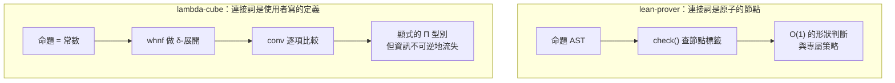

# 5.6 Church 編碼：∧、∨、∃、⊥ 的定義

上一節把 λ-cube 的頂點推到最高，得到的結論卻有點反直覺：**λC 什麼都能做，但核心裡沒有 $\wedge$ 、 $\lor$ 、 $\exists$ 、 $\bot$ 。** 這節把這四個連接詞攤開來看，會發現它們並不是「不支援」，而是**被降格成使用者寫的 Π 型別定義**。降格的代價是繁瑣，收益是核心的小——兩者都值得看清楚，因為它們正是「命題即型別」最徹底的版本。

## 連接詞為什麼必須自己寫

回到 cube.js 的檔頭註解（cube.js:2）：「項只有 5 種節點……連接詞全由 Π 型別定義出來。」

這句話在程式碼裡是硬性事實：`infer()` 的 `switch`（cube.js:95-114）七個分支裡沒有一個是「這是合取」；`conv()`（cube.js:82-90）也沒有「這是析取」的比較。核心認識的形狀只有五種：變數、sort、應用、λ 抽象、Π 型別。

那麼 $\wedge$ 從哪裡來？只能從 Π 型別「定義」出來。而 Church 在 1930 年代給出的那個定義，恰好是唯一合理的選擇：**用「對任意目標都能給出證明」來定義邏輯連接詞。** 下面每一條定義都取自 cube.js 的內建範例，或可由它直接驗證。

## 四個定義

### 合取：給我一個造得出任何命題的函數

```
def And (A B : Prop) : Prop := forall (C : Prop), (A -> B -> C) -> C
```
（cube.js:243）

白話直覺：**「給我一個不論要證什麼 $C$ 都能證明的函數，我就同時擁有 $A$ 和 $B$ 。」**

拆成三層看：

1. `forall (C : Prop), ...`——對**任意**命題 $C$ 。這是關鍵： $C$ 不是我事先挑的，是對方挑的。
2. `(A -> B -> C) -> C`——對方給我一個「把 $A$ 和 $B$ 組合成 $C$ 的辦法」，我就給他一個 $C$ 。
3. 整體——所以「我是一個 $A$ 和 $B$ 的同時擁有者」。

與笛卡兒積 $A \times B$ 對照：積型別有專門的 `pair` 、 `fst` 、 `snd` 三個函數；Church 編碼的 $\wedge$ **一個專門函數都沒有**，因為「只取出一個 $A$ 」在型別論裡沒有一致的方式（要取出 $A$ ，就得給出「從 $B$ 與 $A$ 造出 $A$ 的函數」，等於把 $B$ 丟掉）。

### 析取：任一能推出 $C$ ，我就推出 $C$

```
def Or (A B : Prop) : Prop := forall (C : Prop), (A -> C) -> (B -> C) -> C
```
（cube.js:244）

白話直覺：**「 $A$ 或 $B$ 任一能推出 $C$ ，我就推出 $C$ 。」**

這個定義最值得停下來的地方是：**它把「 $\lor$ 消去律」寫成了型別本身。** 在第 3 章的自然演繹裡， $\lor$ 消去（從 $A \lor B$ 、 $A \to C$ 、 $B \to C$ 得 $C$ ）是一條需要三個前提的推理規則（lean.js:94 的 `orE`）。在 Church 編碼裡，它不是一條規則，而是「 $A \lor B$ 這個型別的內容物」：對方給我兩個函數（從 $A$ 推 $C$ 的、從 $B$ 推 $C$ 的），我給他一個 $C$ 。

換句話說，**邏輯規則被提升成了型別的結構**。這是 Curry–Howard 對應最漂亮的一個後果。

### 存在：見證能推出 $C$ ，我就推出 $C$

```
def Ex (A : Prop) (P : A -> Prop) : Prop := forall (C : Prop), (forall (x : A), P x -> C) -> C
```
（cube.js:246）

白話直覺：**「存在一個 $x$ 使得 $P\,x$ 能推出 $C$ ，我就推出 $C$ 。」**

`P : A -> Prop` 是一個**從項到命題的函數**，也就是邏輯學裡的「謂詞」。`Ex` 的宣告型別 `∀ (A : Prop), (A → Prop) → Prop` 需要 `Type>Type` 與 `Prop>Type` 兩條規則，所以 5.5 節末尾實測過：`Ex` 在 λω 與 λP2 下都被核心拒絕，只有 λC 容得下它。**`Ex` 是整個 lambda-cube 裡第一個真正需要 λC 的定義**，這不是巧合，而是設計的證據。

### 矛盾：從矛盾可以推出任何 $C$

```
def False : Prop := forall (C : Prop), C
```

這一條不在內建範例裡，但它是唯一自然的編碼，而且它立刻能用：

```
system λ2
def False : Prop := forall (C : Prop), C
axiom P : Prop
theorem botE (C : Prop) (h : False) : C := by
  exact h C
```

```
✔ def False : Prop
✔ theorem botE : ∀ (C : Prop), False → C
```

白話直覺：**「從矛盾可以推出任何 $C$ 。」** 而且注意 `False` 本身就是「對任何 $C$ 的證明」，所以連續推兩次也沒問題： $C$ 可以是 $D$ ， $D$ 可以是 $E$ 。

還要注意 `False` 的**頂點限制**：這個 Π 的定義域是 `Prop`（sort 為 `Type`），值域的 sort 是 `Prop` ，需要 `Type>Prop` 。所以它在 λ→ 裡不合法：

```
✘ def
    目前的系統不允許這個 Π 型別:定義域屬於 Type,值域屬於 Prop(缺少規則 Type>Prop):∀ (C : Prop), C
```

**連「矛盾」這個概念，在 lambda-cube 裡都要多型才能寫出來。**

把四條定義並排放成 Π 型別，會發現它們是同一個句型：

$$
\mathit{And}\,A\,B \;\equiv\; \Pi (C : \mathit{Prop}).\, \Pi (f : A \to B \to C).\, C
$$

$$
\mathit{Or}\,A\,B \;\equiv\; \Pi (C : \mathit{Prop}).\, \Pi (f : A \to C).\, \Pi (g : B \to C).\, C
$$

$$
\mathit{Ex}\,A\,P \;\equiv\; \Pi (C : \mathit{Prop}).\, \Pi (f : \Pi (x : A).\, P\,x \to C).\, C
$$

$$
\mathit{False} \;\equiv\; \Pi (C : \mathit{Prop}).\, C
$$

**同一個句型：先量化一個「要證明的目標 $C$ 」，再要求對方交出一個能從前提造出 $C$ 的函數。** $\mathit{False}$ 是這個句型退化到極致的樣子——連前提都沒有，直接要對方交出 $C$ 。

## 逐行讀懂 `and_swap`

cube.js:243 的內建範例還多定義了一個 `and_intro`：

```
def And (A B : Prop) : Prop := forall (C : Prop), (A -> B -> C) -> C
def and_intro (A B : Prop) (a : A) (b : B) : And A B := fun (C : Prop) (f : A -> B -> C) => f a b
theorem and_swap (A B : Prop) (h : And A B) : And B A := by
  intro C f
  apply h C
  intro a b
  apply f
  assumption
  assumption
```

`and_intro` 就是引入規則：給定 $a : A$ 與 $b : B$ ，構造 `fun (C : Prop) (f : A -> B -> C) => f a b` ——「不管你要證什麼 $C$ ，我給你一個從 $A$ 與 $B$ 造出 $C$ 的函數」。

現在讀 `and_swap`。目標是 `And B A`，核心先用 `whnf` 把它 δ-展開（cube.js:79 的 δ-redex 分支），得到 `∀ (C : Prop), (B → A → C) → C` 。

- **`intro C f`** ——引入 $C$ 與 $f$ 。 $f$ 的型別被顯示成 `B → A → C`，順序是**反的**：目標是 `And B A`，所以先要 $B$ 再要 $A$ 。目標變成 $C$ 。邏輯意義是：「我答應，不管你要證什麼 $C$ ，我都給你一個從 $B$ 和 $A$ 造出 $C$ 的函數」。
- **`apply h C`** —— $h : \mathit{And}\,A\,B$ ，展開成 `∀ (C : Prop), (A → B → C) → C` 。把 $h$ 用在命題 $C$ 上，得到「從 $A$ 和 $B$ 造出 $C$ 的函數」，型別是 `(A → B → C) → C` 。`apply` 發現它的結論 $C$ 與當前目標 $C$ 吻合，於是把前提拆成新目標 `A → B → C` 。邏輯意義是：「用 $h$ 從 $A$ 和 $B$ 造出 $C$ 」，而我們還欠 $A$ 和 $B$ 。
- **`intro a b`** ——把 `A → B → C` 拆成兩個假設 $a : A$ 、 $b : B$ 。目標回到 $C$ 。
- **`apply f`** —— $f : B \to A \to C$ 。套用它，核心產生**兩個**目標，順序是先 $B$ 後 $A$ （因為 $f$ 的第一個參數是 $B$ ）：`⊢ B` 與 `⊢ A` 。邏輯意義是：「 $f$ 要一個 $B$ 和一個 $A$ ，給它們，它回我一個 $C$ 」。
- **`assumption`** ——用 $b$ 填掉 `⊢ B` 。
- **`assumption`** ——用 $a$ 填掉 `⊢ A` 。

整個證明的骨架現在完全透明：`And B A` 要求「給我一個從 $B$ 和 $A$ 造出 $C$ 的函數」，而 $h$ 提供「從 $A$ 和 $B$ 造出 $C$ 的函數」；於是我們做的事情就是**把 $h$ 的產物重新排一次序**。** $\wedge$ 的交換律在 Church 編碼裡，就是「把兩個前提對調」。**

## 逐行讀懂 `or_comm`

```
def Or (A B : Prop) : Prop := forall (C : Prop), (A -> C) -> (B -> C) -> C
theorem or_comm (A B : Prop) (h : Or A B) : Or B A := by
  intro C f g
  apply h C
  intro a
  apply g
  assumption
  intro b
  apply f
  assumption
```

- **`intro C f g`** ——目標 `Or B A` 展開成 `∀ (C : Prop), (B → C) → (A → C) → C` ，引入三個綁定： $C$ 、 $f : B \to C$ 、 $g : A \to C$ 。**這兩個函數正是 $\lor$ 消去的兩個分支**——它們在 Church 編碼裡不是一條規則的兩個前提，而是**型別本身的兩個組成部分**。
- **`apply h C`** —— $h : \mathit{Or}\,A\,B$ ，用在 $C$ 上得到 `(A → C) → (B → C) → C` ；`apply` 把它拆成兩個新目標：`⊢ A → C` 與 `⊢ B → C` 。
- **`intro a`** ——第一個目標拆出 $a : A$ ，目標 $C$ 。
- **`apply g`** —— $g : A \to C$ ，套用它，目標變成 `⊢ A` 。這裡是關鍵一步： $h$ 給的分支是「從 $A$ 推 $C$ 」，我手上的是「從 $A$ 推 $C$ 」與「從 $B$ 推 $C$ 」兩個函數，現在要把 $h$ 的 $A$ 分支接到我的 $A$ 分支上。
- **`assumption`** ——用 $a$ 填掉 `⊢ A` 。
- **`intro b`** ——第二個目標拆出 $b : B$ ，目標 $C$ 。
- **`apply f`** —— $f : B \to C$ ，目標變成 `⊢ B` 。
- **`assumption`** ——用 $b$ 填掉 `⊢ B` 。

整體： $h$ 說「給我一個從 $A$ 推 $C$ 的與一個從 $B$ 推 $C$ 的，我就給你 $C$ 」；目標 `Or B A` 說「給我一個從 $B$ 推 $C$ 的與一個從 $A$ 推 $C$ 的，我就給你 $C$ 」。**兩個函數對調即可。** `or_comm` 之所以比 `and_swap` 多兩行，是因為 $\lor$ 的編碼裡有**兩個**分支函數，每個分支都要 `intro` 一次、`apply` 一次、`assumption` 一次。

## 逐行讀懂 `ex_intro`

```
def Ex (A : Prop) (P : A -> Prop) : Prop := forall (C : Prop), (forall (x : A), P x -> C) -> C
theorem ex_intro (A : Prop) (P : A -> Prop) (a : A) (h : P a) : Ex A P := by
  intro C f
  apply f a
  assumption
```

- **`intro C f`** ——目標 `Ex A P` 展開成 `∀ (C : Prop), (∀ (x : A), P x → C) → C` ，引入 $C$ 與 $f : \forall (x : A).\, P\,x \to C$ 。這是「給我一個能把見證 $x$ 變成 $C$ 的函數」。
- **`apply f a`** —— $f$ 的型別是 $\forall (x : A).\, P\,x \to C$ ，套用在見證 $a$ 之後，型別變成 $P\,a \to C$ （`inst` 把 $x$ 真真切切代成 $a$ ，這是 5.4 節講過的依值行為）。目標是 $C$ ，所以 `apply` 把前提 $P\,a$ 拆成新目標。邏輯意義是：「把見證 $a$ 交給 $f$ ，它還欠你一個 $P\,a$ 」。
- **`assumption`** ——用 $h : P\,a$ 填掉它。

`ex_intro` 只有三行，因為 $\exists$ 的編碼裡「見證」是**被綁在 $\forall (x : A)$ 裡的**。在這四個連接詞中， $\exists$ 是唯一一個量化**項**（而不是量化命題）的，因此它是唯一一個需要依值型別（5.4 節第三條軸）才寫得出來的，也因此它的證明裡必須把見證 $a$ 明確地「餵」給 $f$ 。

## 與第 3 章的對照

現在可以攤開兩條路線的差別了。

| | lean.js（自然演繹） | cube.js（λ-cube，Church 編碼） |
|---|---|---|
| $\wedge$ 的表示 | AST 節點 `{t:'and', l, r}`（lean.js:89） | 使用者寫的 `def And` |
| 核心如何認出它 | `need(C(p.p), 'and', '∧ 消去')`，比對節點標籤（lean.js:90） | 沒有「∧ 檢查」；只能 δ-展開後逐項比較 |
| 消去規則 | `andE1` / `andE2` 各一條規則（lean.js:90-91） | 沒有專門規則；要 `apply h A` 再 `intro a b` |
| $\lor$ 消去 | `orE` 一條規則處理兩個分支（lean.js:94） | 沒有專門規則；兩個分支各自走一遍 |
| $\exists$ 引入 | `exI` 一條規則（lean.js:101） | 沒有專門規則；要 `apply f a` |
| $\bot$ 消去 | `botE` 一條規則（lean.js:97） | 沒有專門規則；要 `exact h C` |
| 使用者要寫的東西 | `P ∧ Q` | `def And (A B : Prop) : Prop := ...` |

策略層的對比更乾脆。cube.js 的策略只有六個：`intro` 、 `exact` 、 `assumption` 、 `apply` 、 `have` 、 `sorry` （cube.js:127-162），**沒有一個是連接詞專屬的**；而 lean.js 有 `constructor` （lean.js:153）、 `left` / `right` （lean.js:154）、 `exists` （lean.js:155）、 `exfalso` （lean.js:156）、以及 `cases` 裡對 $\wedge$ 、 $\lor$ 、 $\exists$ 的三套分支（lean.js:160-162）。



**兩條路線的取捨可以一句話說完**：lean.js 把連接詞當成原子的資料結構，換來核心裡九條現成的連接詞規則（lean.js:89-94、97、101-102）與六個現成的連接詞策略，代價是核心要為每個連接詞寫一份形狀檢查；cube.js 把連接詞降格成 Π 型別，換來核心裡一個連接詞分支都不用寫，代價是使用者要自己寫定義、自己多打很多行。

## 可量化的對比

把兩個程式裡同名的定理並排放，行數差距是能量出來的：

| 定理 | lean-prover | lambda-cube | 差距的來源 |
|---|---|---|---|
| $\wedge$ 交換律 | 5 行（lean.js:232） | 6 行（cube.js:243） | 多一次「展開並引入 $\forall (C : Prop)$ 」 |
| $\lor$ 交換律 | 6 行（lean.js:234） | 8 行（cube.js:244） | $\lor$ 的兩個分支各自要 `intro` / `apply` / `assumption` 三件套 |
| $\exists$ 引入 | 2 行（`exists` + `exact`，lean.js:155） | 3 行（cube.js:246） | 多一次「展開並引入 $\forall (C : Prop)$ 」 |

這兩列的差距是怎麼來的？lean-prover 版的 `cases h with hp hq` 一步就給出 $hp$ 與 $hq$ ，而 Church 編碼裡 `And A B` 多了一層 `∀ (C : Prop)` ，所以必須 `intro C f` 、`apply h C` 、`intro a b` 三步才走得到同樣的地方。**這個多出來的 `∀ (C : Prop)` 不是浪費——它是「這個合取對任何目標都成立」這件事的完整內容。** 把它省掉是可能的（用內建的 $\wedge$ 節點），但省掉的同時也就把資訊藏起來了。

## 爆炸原理：`False` 與 `botE`

lean.js 的 `botE`（lean.js:97）：

```js
case 'botE': need(C(p.p), 'bot', '⊥ 消去'); return p.f;
```

`need(...)` 只檢查前提的節點標籤是不是 `'bot'`；然後 `return p.f` ——**結論是使用者寫的，核心完全不去檢查**。這就是爆炸原理在核心裡的樣子：從 $\bot$ 可以得到任何東西。

在 lambda-cube 裡，同一件事變成：

```
theorem botE (C : Prop) (h : False) : C := by
  exact h C
```

$h : \mathit{False}$ 展開成 $\forall (C : \mathit{Prop}).\, C$ ，所以 `h C` 的型別就是 $C$ 。**「從矛盾推出任何東西」不再是核心的一條規則，而是「把 $\bot$ 的展開式套用在目標上」這個 β-歸約。**

這是「邏輯與型別同構」最漂亮的一個例子： $\bot$ 的邏輯內容（它能推出一切）與它的型別內容（它是一個對每個命題都有元素的 Π）**是同一件事**，中間沒有任何翻譯層。lean.js 裡 `need(...)` 與 `return p.f` 之間的那道「翻譯」，在這裡根本不存在。

順帶一提，這也解釋了為什麼 lambda-cube 沒有 `exfalso` 策略：在 lean.js 裡 `exfalso` （lean.js:156）是一條把目標換成 $\bot$ 的專屬策略；在 lambda-cube 裡同樣的效果要寫成 `exact h C` ——**連接詞專屬的策略消失了，因為連接詞不再是核心裡的東西。**

## 代價：單向可讀、不可逆

Church 編碼最實際的代價，是**它只能往一個方向讀**。

往正向讀是很好的：展開 `And P Q` 會得到明確的 Π 型別。

```
system λω
def And (A B : Prop) : Prop := forall (C : Prop), (A -> B -> C) -> C
axiom P : Prop
axiom Q : Prop
eval And P Q
```

```
✔ eval ∀ (C : Prop), (P → Q → C) → C : Prop
```

`conv` 判定因此能證明「`And A B` 等價於某個明確的 Π 型別」。而且因為 `conv` 不比較綁定變數的名字（cube.js:87 只比 `ty` 與 `b` ），連「兩個寫法不同的 Church 定義其實等價」都能判定：

```
system λω
def And (A B : Prop) : Prop := forall (C : Prop), (A -> B -> C) -> C
def And2 (A B : Prop) : Prop := forall (Z : Prop), (A -> B -> Z) -> Z
theorem same (A B : Prop) (h : And A B) : And2 A B := by
  exact h
```

```
✔ theorem same : ∀ (A : Prop), ∀ (B : Prop), And A B → And2 A B
```

但反過來就不行：**從展開式 $\forall (C : \mathit{Prop}).\, (P \to Q \to C) \to C$ ，你無法知道它原本是使用者寫的 `And P Q` ，還是使用者自己手寫的 Π 型別。** 資訊在展開的瞬間就丟掉了。

這正是「失去 $O(1)$ 的結構判斷」的精確內容。lean.js 的 `need(C(p.p), 'and', '∧ 消去')` 只需要看節點標籤，是 $O(1)$ 的；在 lambda-cube 裡想知道一個型別是不是「某個合取」，你必須先 `whnf` 把它 δ-展開，再逐項比較——而 `conv` 每一次比較都做完整展開（cube.js:83 的兩個 `whnf` ），遇到互相定義的長鏈條會指數級膨脹。README 最後一句講得很準：「化簡用『定義等價』而非最佳化,大型項會很慢」。

還有一個更實務的代價：**使用者要自己寫定義**。lean-prover 的使用者永遠不必想「合取是什麼」；lambda-cube 的使用者每開一個新腳本，都得先把 `And` 、 `Or` 、 `Ex` 、 `False` 四條定義抄一遍。**核心省下的行數，是使用者多打的行數。** 這筆帳在這個玩具裡是划算的（核心因此小了一整節），但在一個真實的系統裡，它就是「標準函式庫」存在與否的差別。

## 小結與交棒

本節的四個定義可以濃縮成一句話：**Church 編碼把每個邏輯連接詞定義成「對任意目標都能給出證明」的 Π 型別**，於是 $\wedge$ 、 $\lor$ 、 $\exists$ 、 $\bot$ 全部變成使用者寫的 `def` ，核心裡一個連接詞分支都不用留。

代價則是三條可指名的：核心無法 $O(1)$ 認出結構（要 δ-展開）、展開不可逆（資訊永久丟失）、使用者得自己寫定義。

下一節我們要往下鑽到這套機制的最底層：**那些 Π 型別與 λ 抽象是用什麼資料結構表示的？** 為什麼「變數」在 lambda-cube 裡不是一個名字而是一個數字？β-歸約怎麼把參數塞進函數體？`conv` 判定在比較什麼？這正是 5.4 節末尾埋下的伏筆——「綁定變數有沒有被用到」變成一個可計算的問題，靠的是 de Bruijn 索引。

## 延伸閱讀

- Church, *Introduction to Mathematical Logic*, §II（1934 年的 Church 編碼原始形式）。
- Barendregt, *The Lambda Calculus*, §5.3（Church 編碼與 Curry–Howard 對應的系統化處理）。
- Giménez, *Proofs and Types*（Curry–Howard 對應的完整發展，含 Church 編碼與直觀主義邏輯的等價性）。
- Wadler, *On the Expressive Power of the Types and the Pure Calculus of Applications*（Church 編碼與邏輯連接詞的對應）。

## 下一節

下一節：**de Bruijn 索引、β-歸約與 conv 判定**——把 lambda-cube 核心裡的 `V(i)` 、 `shift` 、 `subst` 、 `inst` 、 `uses` 、 `whnf` 、 `conv` 、 `nf` 一個一個攤開，並與第 3.5 節的 `key()` / `sub()` / 新鮮性檢查三件套並排比較。
