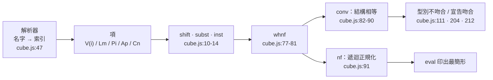

# 5.7 de Bruijn 索引、β-歸約與 conv 判定

上一節把 $\wedge$ 、 $\lor$ 、 $\exists$ 、 $\bot$ 攤開，確認它們全是用戶在 Π 型別之上寫出來的定義。這節要往下鑽兩層，看看**那些定義本身是用什麼資料結構承載的**。答案會讓人意外地簡單：lambda-cube 裡沒有「變數名」這種東西，只有 `V(i)` ——一個數字。本節要把這個數字、圍著它的三個運算（`shift` 、 `subst` 、 `inst` ）、以及最後那個把一切串起來的 `conv` 判定，一個一個攤開。

## 為什麼用索引

cube.js:7 的一行裡就有答案：

```js
const V = i => ({ k: 'v', i }), Sx = s => ({ k: 's', s }), Ap = (f, a) => ({ k: 'a', f, a }), Cn = n => ({ k: 'c', n }), Mv = id => ({ k: 'm', id });
```

變數節點 `v` 只有一個欄位：`i` ，一個整數。它的意思是「**從我所在的層級往外數，第 $i$ 層的綁定**」。索引 0 指向最近的綁定，索引 1 越過它指向再上一層，依此类推。

名字只出現在兩個地方，而且都在核心之外：

- **解析期**：cube.js:47 的 `const i = ns.lastIndexOf(x); if (i >= 0) return V(ns.length - 1 - i);` ——把使用者寫的名字換成索引。
- **顯示期**：cube.js:21 的 `case 'v': return ns[ns.length - 1 - t.i] ?? '#' + t.i;` ——把索引換回名字。

**核心從來不知道名字。** 這帶來的第一個收益是第 2.5 節說過的那個：**α 等價自動成立**。`fun (x : A) => x` 與 `fun (y : A) => y` 在核心眼裡是同一個資料結構（都是 `Lm('x', A, V(0))` 與 `Lm('y', A, V(0))`，而 `Lm` 的第一個欄位 `n` 從不參與任何比較），不需要任何「改名」或「正規化」的步驟。

第二個收益是**變數捕獲在結構上不可能**：名字方案要靠「偵測撞名 → 改名 → 重算」三步走，索引方案只要「加一」。

## `shift`：把索引推開

cube.js:10-11：

```js
const shift = (t, d, c = 0) => t.k === 'v' ? (t.i >= c ? V(t.i + d) : t) : t.k === 'a' ? Ap(shift(t.f, d, c), shift(t.a, d, c))
  : bind(t) ? { k: t.k, n: t.n, ty: shift(t.ty, d, c), b: shift(t.b, d, c + 1) } : t;
```

逐條讀：

- **`t.k === 'v'`** ——變數。若 `t.i >= c` 就把索引加上 `d` ，否則原封不動。`c` 是**門檻**：索引小於 `c` 的變數被某個「在這次移位範圍之內的綁定」佔著，所以它們不該移動。`c` 的預設值是 0 ，意思是一般情形下所有變數都移動。
- **`t.k === 'a'`** ——應用。函式與引數各自遞迴，門檻 `c` 不變（因為應用不新增綁定）。
- **`bind(t)`** ——λ 抽象或 Π 型別。`ty` （宣告的型別）以 `c` 遞迴，**`b` （主體）以 `c + 1` 遞迴**。差在這個 `+1` ：主體在綁定之下，所以它自己綁定的變數佔了索引 0 ，那些變數不該被移位，於是門檻要往上抬一格。

一句話：**`shift(t, d, c)` 把「深度 $c$ 以上的變數」的索引整體加上 $d$ ，用來處理「把一個項搬進另一個綁定的作用域」這件事。**

## `subst`：把索引降回

cube.js:12-13：

```js
const subst = (t, j, s) => t.k === 'v' ? (t.i === j ? s : t) : t.k === 'a' ? Ap(subst(t.f, j, s), subst(t.a, j, s))
  : bind(t) ? { k: t.k, n: t.n, ty: subst(t.ty, j, s), b: subst(t.b, j + 1, shift(s, 1)) } : t;
```

`subst(t, j, s)` 的意思是：**把 `t` 裡那個「深度 $j$ 的綁定變數」換成 `s` 。**

- **`t.k === 'v'`** ——若 `t.i === j` 就整個換成 `s` ，否則不動。注意是**整個換**，不是把 `s` 塞進去：`s` 是一個完整的項。
- **`t.k === 'a'`** ——應用，兩邊各自遞迴。
- **`bind(t)`** ——這是最關鍵的一行。`ty` 以 `j` 遞迴（型別部分不受綁定影響），但 `b` 以 **`j + 1`** 遞迴，而且替代項變成 **`shift(s, 1)`** 。兩件事必須同時做：

  - `j + 1` ：走進主體等於深了一層，被綁定的變數佔了索引 0 ，所以要替換的那個變數（如果在外面）的索引變成了 1 。
  - `shift(s, 1)` ：替代項 `s` 要被放進主體裡，它原本的自由變數索引要整體加一，才落在正確的深度上。

  **這兩件事合起來，就是「用綁定遮蔽掉原來的變數，同時把替代項推到正確深度」——也就是變數捕獲防護。在名字方案裡這件事要靠「偵測撞名 + 加撇號改名」完成；在這裡它只是一個 `+1` 。**

舉一個直接看得出效果例子：對 $\Pi (x : A).\, x$ 做 `subst(t, 0, V(0))` ，結果**完全沒變**。因為主體裡的 `V(0)` 指的就是這個 Π 自己綁定的 $x$ （被遮蔽了），不是外面那個要替換的變數；核心在 `b` 分支把 `j` 提到 1 ，所以主體裡的 `V(0)` 對不上 `j = 1` ，原樣保留。

## `inst`：β-歸約的三步

cube.js:14 只有一行：

```js
const inst = (b, a) => shift(subst(b, 0, shift(a, 1)), -1);
```

這就是 β-歸約：**把引數 `a` 塞進函數體 `b`（函數體活在 λ 抽象之下，第 0 層綁定就是那個參數），然後離開那層綁定。**

用 λ 演算的標準寫法說，同一件事是：

$$
(\lambda .\, M)\, N \;\longmapsto\; M[N/0]
$$

其中 $M[N/0]$ 的意思是「把 $M$ 裡綁定深度 0 的那個自由出現，換成 $N$ 」 。

三步各自在做什麼：

1. **`shift(a, 1)`** ——進去。引數原本活在「外層」作用域裡；把它放進函數體就等於多穿過一層綁定，所以它的自由變數索引要加一。
2. **`subst(b, 0, ...)`** ——替換。把函數體裡那個「第 0 層綁定」（就是參數）換成剛才推開過的引數。
3. **`shift(..., -1)`** ——出來。離開那層綁定，索引減一。

**「進去」與「出來」各推開/降回一格，兩次恰好抵消**——除非引數裡含有會被內層綁定捕捉的變數，那時 `subst` 裡的 `shift(s, 1)` 才會額外發揮作用（第 2.5 節講過的三個規則之二）。

`inst` 的使用點只有一個，但很關鍵：cube.js:112 的 `return inst(tf.b, t.a);`。那是 `infer()` 的應用分支——**「把參數代進函數體」正是「算出應用的結果型別」這件事本身**。這就是 5.2 節說過的「λ 演算與 Π 在核心裡是同一個機制的兩種外觀」在資料結構層的樣子。

## `uses`：綁定變數有沒有用到

cube.js:15：

```js
const uses = (t, j = 0) => t.k === 'v' ? t.i === j : t.k === 'a' ? uses(t.f, j) || uses(t.a, j) : bind(t) ? uses(t.ty, j) || uses(t.b, j + 1) : false;
```

`uses(t, j)` 的意思是：**在 `t` 自己的作用域裡，索引為 $j$ 的綁定變數有沒有出現。**

- `v` ：就是它本身，比索引。
- `a` ：兩邊都查。
- `bind` ：**型別部分 `ty` 在同一層**（ $j$ 不變），**主體 `b` 深了一層**（ $j$ 變成 $j+1$ ）。

呼叫 `uses(t.b)` 時用的是預設值 $j = 0$ ，而 `t.b` 直接在 `t` 的綁定之下，所以索引 0 正是 `t` 自己的綁定變數。於是 `uses(t.b)` 精確回答：「這個 Π 的綁定變數有沒有出現在它的主體裡？」——這就是 5.4 節講過的 `A → B` 與 `∀ (x : A).\, B` 的區分依據。

在這裡要補一句 5.4 節沒講的：**`uses` 能這麼簡單，是因為綁定關係已經被編碼在索引裡。** 它不需要維護任何「名字 → 綁定」的環境表，只要沿著樹走一遍、比較數字就結束了。一次 `uses` 是 $O(\lvert t\rvert)$ 的掃描。

## `conv`：六種形狀、五個分支

cube.js:82-90 是整個核心的相等判定：

```js
const conv = (a, b) => {
  a = whnf(a); b = whnf(b); if (a.k !== b.k) return false;
  switch (a.k) {
    case 'v': return a.i === b.i; case 's': return a.s === b.s; case 'c': return a.n === b.n;
    case 'a': return conv(a.f, b.f) && conv(a.a, b.a);
    case 'l': case 'p': return conv(a.ty, b.ty) && conv(a.b, b.b);
  }
  return false;
};
```

先看結構：兩個 `whnf` 之後，先比 `k`（節點種類），再按種類分支。**六種可比較的節點形狀對應五個分支**（`l` 與 `p` 共用一個）：

| 分支 | 比較的東西 | 備註 |
|---|---|---|
| `v` | `a.i === b.i` | **比較索引，不是名字**——de Bruijn 紅利的第一現場 |
| `s` | `a.s === b.s` | sort 只有 `Prop` 與 `Type` 兩種 |
| `c` | `a.n === b.n` | 常數比**名稱**；兩個不同名的常數要靠 `whnf` 先展開成同一個形狀才會相等 |
| `a` | 遞迴比 `f` 與 `a` | 應用 |
| `l` / `p` | 遞迴比 `ty` 與 `b` | **綁定變數的名稱 `n` 從不參與比較** |
| （落空） | `return false` | `m` （未填的洞）與 `z` （ `sorry` ）永遠不會被判成相等 |

有兩個細節值得指出：

**第一，`l` 與 `p` 共用一個分支，但它們永遠不會互相相等。** 因為 `a.k !== b.k` 那一行先擋掉了（cube.js:83）。共用分支只是說它們的**內部結構**一樣（`ty` 與 `b`），不是說它們是同一種東西。順帶一提，這正是 Curry–Howard 在資料結構層面的體現：**λ 抽象與 Π 型別長得一模一樣**——一個綁定、一個型別、一個主體。

**第二，`case 'l': case 'p':` 這一行是 α 等價自動成立的全部機制。** 它比的是 `ty` 與 `b` ，**綁定名 `n` 根本沒被拿出來比**。所以 $\Pi (x : A).\, B$ 與 $\Pi (y : A).\, B$ 只要 `ty` 與 `b` 的索引對得上就相等，不需要任何預處理。

**第三，`conv` 只做 β 與 δ 展開（由 `whnf` 提供），不做 η 展開。** 5.5 節提過這個缺口：`fun (x : A) => f x` 與 `f` 在核心眼裡是不同的項。目前看不見，是因為 `conv` 的五個呼叫點（cube.js:111、136、139、204、212）全部作用於**型別**；一旦加入任何「項的定義等價」判斷，這個缺口立刻會變成一個證不出來的定理。

## `whnf` 與 `nf`：一個只走頭，一個走到底

cube.js:77-81 的 `whnf`：

```js
const whnf = t => { for (;;) {
  if (t.k === 'a') { const f = whnf(t.f); if (f.k === 'l') { t = inst(f.b, t.a); continue; } return Ap(f, t.a); }
  if (t.k === 'c' && G[t.n] && G[t.n].val) { t = G[t.n].val; continue; }
  return t;
} };
```

它只做兩件事：**β-redex**（函數位置是 λ 抽象，就把引數代進函數體——注意它呼叫 `whnf(t.f)` 遞迴，所以是「沿著函數位置一路化簡到頭部不再是 redex」為止）與 **δ-redex**（常數有 `val` 就攤開）。**它不遞迴進引數，也不遞迴進 λ 抽象的主體。**

cube.js:91 的 `nf` 才是完整的：

```js
const nf = t => { t = whnf(t); return t.k === 'a' ? Ap(nf(t.f), nf(t.a)) : bind(t) ? { k: t.k, n: t.n, ty: nf(t.ty), b: nf(t.b) } : t; };
```

**先 `whnf` ，再把每一個子項遞迴正規化。**

差別可以親眼看到：

```
system λ→
axiom A : Prop
check fun (x : A) => (fun (y : A) => y) x
eval fun (x : A) => (fun (y : A) => y) x
```

```
✔ check fun (x : A) => (fun (y : A) => y) x : A → A
✔ eval fun (x : A) => x : A → A
```

`check` 印出原樣（cube.js:184 只對 `eval` 呼叫 `K.nf(t)` ），`eval` 則把主體裡那個 `(fun (y : A) => y) x` 這個 redex 歸約掉了。**如果只走 `whnf` ，就會停在 `fun (x : A) => (fun (y : A) => y) x`** ——因為 `whnf` 看到頭部是 λ 抽象就不再往下看。

用途上的分工很清楚：`conv` 用 `whnf` （它自己會遞迴比較子項，不需要預先把整棵樹正規化）；`eval` 用 `nf` （要的是「最簡潔的樣子」）。代價是 `nf` 的成本是整個項的大小，而 README 最後一句說得很準：「化簡用『定義等價』而非最佳化,大型項會很慢」。

## 與第 3.5 節的三件套對照

第 3.5 節講過 lean.js 解決同一個問題的三件套：**α 等價的 key**（lean.js:54-57）、**安全的 `sub`**（lean.js:65-76）、**新鮮性檢查**（lean.js:99 的 `allI` 與 lean.js:104 的 `exE`）。現在可以並排看了：

| | lean.js（第 3 章） | cube.js（本節） |
|---|---|---|
| 綁定的表示 | 變數名 + 綁定結構 | 索引（相對距離） |
| α 等價 | 每次比較都重算字串鍵 `key()` | **索引相同即 α 等價**（cube.js:85） |
| 避免捕獲 | 代換時偵測撞名、加撇號改名 | **`shift` / `subst` 結構上不可能**（cube.js:10-13） |
| 新鮮性檢查 | 核心裡三個條件、策略層還要再查一次 | **不需要**：索引沒有名字，無從撞名 |
| 比較成本 | $O(\lvert f\rvert)$ 重算鍵 | 比較本身 $O(\lvert t\rvert)$ ，但展開成本另計 |
| 錯誤訊息 | 「變數 x 不夠新」（人話） | 只能說「索引 3 與索引 7 不匹配」 |

**哪個更簡潔？** cube.js。三件套壓縮成三個純函式（`shift` 、 `subst` 、 `inst` ），核心裡沒有任何「名字環境」或「新鮮性」的概念。

**哪個更適合人類閱讀？** lean.js。因為它處理的對象是自然語言寫成的公式，而公式裡的變數名是有意義的；錯誤訊息要能被人讀懂。

第 3.5 節末尾那句話正好可以移到這裡：「**資料表示的選擇不是『哪個更聰明』，而是『哪個的失敗模式更可以接受』。**」名字方案的失敗模式是「多繞一個彎還算對」；索引方案的失敗模式是「使用者完全看不懂系統在說什麼」。

lambda-cube 選了索引，因為它處理的對象是**項**而不是命題——項裡的綁定（λ 抽象）出現得極其頻繁，每一個 Π、每一個 λ 都是一次綁定，每次比較都重新正規化是不可接受的。

## 手算：`fun (x : A) => x` 與 `A -> A`

現在把整條鏈子手算一遍。設定：

```
system λ→
axiom A : Prop
```

於是 $G['A'] = \{ \mathit{ty} : Sx(\mathit{Prop}) \}$ （cube.js:214 產生）。

**第一步：解析。**

- `fun (x : A) => x` 走 `term()` 的 `fun` 分支（cube.js:61-70）：先把 `x` 推進命名空間（cube.js:56 的 `ns.push(n)`），再解析主體 `x` 。`atom()` 找到 `ns.lastIndexOf('x') = 0` ，`ns.length = 1` ，於是回傳 `V(1 - 1 - 0) = V(0)` （cube.js:47）。整個項是 `Lm('x', Cn('A'), V(0))` 。
- `A -> A` 走 `arrow()`（cube.js:52）：`A` 不在命名空間裡（它是常數），所以是 `Cn('A')` ；`->` 被翻成 `Pi('_', l, r)` ，得到 `Pi('_', Cn('A'), Cn('A'))` 。**注意 `arrow()` 在解析右邊之前會 `ns.push('_')` ，但因為 `A` 是常數而不是綁定變數，這個推擠對它沒有影響。**

**第二步：推型別。** 對 `Lm('x', Cn('A'), V(0))` 呼叫 `infer` 會走 cube.js:106 的 `l` 分支：

- `sort(ctx, Cn('A'))` → `infer` 走 `c` 分支（cube.js:98）回傳 `G['A'].ty = Sx('Prop')` ，`whnf` 後仍是 sort 節點 → 回傳 `'Prop'` ✓
- `infer([{n:'x', ty:A}], V(0))` → 走 `v` 分支（cube.js:96）：`ctx.length - 1 - 0 = 0` → 取到 `e = {n:'x', ty:Cn('A')}` ；回傳 `shift(e.ty, t.i + 1) = shift(Cn('A'), 1)` 。`shift` 對 `c` 節點原封不動（cube.js:10-11 只處理 `v` 、 `a` 與綁定）→ 仍是 `Cn('A')` 。
- 組裝成 `T = Pi('x', Cn('A'), Cn('A'))` ；最後 `infer(ctx, T)` 觸發 `p` 分支： $s_1 = \mathit{Prop}$ 、 $s_2 = \mathit{Prop}$ ，規則 `Prop>Prop` ✓ → 回傳 `Sx('Prop')` 。

**所以 `fun (x : A) => x` 的型別是 `Pi('x', A, A)` ，顯示成 `A → A`（因為 `uses(A, 0)` 為假）。**

**第三步：`conv` 判定。** 宣告的型別是 `Pi('_', A, A)` ；`def` 的內容檢查（cube.js:212）做 `K.conv(K.infer([], val), pis)` ：

- `a = whnf(Pi('x',A,A))` → `p` 節點不是應用也不是常數，whnf 原封不動；`b` 同理。
- `a.k !== b.k`？都是 `'p'` → 繼續。
- `case 'l': case 'p':` → `conv(a.ty, b.ty) && conv(a.b, b.b)` ，也就是 `conv(Cn('A'), Cn('A'))` 兩次。兩次都走 `case 'c': return a.n === b.n;` → `'A' === 'A'` ✓
- → **true** ✓

**這一步是整節的關鍵**：`Pi('x', A, A)` 與 `Pi('_', A, A)` 的唯一差別是綁定名，而 `conv` 從來不拿它出來比。**α 等價不是一條規則，而是「根本不比較名字」的副產品。**

**第四步：β-歸約。** 把 `fun (x : A) => x` 套用在引數 `a` 上（函數體 `b = V(0)` ，引數 `a = Cn('a')`）：

1. `shift(Cn('a'), 1)` → `c` 節點 → 原封不動 → `Cn('a')`
2. `subst(V(0), 0, Cn('a'))` → `case 'v'` 且 `t.i === j`（0 = 0）→ 回傳 `Cn('a')`
3. `shift(Cn('a'), -1)` → 原封不動

→ 結果 `Cn('a')` 。**參數被塞進函數體，得到引數本身。** 這正是 `whnf` 的 β-redex 分支（cube.js:78）在做的事。

**第五步：真正需要「推開與降回」的情形。** 把引數換成一個變數：考慮 `fun (y : B) => (fun (x : A) => x) y` 。

- 外層 λ 的主體是 `Ap(Lm('x', A, V(0)), V(0))` 。內層 λ 裡的 `V(0)` 指 $x$ ；套用的引數 `V(0)` 指外層的 $y$ 。**兩個都是 `V(0)` ，指的卻是不同的綁定** ——這正是索引方案必須靠 `shift` 來區分的地方。
- `inst(b, a)` ，其中 `b = V(0)` （指 $x$ ）、`a = V(0)` （指 $y$ ）：
  1. `shift(V(0), 1)`：`t.i = 0 >= c = 0` → `V(0 + 1) = V(1)` 。**推開一格**：函數體活在 λ 抽象之下，多了一層綁定，引數裡的自由變數索引要整體加一。
  2. `subst(V(0), 0, V(1))` → `t.i === j` → 回傳 `V(1)` 。
  3. `shift(V(1), -1)`：`t.i = 1 >= c = 0` → `V(1 - 1) = V(0)` 。**降回一格**：離開那層綁定，索引減一。
- → 結果 `V(0)` ，正是 $y$ ✓

**β-歸約的全部就是這三步**：`shift` 進去、`subst` 替換、`shift` 出來。



## 本章收尾

把整章攤開來看，第 5 章其實只講了一件事：**命題即型別不是一個比喻，而是三個程式能共用同一套思考方式的根本原因。**

- 5.1 給出對應表：命題即型別、證明即項、假設即 λ 抽象、結論即應用。
- 5.2 把最小的頂點 λ→ 拆開，證明「核心只要知道 Π 型別就夠了」。
- 5.3、5.4、5.5 把三條軸分別打開，證明 λ-cube 的八個頂點只是同一個核心加八個不同的形成規則集合。
- 5.6 把被抽出去的連接詞用 Church 編碼收回來，證明它們本來就是 Π 型別。
- 5.7 把最底層的資料結構攤開，證明「名字」是可以被消去的——而消去之後，α 等價與變數捕獲這兩個問題就從核心裡消失了。

**「命題即型別」之所以不是比喻，是因為在這個實作裡，「證明一個命題」與「造出一個該型別的項」是同一個程序。** 兩邊都是同一棵資料結構、同一個遞迴、同一個守門員。lean-prover 的 `check()` 與 lambda-cube 的 `infer()` 是這同一個程序的兩種視角：前者從證明項回推命題，後者從項正推型別。

而本章最後那個手算——`fun (x : A) => x` 與 `A -> A` 的 `conv` 判定之所以通過，不是因為核心多麼聰明，**而是因為核心壓根沒有看綁定變數的名字**。這是本章最實用的一課：**很多複雜的邏輯問題，是被資料表示的形式化解決掉的，而不是被演算法解決掉的。**

## 延伸閱讀

- N. G. de Bruijn，*Compositions of Groups*（1968），其中的〈Lambda Calculus Notation〉一章。
- Barendregt, *The Lambda Calculus*, §2.2（移位與避免捕獲的代換）。
- Pierce, *Types and Programming Languages*, §5.2（capture-avoiding substitution 的兩種做法）。
- McBride & McGiveron, *The Calculus of Inductive Constructions*（歸約、定義等價與正規形）。

## 下一節

下一章是**第 6 章：演練——同一批數學在三個系統中的樣貌**。我們會把「合取交換律」、「假言三段論」、「雙重否定消去」、「Peirce 定律」、「一階量詞」這幾個例子，依次丟給自然演繹（lean-prover）、歸結法（theorem-prover）與 λ-cube，看同一個邏輯事實在三種證明風格裡各自長什麼樣子。**那時本章講過的每一個機制都會被實際用到**：Church 編碼決定了 lambda-cube 那一欄的長相，de Bruijn 索引與 `conv` 決定了它怎麼樣被判定為「對」。
