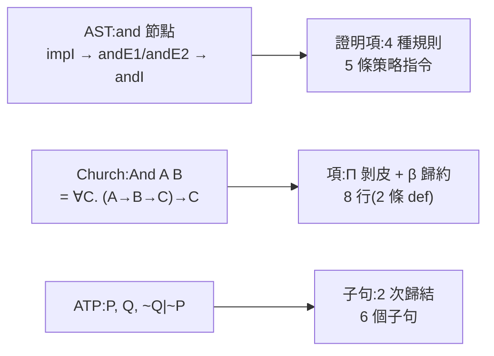

# 6.1 合取交換律：AST 規則、Church 編碼與歸結子句

第 5 章把 $\land$ 、 $\lor$ 、 $\exists$ 、 $\bot$ 從核心裡搬了出去，改成用 Π 型別定義；第 3 章與第 4 章則分別示範了自然演繹與歸結法怎麼把一個命題壓成可檢查的物件。本章要做一件前面各章都沒做過的事：**把同一個定理同時放進三個系統跑一遍，然後把三份產物並排攤開。**

為什麼要用「合取交換律」當第一把尺子？因為它是所有對照實驗裡最乾淨的一個：它沒有量詞、沒有否定、沒有等式，只有一個二元的連接詞；它在前兩個系統裡是內建結構，在第三個系統裡卻必須從零定義。拿它當基準線，後面幾節的落差才不會被「這個定理本來就難」之類的因素干擾。

本章要做的是**把「同一批數學在三個系統中的樣貌」變得可比較**。可比的意思不是「誰比較好」，而是「它們各自做了什麼選擇」。因此每一節都會問同一組問題：這個定理在這個系統裡長什麼樣？需要多少規則？什麼時候會失敗，失敗時的訊息是什麼？而每一節的結尾，都會把視角交給下一個更難的定理。

合取交換律尤其適合當基準線，還因為它是**三個系統都能無痛表達的少數命題之一**：它不需要任何假設，不需要任何邏輯強度上的妥協（直觀主義就夠），也不需要任何量詞或等式的技巧。於是本節觀察到的差距，可以乾淨地歸因於**表示方式的選擇**，而不會被「這個定理本身有什麼特別之處」干擾。我們會看到：AST 的一個 $\wedge$ 是一個節點，Church 編碼的一個 $\wedge$ 是一個 Π，ATP 的一個 $\wedge$ 是一組子句。三者的物理成本相差無幾，但**成本的性質**完全不同——前兩種是一次性的，第三種是累積的。

本節的命題是：

$$
P \wedge Q \;\to\; Q \wedge P
$$

它有一個很特別的性質：**在直觀主義邏輯裡完全不需要任何假設**。沒有排除律、沒有雙重否定消去、沒有原子性假設，三個系統在這裡應該是「平手」的。接下來我們會看到，它們其實連「平手」的具體含義都不一樣。

## 6.1.1 ITP：一棵兩層的樹

`lean-prover` 內建的八個範例裡，第一個就是它（`lean-prover/src/lean.js:232`）：

```js
  { name: '∧ 交換律', src: 'theorem and_swap : P & Q -> Q & P := by\n  intro h\n  cases h with hp hq\n  constructor\n  exact hq\n  exact hp' },
```

跑 `node bin/cli.js --demo --trace`，實際輸出是：

```
theorem and_swap : P ∧ Q → Q ∧ P
  intro h
      h : P ∧ Q
      ⊢ Q ∧ P
  cases h with hp hq
      h : P ∧ Q
      hp : P
      hq : Q
      ⊢ Q ∧ P
  constructor
      2 個目標
      
      h : P ∧ Q
      hp : P
      hq : Q
      ⊢ Q
      
      h : P ∧ Q
      hp : P
      hq : Q
      ⊢ P
  exact hq
      h : P ∧ Q
      hp : P
      hq : Q
      ⊢ P
  exact hp
      沒有目標了
✔ 證明完成,核心檢查通過
```

五條策略指令，四個核心規則節點。逐步拆解：

- `intro h` 把蘊含的前提 $P \wedge Q$ 放進上下文，證明項片段是 `impI`（`lean.js:141`）。
- `cases h with hp hq` 是 `cases` 的 $\wedge$ 分支（`lean.js:160`）：它把「一個 $\wedge$ 節點」拆成上下文的兩條假設 `hp : P` 與 `hq : Q`，證明項是巢狀的 `let`（`andE1` 與 `andE2`）。
- `constructor` 把目標 $\wedge$ 拆成**兩個**目標（`lean.js:153`），證明項是 `andI`。
- `exact hq` 與 `exact hp` 各用一個 `hyp` 節點結案。

所以整個證明項用到四種規則：`impI`、`andE1`、`andE2`、`andI`。**注意這裡沒有出現 `orE`、沒有出現分支機制**—— $\wedge$ 的消去是「把資訊攤平」，不是「分成兩條線」。這是 $\wedge$ 與 $\vee$ 在自然演繹裡最要命的差別： $\wedge$ 是一條線， $\vee$ 是兩條線，而 `cases` 這一個策略同時負責兩件事。

最後產生的證明項（把 `meta` 洞填滿之後）是：

```
impI h  [前提 P ∧ Q]
  └ let hp
    ├ p = andE1 (hyp h)
    └ q = let hq
      ├ p = andE2 (hyp h)
      └ q = andI
        ├ hyp hq
        └ hyp hp
```

**核心只認這棵樹，不認那五條指令。** 指令是策略層的事實；樹才是證明。

值得停下來看一眼的是那個**兩層巢狀的 `let`**。核心的 `let` 規則（`lean.js:88`）是：

```js
    case 'let': return C(p.q, [...ctx, [p.n, C(p.p)]]);
```

它先把 `p.p`（綁定值）在當前上下文算出來，再把 `p.q`（主體）在**擴充後**的上下文裡檢查。於是「`hp` 綁左半、`hq` 綁右半」就必須寫成兩層 `let`：外層把 `hp` 綁進去，內層才看得見 `hq` 綁的是**同一個** `h` 的右半。

這是本節第一個值得記住的觀察：** $\wedge$ 在 AST 裡是一個節點，但在證明項裡是一種「作用域嵌套」。** 命題的結構是平的（左右兩個欄位），證明的結構卻是嵌套的（先引入左半，再在左半的環境裡引入右半）。第 3.6.2 節說過同樣的觀察——`cases` 對 $\wedge$ 的處理是「把資訊攤平到同一條線上」，但那個「同一條線」其實是有順序的。

## 6.1.2 λ-Cube：一個 Π，兩層殼

`lambda-cube` 的核心裡沒有 $\wedge$ 。要證明同一個定理，第一件事是**自己把 $\wedge$ 寫出來**。內建範例的寫法是（`lambda-cube/src/cube.js:243`）：

```js
  { name: 'Church 編碼的 ∧(λω)', src: 'system λω\ndef And (A B : Prop) : Prop := forall (C : Prop), (A -> B -> C) -> C\ndef and_intro (A B : Prop) (a : A) (b : B) : And A B := fun (C : Prop) (f : A -> B -> C) => f a b\ntheorem and_swap (A B : Prop) (h : And A B) : And B A := by\n  intro C f\n  apply h C\n  intro a b\n  apply f\n  assumption\n  assumption' },
```

同一個定理，兩條 `def` 加上六條策略指令。**真正值得讀懂的是 `intro C f` 這一步。**

`And A B` 展開後是 $\forall C : Prop$ ， $(A \to B \to C) \to C$ 。`intro C f` 做的事，正是把這個 $\forall$ 的綁定變數 $C$ 引進來，同時把後面那個 $\to$ 也拆開，得到兩個假設：

```
    intro C f
        A : Prop
        B : Prop
        h : And A B
        C : Prop
        f : B → A → C
        ⊢ C
```

於是這一步的意義立刻清楚了：

- ** $C$ 是一個新鮮的命題變數。** 它代表「任意的命題」，也就是證明 $P \wedge Q$ 時你可以選擇的任何目標類型。 $\wedge$ 的 Church 編碼本質上是一句「對任何 $C$ ，只要你能從 $P$ 與 $Q$ 造出 $C$ ，那麼 $P \wedge Q$ 就是 $C$ 的證明」。
- ** $f : B \to A \to C$ 是「繼續」的函數。** 它是 $C$ 的生產線：給它一個 $B$ 和一個 $A$ ，它產出 $C$ 。注意這裡的引數順序是 ** $B$ 在前、 $A$ 在後**——這個順序正是交換律要動的地方。

接下來三行就是全部的「交換」動作：

- `apply h C`：把 $h$ （型別 `And A B`）套用到目標 $C$ 上。注意這裡必須**把參數 $C$ 寫出來**，因為 `And A B` 展開後的頭是 $\forall C$ ，是依賴型參數；`lambda-cube/src/cube.js:145` 的 `apply` 遇到依賴型參數會直接拒絕：

```js
        if (uses(cur.b)) throw new Error('apply 遇到依賴型參數(∀),請把參數寫進去,例如 apply h C');
```

  套用之後，目標變成 $A \to B \to C$ ——正是**原來的**那條生產線。
- `intro a b`：把那條生產線的兩個零件 $a : A$ 、 $b : B$ 取出來。取出來的順序是 $A$ 在前、 $B$ 在後，與 `h` 原本要求的順序**相反**。
- `apply f`：**這一步才是真正的交換。** $f$ 要的是 $B \to A \to C$ ，而我們手上是 $A \to B$ 。`apply f` 產生兩個目標（ $B$ 與 $A$ ），然後 `assumption` 兩次，分別把 $b$ 餵給第一個、把 $a$ 餵給第二個。

所以「交換律」在 λ-Cube 裡的物理內容是：**把兩條生產線的引數順序對調**。在 AST 裡這是一個節點的左右子樹互換；在 Church 編碼裡這是一個函數的引數順序互換。兩者的代價差異是顯著的——AST 版本是 5 行指令加 4 個規則節點，Church 版本是 8 行（2 條定義加 6 條指令）加一層額外的 Π 剝皮。

還有一個容易被忽略的開銷：**連「定義 $\wedge$ 」這件事本身，都要先付出系統升級的代價。** 上面那個 `def And` 不能寫在 $\lambda \to$ 裡：

```
system λ→
def And (A B : Prop) : Prop := forall (C : Prop), (A -> B -> C) -> C
```

輸出：

```
✘ def
    目前的系統不允許這個 Π 型別:定義域屬於 Type,值域屬於 Type(缺少規則 Type>Type):Prop → Prop
```

因為 `And` 的宣告型別 $\forall (A : Prop)$ ， $\forall (B : Prop)$ ， $Prop$ 需要 `Type > Type` 這條規則——** $\lambda \to$ 的簡單型別系統連「把命題當參數」的 Π 都組不起來**。所以內建範例用的系統是 $\lambda \omega$ 。第 6.3 節會看到，這個升級並不是唯一的成本：連否定都還要另外定義。

## 6.1.3 ATP：一組子句，兩步歸結

把同一個命題交給 `theorem-prover`：

```bash
node -e "
const P = require('./src/prover.js');
console.log(P.format(P.prove(['P & Q'], 'Q & P')));
"
```

實際輸出：

```
✔ 證明成功(產生 6 個子句,2 ms)
  1. P    [前提]
  2. Q    [前提]
  3. ~Q | ~P    [否定結論]
  4. ~Q    [歸結 3, 1]
  6. ⊥    [歸結 4, 2]
```

三個步驟值得攤開看。

**第一步：子句化。** 前提 `P & Q` 經過 `nnf()`（`prover.js:50-59`）不變，因為它已經是 NNF；再經過 `cnf()`（`prover.js:68-73`）被**分配律**拆成兩個獨立的單位子句 `P` 與 `Q`。這就是 CNF 化的代價：** $\wedge$ 消失了，但也失去了「它們是一個整體」這個資訊**。

**第二步：否定結論。** `prove()` 會把結論翻轉並塞進子句集（`prover.js:157`）：

```js
  if (goal) { const g = load(goal, 'negated goal'); items.push({ f: { t: 'not', f: g.f }, rule: g.rule }); }
```

`~(Q & P)` 的 NNF 是 $\neg Q \lor \neg P$ ，CNF 化之後**仍然是一個子句** `~Q | ~P`。注意這裡的差異：AST 裡的 $\wedge$ 被拆散了， $\vee$ 卻被保留下來——因為 CNF 化的目標型態就是「合取範式的析取」，一個子句就是一個析取。

**第三步：歸結。** `~Q | ~P` 與 `P` 消去 $P$ 得到 `~Q`（第 4 條），`~Q` 與 `Q` 消去 $Q$ 得到空子句 $\bot$ （第 6 條）。**兩次歸結，一個矛盾。** ATP 整條推理鏈裡只有一條規則：歸結。

這裡有兩個細節值得記下。

第一，**否定結論裡的順序是反的**：`~(Q & P)` 變成 `~Q | ~P` ，而不是 `~P | ~Q` 。這是 `nnf()` 與 `cnf()` 決定的——否定把 $\wedge$ 換成 $\lor$ ，而 CNF 化保留了原本的左右順序。子句的順序對歸結沒有影響（歸結是無序的），但它提醒我們：**ATP 的子句集是一個「無序但有結構」的集合**，而不是一個序列。

第二，**`P & Q -> Q & P` 本身不是定理。** ATP 需要前提 `P & Q` ；如果我們把 `prove(['P & Q'], 'Q & P')` 改成 `prove([], 'Q & P')` ，得到的會是「子句集已飽和」。這是第 4.1 節講過的分工：**歸結法證明的是「前提的邏輯後果」，而不是「命題本身為真」**。而 ITP 與 λ-Cube 證明的是同一件事——它們的定理宣告裡，結論的蘊含前提已經寫在宣告中了。

把三個系統的產物並排：



## 6.1.4 對照小結

| | ITP（`lean-prover`） | λ-Cube（`lambda-cube`） | ATP（`theorem-prover`） |
|---|---|---|---|
| $\wedge$ 從哪來 | AST 內建節點 `and` | 自己用 Π 定義 `And` | CNF 化後的副產品 |
| 證明行數 | 5 條策略指令 | 6 條策略指令 + 2 條 `def` | 6 個子句（2 次歸結） |
| 用到的核心規則 | `impI` `andE1` `andE2` `andI` | Π 引入、Π 消去、β 歸約 | `resolve`（唯一） |
| 交換動作的位置 | 證明項裡 `andI` 的兩個子項互換 | `apply f` 的引數順序 | 兩次歸結消去 $P$ 與 $Q$ |
| 失敗時的訊息 | `exact 的型別不吻合:得到 P,但目標是 Q` | `exact 的型別不吻合:`（多行，含「得到／需要」） | `✘ 無法證明:子句集已飽和,結論不是前提的邏輯後果` |
| 誰來找答案 | 人（給策略） | 人（給策略，但受型別規則擋） | 機器（自己選子句） |

三個系統在這個定理上「都能做」，但**它們為同一件事付出的物理成本完全不同**：

- **AST 的一個 $\wedge$ 是一個節點。** 它有左右兩個欄位（`l` 與 `r`），交換就是互換兩個指標。核心的 `andI` 規則只做一件事：把兩個子證明的型別拼成一個 `and` 節點。
- **Church 編碼的一個 $\wedge$ 是一個 Π。** 它有兩層殼：外層 $\forall C$ 與內層 $(A \to B \to C) \to C$ 。交換的代價是「引數順序要對調」，而對調的機會成本是**多寫兩個引數**，外加**先把系統升級到 $\lambda \omega$ ** 。
- **ATP 的一個 $\wedge$ 是一組子句。** 它的代價最徹底：CNF 化把 $\wedge$ 分配成獨立子句，連「 $P$ 與 $Q$ 是一個整體」這個資訊都丟了。

這三種成本會在後面幾節裡逐漸拉開距離。第一節的差距還很小（5 行對 8 行對 6 個子句）；但當命題裡加入否定、加入量詞、加入等式之後，三者的差距會變成**能不能表達**的問題——不再是行數問題，而是語言能力問題。

值得記住的是這個順序：**連接詞的「物理成本」是可以用行數衡量的，而且三個系統的排序在整個第 6 章裡都不會改變。** ITP 最省；λ-Cube 居中（但要自備定義）；ATP 表面最省，卻把成本轉嫁到了「你得先把它壓平」這件事上。真正會翻轉這個排序的，是下一節的蘊含——因為 ATP 一旦遇到蘊含，就必須把它**拆掉**，於是「省下來的行數」立刻被還了回去。

下一節我們加入第一個真正的推論規則：假言三段論。它在 ATP 裡會退化成一場「量詞消去與合一」的遊戲，而在另外兩個系統裡則是兩個截然不同的函數合成。
