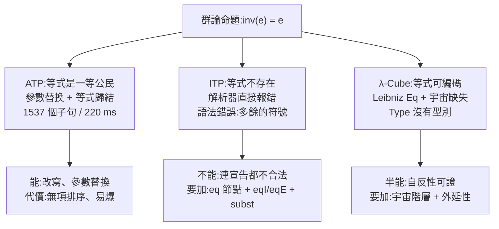

# 6.7 群論與等式：ATP 的強項與 ITP 的窘境

前六節的對照都在「同一個命題、三種證明」的框架裡，而且三個系統都能說話。本節的最後一個命題會打破這個框架：

$$
\operatorname{inv}(e) = e
$$

這是群論裡最基本的一條推論：單位元的反元素就是單位元本身。它的證明不難，但**需要等式**。而本專案的三個系統對等式的處理，是全書落差最大的一處：

- **ATP 把等式當一等公民**，甚至為它寫了專門的推論規則（參數替換）。
- **ITP 連表達都做不到**——不是證不出來，是**連寫都寫不出來**。
- **λ-Cube 有一個漂亮的等式編碼（Leibniz 等式）**，卻缺少處理群論所需的宇宙層級。

這是全書最能說明「三個系統不是同一個東西」的案例。前面六節我們看到的是同一批數學的三種樣貌；這一節我們看到的是三種不同的語言能力。

## 6.7.1 命題與 ATP 的答案

問題檔 `theorem-prover/examples/group.txt`：

```
# 群論:單位元的反元素是單位元
forall x. mul(e,x) = x
forall x. mul(inv(x),x) = e
forall x y z. mul(mul(x,y),z) = mul(x,mul(y,z))
|- inv(e) = e
```

三條公理：左單位律、反元素的定義、結合律。結論： $inv(e) = e$ 。

`node bin/cli.js examples/group.txt` 的實際輸出：

```
✔ 證明成功(產生 1537 個子句,220 ms)
  1. mul(e,X2) = X2    [前提]
  2. mul(inv(X4),X4) = e    [前提]
  3. mul(mul(X8,X9),X10) = mul(X8,mul(X9,X10))    [前提]
  4. inv(e) != e    [否定結論]
  7. mul(mul(inv(X15),X15),X16) = X16    [等式替換 2, 1]
 13. mul(mul(X91,e),X92) = mul(X91,X92)    [等式替換 1, 3]
 19. mul(inv(X105),mul(X105,X106)) = X106    [等式替換 3, 7]
501. mul(mul(inv(X1856),e),X1856) = e    [等式替換 13, 2]
1234. mul(inv(inv(X4612)),e) = X4612    [等式替換 2, 19]
1266. mul(X4724,inv(X4724)) = e    [等式替換 1234, 501]
1274. e = inv(e)    [等式替換 1266, 1]
1474. e != e    [等式替換 1274, 4]
1537. ⊥    [等式歸結 1474]
```

**這 11 行就是全部的證明。** 每一行的數學內容，第 4.7 節已經逐條拆解過：第 7 步用「反元素的定義」改寫左單位律裡的 $e$ ；第 13 步用左單位律與結合律推出右單位律；第 1266 步證明「左反元素也是右反元素」；第 1274 步得到 $e = inv(e)$ ；最後由 `eqres` 收尾。

現在我們要問一個 ITP 使用者永遠問不出來的問題：**這條推理鏈裡的「等式替換」，對應到 ITP 裡的什麼？**

答案是：**沒有對應物。** 因為 `lean-prover` 的核心根本不認識等式。

## 6.7.2 ITP：連表達都做不到

`lean-prover` 的核心 `check()` 認得的公式節點只有六種：`imp`、`and`、`or`、`all`、`ex`、`atom`（外加 `bot`）。等式不在其中。更徹底的是，**連解析器都不接受等式**：

```bash
$ node bin/cli.js bad_eq.lean
錯誤:語法錯誤:多餘的符號(附近:a =)
```

完整的情境是這樣的：

```
theorem bad_eq : a = b := by
  intro h
```

輸出：

```
錯誤:語法錯誤:多餘的符號(附近:a =)
```

**注意錯誤發生在「連定理宣告都沒讀完」的階段。** 這不是「核心拒絕了一個錯誤的證明」，而是「這個語言裡沒有這個概念」。這是本節最殘酷、也最有意義的觀察：

> **表達力的落差不是「證明難度」的落差，而是「能不能開口說話」的落差。**

ATP 用 1537 個子句、220 毫秒和一個不完美但可用的等式推理系統處理這個命題；ITP 用**零秒**給出了答案——因為它連命題都無法解析。兩者都是「正確」的回應，卻是天差南別的兩種能力。

### 要加入等式，得動哪裡？

假設我們想讓 `lean-prover` 能說等式。這不是「加一個節點」那麼簡單，至少要動六個地方：

1. **解析器**：`lean.js:7` 的詞法表要認 `=` 與 `!=` ；`un()` 要把它們變成新的 AST 節點 `{ t: 'eq', l: term, r: term }` 。
2. **AST 工具**：`key()`（`lean.js:55`）要為新節點定義 α 等價的鍵；`sub()`（`lean.js:66`）要處理「替換一個項」；`fv()` 要能從等式的兩端取出自由變數。
3. **核心規則**：至少要兩條——
   - `eqI`：從 `hyp a : A` 推出 `a = a` （自反性）；
   - `eqE`：從 `a = b` 與 `P(a)` 推出 `P(b)` （等式消去）。
   而 `eqE` 的實作才是真正困難的地方：它需要一個**代換**操作，而代換需要防範變數捕獲（第 3.5 節的主題）。
4. **核心的 `check()`**：新節點要能被 `need()` 檢查形狀，`eqE` 要呼叫 `sub()`。
5. **策略層**：需要一個 `subst`（或 `rewrite`）策略，讓使用者說「把 `h : a = b` 用到目標 `P(a)` 上」；還需要 `eq_refl` 之類的建構子策略。
6. **顯示層**：`fm()`（`lean.js:42`）要能把新節點印成人看得懂的樣子。

**而且做完之後，你會立刻遇到真實 ITP 都遇到的難題**：等式消去是一條「隱含重寫」的規則，它會與其他規則互動（例如與 $\forall$ 消去的交互作用會產生需要新鮮性檢查的情況）。這就是為什麼 Lean 與 Coq 的等式推理不是「一條規則」，而是一整套**帶著轉換策略（conversion tactic）與可判定性假設**的機制。

第 8 章會把這份工作清單列為延伸練習之一。**在真正的 ITP 裡，等式不是一個可以隨手加入的 AST 節點，而是一整套基礎設施。**

## 6.7.3 λ-Cube：等式可以編碼，但宇宙不夠用

λ-Cube 的情況最有意思：**等式在型別論裡有兩個標準的說法，而我們的 λ-Cube 恰好能表達其中一個。**

其一是「原始的等式」（Lean 的 `Eq`）：

```
eq : forall (A : Type) (x y : A), A -> A
```

其二是「Leibniz 等式」（Coq 早期與直覺主義型別論常用的做法）：兩個項相等，若且唯若它們對任何「定義在該型別上的命題」都無法區分。在我們的 λ-Cube 裡，可以把它寫成（實測可過）：

```
system λC
axiom Nat : Prop
axiom zero : Nat
axiom succ : Nat -> Nat
def Eq (A : Prop) (x y : A) : Prop := forall (P : A -> Prop), P x -> P y
theorem eq_refl : forall (A : Prop) (x : A), Eq A x x := by
  intro A x
  intro P
  intro h
  exact h
```

輸出：

```
✔ def Eq : ∀ (A : Prop), A → A → Prop
✔ theorem eq_refl : ∀ (A : Prop), ∀ (x : A), Eq A x x
    intro A x
        A : Prop
        x : A
        ⊢ Eq A x x
    intro P
        A : Prop
        x : A
        P : A → Prop
        ⊢ P x → P x
    intro h
        A : Prop
        x : A
        P : A → Prop
        h : P x
        ⊢ P x
    exact h
        沒有目標了
```

**自反性只花了四條指令，而且每一條都是 Π 型別的標準操作。** 這是 Church–Howard 對應最漂亮的一次展現：等式的自反性，在型別論裡就是「對任意命題 $P$ ， $P(x) \to P(x)$ 這個恆等函數存在」。

但有兩個障礙擋在「用 Leibniz 等式證明 $inv(e) = e$ 」的路上。

**第一個障礙：這個 `def` 需要 $\lambda C$ 的頂點。** 在 $\lambda \omega$ 裡它連定義都寫不出來：

```
✘ def
    目前的系統不允許這個 Π 型別:定義域屬於 Prop,值域屬於 Type(缺少規則 Prop>Type):A → Prop
```

因為 `Eq` 需要 `A -> Prop` 這個「型別上的命題族」，需要 `Prop > Type` 這條規則。**這是第 6.5 節那個「 $\exists$ 沒有內建」的同一個代價：要談論元素的等式，就得把系統推到有依值型別的頂點。**

**第二個障礙（更根本）：λ-Cube 沒有型別的宇宙層級。** 群論需要一個「群」的型別、一個「元素」的型別、一個乘法運算的型別——它們是**型別的型別**。但在 λ-Cube 裡，`Type` 沒有型別：

```
system λω
axiom Nat : Type
```

輸出：

```
✘ axiom
    Type 沒有型別(λ-cube 的最頂層)
```

這是核心 `infer()` 的最後一行（`cube.js:97`）：

```js
      case 's': if (t.s === 'Prop') return Sx('Type'); throw E('Type 沒有型別(λ-cube 的最頂層)');
```

`Prop` 住在 `Type` 裡，但 `Type` 自己是頂點，**沒有更高的宇宙**。所以在我們的 λ-Cube 裡，「一個群」只能被寫成 `axiom Group : Prop`（把型別當成命題），「群裡的元素」只能寫成 `axiom G : Group` ——**而 `G` 是被當成一個「命題」來對待的**，它的元素則是 `G -> Prop` 這種奇怪的東西。

這不是小瑕疵。**群論需要的正是「型別宇宙」與「依值型別的乘積／商」這兩件事**，它們在 Coq 與 Lean 裡分別是 `Type` 宇宙與 `sig`／`Type` 級別的結構。Coq 能把「群論定理」寫成一句：

```coq
Theorem inv_unit (G : Group) (e : unit G) : inv G e = e.
```

那是因為 Coq 有 `Type : Type` 的宇宙（嚴格說是 `Type@{i}` 的階層）、有 `Setoid`／`Morphisms` 的等式抽象、有 `Program` 與 `setoid` 的重寫系統。**Coq 與 Lean 能處理這類問題，是因為它們除了「命題即型別」之外，還有「型別即宇宙」與「可計算的等式」。**

最後補一句關於 Leibniz 等式的技術性提醒：Leibniz 等式是**忠實**的（它不會把不相等的項說成相等），但它的**實用性**取決於函數外延性。在它之下證明 $inv(e) = e$ ，意味著要對**任意**命題 $P$ 證明 $P(inv(e)) \to P(e)$ ——這正是等式消去規則的方向，也是等式推理最核心的困難所在。

## 6.7.4 三種語言能力



| | ITP | ATP | λ-Cube |
|---|---|---|---|
| 等式能不能寫 | **不能**（解析器拒絕） | 能（`=`、`!=` 是語法的一部分） | 能（要自己 `def Eq`） |
| 等式的推理規則 | 無 | `para()`（參數替換）、`eqres()`（等式歸結） | 有 `eqE` 就要自己寫 |
| 本命題的結果 | 語法錯誤 | **證明成功**，1537 個子句 | 能寫出 `Eq` 與 `eq_refl`，群論要另外的基礎設施 |
| 主要缺口 | `eq` 節點、`eqI`/`eqE`、`subst` 策略、代換的捕捉防護 | 沒有項排序與化簡；等式在替換後被丟棄（不完備） | `Type` 沒有型別（無宇宙階層）；函數外延性 |
| 失敗時的訊息 | `語法錯誤:多餘的符號(附近:a =)` | `… 超過時間或子句數上限,結果未知` | `Type 沒有型別(λ-cube 的最頂層)` |

### 一個實測發現：ATP 的效率取決於變數名的長度

在整理上面那條 1537 個子句的推理鏈時，我們發現了一個**必須記錄下來**的現象：**同一個問題，在不同的執行順序下，代價可以差二十倍。**

```bash
$ node -e "
const P = require('./src/prover.js');
const pre = ['forall x. mul(e,x) = x','forall x. mul(inv(x),x) = e','forall x y z. mul(mul(x,y),z) = mul(x,mul(y,z))'];
console.log('第一次:', P.prove(pre, 'inv(e) = e').generated, '個子句');
P.prove(['Man(socrates)'], 'Mortal(socrates)');            // 先跑一個小題
console.log('第二次:', P.prove(pre, 'inv(e) = e').generated, '個子句');
"
```

實際輸出：

```
第一次: 1537 個子句
第二次: 71 個子句
```

**同一個命題，同一份程式碼，第二次只用了 71 個子句（3 毫秒），而且找到的是一條更短的路。** 原因是這樣的：

1. `norm()` 會用 `ren()` 把子句裡的變數改名成 `_1` 、 `_2` ……，而編號來自一個**全域計數器**。
2. 子句的權重 `w` 是**文字的字串長度**（`prover.js:150`）：

```js
    const c = { id: ++nid, lits: l, rule, from, w: l.map(ls).join('').length };
```

3. 因此，變數名 `_2`（2 個字元）與 `_5154`（6 個字元）會給出**不同的權重**，而權重決定了「哪一條子句先被挑出來做運算」（第 4.5 節的啟發式）。
4. 挑選順序不同 → 整條搜尋路徑不同 → 代價相差 21 倍。

**這是一個教科書級的工程教訓：啟發式不該依賴表示的無關細節。** 一個「用字串長度當權重」的啟發式，理論上沒問題（短子句通常比較有力），但它不該**間接**依賴全域計數器的狀態。第 7 章會回到這個話題：怎麼讓核心與策略層的邊界乾淨到「改了策略不會改變核心的行為」。

### 本節小結與交棒

三個系統在等式上的落差，可以總結成三句話：

> **ATP 之所以強，是因為它把「把 $t$ 換成 $s$ 」當成一個可以窮舉的機械動作——代數推理的本質就是到處代入。**
>
> **ITP 之所以窘，是因為自然演繹的每一步都需要一個「明確的推理規則」，而等式消去不是這樣的規則——它是一個隱含的、與其他規則互動的轉換機制。**
>
> **λ-Cube 之所以半能，是因為 Curry–Howard 對應把等式變成了一個「關於所有命題的等價」，很漂亮，但同時也把代數推理需要的「計算性」推到了基礎設施之外。**

這三句話，也是全書對「三個系統不是同一個東西」的最終回答。第 1.1 節說三個程式「剛好踩在現代邏輯學的三條主幹上」；本章七節把它們拆開來看之後，應該可以修正成一句更準確的話：**它們踩在三條不同的主幹上，而主幹之間的距離，比想像中遠。**

---

## 本章結語

本章做了七場對照實驗。每一場的固定結構是：命題 → ITP → λ-Cube → ATP → 對照小結。回頭看這七場實驗，可以畫出一張總表：

| 定理 | ITP | λ-Cube | ATP | 分歧的真正來源 |
|---|---|---|---|---|
| 合取交換律 | 5 條指令 | 8 行（含 2 條 `def`） | 6 個子句 | 連接詞的表示成本 |
| 假言三段論 | 4 條指令 | 4 條指令 | 8 個子句 | ATP 把蘊含壓平了 |
| 雙重否定消去 | 3 條指令（古典集中在 `by_contra`） | 1 條公理 + 1 條指令 | 0 條指令（NNF 自動對偶） | 古典性的來源與位置 |
| Peirce 定律 | 7 條指令 | 3 條指令（1 條密集項） | 3 個子句 | 「證明」到底指什麼 |
| 一階量詞 | 分支 + 新鮮性檢查 | Π 型別 + Church 編碼 | Skolem 化 | 綁定機制 |
| 德摩根律 | 12 行 + 6 行（要 DNE） | 9 行 + `def` | 6 個子句 | 否定是展開、對偶化還是編碼 |
| 群論與等式 | **語法錯誤** | 編碼可行但缺宇宙 | 1537 個子句 | 表達力本身 |

三個結論：

**第一，「證明」的長度不是可比較的量。** ITP 的 Peirce 證明有 7 行、λ-Cube 的有 3 行、ATP 的有 3 個子句——三個數字之間沒有可比性，因為它們測量的東西不同。唯一可比的是**成本與能力的比值**：ATP 在等式上極划算、在量詞上極昂貴；ITP 在每個定理上都很平均；λ-Cube 則把成本從「推導」搬到了「定義」。

**第二，失誤的樣子透露了系統的性格。** ITP 會說「變數名 x 已被使用」或「核心檢查失敗:反證需要 ¬¬A」——它是**老師**型的，會指出你哪裡寫錯。ATP 會說「子句集已飽和,結論不是前提的邏輯後果」——它是**抽籤**型的，只說「我沒找到」。λ-Cube 會說「目前的系統不允許這個 Π 型別:缺少規則 Prop>Type」——它是**守門人**型的，告訴你這扇門你還推不開。

**第三，也是最重要的一點：三個系統的差異，最終會落在「語言能力」上。** 前六節的落差都在「證明成本」這個量級上；第七節的落差是二元的——**會不會**。等式在 ATP 裡是基本詞彙，在 ITP 裡連語法都進不去。這提醒我們：把三個系統放在一起比較時，最先該問的不是「它們誰比較強」，而是「**它們各自能說哪些句子**」。

下一章（第 7 章「軟體工程：可信核心、策略與介面」）會把視角從「邏輯」轉到「工程」。本章裡那些看起來像是邏輯問題的東西——比如那個「權重依賴變數名長度」的怪現象、比如「核心與策略層的邊界到底畫在哪裡」——其實都是工程問題。我們會回到 `check()` 與 `infer()` 這兩個函式，看它們怎麼被設計成「小到可以逐句審查」，以及本章的對照實驗如何反過來成為設計時的檢驗標準。
