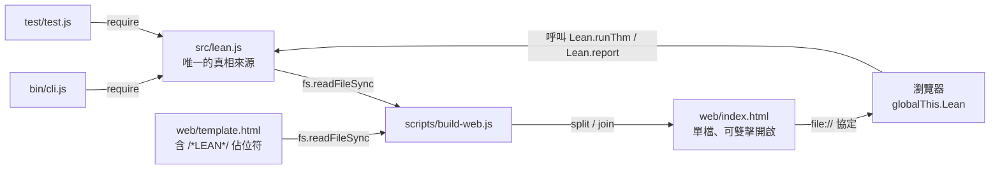

# 7.4 命令列與單檔網頁：零依賴的打包策略

前三節談的是「系統內部怎麼分層」。這一節談的是「系統怎麼被交到別人手上」。這看起來是個小題目——CLI 加上一個網頁而已——但正是在這個最外層，本專案做了幾個在其他專案裡不常見的選擇：**三個 `bin/cli.js` 全部不超過 30 行；三個 `package.json` 一個 `dependencies` 都沒有；網頁版是一個可以直接用 `file://` 協定打開的單一 HTML 檔案，不需要伺服器、不需要建置工具。**

這些選擇背後有一個共同的理由，本節要把它說清楚。

## 7.4.1 CLI：薄到沒有推理的殼

先看 ITP 的 CLI，全文 13 行：

```js
#!/usr/bin/env node
// 用法: node bin/cli.js --demo | 檔案.lean [--trace] | (標準輸入)
const fs = require('fs'), L = require('../src/lean.js');
const a = process.argv.slice(2), trace = a.includes('--trace'), files = a.filter(x => !x.startsWith('--'));
let text;
if (a.includes('--demo') || (!files.length && process.stdin.isTTY)) text = L.examples.map(e => e.src).join('\n\n');
else text = fs.readFileSync(files[0] || 0, 'utf8');
let bad = 0;
for (const t of L.splitThms(text)) {
  try { const r = L.runThm(t); console.log(L.report(r, trace) + '\n'); if (r.status !== 'done') bad++; }
  catch (e) { console.log('錯誤:' + e.message + '\n'); bad++; }
}
process.exit(bad ? 1 : 0);
```
（`lean-prover/bin/cli.js:1-13`）

這 13 行裡**沒有一行在做推理**。逐行拆解：

| 行 | 做的事 |
|---|---|
| `:3` | 載入核心 |
| `:4` | 解析參數：抓 `--trace`、抓檔名 |
| `:6` | 決定輸入來源：示範 / 檔案 / stdin |
| `:7` | 讀檔（`files[0] || 0`，`0` 是檔描述符 0，也就是 stdin） |
| `:9` | 把整份文字依 theorem 切成多段 |
| `:10` | 對每段跑 `runThm`，印 `report`，非 `done` 就記一筆 |
| `:13` | 有任何一段沒成功就 `process.exit(1)` |

**CLI 裡沒有 `check()`、沒有 `tactic()`、沒有任何邏輯。** 它只是「把字串餵進去，把字串印出來」。這是第 1.2 節講過的四段式切分的必然結果：報告段拿到的結果已經是「狀態 + 資料」，CLI 只需要排版。

λ-Cube 的 CLI 是同樣的形狀，只是 8 行：

```js
const fs = require('fs'), C = require('../src/cube.js');
const a = process.argv.slice(2), trace = a.includes('--trace'), files = a.filter(x => !x.startsWith('--'));
const srcs = a.includes('--demo') || (!files.length && process.stdin.isTTY) ? C.examples.map(e => '-- ' + e.name + '\n' + e.src) : [fs.readFileSync(files[0] || 0, 'utf8')];
let bad = 0;
for (const s of srcs) { const r = C.runScript(s); console.log(C.report(r, trace) + '\n'); if (!r.ok) bad++; }
process.exit(a.includes('--demo') ? 0 : bad ? 1 : 0);
```
（`lambda-cube/bin/cli.js:3-8`）

注意 λ-Cube 的退出碼邏輯多了一層：`a.includes('--demo') ? 0 : bad ? 1 : 0`。**示範模式永遠回傳 0**，因為 λ-Cube 的內建範例裡有一個是故意失敗的（「λ→ 不允許多型(錯誤示範）」，`cube.js:247`），那個失敗是示範內容的一部分，不是程式的問題。如果示範模式也回傳 1，`npm run demo` 就會被 CI 判成失敗。

ATP 的 CLI 比較特殊，28 行，因為它支援一個 ITP 沒有的模式：

```js
//   node cli.js -e "前提1" "前提2" "|- 結論"   直接在命令列輸入
```
（`theorem-prover/bin/cli.js:5`）

而且它的檔案格式也不同：**每行一個前提，以 `|-` 開頭的行是結論**。

```js
    if (l.startsWith('|-') || l.startsWith('⊢')) goal = l.replace(/^(\|-|⊢)/, '').trim();
    else premises.push(l);
```
（`theorem-prover/bin/cli.js:17`）

這是因為 ATP 的輸入是「前提集合 + 一個結論」，不是「一個宣告 + 一串策略」。ITP 的 `theorem` 宣告裡包含了前提，所以一個檔案可以有多個 theorem；ATP 的前提與結論是分開的欄位，所以一個檔案只有一個問題。

### 退出碼：三個系統的一致與不一致

退出碼是最容易被忽略、但對指令列工具最要緊的介面。理想上：**成功回傳 0，失敗回傳非 0**。

三個 CLI 的實作：

- **ITP**（`lean.js` CLI 的 `:13`）：`process.exit(bad ? 1 : 0);` —— `bad` 是在 `:10` 與 `:11` 累積的，條件是 `r.status !== 'done'`。所以 `sorry`、`open`、`error`、`kernel` 都算失敗。實測：

  ```
  $ node bin/cli.js examples/bad.lean ; echo $?
  1
  ```

- **λ-Cube**（`cube.js` CLI 的 `:8`）：`process.exit(a.includes('--demo') ? 0 : bad ? 1 : 0);` —— 條件是 `!r.ok`（`cube.js:220` 的 `R.ok = R.cmds.every(c => c.status === 'ok')`）。

- **ATP**（`prover.js` CLI）：**沒有 `process.exit`**。整個 CLI 的最後一行是 `else run(fs.readFileSync(a.length ? a[0] : 0, 'utf8').split('\n'));`。所以它**永遠回傳 0**，即使證明失敗。實測：

  ```
  $ node bin/cli.js /tmp/t.txt ; echo $?     # 檔案內容是 "P -> Q"，這不是定理
  0
  ```

這個差異值得停下來。ATP 的 `saturated` 狀態在**語意上**是「沒證出來」，但在**工程上**它跟「證出來了」是同一個出口：`prove()` 都正常回傳，`format()` 都正常印出。ATP 的 CLI 沒有把「結果是負面的」翻譯成「行程失敗」。

這是一個真實的缺陷，但它的成因值得辨認：**ATP 的失敗模式比 ITP 多**。ITP 的失敗是「這段證明寫錯了」（`error`）或「還沒寫完」（`open`），兩者都是「使用者還可以再做點什麼」。ATP 的 `saturated` 是「在 10 秒與 20000 個子句的上限內，我沒找到矛盾」——這**不是錯誤**，是一個**合法的負面答案**。第 4.5 節說過它「不是反例」。所以 ATP 的 CLI 把它當成「正常執行完畢」不算錯，只是選擇了另一種語意。

如果要修，改動很小：把 `run()` 的回傳值接出來，看 `r.status === 'proved'` 才回傳 0。但這道題留給 8.5 節的練習。

## 7.4.2 `scripts/build-web.js`：把核心內嵌成單一 HTML

網頁版不是另一份實作，而是同一份 `src/*.js` 被**內嵌**進 HTML 的產物。

`lean-prover/scripts/build-web.js` 只有四行：

```js
const fs = require('fs'), path = require('path'), root = path.join(__dirname, '..');
fs.writeFileSync(path.join(root, 'web/index.html'), fs.readFileSync(path.join(root, 'web/template.html'), 'utf8')
  .split('/*LEAN*/').join(fs.readFileSync(path.join(root, 'src/lean.js'), 'utf8')));
console.log('已產生 web/index.html');
```
（`lean-prover/scripts/build-web.js:1-4`）

機制簡單到有點粗暴：把 `template.html` 讀成字串，用 `split('/*LEAN*/')` 把它切成兩半，再把 `src/lean.js` 的內容 `join` 回去。

三個專案的佔位符名字刻意不同：

| 專案 | 佔位符 | 位置 |
|---|---|---|
| `lean-prover` | `/*LEAN*/` | `scripts/build-web.js:3` |
| `theorem-prover` | `/*PROVER*/` | `scripts/build-web.js:5` |
| `lambda-cube` | `/*CUBE*/` | `scripts/build-web.js:3` |

模板裡對應的位置是：

```html
    <script>/*LEAN*/</script>
```
（`lean-prover/web/template.html:63`）

```html
<script id="pmain">/*PROVER*/</script>
```
（`theorem-prover/web/template.html:60`）

```html
    <script>/*CUBE*/</script>
```
（`lambda-cube/web/template.html:64`）

ATP 的模板多了一個 `id="pmain"`，這是為了網頁版的核心跑在 Web Worker 裡——`theorem-prover/web/template.html:74` 把 `<script id="pmain">` 的內容讀出來，包成一個 Blob 送進 `new Worker()`。這樣歸結搜尋跑在背景執行緒，介面不會卡住：

```js
    const src=$('pmain').textContent+';onmessage=e=>{try{postMessage({r:Prover.prove(e.data.prem,e.data.goal,e.data.opts)})}catch(x){postMessage({e:x.message})}}';
    worker=new Worker(URL.createObjectURL(new Blob([src],{type:'text/javascript'})));
```
（`theorem-prover/web/template.html:74-75`）

**注意 `id="pmain"` 這個設計的深意**：它讓網頁版能把自己的核心**再讀出來、送進 Worker**。這是「核心是一個可以被獨立取用、獨立執行」的又一個證明——如果核心依賴了別的模組變數，這招就沒那麼乾淨了。

### 產物的形狀

跑完 `npm run build` 之後，三個 `web/index.html` 的樣子：

| 專案 | 行數 | 大小 |
|---|---|---|
| `lean-prover/web/index.html` | 339 | 約 23 KB |
| `theorem-prover/web/index.html` | 347 | 約 20 KB |
| `lambda-cube/web/index.html` | 351 | 約 22 KB |

以 `lean-prover` 為例：模板 96 行 + 核心 243 行 = 339 行，正好。這說明內嵌是**純文字拼接**，沒有任何壓縮或轉譯。

產物可以直接用瀏覽器以 `file://` 協定打開，不需要起伺服器。這是「發佈即檔案」的實際意義：**你把這個檔案 email 給別人，別人雙擊就能用。**

### 「發佈即檔案」的取捨

這套做法有明顯的代價，而且這些代價是真實的：

**第一，檔案比較大。** 核心的原始碼整個進了 HTML，沒有 minify、沒有 tree-shaking。23 KB 對一個教學用的工具不算什麼，但對一個真的產品，這是白白的體積。

**第二，沒有模組化。** `web/index.html` 裡的 `<script>` 是**全域腳本**，不是 ES module。它污染全域命名空間（靠 `globalThis.Lean` 這個名字），不能用 `import` 引入，也沒辦法讓兩個版本共存。

**第三，不能 lazy-load。** 所有東西都在同一個 HTML 裡，一開就全部下載。

**第四，沒有快取機制。** 每次改一行邏輯都要重新產生整個檔案，改一行的「增量更新」在這個模型裡不存在。

但換來的東西更值錢：

- **零建置工具鏈。** 沒有 webpack、沒有 vite、沒有 babel。`npm run build` 就是 `node scripts/build-web.js`。這意味著**沒有依賴可以壞掉**。第 1.2 節說過「沒有 `dependencies`，也沒有 `devDependencies`」，這裡是那個決定的直接後果。
- **零部署。** 沒有伺服器、沒有容器、沒有 CDN。一個檔案就是全部。
- **可審計。** 想確認網頁版跟 CLI 版行為一致？打開 `web/index.html` 搜尋 `function check`，你就看到了同一份原始碼。**網頁版沒有「另一份實作」這件事。**
- **三十年後還能跑。** 一個 HTML 檔案在 2055 年用瀏覽器打開還能工作——前提是瀏覽器還支援 `<script>` 與 `globalThis`。這比「需要 npm install 一個還活著的相依套件樹」可靠得多。

## 7.4.3 雙棲核心：`module.exports` 與 `globalThis`

上面那個「網頁版跟 CLI 版是同一份程式碼」不是說它們共用檔案，而是說**同一個檔案在兩個環境裡都能用**。這靠的是每個核心檔案的最後一行：

```js
const API = { runThm, splitThms, report, statusText, showGoals, check, parseF, fm, examples };
if (typeof module !== 'undefined' && module.exports) module.exports = API; else globalThis.Lean = API;
```
（`lean-prover/src/lean.js:241-242`）

```js
const API = { CUBE, runScript, report, showGoals, examples };
if (typeof module !== 'undefined' && module.exports) module.exports = API; else globalThis.Cube = API;
```
（`lambda-cube/src/cube.js:249-250`）

```js
const API = { parse, prove, format, statusText, examples };
if (typeof module !== 'undefined' && module.exports) module.exports = API; else globalThis.Prover = API;
```
（`theorem-prover/src/prover.js:223-224`）

三行，結構完全一樣，做同一件事：**偵測自己跑在哪裡**。

- 在 Node 裡，`module` 存在，走第一個分支，`require('../src/lean.js')` 拿到的是 `API` 物件。
- 在瀏覽器裡，`module` 不存在（`typeof module` 是 `'undefined'`），走 else 分支，把 API 掛到 `globalThis.Lean`。

網頁版就是靠 `globalThis.Lean` 取得能力的：

```js
const $=id=>document.getElementById(id),ta=$('src'),X=Lean.examples;
```
（`lean-prover/web/template.html:65`）

### 這一行為什麼要求核心不能用 ES module 語法

這是本節最實用的一個技術觀察。

如果核心檔案寫成 ES module：

```js
export const API = { runThm, check, ... };
```

那麼：

1. **`export` 語法在 Node 裡是合法的**，但要求檔案是 `.mjs` 或者 `package.json` 裡有 `"type": "module"`。而 `package.json` 裡沒有 `type` 欄位，所以 `.js` 檔案被當成 CommonJS。
2. **在瀏覽器裡，`export` 語法會讓整個 `<script>` 標籤變成 parse error**，除非用 `<script type="module">`。而 `<script type="module">` 有兩個額外限制：
   - 模組是**嚴格模式**，而且有自己的作用域——`globalThis.Lean = API` 這種掛法仍然可行，但模組檔案透過 `file://` 載入時會被 **CORS 規則擋下**（`file://` 的 origin 是 `null`），而 `<script type="module">` 預設帶 `crossorigin` 屬性，會失敗。
   - 也就是說，**`<script type="module" src="...">` 在 `file://` 下不能用**，但我們的目標正是要能雙擊開啟。

所以雙棲的要求直接排除了 ES module 語法。核心必須是**同時是合法的 CommonJS 與合法的傳統瀏覽器腳本**。

這個要求還牽涉到**整個檔案的包裹方式**。三個核心檔案的開頭都是：

```js
/* 互動式一階邏輯證明助手 — 核心(Node 與瀏覽器共用)
   結構:解析器 → 可信核心 check()(唯一決定證明對錯的部分)→ 策略層(只負責產生證明項)→ 報告 */
(function () {
'use strict';
```
（`lean-prover/src/lean.js:1-4`）

那個 IIFE（立即呼叫函式表達式）的作用是**隔離作用域**：核心裡的所有 `const`、`let`、函式都不會漏到全域。網頁版靠 `globalThis.Lean` 這個唯一明確的出口取得 API；模組化（IIFE）保證除它以外沒有任何全域汙染。

順帶一提，ATP 的模板裡那個 Worker 的做法（`template.html:74`）也是靠 IIFE 才成立的：Worker 的腳本是 `src + ';onmessage=...'` 字串，如果核心的變數漏到全域，就會跟 `onmessage` 打架。

### 雙棲帶來的實際好處

回頭看 `theorem-prover/README.md` 的「作為函式庫」段落，它示範的用法是：

```js
const P = require('./src/prover.js');
const r = P.prove(['forall x. (Man(x) -> Mortal(x))', 'Man(socrates)'], 'Mortal(socrates)');
```

**同一份檔案**在瀏覽器裡是 `Prover.prove(...)`。這就是「核心是同一份」的完整意義：**不只是在原始碼層面同一份，連匯出介面都是同一組函式**。第 7.2 節說過，核心的輸入輸出都是純資料，所以它能被第三方取用；而雙棲匯出讓「取用」這個動作在 Node 與瀏覽器裡是一樣的。

## 7.4.4 為什麼堅持零外部相依

三個 `package.json` 的完整內容（`lean-prover/package.json`）：

```json
{
  "name": "mini-lean-prover",
  "version": "1.0.0",
  "description": "互動式一階邏輯證明助手(策略 + 可信核心),命令列與網頁版",
  "bin": { "lean-mini": "bin/cli.js" },
  "scripts": { "demo": "node bin/cli.js --demo", "test": "node test/test.js", "build": "node scripts/build-web.js" },
  "license": "MIT"
}
```

只有 `bin` 與 `scripts`，**沒有 `dependencies`，也沒有 `devDependencies`**。三個專案都一樣（第 1.2 節指出 `theorem-prover` 的 `scripts` 只是縮排風格不同）。

為什麼？三個理由，按重要性排。

**第一，可重現。** 一個有相依的專案，「能跑起來」這件事取決於當下的相依樹狀態。相依套件會被發新版本、會被下架、會有 CVE。**三年前 `npm install` 成功，今天可能就失敗了**，而且失敗的原因跟你的數學毫無關係。零相依的專案沒有這個問題：`git clone` 之後 `node bin/cli.js` 就能跑。

**第二，可審計。** 這是 de Bruijn 準則的直接延伸。核心的可信性建立在「它只有 30 行」上，而**整個專案的可信性建立在「沒有其他程式碼會偷偷跑」上**。如果 `lean-prover` 依賴 200 個套件，那「核心只有 30 行」這個話就只在「核心本身」的範圍內成立；使用者還得另外審 200 個套件才敢相信整件事。零相依把這個問題連根拔除。

**第三，三十年後還能跑。** 這是 7.4.2 節講過的延伸，但值得再說一次：Node.js 的語言本身是穩定的（Node 15 以上的所有版本都能跑本專案的程式碼，因為只用了 `??=` 這個 2020 年就定案的語法），但**生態圈不是**。2020 年的一個中型 npm 專案，五年後 `npm install` 能不能成功是個賭注。

順帶一提，Node.js 版本門檻本身也是這條思路的產物。第 1.2 節講過：整個專案真正需要新語法的只有一處——`theorem-prover/src/prover.js:113` 的 `??=`。其餘的語法（`Object.fromEntries`、`padStart`、`globalThis`）在更早的版本就有了。把門檻定在 Node 15，是為了讓「三個子專案的執行環境需求完全一致」這件事成立。

## 7.4.5 打包流程圖

把整條流程畫出來：



這張圖的重點是**箭頭的方向**：`src/` 是唯一的來源，其他一切都從它派生。`web/index.html` 是**產物**不是原始碼——永遠不要直接改它，下一次 build 就會蓋掉（1.3 節明說了這點）。`bin/cli.js` 與 `test/test.js` 也都只是 `require` 核心。

**唯一的例外是 `web/template.html`**：它是原始碼，不是產物。它需要人維護——那是網頁介面（排版、按鈕、樣式）所在的地方。

## 小結與交棒

三個 CLI 全部不超過 30 行，**沒有一行在做推理**；它們只做「讀檔、呼叫核心、印報告」，並且用退出碼告訴作業系統成功還是失敗（這裡也記下了一個真實的不一致：ATP 的 CLI 沒有把 `saturated` 翻譯成失敗）。

`build-web.js` 只有四行，把核心內嵌成單一 HTML。這個「發佈即檔案」的模型有明確的代價（檔案大、沒有模組化、沒有增量更新），但換來了零建置工具鏈、零部署、可審計、三十年後還能跑。

雙棲匯出（`module.exports` 對 `globalThis`）是讓同一份原始碼在 Node 與瀏覽器都能跑的關鍵，而它**要求核心不能用 ES module 語法**——因為 `<script type="module">` 在 `file://` 下會被 CORS 擋下，而雙擊開啟正是這個模型的核心價值。

零外部相依不是潔癖：**可重現、可審計、長久可用**三個理由，都直接來自 de Bruijn 準則。

下一節是本章最後一節，也是整個工程鏈的最後一環：**怎麼知道核心真的會拒絕壞的證明**？前面三節建立了架構，但架構本身不能證明架構是對的——那要靠測試。而且這裡有一個特別的點：可信核心的測試跟一般軟體的測試**方向是相反的**。

下一節：**測試策略：核心必須拒絕偽造證明。**
