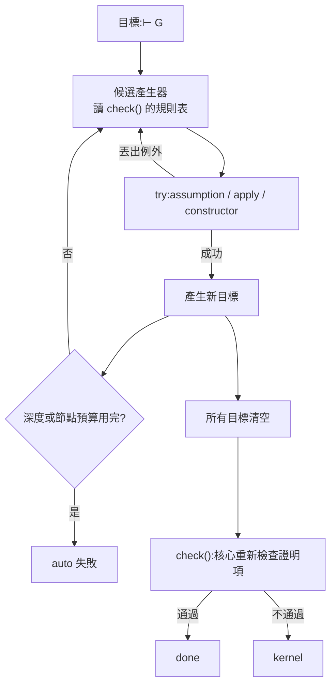

# 8.3 自動化的第二種可能：auto 與定理發現

8.2 節談的是「邏輯強度」，那是核心與證明的**語意**層面。本節轉到**工程**層面，而且是最被低估的一個工程問題：在真實的互動式定理證明器裡，**大部分的證明文字是樣板**。人寫的不是「推理」，而是「請幫我把這一步拆成五步」。

本專案的三個系統在這件事上的位置很特別：`theorem-prover` 是**完全自動**的（使用者只給命題），`lean-prover` 與 `lambda-cube` 是**完全手動**的（每一條策略都要人指定）。中間地帶——「人給骨架，機器補樣板」——三個系統都沒有。本節要說明的，是**為什麼在這個專案的架構裡補上這個中間地帶是容易的**，以及**為什麼它仍然是壞交易**。

## 8.3.1 為什麼 ITP 需要自動化

先看一個真實 Lean 證明的樣子。下面這段來自 `Mathlib` 裡最常見的型別：

```lean
theorem Nat.add_comm (n m : Nat) : n + m = m + n := by
  induction n with
  | zero => rfl
  | succ n ih =>
      show Nat.succ n + m = m + Nat.succ n
      rw [Nat.add_succ, ih, Nat.add_comm]
```

真正需要「想的」只有 `induction` 那一行——而且它也是標準的。剩下的 `rfl`、`show`、`rw` 全是**把一個已知的等式套用到一個已知目標上**的樣板。

真實的 Lean 證明裡這類比例非常高。Lean 社群流傳一個說法：Lean 4 的證明裡，`simp` 與 `constructor` 這類「結束型」策略佔了八成以上；而 `Mathlib` 裡光是 `simp` 的重寫引理就有數千條，構成一個巨大的「等式資料庫」。

**自動化的本質是：把人每次都做同一件事的部分，交給機器。** 這件事在 ITP 裡格外重要，因為 ITP 的人力成本是**互動的**：使用者要坐在終端機前，一步步看著目標變化，一步步決定下一步。樣板策略佔八成，就等於八成的互動時間花在不需要思考的地方。

## 8.3.2 Lean 的 `simp` 與 Coq 的 `auto`

兩家的做法不同，但背後是同一個想法：**把上下文裡的已知等式與命題做成一個資料庫，然後用它反覆求解目標**。

**Lean 的 `simp`** 是一個重寫系統。它維護一個有序的引理集合（每條引理形如 `a = b` 或 `a ↔ b`），然後把目標裡的**子項**用引理替換掉：

1. 從目標的最外層往內遍歷；
2. 每遇到一個子項，試著用資料庫裡的引理把它改寫；
3. 改寫之後**重新**從外層開始（因為最外層的改寫可能讓內層的新機會出現）；
4. 直到沒有任何改寫發生（固定點）。

`simp` 的強項是**等式密集**的目標；弱點是它只會改寫，不會「分解結構」（例如把一個合取拆成兩半）。`constructor` 補上了這一塊：看到 $\wedge$ 就拆成兩個目標。

**Coq 的 `auto` / `eauto` / `tauto`** 則是另一種風格：`auto` 把「目前 context 裡的每一條假設」當成資料庫，反覆做三件事：

- `assumption`：目標恰好等於某條假設 → 完成；
- `apply h`：把某條假設（蘊含式或全稱式）的結論對上目標 → 產生新目標；
- `intro` / `constructor` / `left` / `right`：拆開目標。

`eauto` 加上了**合一**（可以給假設餵參數），`tauto` 則更進一步：它是一個**決策程序**（decision procedure），對命題邏輯（可判定片段）做完整的反駁法搜尋，因此**一定會找到證明或報告失敗**，不會卡住。

三者的差別可以這樣記：

| | 資料庫的內容 | 求解方式 | 保證 |
|---|---|---|---|
| `simp` | 等式／等價引理 | 貪婪重寫到固定點 | 不保證（可能改寫不出來） |
| `auto` | context 裡的假設 | `apply` + `assumption` 迴圈 | 不保證 |
| `eauto` | context 裡的假設 | 加上合一 | 不保證 |
| `tauto` | context 裡的假設 | 反駁法決策程序 | **保證**（可判定片段內） |

## 8.3.3 為什麼在本專案加 `auto` 是容易的

這是本節最實用的一段。答案是因為第 7.1 節的 **de Bruijn 準則**已經把最難的部分做完了。

回顧 `lean-prover` 的架構：核心 `check()`（`lean.js:80-109`）完全不依賴策略層——3.3.4 節說過，它裡面沒有任何一行提到策略、腳本、洞或 `S.assign`。它只認證明項的形狀。而策略層的入口是單一函式：

```js
function tactic(S, name, arg) {
```

（`lean-prover/src/lean.js:129`）

策略要做的事情只有三件：讀 `S.goals[0]`（當前目標）、呼叫 `solve(pf, gs)` 填洞並推進目標棧、或者丟出例外表示「這條路走不通」。**這三件事的介面沒有任何假設限制策略的種類。** 所以加一個 `auto` 策略，就是加一個 `case 'auto':`——核心一行都不用動。

這正是 de Bruijn 準則的紅利：**把信任集中在最小核心之後，策略層可以任意膨脹而不影響正確性。** `auto` 無論多笨多慢，它產生的證明項都必須通過 `check()`；`auto` 就算寫錯了，也只是「證明失敗」，不會讓錯誤的證明通過。

現在把 `auto` 該長什麼樣寫出來。**以下是設計草稿，不是本專案的實作**：

```js
// 草稿:auto 策略的設計草稿(非本專案現有實作)
// 位置:lean-prover/src/lean.js 的 tactic() 的 switch 裡新增 case 'auto'

case 'auto': {
  // 1) 建立「命題資料庫」:目前的 context 假設
  const db = ctx.map(([n, f]) => ({ n, f }));

  // 2) 候選產生器:把 check() 的規則表反過來當搜索空間
  //    每個候選是一個「怎麼把目標換成新目標」的操作
  const cands = g => {
    const out = [];
    // 2a) assumption:目標就是某條假設
    for (const [n, f] of db) if (eq(f, g.f)) out.push({ k: 'hyp', n });
    // 2b) apply:假設的結論對上目標
    for (const [n, f] of db) {
      let c = f;
      while (c.t === 'imp' || c.t === 'all') {
        if (c.t === 'imp') { out.push({ k: 'apply', n, prem: c.l }); c = c.r; }
        else { out.push({ k: 'applyAll', n, prem: sub(c.f, c.v, { v: 'x' }) }); c = null; }
        if (!c) break;
      }
    }
    // 2c) 拆解目標:constructor / left / right / intro
    if (g.f.t === 'and') out.push({ k: 'constructor' });
    if (g.f.t === 'or') { out.push({ k: 'left' }); out.push({ k: 'right' }); }
    if (g.f.t === 'imp' || g.f.t === 'all') out.push({ k: 'intro' });
    return out;
  };

  // 3) 深度優先搜索,失敗就回溯(策略層的例外就是「失敗」訊號)
  const search = (goals, depth, budget) => {
    if (!goals.length) return [];
    if (depth > LIMIT_DEPTH || budget.n > LIMIT_NODES) throw new Error('auto:超出預算');
    const g = goals[0];
    for (const c of cands(g)) {
      budget.n++;
      try {
        // 4) 呼叫既有的策略來產生證明項(不重寫規則邏輯,只重複使用)
        const sub = simulate(c, g);            // 回傳 [新目標...]
        const rest = search([...sub, ...goals.slice(1)], depth + 1, budget);
        if (rest) return [c, ...rest];
      } catch (e) { /* 這個候選走不通,換下一個 */ }
    }
    return null;
  };

  const plan = search(S.goals, 0, { n: 0 });
  if (!plan) throw new Error('auto:找不到辦法');
  for (const step of plan) applyStep(step);   // 把計畫套用回目標棧,產生證明項
  return;
}
```

這段草稿有四個設計決定值得說明。

**第一，候選產生器直接讀 `check()` 的規則表。** `check()` 的每一個 `case` 對應一個推理規則；`auto` 的候選產生器是它的**反函式**——給定一個目標，列出「哪些規則在這個目標形狀下可能適用」。這是本專案的架構給的白紅利：**核心與策略層共享同一套規則語彙**，所以自動化不需要另外建立一套推論引擎。

**第二，資料庫就是 context。** `db` 這個陣列就是「已知命題的資料庫」，這正是 8.3.2 裡 `auto` 的定義。差別只在於 Coq 的 `auto` 還能查 hint database（全域的引理庫），而 `lean-prover` 的 context 只有當前目標的區域假設。**所以這個 `auto` 能處理的，是「用區域假設就能收尾的目標」**——也就是說，它取代的是 `exact h` / `apply h` / `constructor` 這幾條策略的串聯，不取代 `simp` 那種需要全域等式庫的重寫。

**第三，失敗回溯靠例外。** 策略層的每一條策略在失敗時都是 `throw new Error(...)`（例如 `lean.js:145` 的 `exact` 型別不吻合、`lean.js:149` 的 `apply 失敗`）。所以 `auto` 的回溯不需要新的機制：**把 `try` / `catch` 當成失敗偵測器就行**。這是這個專案的「錯誤分流」設計（1.3.3 節的五種狀態）的一個額外紅利。

**第四，預算。** `LIMIT_DEPTH` 與 `LIMIT_NODES` 是必需的，因為 `auto` 的搜索空間是組合爆炸的：`apply` 與 `intro` 交替可以產生無限多條路徑。**沒有預算的 `auto` 是一個 hang 機器。** 而且預算要能被使用者控制（`auto 5` 表示深度上限 5），這是真實系統的通行做法。

最後一點最關鍵：**`auto` 走完之後，產出的證明項仍然要經過 `check()`**（`lean.js:209-212`）。`auto` 只是把「找一條路」這件事自動化，**「驗證這條路」這件事完全沒變**。這是整個設計的道德核心：**自動化發生在策略層，可信性發生在核心層**。



這張圖的重點在右下角那條邊：**`auto` 的成功與失敗，最終都由核心裁決。** `auto` 找到的路如果錯了，核心會擋下來——所以 `auto` 最多是「浪費時間」，不會是「騙過檢查」。

## 8.3.4 反面：可讀性的代價

上面把 `auto` 說得太輕鬆了。現在講代價。

**ITP 的一個核心價值主張是「證明是可以被人審查的」。** 第 1 章說的是「一個命題已被證明，機器究竟檢查了什麼」；而 ITP 相對於 ATP 的一個關鍵優勢就是**它的產物（證明項）是有結構的、可展開的**。第 3.6 節把 `lean-prover` 的八個範例逐行攤開，就是這個價值的具體展示。

`auto` 會侵蝕這個價值。想像一個真實的 Lean 證明裡出現：

```lean
theorem foo : Complex := by aesop
```

`aesop` 是 Lean 社群給自動化策略取的綽號，它把整個證明壓成一個詞。**這個定理現在是「可檢查的」但不是「可審查的」**：核心照樣會驗證，但人無法在合理的時間內理解 `aesop` 究竟用了哪些假設、做了哪些推理。證明的**正確性**沒有問題，證明的**可溝通性**壞了。

這在 Lean 社群裡是一場持續的爭論，兩邊都有道理：

- **支持自動化的一方**說：樣板策略佔八成，而樣板是最無聊的部分；把無聊的部分交給機器，是讓人把時間花在真正需要思考的地方。「證明的可讀性」不該由讀者承擔全部成本。
- **反對的一方**說：一旦證明裡出現不可解釋的片段，**整個證明的可審查性就降級了**。因為讀者無法判斷「這一步有沒有偷偷用到某個假設」，而這正是閱讀證明的主要目的。極端一點說：一個不可讀的證明，和一個 ATP 產生的矛盾鏈，在「可信性」上是同一個層級的東西——你都得信任那個工具。

比較公平的折衷是這樣的：

1. **`auto` 必須留下足跡。** 在本專案裡，`auto` 執行完之後應該在報告層印出「用了哪幾條規則、依序是什麼」，就像 `--trace` 印出目標變化那樣。`lean.js:179` 的 `sx()` 函式本來就是把證明項攤平成文字的工具，`auto` 產生的證明項經過它之後應該是人能讀懂的。
2. **`auto` 應該是「就地」而不是「整段」。** 也就是說，理想的使用方式是 `auto` 只負責收尾那個「用區域假設就能收尾」的目標，而不是把整個定理一口氣解決。這樣證明的主幹仍然是人寫的。
3. **`auto` 應該可選、可關閉。** 真實的 ITP 都給使用者控制權（Lean 的 `set_option`、Coq 的 `Unset`）。

## 8.3.5 ATP 的另一種自動化

現在把視角轉到 `theorem-prover`，因為它是**另一種自動化哲學**的純粹形態。

| | ITP 的 `auto` | ATP 的整個引擎 |
|---|---|---|
| 輸入 | 命題 **+ 人給的策略序列** | 只有命題 |
| 誰決定推理鏈 | 人決定骨架，機器補樣板 | **全部由機器決定** |
| 搜索空間 | 規則的有限組合，受深度限制 | 子句空間，指數級膨脹 |
| 失敗的樣子 | 「auto 找不到辦法」（可讀） | `saturated` 或 `timeout`（語意空洞） |
| 產物 | 證明項（可展開、可審查） | 推理鏈（ID 到 ID 的引用） |
| 信任落點 | 核心 `check()` | 推論規則的可靠性 |

關鍵的哲學差異是：**ATP 的自動化是「整個證明都是機器給的」，ITP 的自動化是「把機器已經能做的部分包裝成便利函式」。** 前者的哲學是「既然機器能找，就讓它找」；後者的哲學是「既然人要負責思路，就別讓人做重複的事」。

但這兩者正在互相靠攏，這是值得注意的趨勢。Lean 裡的 `sledgehammer` 就是一個混合體：**它呼叫外部的 ATP（Vampire、Z3、E）去找一個證明，找到之後把那個證明「匯入」成 Lean 內部的證明項**，交給核心檢查。流程是這樣的：

1. ATP 在背景跑，試圖證明當前目標；
2. 找到一個等價命題的證明；
3. 這個證明被**重新翻譯**成 Lean 的 tactic 序列（`apply` + `exact` + `simp` 等）；
4. 翻譯後的序列交給 Lean 的核心重新檢查。

**這是自動化的終極形態**：搜尋交給 ATP，可信性交給 ITP 核心。兩種哲學不是互斥的，而是分工的。

還有一個方向值得提一句，因为它跟「定理發現」這個標題直接相關：**ATP 不只可以證明已知的命題，還可以「找出可證的命題」**。比如在一堆前提裡找出哪一個子集足以推出結論（premise selection），或者在反駁模式裡**找出一個反例**。後者在實務上特別有用：給一個「這個程式不會崩潰」的規格，ATP 去找一個讓它崩潰的輸入——這是模型檢測（model checking）的思想，而它的成功往往比證明更容易。

## 8.3.6 小結與交棒

本節的三個結論：

1. **自動化的收益是實在的**：真實的 ITP 證明裡八成是樣板，把它們交給策略層是必要的。
2. **在本專案的架構裡加 `auto` 是容易的**，因為 de Bruijn 準則已經把核心與策略層分開了：`auto` 只是 `tactic()` 的一個新 `case`，核心一行都不用動，而它產生的證明項仍然要過 `check()`。
3. **但自動化是有代價的**：證明的可讀性與可審查性會下降，而這正是 ITP 相對於 ATP 的核心優勢。合理的折衷是讓 `auto` 只做收尾、留下足跡、隨時可關。

那麼，下一個問題自然浮現：**如果 ITP 的自動化最後要靠 ATP 來加速，而 ATP 的搜尋空間又爆炸得這麼厲害（第 4.7 節的 1537 個子句只是小試），有沒有辦法讓搜尋不爆炸？** 有，而且答案不在邏輯裡，在**工程**裡。

下一節就講那個答案：**模理論（modular theory）與 SMT（SAT Modulo Theories）**。它們是現代 ATP 與 SMT 求解器（如 Z3、cvc5）真正的生產力來源，也是「等式推理」這件事的工業化版本。同時，本節也會誠實地指出 ATP 這條路的天花板在哪裡。
