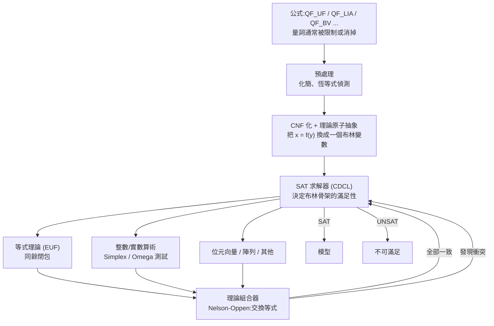

# 8.4 模理論、SMT 與實務驗證

8.3 節的最後一句話是個提問：搜尋空間爆炸，有沒有辦法讓它不爆炸？答案分兩半。**一半是「對」**：現代工業界真的找到了一條路，而且它已經是一個數十億美元的產業（形式化驗證工業）。**另一半是「不對」**：那條路並不能回答所有問題，它有明確的天花板。

這條路的名字叫 **SMT**（SAT Modulo Theories，模理論上的 SAT）。本節要做的三件事：先說清楚「模理論」為什麼特別適合被自動化（回到第 6.7 節的群論案例），再說清楚 SMT 的架構與它跟本專案 ATP 的關係，最後誠實地指出這條路的天花板在哪裡。

## 8.4.1 從一階邏輯到模理論

先把「模理論」這個詞拆開。**theory** 在這裡的意思是「一組帶有公理的符號與其解釋規則」，例如：

- **等式理論（EUF, Equality with Uninterpreted Functions）**：有一堆未解釋的函數符號 $f, g, h, \dots$ 與常數 $a, b, c, \dots$ ，等式遵守同餘性（congruence），但沒有別的公理。
- **整數算術理論（LIA）**：變數取整數值，支援加、乘、線性不等式。
- **實數算術理論（LRA）**：變數取實數值，支援加與線性不等式。
- **位元向量理論（BV）**：固定寬度的整數位元運算。
- **陣列理論（Arrays）**：帶有讀寫與選擇公理的陣列。

**「模」的意思是：把一個大問題拆成幾個小問題，每個小問題由一個專門的理論求解器處理，再用一個「組合器」把答案拼起來。**

為什麼等式理論特別適合自動化？因為它就是**自由代數（free algebra）**：項是由符號組成的樹，兩個項相等當且僅當它們有共同的樹形。這個結構帶來三個對自動化極為友好的性質：

1. **替換是機械的。** 從 $t = s$ 推出任何公式裡的 $t$ 可換成 $s$ （Leibniz 定律），這一步不需要任何語意直覺，只需要找到子項位置。第 4.7 節的 `pos()`（`prover.js:123-127`）就是這個「找子項位置」的操作。
2. **搜索空間是局部可枚舉的。** 「這個等式能用在哪些地方」是有限且可機械列舉的。
3. **不完整性不是問題。** 未解釋函數符號沒有公理，所以**不存在**「只有領域專家才知道」的推論步驟。整個推理過程就是磚頭碰撞。

第 6.7 節的群論案例正是這一類的典範：`mul(e,x) = x` 、`mul(inv(x),x) = e` 、`mul(mul(x,y),z) = mul(x,mul(y,z))` ——這三條公理在**自由代數**上並不恆成立，它們只在「群」這個具體的代數結構裡成立。所以 ATP 在這裡做的事，用術語說是：**在一個自由代數上做等式推論，證明群論公理之間的某個等式是「可推得的」**。這個片段是**相容的**（不會推出 $a = b$ 這種矛盾），而推理是純機械的。這正是為什麼 ATP 在等式題目上表現亮眼：它不需要理解群，只需要會做磚頭碰撞。

順帶說明一個容易被忽略的差別：**這個結論的意義取決於你問的問題是什麼。** 如果你問「群論公理在自由代數上是否相容」，ATP 給了答案（相容）。如果你問「群論公理是否描述了所有群」，那是一個**二階**問題（需要量化「對所有群」），ATP 答不了——這是 8.4.5 節的天花板。

## 8.4.2 SMT 的架構

SMT 求解器（如 Z3、cvc5、MathSAT）的基本架構可以用一張圖說清楚：

這張圖的重點在**中央那一圈回饋**：SAT 求解器只管布蘭骨架（「哪個等式為真、哪個為假」），理論求解器只管每一個等式本身能不能同時成立。兩者透過**理論原子**（theory atom，如「 $x = f(y)$ 這個等式為真」）溝通。SAT 求解器猜出一組布林賦值，理論求解器檢查這組賦值在各個理論裡是否一致；若不一致，SAT 求解器就加上一條「不可同時成立」的子句，重新搜尋。

**「SAT Modulo Theories」這個名字就是這個結構**：把 SAT 當成一個「模」運算的基礎理論，理論求解器提供「模」的部分。

其中最關鍵、也最該拿來跟本專案對照的是**等式理論求解器（EUF）**。它的核心操作是**同餘閉包（congruence closure）**：維護一個「哪些項已知相等」的等價類，並且遵守同餘律——若 $f(a) = f(b)$ 且 $a = b$ 的等價類……更精確地說，若 $a$ 與 $b$ 在同一等價類，則 $f(a)$ 與 $f(b)$ 也在同一等價類。

**這一點值得停下來對照**：`theorem-prover` 的 `para()`（`prover.js:128-140`）做的其實就是同餘閉包的一個**暴力版本**——它枚舉所有位置、嘗試所有等式、所有方向。而真正的 EUF 求解器用的是**並合查找（union-find）加上項的索引**：先建立「哪些項等價」的分組，再回答「 $f(a)$ 與 $f(b)$ 是否等價」。這是一個**指數級到多項式級**的差別。

## 8.4.3 等式推理在實務上的用途

等式推理不是只有邏輯學家在用。它是現代軟體工業的基礎設施之一，主要用在四個地方。

**編譯器優化。** 這是最廣泛的應用。等價類分析（equivalence class analysis）、全域值數量傳播（GVN）、別名分析（alias analysis）、死碼消除——它們的底層全都是「求一個等式的同餘閉包」。LLVM 裡有 `GVN` 與 `MemCpyOpt` 等 passes，GCC 裡有 `-fipa-*` 系列，它們做的正是**用等式替換把程式碼改寫成等價但更簡單的形式**。第 4.7 節的 `para()` 與它們的差別只在於工業版本有項排序與化簡。

**程式驗證。** Hoare 邏輯（`{P} c {Q}`）的規則推導本質上是等式替換：代入規則（substitution rule）就是 Leibniz 定律。符號執行（symbolic execution）與不變式推理也大量依賴等式推理。

**密碼協定驗證。** 這是「攻擊自動尋找」最成功的領域。工具（如 Tamarin、ProVerif）把協定步驟編碼成項重寫系統，然後用**攻擊者歸納法（Intruder deduction）**找出攻擊路徑。這裡的「等式」是攻擊者能構造的訊息之間的等價關係，模理論化的思想完全一致。

**硬體與系統驗證。** 形式化驗證 TLC（模型檢查）、SPIN、Frama-C 的 ACSL 契約等。

**定理證明器本身。** 工業級 ATP 裡，E、Vampire、Z3 都有專門的等式推理模組，只是它們用的是「超對稱（superposition）」而不是 Robinson 的參數替換。

## 8.4.4 SMT 與本專案 ATP 的關係

現在可以給出一個明確的判斷：**SMT 求解器的等式部分，幾乎就是 `theorem-prover` 裡 `para()` 的工業化版本**。差別在於工業版本多了四樣東西：

1. **項排序（term ordering）**。給所有項一個全序，只允許從大到小替換。這保證替換是簡化、推理會收斂。
2. **超對稱（superposition）**。取代 Robinson 的參數替換：等式不再在用完後被丟掉，而是**被保留並被簡化**，同時限制替換只能發生在「等式的一部分已經被統一」的特定位置上。
3. **Siphons 與 literal selection**。決定「現在該處理哪個文字」的一組啟發式規則，讓搜尋優先走有希望的路徑。
4. **索引與 subsumption 的加速**。用項的索引（indexing / discrimination tree）把「哪些子句可能包含 $t$ 」這類查詢從線性降到對數。

再加上一個更根本的工程改動：

5. **用 SAT 求解器取代 naive 迴圈**。`theorem-prover` 的主迴圈（`prover.js:160-186`）是一個「生成—篩選—合一」的無限迴圈，選子句靠「最小字串長度」（`prover.js:163`）。工業 ATP 用的是 **CDCL SAT 求解器**：帶子句學習（learning）與非確定性重啟（restart）的衝突驅動搜尋。CDCL 的子句學習機制**在同一個子句空間裡學到東西**，這是 naive 迴圈完全沒有的能力。

把這些映射到本專案的具體位置，就得到一張非常實用的「改造清單」：

| 目標 | 現況 | 最小改動 | 影響 |
|---|---|---|---|
| 項排序 | `prover.js:131` 兩個方向都試 | 加一個項的全序，只允許大→小 | 子句數大幅下降 |
| 等式保留 | `prover.js:136` 把等式刪掉 | 改用超對稱的規則形狀 | 完备性提升 |
| 化簡 | `prover.js:114-120` 只去重複 | 加一個重寫器，把子句正規化 | 搜尋空間縮小 |
| 支撐集 | `prover.js:163` 只按長度選 | 加上 set of support（優先處理含否定結論的子句） | 聚焦在相關線索上 |
| 單位傳播 | 無 | 單文字子句（unit clause）優先處理並傳播 | 早期剪枝 |
| SAT 取代迴圈 | `prover.js:160-186` | 導入 CDCL 求解器 | 數量級的差距 |

**最後一行是最重要的，也是最困難的。** 前面五項都是「聰明一點的啟發式」，可以在一兩百行內做完；最後一項是**換掉整個引擎**。

## 8.4.5 ATP 路徑的天花板

現在說誠實的部分。有三道牆。

**第一道牆：可判定性。** 歸結法在**一階**邏輯裡是半可判定的：命題可證當且僅當證明存在，但「不存在」是半可決定的（`saturated` 只能說「在預算內沒找到」）。**二階邏輯不可判定**（Church 定理，1929 證明）：存在一個固定的二階句子，使得「這個句子是否有效」在一般情形下無法用任何程序判定。

這一條的後果是殘酷的：**「證明所有群都滿足某個性質」這類問題，在原理上就沒有演算法能回答。** 這不是工程問題，是邏輯的極限。第 8.1 節講的歸納型別之所以那麼重要，正是因為**歸納原理把「對所有自然數」的問題從二階降成一階**，讓它重新變得可判定。這是 8.5 節第二個練習的真正意義所在。

**第二道牆：組合爆炸。** 即使是一階命題邏輯，歸結法的最壞情況複雜度也是子句數的指數。`theorem-prover` 的預設預算是 20000 個子句（`prover.js:144`），因為再往上 JavaScript 的執行時間會超過 10 秒。工業 ATP 的預算可以放大到數百萬子句、數小時——**但那只是把牆推遠，不是拆掉**。

**第三道牆：領域知識。** 這道牆最常被低估。很多命題**在原理上可證**，但需要一個「只有領域專家知道」的引理。例如「這個程式的輸出滿足這個不變式」需要知道某個不變式；「這個定理的證明需要先用某個標準引理」需要知道那個引理。ATP 沒有辦法自己知道這些。

工業 ATP 對這道牆的答案是**前提選擇（premise selection）**：給定一個很大的前提庫，自動挑出可能相關的子集再證明。這是一個**統計性的、啟發式的**方法（工具如 SInE），它大幅改善了「在真實數學庫裡找證明」的體驗，但它並不改變「需要領域知識」這個事實。

把這三道牆合起來，可以給 ATP 一句總結：**ATP 是一條「廣度優先」的路——它把整個子句空間攤開，用機械的碰撞換取不需要巧思的廣度；ITP 是一條「深度優先」的路——它把人的思路鎖定成一條路徑，換取能處理需要巧思的深度。** 兩者不是競爭關係，而是分工：需要巧思的部分交給人（ITP），不需要巧思但數量龐大的部分交給機器（ATP），中間用 `sledgehammer` 那種方式縫合（8.3.5 節）。

## 8.4.6 讓 theorem-prover 更實用：一份清單

綜合上面三節，如果要把 `theorem-prover` 從玩具推向可用，我會依這個順序做：

1. **項排序 + 單向替換**（改 `prover.js:128-140`）。這是性價比最高的一項：只允許從大到小替換，會讓群論範例那條 1537 個子句的鏈大幅縮短。
2. **化簡器**（改 `prover.js:114-120` 的 `norm()`）。把 `mul(e, x)` 之類的恆等式在子句進入集合前就化掉。
3. **支撐集與單位傳播**（改 `prover.js:160-186` 的選子句邏輯）。讓搜尋優先沿著「與否定結論相關」的那條線走。
4. **索引化 subsumption**（改 `prover.js:146` 的 `prune`）。現在 `prune` 對每個新子句都線性掃描整個集合並呼叫 `subsumes`，在幾千個子句時這是主要瓶頸。
5. **超對稱取代參數替換**（改 `prover.js:128-140` 的規則形狀）。恢復等式推理的完備性，並避免同一想法的兩個方向互相膨脹。
6. **最後才考慮 CDCL**（重寫 `prover.js:160-186`）。這是最大的一筆投資，但也是與工業 ATP 差距最大的一項。

前五項加起來大約三四百行，會讓 `theorem-prover` 從「玩具」變成「可以拿來解真題的工具」。第六項會讓它變成「競賽級別的求解器」，但那是另一個量級的工程。

## 8.4.7 小結與交棒

本節的四個結論：

1. **等式推理之所以特別適合自動化**，是因為自由代數的結構保證了「替換是機械的、搜索是局部可枚舉的、沒有領域知識的缺口」。第 6.7 節的群論案例就是這個結構的典範。
2. **SMT 的架構是「SAT 求解器 + 理論求解器 + 組合器」**，其中最該跟本專案對照的是等式理論求解器的同餘閉包——它是 `para()` 的工業化版本，指數級與多項式級的差別就在於「用 union-find 而不是暴力枚舉」。
3. **ATP 路徑的天花板有三道牆**：二階不可判定、組合爆炸、領域知識缺口。歸納型別之所以關鍵，正是因為它把「對所有自然數」的問題降回一階。
4. **讓 `theorem-prover` 更實用有六步**，前三步（項排序、化簡、支撐集與單位傳播）就能帶來可觀的改善。

三道牆、三種自動化、兩條哲學路——講到這裡，第 8 章的理論部分已經完整了。剩下的問題回到讀者手上：**這些事情要怎麼做？**

下一節是本章的實作章。它給出五個練習，每個都指明要改哪個檔案的哪個函數、需要新增什麼規則與測試、以及怎麼驗收。它假設你已經讀完前面七章，並且願意動手改 `src/` 目錄裡的程式碼。
