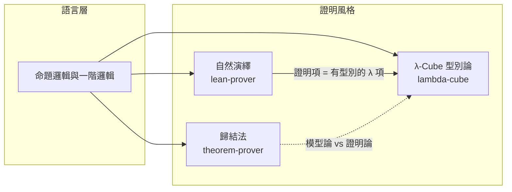

# 三個證明器：自然演繹、歸結法與 λ-Cube

> 一本關於「證明如何被機器執行」的教科書。
> 本書以本專案的三個真實程式為主線：`lean-prover`（互動式定理證明器）、`theorem-prover`（歸結法自動定理證明器）、`lambda-cube`（λ-Cube 型別檢查器）。
> 全書共用一個中心問題：**當我們說「一個命題已被證明」時，機器究竟檢查了什麼？**

---

## 導論：這本書在講什麼

三個程式加起來不到 750 行 JavaScript，卻剛好踩在現代邏輯學的三條主幹上：

- **自然演繹（Natural Deduction）** —— 人給思路、機器驗證的**互動式定理證明器（ITP）**；
- **歸結法（Resolution）** —— 機器獨自尋找矛盾的**自動定理證明器（ATP）**；
- **Curry–Howard 對應** —— 命題即型別、證明即程式的**λ-Cube 型別論**。

三者不是三個互不相干的玩具，而是同一個想法的三種刻度。本書的目的，是把「刻度」講清楚：每一章都會指出前一章的技術如何推動下一章的設計，最後回到「一個可信核心要多小才夠」這個工程問題。



### 本書的三條閱讀路線

| 路線 | 適合誰 | 順序 |
|---|---|---|
| **實作線** | 想動手改程式、或想讀懂 `src/*.js` 的人 | 第 1 章 → 第 3 章 → 第 5 章 → 第 7 章 → 第 9 章 |
| **理論線** | 想搞懂 Curry–Howard、λ-Cube 與證明論史的人 | 第 1 章 → 第 2 章 → 第 5 章 → 第 6 章 → 第 9 章 |
| **對比線** | 想比較 ITP 與 ATP 兩大流派的人 | 第 1 章 → 第 3 章 → 第 4 章 → 第 6 章 → 第 8 章 |

---

## 目錄

* [第1章 緒論：把「證明」變成可以執行的程式](#第1章-緒論把證明變成可以執行的程式)
    * [1.1-三個程式三種證明哲學](01.1-三個程式三種證明哲學.md)
    * [1.2-本專案的程式碼地圖](01.2-本專案的程式碼地圖.md)
    * [1.3-閱讀指南與執行環境](01.3-閱讀指南與執行環境.md)
* [第2章 邏輯的座標：從 Hilbert 到 Curry-Howard](#第2章-邏輯的座標從-hilbert-到-curry-howard)
    * [2.1-1900-1930 Hilbert 綱領與形式化的誕生](02.1-1900-1930-Hilbert-綱領與形式化的誕生.md)
    * [2.2-1934-1936 Church 演算與 Church 編碼](02.2-1934-1936-Church-演算與-Church-編碼.md)
    * [2.3-1935 Gentzen 自然演繹與可執行的證明](02.3-1935-Gentzen-自然演繹與可執行的證明.md)
    * [2.4-1959-1965 Robinson 歸結原理與 Herbrand 定理](02.4-1959-1965-Robinson-歸結原理與-Herbrand-定理.md)
    * [2.5-1960-1990 de Bruijn 索引、Curry-Howard 與 Martin-Löf 類型論](02.5-1960-1990-de-Bruijn-索引Curry-Howard-與-Martin-Löf-類型論.md)
* [第3章 互動式證明助手：自然演繹的策略引擎](#第3章-互動式證明助手自然演繹的策略引擎)
    * [3.1-目標狀態機：Context、Goal 與證明項](03.1-目標狀態機ContextGoal-與證明項.md)
    * [3.2-從字串到 AST：解析器與否定、雙條件句的展開](03.2-從字串到-AST解析器與否定雙條件句的展開.md)
    * [3.3-可信核心 check()：以型別遞迴驗證證明項](03.3-可信核心-check以型別遞迴驗證證明項.md)
    * [3.4-策略層：intro、apply、cases、exact 的語意](03.4-策略層introapplycasesexact-的語意.md)
    * [3.5-變數捕獲、α 等價與安全的代換](03.5-變數捕獲α-等價與安全的代換.md)
    * [3.6-演練：八個範例的目標變化全紀錄](03.6-演練八個範例的目標變化全紀錄.md)
* [第4章 演繹與反駁：歸結法自動定理證明器](#第4章-演繹與反駁歸結法自動定理證明器)
    * [4.1-演繹式證明與反駁式證明的分工](04.1-演繹式證明與反駁式證明的分工.md)
    * [4.2-NNF 與 CNF：把公式壓平成子句集](04.2-NNF-與-CNF把公式壓平成子句集.md)
    * [4.3-Skolem 化：消去存在量詞的代價](04.3-Skolem-化消去存在量詞的代價.md)
    * [4.4-合一演算法與 occurs check](04.4-合一演算法與-occurs-check.md)
    * [4.5-Given-Clause 迴圈：active、passive 與加權選擇](04.5-Given-Clause-迴圈activepassive-與加權選擇.md)
    * [4.6-剪枝：Subsumption、Factoring 與子句正規化](04.6-剪枝SubsumptionFactoring-與子句正規化.md)
    * [4.7-等式推理：Paramodulation 與 Eqres](04.7-等式推理Paramodulation-與-Eqres.md)
* [第5章 λ-Cube：命題即型別](#第5章-λ-cube命題即型別)
    * [5.1-Curry-Howard 對應表](5.1-Curry-Howard-對應表.md)
    * [5.2-λ→：簡單型別與核心的形狀](5.2-λ→簡單型別與核心的形狀.md)
    * [5.3-λ2：System F 與多型](5.3-λ2System-F-與多型.md)
    * [5.4-λP：依值型別與 Π 型別](5.4-λP依值型別與-Π-型別.md)
    * [5.5-λC：三個維度同時打開](5.5-λC三個維度同時打開.md)
    * [5.6-Church 編碼：∧、∨、∃、⊥ 的定義](5.6-Church-編碼∧∨∃⊥-的定義.md)
    * [5.7-de Bruijn 索引、β-歸約與 conv 判定](5.7-de-Bruijn-索引β-歸約與-conv-判定.md)
* [第6章 演練：同一批數學在三個系統中的樣貌](#第6章-演練同一批數學在三個系統中的樣貌)
    * [6.1-合取交換律：AST 規則、Church 編碼與歸結子句](6.1-合取交換律AST-規則Church-編碼與歸結子句.md)
    * [6.2-假言三段論：三種系統的推理鏈](6.2-假言三段論三種系統的推理鏈.md)
    * [6.3-雙重否定消去：直觀主義的壁與兩種跨越方式](6.3-雙重否定消去直觀主義的壁與兩種跨越方式.md)
    * [6.4-Peirce 定律：古典性的代價](6.4-Peirce-定律古典性的代價.md)
    * [6.5-一階量詞：∀-消去、∃-消去與新鮮變數](6.5-一階量詞∀-消去∃-消去與新鮮變數.md)
    * [6.6-德摩根與對偶性：量詞的否定](6.6-德摩根與對偶性量詞的否定.md)
    * [6.7-群論與等式：ATP 的強項與 ITP 的窘境](6.7-群論與等式ATP-的強項與-ITP-的窘境.md)
* [第7章 軟體工程：可信核心、策略與介面](#第7章-軟體工程可信核心策略與介面)
    * [7.1-De Bruijn 準則：把信任集中在最小核心](7.1-De-Bruijn-準則把信任集中在最小核心.md)
    * [7.2-核心的形狀：check() 與 infer() 的對稱](7.2-核心的形狀check-與-infer-的對稱.md)
    * [7.3-策略層的設計：目標棧與洞的填補](7.3-策略層的設計目標棧與洞的填補.md)
    * [7.4-命令列與單檔網頁：零依賴的打包策略](7.4-命令列與單檔網頁零依賴的打包策略.md)
    * [7.5-測試策略：核心必須拒絕偽造證明](7.5-測試策略核心必須拒絕偽造證明.md)
* [第8章 局限與延伸：從三個玩具走向真實的證明器](#第8章-局限與延伸從三個玩具走向真實的證明器)
    * [8.1-缺了什麼：歸納型別、宇宙階層與 η 規則](8.1-缺了什麼歸納型別宇宙階層與-η-規則.md)
    * [8.2-從 by_contra 到排中律：古典邏輯的全面代價](8.2-從-by_contra-到排中律古典邏輯的全面代價.md)
    * [8.3-自動化的第二種可能：auto 與定理發現](8.3-自動化的第二種可能auto-與定理發現.md)
    * [8.4-模理論、SMT 與實務驗證](8.4-模理論SMT-與實務驗證.md)
    * [8.5-五個動手改寫的實作練習](8.5-五個動手改寫的實作練習.md)
* [第9章 附錄：語法速查與原始碼索引](#第9章-附錄語法速查與原始碼索引)
    * [9.1-互動式證明助手：語法與策略速查](9.1-互動式證明助手語法與策略速查.md)
    * [9.2-歸結法證明器：問題檔格式與命令列](9.2-歸結法證明器問題檔格式與命令列.md)
    * [9.3-λ-Cube：腳本語法與系統表](9.3-λ-Cube腳本語法與系統表.md)
    * [9.4-原始碼索引與延伸閱讀](9.4-原始碼索引與延伸閱讀.md)

---

## 關於程式碼

全書引用的每一段程式碼都取自本專案的真實原始碼（可直接對照閱讀）：

| 程式 | 核心檔案 | 行數 | 角色 |
|---|---|---|---|
| `lean-prover` | [`src/lean.js`](../lean-prover/src/lean.js) | 243 | 自然演繹策略引擎 + `check()` 可信核心 |
| `theorem-prover` | [`src/prover.js`](../theorem-prover/src/prover.js) | 225 | 子句化 + 合一 + 歸結 + 參數替換 |
| `lambda-cube` | [`src/cube.js`](../lambda-cube/src/cube.js) | 251 | 依值型別檢查器 `infer()` + Π 形成規則 |

所有範例都可以直接執行：

```bash
cd lean-prover     && node bin/cli.js --demo --trace   # 互動式證明助手
cd theorem-prover  && node bin/cli.js --demo           # 歸結法證明器
cd lambda-cube     && node bin/cli.js --demo           # λ-Cube 證明助手
```

---

## 撰寫原則

1. **理論與程式碼對照**：每一個定理都會指出它在本專案三個程式的哪一行被實作。
2. **前因後果**：先講「為什麼需要這個技術」，再講「這個技術怎麼寫」，最後講「它帶來什麼新問題」。
3. **失敗也要記錄**：每章盡量包含「這個設計在哪裡會壞掉」，因為真實的證明器史幾乎都是被失敗推著走的。
4. **歷史要標年份**：所有歷史事件的標題都附上年份，方便對照原始論文。

授權：本書文字採用與本專案相同的 [MIT License](../LICENSE)。
